# BTCognitive V33.2 — Adaptive Conformal Calibration Literature Review

**Document ID:** `BTC-V33-2-RPT-001`  
**Milestone:** V33.2 (Adaptive Risk Calibration & Volatility-Shift Response)  
**Author:** Lead Quantitative Research Engineer  
**Governing Status:** Verified Academic Literature Survey  
**Operating Posture:** `OFFLINE_RESEARCH_ONLY` | Live Trading `DISABLED`  

---

## 1. Executive Summary & Epistemic Motivation

Milestone V33.1A established that the C2 Conformal Risk Envelope for 7-day realized variance achieves **$84.89\%$ causal point-in-time coverage** on the 2026 chronological holdout ($N = 5,671$), undercovering the nominal $90.0\%$ target by $-5.11\text{ percentage points}$. While the dependence-aware $95\%$ stationary block bootstrap confidence interval ($[74.63\%, 93.09\%]$ at block length $168\text{h}$) encompasses the nominal target, the empirical undercoverage suggests potential adaptation sluggishness during regime shifts.

This literature review evaluates the theoretical foundations, operational guarantees, and boundary limitations of modern distribution-free conformal inference under non-stationarity and delayed feedback, specifically focusing on:
1. **Adaptive Conformal Inference (ACI)** — Gibbs & Candès (NeurIPS 2021).
2. **Fast Adaptive Conformal Inference (FACI)** — Gibbs & Candès (*JMLR* 2024).
3. **Ensemble batch Prediction Intervals (EnbPI)** — Xu & Xie (*ICML* 2021).
4. **Recent Inference under Temporal Dependence** — Block-based coverage estimation in dependent financial time series (2025–2026 preprints).

---

## 2. Theoretical Breakdown of Candidate Frameworks

```mermaid
graph TD
    subgraph Traditional_Conformal ["Static / Split Conformal Prediction"]
        E["Exchangeability Assumption<br/>(i.i.d. / permutation invariant)"]
        E -->|Violated by Non-Stationarity| F1["Empirical Undercoverage During Regime Shifts"]
    end
    subgraph Online_Adaptive_CP ["Online Adaptive Conformal Inference (ACI / FACI)"]
        A1["Online Gradient Descent on alpha_t"] --> A2["Asymptotic Long-Run Marginal Coverage Guarantee"]
        A2 -->|Requires Immediate Feedback| A3["Sluggish under Multi-Step Delays (tau = 168h)"]
    end
    subgraph Time_Series_Ensemble ["Sequential Empirical Time Series (EnbPI)"]
        X1["Rolling Non-Conformal Quantiles"] --> X2["Avoids Online Gradient Descent"]
        X2 --> X3["Bounded Error under Strongly Mixing Innovations"]
    end
```

### 2.1 Adaptive Conformal Inference (ACI) — Gibbs & Candès (2021)
- **Primary Citation:** Gibbs, I., & Candès, E. (2021). *Adaptive Conformal Inference Under Distribution Shift*. Advances in Neural Information Processing Systems (NeurIPS 34), 1660–1672.
- **Core Mechanism:** ACI replaces the static nominal miscoverage level $\alpha$ with a dynamic parameter $\alpha_t \in (0, 1)$, updated online via projected gradient descent:
  $$\alpha_{t+1} = \Pi_{[\alpha_{\min}, \alpha_{\max}]} \left( \alpha_t + \gamma (\alpha - \text{err}_t) \right)$$
  where $\text{err}_t = \mathbf{1}_{\{y_t \notin C_t(\alpha_t)\}}$ and $\gamma > 0$ is a pre-specified step size.
- **Theoretical Guarantee:** Under arbitrary distribution shift (including adversarial shift), the asymptotic average miscoverage satisfies:
  $$\left| \frac{1}{T} \sum_{t=1}^T \text{err}_t - \alpha \right| \le \mathcal{O}\left( \frac{1}{\gamma T} + \gamma \right)$$
- **Critical Boundary Condition (Delayed Feedback):**
  In multi-step time-series forecasting where horizon $H = 168\text{h}$, the true outcome $y_t$ is not observed until $t + \tau$. When feedback is delayed by $\tau$ steps:
  $$\alpha_{t+1} = \Pi \left( \alpha_t + \gamma (\alpha - \text{err}_{t - \tau}) \right)$$
  During a sustained quiet regime, the algorithm observes $\text{err}_{t-\tau} = 0$, driving $\alpha_t$ upward and narrowing the prediction band. When a volatility shock hits, the interval is compressed, and feedback cannot arrive for $\tau = 168\text{ hours}$. This creates the **Delayed Feedback Inversion Trap**.

### 2.2 Fast Adaptive Conformal Inference (FACI) — Gibbs & Candès (2024)
- **Primary Citation:** Gibbs, I., & Candès, E. (2024). *Conformal Inference for Online Prediction with Arbitrary Distribution Shifts*. Journal of Machine Learning Research (JMLR), 25(162), 1–36.
- **Core Mechanism:** Standard ACI is highly sensitive to the choice of $\gamma$: a small $\gamma$ is sluggish, while a large $\gamma$ induces extreme interval oscillations. FACI implements online expert aggregation (similar to AgACI). It maintains a discrete grid of candidate learning rates $\Gamma = \{\gamma_1, \dots, \gamma_K\}$ and tracks expert weights $w_{t, k}$ via an exponentially weighted hedge algorithm driven by pinball or interval loss:
  $$w_{t+1, k} \propto w_{t, k} \exp\left( -\eta \cdot \ell_t(C_{t, k}) \right), \quad \alpha_t = \sum_{k=1}^K w_{t, k} \alpha_{t, k}$$
- **Operational Reality:** While FACI automatically balances slow and fast learners under immediate feedback, under a 168-hour lag the fastest experts react violently to the first matured error, while remaining completely blind during the onset of the shock itself.

### 2.3 Ensemble Batch Prediction Intervals (EnbPI) — Xu & Xie (2021)
- **Primary Citation:** Xu, C., & Xie, Y. (2021). *Conformal Prediction Interval for Dynamic Time-Series*. Proceedings of the 38th International Conference on Machine Learning (ICML 2021), PMLR 139, 11559–11569.
- **Core Mechanism:** EnbPI constructs sequential prediction intervals for dependent time-series without assuming exchangeability. It uses an ensemble of bootstrap predictors and forms prediction intervals from the empirical $(1 - \alpha)$ quantile of sliding absolute residuals $\{ |y_i - \hat{y}_i| \}_{i=t - W}^{t - \tau}$.
- **Theoretical Guarantee:** Establishes approximately valid marginal coverage under the assumption that the stochastic errors form an $\alpha$-mixing (strongly mixing) sequence.
- **Advantage over ACI:** It does not use online gradient descent on $\alpha_t$; therefore, it does not artificially force narrow intervals during tranquil regimes.

---

## 3. Comparison of Theoretical Guarantees & Assumptions

| Dimension | Standard Split Conformal (C2 Baseline) | ACI (Gibbs & Candès 2021) | FACI (Gibbs & Candès 2024) | EnbPI (Xu & Xie 2021) |
| :--- | :--- | :--- | :--- | :--- |
| **Foundational Assumption** | Exchangeability / Stationary residual pool | Arbitrary non-stationary shift | Arbitrary non-stationary shift | Strongly mixing ($\alpha$-mixing) residuals |
| **Coverage Guarantee** | Finite-sample marginal coverage under i.i.d. | Asymptotic long-run marginal coverage | Locally adaptive low-regret coverage | Finite-sample approximately valid coverage |
| **Conditional Coverage** | Weak across extreme volatility | Weak under rapid shifts | Better local adaptivity under fast feedback | Empirical robustness to serial dependence |
| **Hyperparameter Burden** | Quantile level $\alpha$ | Step size $\gamma$ | Learning rates $\Gamma$, hedge rate $\eta$ | Rolling window size $W$ |
| **Sensitivity to Delay ($\tau$)** | Robust (quantile estimated on historical pool) | **Severe** (delayed gradient oscillation) | **Severe** (delayed expert misweighting) | **Moderate** (pool lagged by $\tau$) |
| **Computational Overhead** | Minimal ($\mathcal{O}(1)$ rolling quantile) | Minimal ($\mathcal{O}(1)$ scalar update) | Moderate ($\mathcal{O}(K)$ expert tracking) | Minimal ($\mathcal{O}(W)$ sorting) |

---

## 4. Key Epistemic Finding: The Marginal vs. Conditional Trade-off

Conformal prediction literature (e.g. Barber et al., 2021; Vovk, 2012; Angelopoulos & Bates, 2023) proves an impossibility theorem:
> *Distribution-free conditional coverage $P(Y \in C(X) \mid X = x) \ge 1 - \alpha$ for all $x$ is impossible for continuous distributions with finite sample sizes without distribution assumptions.*

All online adaptive methods guarantee **long-run marginal coverage**:
$$\lim_{T \to \infty} \frac{1}{T} \sum_{t=1}^T \mathbf{1}_{\{y_t \in C_t\}} = 1 - \alpha$$
They do **not** guarantee $90\%$ coverage during the specific hours of a volatility spike. In fact, by actively attempting to force average miscoverage to exactly $10\%$ during extended quiet regimes, online gradient descent inherently leaves the system vulnerable to severe undercoverage when volatility abruptly explodes.

