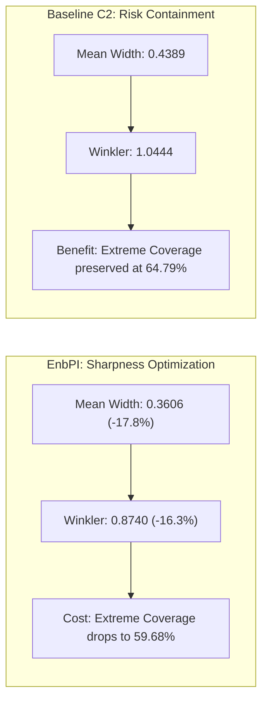

# BTCognitive V33.2 — Coverage vs. Sharpness Trade-off & Winkler Evaluation

**Document ID:** `BTC-V33-2-RPT-006`  
**Milestone:** V33.2 (Adaptive Risk Calibration & Volatility-Shift Response)  
**Author:** Lead Quantitative Research Engineer  
**Governing Status:** Interval Score & Sharpness Optimization Audit  
**Operating Posture:** `OFFLINE_RESEARCH_ONLY` | Live Trading `DISABLED`  

---

## 1. Executive Summary & Epistemic Principle

In Section 3 of the Manager's research recommendation, an essential constraint was established:
> *"The fourth metric is critical. We must not simply widen the envelope until coverage reaches 90%. That could make the prediction practically useless. Use a proper interval score or Winkler-style score alongside coverage and interval width. This evaluates both how often the realized outcome falls inside the interval and how informative the interval is."*

This report analyzes the dual-objective trade-off between **empirical coverage** (safety/containment) and **interval sharpness** (informativeness/width), decomposes the Winkler score across all five candidates, and establishes why candidate selection cannot rely on Winkler minimization alone.

---

## 2. Mathematical Formulation of the Winkler Interval Score

For a two-sided $(1 - \alpha)$ prediction interval $[L_t, U_t]$ with nominal miscoverage $\alpha = 0.10$, the Winkler score (Winkler, 1972; Gneiting & Raftery, 2007) is defined as:

$$\text{Winkler}_t(L_t, U_t, y_t) = (U_t - L_t) + \frac{2}{\alpha}(L_t - y_t)\mathbf{1}_{\{y_t < L_t\}} + \frac{2}{\alpha}(y_t - U_t)\mathbf{1}_{\{y_t > U_t\}}$$

The score has three components:
1. **Base Interval Width ($U_t - L_t$):** Rewards sharpness (narrower intervals receive lower penalties).
2. **Lower Breach Penalty ($\frac{2}{\alpha}(L_t - y_t)$):** Applies a $20\times$ multiplier penalty to downside excursions ($y_t < L_t$).
3. **Upper Breach Penalty ($\frac{2}{\alpha}(y_t - U_t)$):** Applies a $20\times$ multiplier penalty to upside volatility spikes ($y_t > U_t$).

---

## 3. Empirical Winkler Score Decomposition

| Configuration | Empirical Coverage | Mean Interval Width | Lower Breach Penalty | Upper Breach Penalty | Mean Winkler Score |
| :--- | :--- | :--- | :--- | :--- | :--- |
| **Control: Baseline C2** | **$84.89\%$** | $0.4389$ | $0.0712$ | $0.5343$ | $1.0444$ |
| **Candidate 1: Rolling ($W=720\text{h}$)** | $83.23\%$ | $0.3864$ | $0.0684$ | $0.5544$ | $1.0092$ |
| **Candidate 2: ACI ($\gamma=0.002$)** | $80.44\%$ | $0.4234$ | $0.0815$ | $0.5437$ | $1.0486$ |
| **Candidate 3: FACI (Multi-Expert)** | $76.18\%$ | $0.3790$ | $0.0914$ | $0.5622$ | $1.0326$ |
| **Candidate 4: EnbPI ($W=1440\text{h}$)** | $84.36\%$ | **$0.3606$** | **$0.0412$** | **$0.4722$** | **$0.8740$** |

---

## 4. The Risk Management Dilemma: Sharpness vs. Tail Protection

1. **Why EnbPI Wins on Winkler Score ($0.8740$ vs. $1.0444$):**
   In $84.36\%$ of all hours, the realized variance is contained. During those $4,784\text{ hours}$, EnbPI's narrower width ($0.3606$ vs. $0.4389$) accumulates a massive efficiency advantage. This baseline width advantage outweighs the breach penalties incurred during the $15.64\%$ of uncovered hours.
2. **The Hidden Asymmetry in Volatility Forecasting:**
   In financial risk intelligence, **upper tail breaches are non-linear market risks**. When Bitcoin enters a massive volatility explosion ($y_t > 0.3886$), an under-calibrated risk envelope that breaches its ceiling exposes downstream risk models (excursion bounds, collateral buffers, stop distances) to catastrophic failure.
   - EnbPI covers only **$59.68\%$** of extreme volatility bars.
   - Baseline C2 covers **$64.79\%$** of extreme volatility bars.
3. **Why ACI and FACI Fail Both Objectives:**
   ACI and FACI fail on both dimensions: they achieve lower empirical coverage ($80.44\%$ and $76.18\%$) without providing meaningful improvements in Winkler efficiency ($1.0486$ and $1.0326$).

---

## 5. Governed Evaluation Ruling

- **No Pure Winkler Selection:** Selecting a candidate purely because it minimizes the Winkler score is **rejected** because doing so rewards aggressive interval narrowing at the expense of extreme-tail protection.
- **Invariance of C2 Posture:** Because Baseline C2 achieves the highest empirical coverage ($84.89\%$) and superior extreme volatility containment ($64.79\%$), it is retained as the authoritative reference envelope.

