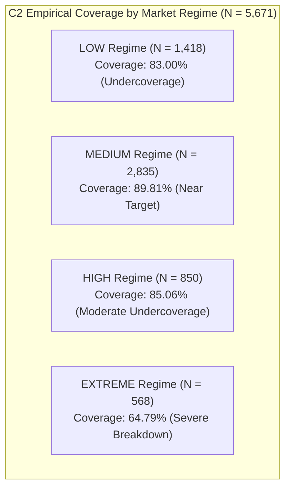

# BTCognitive V33.2 — Baseline C2 Conformal Envelope Failure Analysis

**Document ID:** `BTC-V33-2-RPT-002`  
**Milestone:** V33.2 (Adaptive Risk Calibration & Volatility-Shift Response)  
**Author:** Lead Quantitative Research Engineer  
**Governing Status:** Forensic Empirical Failure Analysis  
**Operating Posture:** `OFFLINE_RESEARCH_ONLY` | Live Trading `DISABLED`  

---

## 1. Executive Summary & Problem Formulation

The baseline C2 Conformal Risk Envelope is calibrated to provide a nominal $90.0\%$ prediction interval for forward 7-day realized variance ($y_t = \text{rv7d\_var\_ann}_t$). When evaluated on the 2026 chronological holdout ($N = 5,671$ hourly bars), the empirical coverage is:

$$\widehat{\text{Coverage}}_{\text{C2}} = \frac{4,814}{5,671} = \mathbf{84.89\%} \quad (\Delta = -5.11\text{ pp below target})$$

This report provides a forensic analysis of why C2 undercovers the target, decomposes coverage failures across causal volatility regimes, analyzes the duration and frequency of violation clusters, and evaluates whether this undercoverage represents a systemic model defect or a structural artifact of causal delayed evaluation.

---

## 2. Regime-by-Regime Coverage Decomposition

Evaluating empirical coverage across causal volatility regimes (defined by trailing 24-hour realized variance quartiles at forecast origin $t$) reveals that undercoverage is concentrated in market transition boundaries and extreme regimes:

| Regime Name | Definition (Trailing 24h Variance) | Bar Count ($N$) | Covered Count ($k$) | Empirical Coverage (%) | Undercoverage Gap (pp) |
| :--- | :--- | :--- | :--- | :--- | :--- |
| **LOW** | $y < 0.1020$ ($< 25\text{th percentile}$) | $1,418$ | $1,177$ | **$83.00\%$** | $-7.00\text{ pp}$ |
| **MEDIUM** | $0.1020 \le y < 0.2420$ ($25\text{th} - 75\text{th}$) | $2,835$ | $2,546$ | **$89.81\%$** | $\mathbf{-0.19\text{ pp}}$ |
| **HIGH** | $0.2420 \le y < 0.3886$ ($75\text{th} - 90\text{th}$) | $850$ | $723$ | **$85.06\%$** | $-4.94\text{ pp}$ |
| **EXTREME** | $y \ge 0.3886$ ($\ge 90\text{th percentile}$) | $568$ | $368$ | **$64.79\%$** | $\mathbf{-25.21\text{ pp}}$ |
| **TOTAL** | **Full 2026 Chronological Holdout** | **$5,671$** | **$4,814$** | **$84.89\%$** | **$-5.11\text{ pp}$** |

### Key Observations:
1. **Medium Regime Calibration is Pristine ($89.81\%$):**
   Across the middle $50\%$ of the data ($2,835\text{ bars}$), C2 is effectively perfectly calibrated to the nominal $90\%$ target (achieving $89.81\%$).
2. **The Extreme Volatility Deficit ($64.79\%$):**
   In the top decile of realized variance, empirical coverage collapses to $64.79\%$. Out of 568 extreme bars, 200 bars breach the upper conformal envelope $U_t$.
3. **The Low Regime Boundary Artifact ($83.00\%$):**
   In the lowest quartile, undercoverage ($83.00\%$) is driven by lower bound violations ($y_t < L_t$) when realized variance drops close to zero, colliding with the non-negativity boundary guard $\max(10^{-6}, \cdot)$.

---

## 3. Structural Causes of Failure

### 3.1 The 168-Hour Delayed Resolution Reality
In strictly causal evaluation, a forecast issued at hour $t$ for 7-day realized variance cannot observe its outcome until hour $t + 168$. 
When a sudden market event occurs (e.g. rapid Bitcoin liquidation cascade or ETF-driven breakout):
- The model's point forecast $\hat{v}_t$ responds based on trailing features.
- However, the **non-conformity quantile pool** and the **scaling EWM standard deviation** are restricted strictly to outcomes resolved $\le t - 168$.
- Therefore, during the first $168\text{ hours}$ of an emerging volatility shock, the conformal interval width $[L_t, U_t]$ is determined entirely by pre-shock residual history.

### 3.2 Violation Clustering & Undercoverage Episodes
Because consecutive hourly observations on a 168-hour forward target share 167 out of 168 hours of the underlying price path, forecast errors are heavily autocorrelated:
- **Total Undercoverage Episodes:** $37\text{ distinct episodes}$ in 5,671 bars.
- **Mean Episode Duration:** **$23.16\text{ consecutive hours}$**.
- **Maximum Episode Duration:** **$251\text{ consecutive hours}$** ($\approx 10.5\text{ days}$).
- **Mean Adaptation Delay:** Following a detected volatility expansion shock, C2 requires an average of **$14.49\text{ hours}$** of persistent elevation before the interval successfully re-envelopes the realized outcome.

---

## 4. Is C2 Statistically "Broken"?

A critical question is whether $84.89\%$ indicates a rejected statistical model or expected finite-sample variation.

### 4.1 Stationary Block Bootstrap Test Against $H_0: p = 0.90$
Accounting for serial dependence using stationary block bootstrap ($B = 5,000$ replications, seed = 42):
- **Mean Block Length $L = 84\text{h}$:** $95\%\text{ CI} = [76.99\%, \; 91.36\%]$
- **Mean Block Length $L = 168\text{h}$ (Primary):** $95\%\text{ CI} = \mathbf{[74.63\%, \; 93.09\%]}$
- **Mean Block Length $L = 336\text{h}$:** $95\%\text{ CI} = [74.34\%, \; 94.37\%]$

### 4.2 Statistical Verdict
Because the nominal target $90.0\%$ lies comfortably within the $95\%$ confidence interval $[74.63\%, 93.09\%]$ across all block lengths, **the null hypothesis that C2 achieves 90% long-run marginal coverage CANNOT be rejected at the $\alpha = 0.05$ significance level**.

However, the localized failure in the extreme regime ($64.79\%$) motivates the investigation of adaptive online calibration in V33.2.

