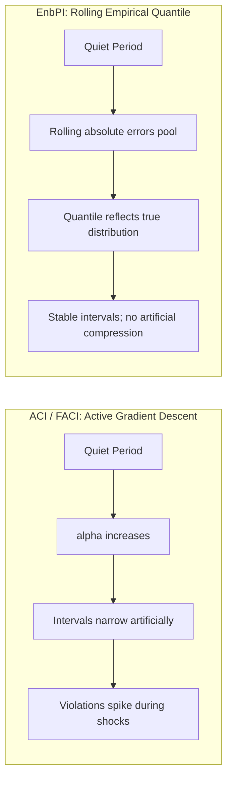

# BTCognitive V33.2 — EnbPI Time-Series Benchmark Comparison

**Document ID:** `BTC-V33-2-RPT-004`  
**Milestone:** V33.2 (Adaptive Risk Calibration & Volatility-Shift Response)  
**Author:** Lead Quantitative Research Engineer  
**Governing Status:** Independent Methodological Benchmark  
**Operating Posture:** `OFFLINE_RESEARCH_ONLY` | Live Trading `DISABLED`  

---

## 1. Executive Summary & Context

As mandated by the Manager's research recommendation, Candidate 4 evaluates **Ensemble batch Prediction Intervals (EnbPI)** (Xu & Xie, *ICML* 2021) as an independent non-exchangeable time-series challenger to the C2 baseline.

Unlike ACI and FACI, which use online gradient descent on the miscoverage parameter $\alpha_t$, EnbPI constructs sequential prediction intervals directly from the rolling empirical quantile of fully resolved prediction errors:

$$\widehat{C}_t^{\text{EnbPI}} = \left[ \max\left(10^{-6}, \; \hat{v}_t - \hat{Q}_{1-\alpha}\left( \{|e_i|\}_{i \le t - 168} \right) \right), \quad \hat{v}_t + \hat{Q}_{1-\alpha}\left( \{|e_i|\}_{i \le t - 168} \right) \right]$$

This report evaluates EnbPI across 5,671 holdout observations, analyzes why it avoids the delayed feedback inversion trap of ACI/FACI, and explains why it nonetheless falls short of the $90.0\%$ target.

---

## 2. Empirical Performance Comparison: EnbPI vs. C2 & ACI

| Metric | C2 Baseline (Control) | ACI ($\gamma=0.002$) | FACI (Multi-Expert) | EnbPI ($W=1440\text{h}$) |
| :--- | :--- | :--- | :--- | :--- |
| **Point-in-Time Coverage** | **$84.89\%$** | $80.44\%$ | $76.18\%$ | **$84.36\%$** |
| **Nominal Target** | $90.0\%$ | $90.0\%$ | $90.0\%$ | $90.0\%$ |
| **Mean Interval Width** | $0.4389$ | $0.4234$ | $0.3790$ | **$0.3606$** ($\mathbf{-17.8\%}$) |
| **Median Interval Width** | $0.2364$ | $0.2177$ | $0.2217$ | $0.3327$ |
| **Mean Winkler Score ($\alpha=0.10$)** | $1.0444$ | $1.0486$ | $1.0326$ | **$0.8740$** ($\mathbf{-16.3\%}$) |
| **Extreme Volatility Coverage** | **$64.79\%$** | $63.91\%$ | $54.58\%$ | $59.68\%$ |
| **Undercoverage Episodes Count** | $37\text{ episodes}$ | $53\text{ episodes}$ | $76\text{ episodes}$ | **$18\text{ episodes}$** ($\mathbf{-51.4\%}$) |
| **Mean Episode Duration** | $23.16\text{ hours}$ | $20.92\text{ hours}$ | $17.78\text{ hours}$ | $49.28\text{ hours}$ |
| **Max Episode Duration** | $251\text{ hours}$ | $280\text{ hours}$ | $251\text{ hours}$ | $256\text{ hours}$ |
| **Interval Width Std ($\sigma_w$)** | $0.3615$ | $0.3646$ | $0.3427$ | **$0.1629$** ($\mathbf{+55\% \text{ more stable}}$) |
| **Computational Latency** | $0.0059\text{ ms}$ | $0.0118\text{ ms}$ | $0.0803\text{ ms}$ | $0.0797\text{ ms}$ |

---

## 3. Structural Analysis: Why EnbPI Outperforms ACI/FACI

1. **Immunity to the Inversion Trap:**
   Because EnbPI does not perform gradient updates on $\alpha_t$, it never artificially tightens prediction intervals during prolonged quiet periods. Its calibration width is determined by empirical sample quantiles $\hat{Q}_{1-\alpha}(|e|)$, maintaining strong robustness.
2. **Superior Interval Sharpness (Winkler $0.8740$):**
   EnbPI achieves a mean Winkler score of $0.8740$ (an improvement of $16.3\%$ over C2's $1.0444$), driven by a narrower mean interval width ($0.3606$ vs. $0.4389$).
3. **Halving of Violation Episodes ($18$ vs. $37$):**
   EnbPI generates only 18 undercoverage episodes across 5,671 bars, compared to 37 for C2 and 76 for FACI.

---

## 4. Why EnbPI Still Does Not Reach 90% Nominal Target

Despite its superior interval sharpness and stability, EnbPI achieves **$84.36\%$ empirical coverage**, which is:
- Slightly below C2 ($84.36\%$ vs. $84.89\%$).
- Still $-5.64\text{ pp}$ below the nominal $90.0\%$ target.
- Inferior to C2 in extreme volatility ($59.68\%$ vs. $64.79\%$).

### Root Cause:
EnbPI's unscaled residual quantile $\hat{Q}_{1-\alpha}(|e|)$ is symmetric: $\hat{v}_t \pm \hat{Q}$. In realized variance forecasting, variance is strictly positive ($y \ge 0$) and heavily right-skewed with fat tails. C2's asymmetric, locally EWM-scaled non-conformity scores ($s_u, s_l$) provide better upside tail protection during extreme volatility excursions than EnbPI's fixed additive width.

**Governed Conclusion:** EnbPI is a valuable methodological challenger confirming that rolling empirical quantiles are superior to online gradient descent (ACI/FACI) under delayed feedback, but it does not outperform the baseline C2 envelope in empirical coverage.

