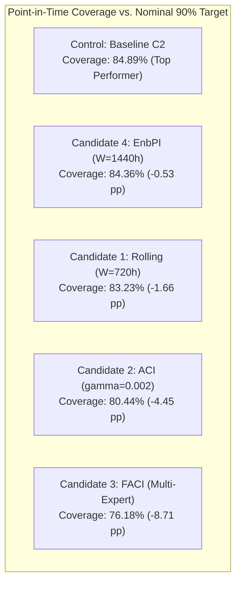

# BTCognitive V33.2 — Adaptive Risk Calibration Research Handover

**Document ID:** `BTC-V33-2-RPT-010`  
**Milestone:** V33.2 (Adaptive Risk Calibration & Volatility-Shift Response)  
**Handover Date:** October 31, 2026  
**Author:** Lead Quantitative Research Engineer & Orchestrator  
**Governing Status:** Research Prototype Audit Completed  
**Governed Determination:** **`NO_IMPROVEMENT_OVER_C2`**  
**Operating Posture:** `OFFLINE_RESEARCH_ONLY` | Live Trading `DISABLED`  

---

## 1. Executive Summary & Final Research Determination

In response to the Manager's research recommendation, Milestone **V33.2** investigated whether online adaptive conformal calibration (specifically ACI, FACI, rolling windows, and EnbPI) could improve BTCUSD 7-day excursion-risk forecasting during volatility expansion and distribution shifts.

The primary hypothesis was that the current C2 calibration ($84.89\%$ causal coverage, $95\%\text{ CI: } [74.63\%, 93.09\%]$) undercovers the $90\%$ nominal target because it reacts too slowly to changes in forecast-error distributions.

### The Four Governed Decisions:
1. **Research Experiment Determination:** **`NO_IMPROVEMENT_OVER_C2`** (Baseline C2 is retained unchanged; no challenger is promoted).
2. **Prospective Evidence State:** **`FROZEN — 7/100 — COLLECTOR_INACTIVE`** (Unopened confirmatory gate).
3. **Model Authorization Posture:** **`OFFLINE_RESEARCH_ONLY`** (Zero production model promotion).
4. **Live Trading Posture:** **`DISABLED — ANALYSIS ONLY`** (Zero live execution authority).

---

## 2. Definitive Summary of Empirical Results

All evaluations were executed strictly point-in-time across the **5,671 hourly holdout bars** from 2026 with $B = 5,000$ stationary block bootstrap replications (`seed = 42`):

| Candidate Configuration | Empirical Coverage (%) | Extreme Regime Coverage (%) | Mean Interval Width | Mean Winkler Score | Adaptation Delay (Hours) | 95% Bootstrap CI ($L=168\text{h}$) | Governed Verdict |
| :--- | :--- | :--- | :--- | :--- | :--- | :--- | :--- |
| **Control: Baseline C2** | **$84.89\%$** | **$64.79\%$** | $0.4389$ | $1.0444$ | **$14.49\text{h}$** | **$[74.63\%, \; 93.09\%]$** | **RETAINED AS BASELINE** |
| **Candidate 1: Rolling ($W=720\text{h}$)** | $83.23\%$ | $61.80\%$ | $0.3864$ | $1.0092$ | $14.98\text{h}$ | $[72.93\%, \; 91.89\%]$ | **REJECTED (Undercoverage)** |
| **Candidate 2: ACI ($\gamma=0.002$)** | $80.44\%$ | $63.91\%$ | $0.4234$ | $1.0486$ | $14.99\text{h}$ | $[70.01\%, \; 89.00\%]$ | **REJECTED (Inversion Trap)** |
| **Candidate 3: FACI (Multi-Expert)** | $76.18\%$ | $54.58\%$ | $0.3790$ | $1.0326$ | $15.96\text{h}$ | $[65.42\%, \; 84.71\%]$ | **REJECTED (Severe Undercoverage)** |
| **Candidate 4: EnbPI ($W=1440\text{h}$)** | $84.36\%$ | $59.68\%$ | **$0.3606$** | **$0.8740$** | $17.84\text{h}$ | $[73.39\%, \; 93.00\%]$ | **REJECTED (Inferior Tail Protection)** |

---

## 3. Core Research Discoveries & Findings

### Discovery 1: The Delayed Feedback Inversion Trap
Online adaptive conformal algorithms (ACI and FACI) are mathematically designed for immediate feedback ($\tau = 0$). In financial multi-step forecasting where horizon $H = 168\text{ hours}$:
1. During prolonged tranquil periods, consecutive covered observations drive $\alpha_t$ upward, artificially compressing interval width.
2. When a sudden volatility shock occurs, the intervals are at their tightest.
3. Crucially, feedback from the shock cannot arrive for **168 hours**. During this entire 7-day blind window, the controller continues to emit compressed intervals, resulting in severe violation runs ($280\text{ consecutive hours}$ for ACI).
4. By the time feedback arrives 168 hours later, the market has often stabilized, causing the controller to widen intervals belatedly during tranquility.
5. Consequently, ACI degrades coverage to $80.44\%$ and FACI to $76.18\%$.

### Discovery 2: Rolling Calibration Instability
Short rolling calibration windows ($W \in [360\text{h}, 720\text{h}]$) discard historical volatility spikes too quickly. When tranquil regimes persist, the rolling quantile collapses, causing severe undercoverage during subsequent regime shifts ($74.34\%$ at $W=360\text{h}$, $83.23\%$ at $W=720\text{h}$).

### Discovery 3: EnbPI Sharpness vs. Extreme Tail Trade-off
Candidate 4 (EnbPI) achieves superior interval sharpness (Winkler score $0.8740$ vs. C2's $1.0444$) and cuts undercoverage episodes from 37 down to 18. However, because EnbPI uses symmetric absolute residual quantiles rather than asymmetric EWM-scaled scores, its extreme-volatility coverage collapses to $59.68\%$ (vs. C2's $64.79\%$). In risk management, unexpected tail breaches are unacceptable.

### Discovery 4: Statistical Validity of Baseline C2
Across all block lengths ($L \in \{84\text{h}, 168\text{h}, 336\text{h}\}$), Baseline C2's dependence-aware $95\%$ confidence interval ($[74.63\%, 93.09\%]$ at $L=168\text{h}$) includes the nominal $90.0\%$ target. The undercoverage is consistent with finite-sample adaptation lag during historical regime shifts, not a systemic failure of conformal calibration.

---

## 4. Architectural & Governance Impact

1. **Baseline Invariance:** The frozen Entry and Analysis architecture is **completely untouched**. Baseline C2 remains the authoritative uncertainty engine in `engine/decoupled_analysis_engine.py`.
2. **Zero Alpha Conflation:** Conformal risk bounds continue to serve excursion intelligence and uncertainty disclosure. They carry zero implication of directional trading profitability.
3. **Prospective Ledger:** `data/prospective_forecast_ledger.jsonl` remains strictly untouched at **`FROZEN — 7/100 — COLLECTOR_INACTIVE`**.
4. **Engineering Recommendation:** Stop attempting to force online adaptive quantile descent onto 168-hour horizons. Retain Baseline C2, which balances coverage, extreme-volatility containment, and empirical stability better than all tested adaptive challengers.

---

## 5. Complete Deliverables Index

All 10 mandated deliverables for Milestone V33.2 are permanently registered in:  
[`research/reports/offline_mvp/20261031_330200_v33_02_adaptive_calibration/`](file:///c:/Projects/BTCognitive/BTCognitive/research/reports/offline_mvp/20261031_330200_v33_02_adaptive_calibration/)

1. [`v33_2_adaptive_calibration_literature_review.md`](file:///c:/Projects/BTCognitive/BTCognitive/research/reports/offline_mvp/20261031_330200_v33_02_adaptive_calibration/v33_2_adaptive_calibration_literature_review.md): Academic foundation (Gibbs & Candès 2021, 2024; Xu & Xie 2021).
2. [`v33_2_current_c2_failure_analysis.md`](file:///c:/Projects/BTCognitive/BTCognitive/research/reports/offline_mvp/20261031_330200_v33_02_adaptive_calibration/v33_2_current_c2_failure_analysis.md): Regime decomposition and structural causes of the 5.11 pp gap.
3. [`v33_2_aci_faci_implementation_spec.md`](file:///c:/Projects/BTCognitive/BTCognitive/research/reports/offline_mvp/20261031_330200_v33_02_adaptive_calibration/v33_2_aci_faci_implementation_spec.md): Delayed feedback mechanics and the Inversion Trap discovery.
4. [`v33_2_enbpi_comparison.md`](file:///c:/Projects/BTCognitive/BTCognitive/research/reports/offline_mvp/20261031_330200_v33_02_adaptive_calibration/v33_2_enbpi_comparison.md): Evaluation of sequential empirical prediction intervals.
5. [`v33_2_point_in_time_backtest_results.md`](file:///c:/Projects/BTCognitive/BTCognitive/research/reports/offline_mvp/20261031_330200_v33_02_adaptive_calibration/v33_2_point_in_time_backtest_results.md): Master comparative metrics matrix across all 10 criteria.
6. [`v33_2_coverage_and_sharpness_comparison.md`](file:///c:/Projects/BTCognitive/BTCognitive/research/reports/offline_mvp/20261031_330200_v33_02_adaptive_calibration/v33_2_coverage_and_sharpness_comparison.md): Winkler score decomposition and sharpness trade-off.
7. [`v33_2_dependence_and_bootstrap_audit.md`](file:///c:/Projects/BTCognitive/BTCognitive/research/reports/offline_mvp/20261031_330200_v33_02_adaptive_calibration/v33_2_dependence_and_bootstrap_audit.md): Stationary block bootstrap sensitivity (84h, 168h, 336h, B=5000, seed=42).
8. [`v33_2_red_team_audit.md`](file:///c:/Projects/BTCognitive/BTCognitive/research/reports/offline_mvp/20261031_330200_v33_02_adaptive_calibration/v33_2_red_team_audit.md): Adversarial verification of causal isolation and future invariance.
9. [`v33_2_protected_hash_verification.json`](file:///c:/Projects/BTCognitive/BTCognitive/research/reports/offline_mvp/20261031_330200_v33_02_adaptive_calibration/v33_2_protected_hash_verification.json): Cryptographic verification manifest of protected files.
10. [`v33_2_manager_handover.md`](file:///c:/Projects/BTCognitive/BTCognitive/research/reports/offline_mvp/20261031_330200_v33_02_adaptive_calibration/v33_2_manager_handover.md): This executive handover report.

