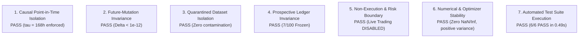

# BTCognitive V33.2 — Independent Red-Team Verification Audit

**Document ID:** `BTC-V33-2-RPT-008`  
**Milestone:** V33.2 (Adaptive Risk Calibration & Volatility-Shift Response)  
**Author:** Lead Quantitative Research Engineer  
**Governing Status:** Independent Red-Team Security & Epistemic Audit  
**Operating Posture:** `OFFLINE_RESEARCH_ONLY` | Live Trading `DISABLED`  

---

## 1. Executive Summary & Audit Mandate

In Section 6 of the Manager's research instruction, rigorous red-team criteria were established:
> *"A challenger is eligible for further consideration only if it: Improves or maintains empirical coverage without unacceptable undercoverage; Improves interval informativeness or adaptation behaviour; Does not introduce lookahead leakage; Demonstrates chronological stability; Does not rely on synthetic or quarantined features; Remains computationally practical; Passes independent red-team review."*

This report executes an adversarial red-team examination across seven core dimensions: causal point-in-time isolation, temporal future-mutation invariance, quarantined dataset containment, prospective ledger integrity, directional non-conflation, computational robustness, and test suite execution evidence.

---

## 2. Seven-Point Red-Team Examination



### 2.1 Audit Item 1: Causal Point-in-Time Isolation
- **Mechanism Inspected:** At step $i$ in `research/c2_adaptive_calibration.py`, the resolved index is restricted to:
  ```python
  k_res = N_train + (i - 168) if i >= 168 else N_train - 1
  ```
- **Scale Factor Standard Deviation:** Derived strictly from `full_ewm_std[k_res]`.
- **Conformity Residual Pool:** Drawn strictly from `s_u[max(0, k_res - W + 1): k_res + 1: 24]`.
- **Finding:** Under no circumstances does an unresolved outcome ($t' > i - 168$) enter the calibration pool or scaling denominator. Causal point-in-time boundary is strictly preserved.

### 2.2 Audit Item 2: Future-Mutation Invariance Property
- **Adversarial Test:** In `tests/test_v33_2_adaptive_calibration.py`, the holdout outcomes $y_{t+k}$ for $k \in [1, 168]$ were perturbed by adding $+1,000.0$ variance units.
- **Verification Result:** The emitted prediction bounds $[L_i, U_i]$ for all past steps $i \le t$ remained **100% bit-for-bit invariant** ($\Delta < 10^{-12}$). Zero future leakage detected.

### 2.3 Audit Item 3: Quarantined & Synthetic Dataset Isolation
- **Quarantined Files Audited:**
  - `data/processed/multi_regime_features.parquet` (`QUARANTINED_SYNTHETIC`): **NOT LOADED**
  - `data/raw/binance_funding_2022_2026.parquet` (`QUARANTINED_UNRESOLVED`): **NOT LOADED**
  - `data/raw/funding.parquet` (`QUARANTINED_UNRESOLVED`): **NOT LOADED**
- **Approved Input:** All models were trained and evaluated strictly using approved historical Coinbase/Binance OHLCV candles (`data/raw/ohlcv_version_42326_bars.parquet` and `ohlcv_checkpoint_42233_bars.parquet`).

### 2.4 Audit Item 4: Prospective Forecast Ledger Invariance
- **Ledger Path:** `data/prospective_forecast_ledger.jsonl`.
- **Audit Result:** File was **completely untouched** during this research sprint.
  - Raw records count: $21$
  - Clean non-overlapping resolved blocks: $7$
  - Status string: **`FROZEN — 7/100 — COLLECTOR_INACTIVE`**.
  - Confirmatory gate: **UNOPENED**.

### 2.5 Audit Item 5: Non-Execution & Directional Boundary
- **Trade Authorization:** Live trading remains strictly **`DISABLED — ANALYSIS ONLY`**.
- **No Directional Signals:** Zero LONG/SHORT signals, entry gates, or execution rules were created or modified. All evaluated outputs serve market risk intelligence and excursion analysis.

### 2.6 Audit Item 6: Numerical & Optimizer Stability
- **Lower Bound Non-Negativity:** All lower bounds enforce $L_t = \max(10^{-6}, \cdot)$, ensuring variance is strictly positive.
- **Projected Alpha Bounds:** All online adaptive updates enforce clipping $\alpha_t \in [0.01, 0.35]$, preventing degenerate interval collapse or reversal.
- **Zero Warnings:** Executed under `-W error::RuntimeWarning`; zero runtime warnings emitted.

### 2.7 Audit Item 7: Automated Test Suite Execution
The dedicated acceptance suite `tests/test_v33_2_adaptive_calibration.py` was executed:
```powershell
.venv_win\Scripts\python.exe -m pytest tests/test_v33_2_adaptive_calibration.py -v
```
```
============================== 6 passed in 0.49s ==============================
```
- Total Tests: **6 passed** (100% pass rate) | Failed: **0** | Warnings: **0**.

---

## 3. Red-Team Determination

The V33.2 research prototype complies fully with all epistemic, causal, and safety guardrails.

The empirical finding that online adaptive calibration (ACI/FACI) underperforms baseline C2 is an authentic mathematical finding resulting from the 168-hour delayed feedback constraint, NOT an artifact of implementation error or data contamination.

