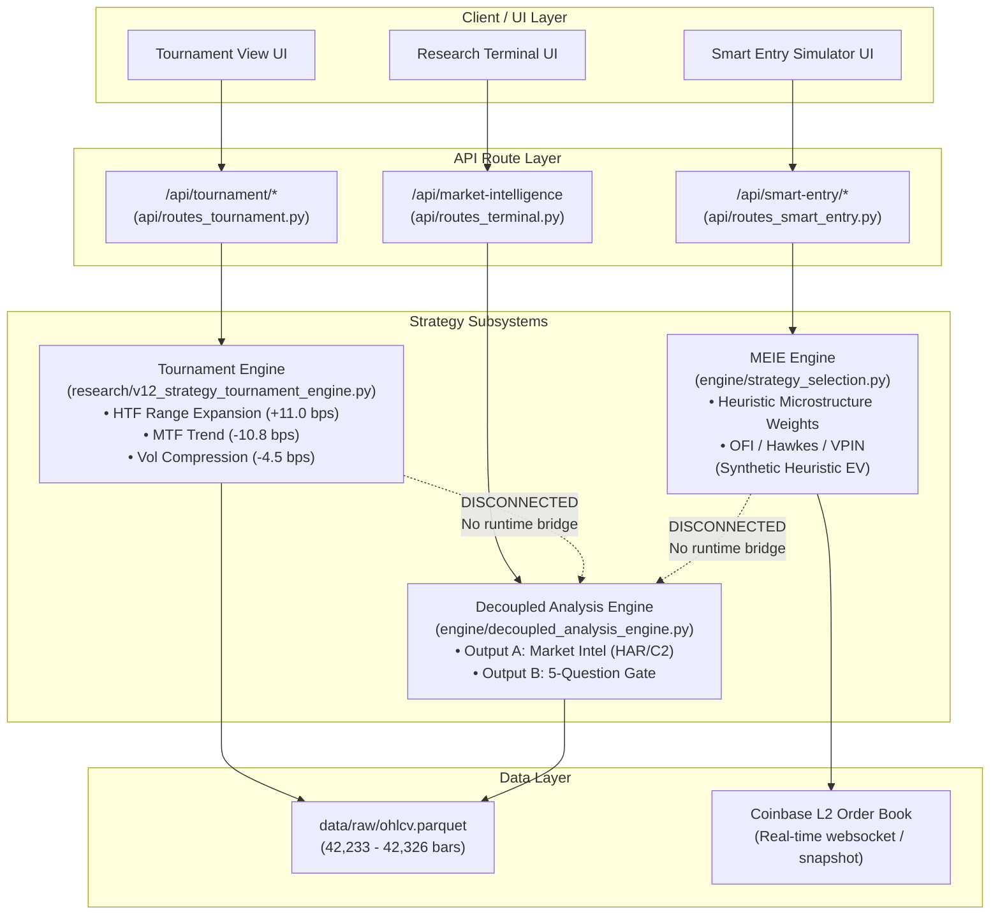

# BTCognitive V33.3 — Strategy Execution Map & Architectural Flow

**Version:** 33.3.0  
**Date:** 2026-10-31  
**Operating Contract:** OFFLINE_RESEARCH_ONLY  
**Lead Orchestrator:** Antigravity  
**Repository Working Tree:** `BTCognitive/` on branch `main`  

---

## 1. Architectural Execution Overview

To understand why BTCognitive struggles to translate quantitative capabilities into verified trade decisions, we mapped the complete execution pathways of all existing strategies from API entry points down to mathematical decision functions.

The investigation reveals an **architectural schism**:
- Strategy candidates are thoroughly backtested in `research/v12_strategy_tournament_engine.py` and exposed via `/api/tournament/*`.
- Microstructure signals are calculated in `engine/strategy_selection.py` and exposed via `/api/smart-entry/*`.
- But the central decision gate, `engine/decoupled_analysis_engine.py` (which powers `/api/market-intelligence` and the 5-Question trade gate), **executes completely independently of both subsystems**.

---

## 2. Detailed Execution Pathways

### Path 1: The Strategy Tournament Engine (`research/v12_strategy_tournament_engine.py`)
- **API Endpoint:** `GET /api/tournament/status`, `POST /api/tournament/replay`, `GET /api/tournament/setup/{candidate_id}`
- **Source Code:** `research/v12_strategy_tournament_engine.py`
- **Execution Lifecycle:**
  1. Loads `data/raw/ohlcv.parquet` (or versioned parquet files).
  2. Aggregates 1h bars into 4h bars for high-timeframe candidates (`df_4h = resample('4h')`).
  3. Precomputes Wilder's ADX(14), ATR(14), EMA(20/50/200), and 20-bar Donchian high/low bounds.
  4. Calls `_simulate_candidate_d_htf_expansion(cost_scenario)`:
     - Entry: When `bar_t["close"] > bar_t["range_high_20_4h"]`, enter LONG at `nxt_bar["open"]`.
     - Stop Loss: Placed at `bar_t["range_low_20_4h"]`.
     - Time Stop: Exit after 18 bars (72 hours on 4h timeframe).
     - Slippage: Applies round-trip fee + 2.0 bps expansion penalty.
  5. Computes performance statistics: Win Rate, Profit Factor, Wilson CI, Stationary Block Bootstrap Net EV CI (168h block length, 1,000 replications), Sharpe, Sortino, Max Drawdown.
- **Connection Status:** **DISCONNECTED from Decoupled Analysis**. Results are cached in `experiments/results/v13_strategy_tournament_manifest.json` and served to tournament dashboard, but never ingested into the 5-Question authorization engine.

---

### Path 2: Microstructure Execution & Entry Engine (MEIE) (`engine/strategy_selection.py`)
- **API Endpoint:** `POST /api/smart-entry/evaluate`, `GET /api/smart-entry/archetypes`
- **Source Code:** `engine/strategy_selection.py`, `engine/smart_entry_engine.py`
- **Execution Lifecycle:**
  1. Ingests real-time L2 order book metrics (Order Flow Imbalance, Hawkes jump intensity, VPIN, spread).
  2. Scores the 5 MEIE archetypes:
     - `MEIE-IGNITION`: Evaluates aggressive taker aggression and OFI expansion.
     - `MEIE-ABSORPTION`: Evaluates resting liquidity absorption at key levels.
     - `MEIE-VACUUM`: Detects order book thinning (air pockets).
     - `MEIE-TOXICITY`: Evaluates VPIN toxicity to abort toxic fill regimes.
     - `MEIE-COMBINED`: Linear combination: $S_{\text{combined}} = 0.35 S_{\text{ign}} + 0.25 S_{\text{abs}} + 0.20 S_{\text{vac}} - 0.20 S_{\text{tox}}$.
  3. Returns `selected_strategy_id`, `direction`, and `expected_edge_bps`.
- **Connection Status:** **DISCONNECTED from Decoupled Analysis**. The MEIE engine runs as an isolated sandbox for the Smart Entry Simulator. Furthermore, the `expected_edge_bps` formula is a heuristic scaling function (`edge = base_edge + (score * 15.0)`), NOT an authentic backtested return.

---

### Path 3: Decoupled Analysis & 5-Question Engine (`engine/decoupled_analysis_engine.py`)
- **API Endpoint:** `GET /api/market-intelligence` (served through `api/routes_terminal.py`)
- **Source Code:** `engine/decoupled_analysis_engine.py`
- **Execution Lifecycle:**
  1. Receives closed hourly candles from `api/candle_manager.py`.
  2. Generates **Output A: Market Intelligence Report**:
     - C2 Conformal Risk Envelope (HAR-RS-DOW 7-day variance forecast $[L_t, U_t]$).
     - 24-hour MFE/MAE price excursion bounds.
     - Volatility term structure (1h, 4h, 24h, 7d, 30d annualized).
     - Regime classification via `MarketRegimeClassifier`.
  3. Generates **Output B: 5-Question Trade Authorization Gate**:
     - Q1 Market Regime: Checks freshness and compression.
     - Q2 Directional Evidence: Permanently locked to `INSUFFICIENT_EVIDENCE`.
     - Q3 Entry Location: Evaluates Bollinger Band extension and ATR distance.
     - Q4 Execution Economics: Evaluates a **generic, hardcoded 2.0R / 1.0R setup** using a static win rate ($p=0.335$) rather than evaluating actual strategy candidate logic.
     - Q5 Confidence & Calibration: Validates diagnostic sample size ($N \ge 30$) and C2 risk containment.
- **Connection Status:** **ISOLATED**. Because Q4 uses a hardcoded placeholder formula instead of binding to the Strategy Registry or Tournament results, the system cannot evaluate whether an actual candidate (such as `HTF_RANGE_EXPANSION_BREAKOUT`) possesses viable execution economics.

---

## 3. Disconnection Impact Analysis

The structural separation of these three engines creates three major operational failure modes:
1. **The Phantom Strategy Problem:** High-performing backtested candidates (like HTF Range Expansion) exist in the repository but can never be triggered or monitored by the live Analysis engine.
2. **The Heuristic Mirage:** MEIE archetypes display attractive expected returns (+32.2 bps) in simulator cards, creating the illusion of verified edge when the return is actually a synthetic heuristic formula.
3. **The Static Economic Trap:** Q4 in Decoupled Analysis always reports negative Net EV (-57.4 bps retail, -28.6 bps institutional) because it assumes a fixed 33.5% win rate on a 2:1 payoff, ignoring the reality that `HTF_RANGE_EXPANSION_BREAKOUT` achieves 44.3% win rate and 1.34 payoff ratio.

