# BTCognitive V33.3A — Execution Cost Sensitivity & Venue Economics Audit

**Version:** 33.3.1  
**Milestone:** V33.3A HTF Range Expansion Breakout Validation  
**Date:** 2026-10-31  
**Operating Contract:** OFFLINE_RESEARCH_ONLY  
**Lead Orchestrator:** Antigravity  
**Strategy Audited:** `HTF_RANGE_EXPANSION_BREAKOUT` (Baseline vs Filtered)  

---

## 1. Executive Summary & Fee Architecture

In accordance with Section 4 of the Manager Ruling, we performed an exhaustive fee sensitivity audit across four distinct execution environments:
1. **Binance VIP0 (24.0 bps round-trip friction):** The baseline institutional/active retail benchmark.
2. **Coinbase Institutional Tier 5+ (18.6 bps round-trip friction):** High-volume institutional spot tier.
3. **Binance Perpetual Futures (15.0 bps round-trip friction):** Derivative contract with maker/taker rebate structure.
4. **Coinbase Retail Tier 1 (87.0 bps round-trip friction):** Standard retail spot taker schedule.

### Key Economic Takeaways
- Under **Binance VIP0 (24.0 bps)**, the baseline strategy delivers **+9.57 bps net EV** (Profit Factor 1.06).
- When the existing `MarketRegimeClassifier` filter is applied under Binance VIP0, Net EV expands to **+59.26 bps** (Profit Factor 1.41).
- The strategy's **breakeven cost ceiling expands from 33.6 bps to 83.3 bps** under regime filtering, meaning the filtered strategy can survive much higher friction environments.

---

## 2. Componentized Fee Schedule Breakdown

To ensure no hidden fees or optimistic friction assumptions are buried, every cost scenario is broken down into its four constituent components:

| Execution Cost Scenario | Venue & Instrument | Two-Sided Commission | Two-Sided Half-Spread | Two-Sided Slippage & Impact | Expansion Penalty | Total Round-Trip Drag |
| :--- | :--- | :---: | :---: | :---: | :---: | :---: |
| **Binance VIP0** | Spot BTC/USDT | 20.0 bps (0.10% / side) | 2.0 bps (0.01% / side) | 2.0 bps (0.01% / side) | +2.0 bps | **26.0 bps** |
| **Coinbase Institutional** | Spot BTC/USD Tier 5+ | 11.6 bps (0.058% / side)| 3.0 bps (0.015% / side)| 4.0 bps (0.020% / side)| +2.0 bps | **20.6 bps** |
| **Binance Perpetual** | USDT-M Perp BTCUSDT | 10.0 bps (0.050% / side)| 2.0 bps (0.010% / side)| 3.0 bps (0.015% / side)| +2.0 bps | **17.0 bps** |
| **Coinbase Retail** | Spot BTC/USD Tier 1 | 80.0 bps (0.400% / side)| 3.0 bps (0.015% / side)| 4.0 bps (0.020% / side)| +2.0 bps | **89.0 bps** |

*Note on Slippage:* Zero slippage is explicitly rejected. All evaluations incorporate 2.0–4.0 bps of base slippage plus an additional **+2.0 bps expansion volatility slippage penalty** to account for entering during rapid range expansions.

---

## 3. Four-Scenario Empirical Performance Comparison

The table below contrasts the baseline strategy (194 trades) against the regime-filtered strategy (110 trades) across all four fee schedules:

| Fee Scenario | Total Round-Trip Drag | Configuration | Trade Count ($N$) | Win Rate | Profit Factor | Net Expectancy (bps) | Compounded Max Drawdown | 10% Sized Max Drawdown |
| :--- | :---: | :--- | :---: | :---: | :---: | :---: | :---: | :---: |
| **Binance VIP0** | **24.0 + 2.0 bps** | Baseline | 194 | 43.8% | 1.06 | **+9.57 bps** | 47.35% | 5.88% |
| | | **Filtered** | **110** | **48.2%** | **1.41** | **+59.26 bps** | **28.35%** | **3.19%** |
| **Coinbase Institutional**| **18.6 + 2.0 bps** | Baseline | 194 | 44.8% | 1.09 | **+14.97 bps** | 45.18% | 5.51% |
| | | **Filtered** | **110** | **49.1%** | **1.46** | **+64.66 bps** | **27.67%** | **3.10%** |
| **Binance Perpetual** | **15.0 + 2.0 bps** | Baseline | 194 | 46.4% | 1.12 | **+18.57 bps** | 43.70% | 5.26% |
| | | **Filtered** | **110** | **50.0%** | **1.49** | **+68.26 bps** | **27.22%** | **3.04%** |
| **Coinbase Retail** | **87.0 + 2.0 bps** | Baseline | 194 | 37.6% | 0.73 | **-53.43 bps** | 75.60% | 11.85% |
| | | **Filtered** | **110** | **42.7%** | **0.98** | **-3.74 bps** | **43.49%** | **5.18%** |

```mermaid
xychart-beta
    title "Net Expectancy Across Fee Venues (bps per trade)"
    x-axis ["Coinbase Retail (87 bps)", "Binance VIP0 (24 bps)", "Coinbase Inst. (18.6 bps)", "Binance Perp (15 bps)"]
    y-axis "Net Expectancy (bps)" -60 --> 80
    bar [-53.4, 9.6, 15.0, 18.6]
    bar [-3.7, 59.3, 64.7, 68.3]
```

---

## 4. Breakeven Cost Threshold Analysis

- **Baseline Strategy Breakeven Cost:** **33.57 bps**  
  If round-trip friction exceeds 33.6 bps, the baseline strategy becomes mathematically negative.
- **Regime-Filtered Strategy Breakeven Cost:** **83.26 bps**  
  By eliminating 84 high-cost chop losses, the strategy's average gross edge expands to +85.26 bps, allowing it to nearly break even even under oppressive retail fees (-3.7 bps at 87 bps).

---

## 5. Spot vs. Perpetual Instrument Risk Caveats

In response to Problem C raised by the Manager:
1. **Instrument Lineage:** The underlying evaluation data is **Coinbase Spot BTC-USD**. 
2. **Perpetual Basis Risk:** Perpetual futures execution introduces funding rate carry costs and mark-to-index basis divergence during extreme expansions.
3. **Conservative Settlement:** On a perpetual contract, funding payments during a 72-hour hold can consume 3.0–8.0 bps if the funding rate is elevated. Therefore, **Binance VIP0 Spot (24.0 bps)** is the most trustworthy operational benchmark. At +59.26 bps net EV, the filtered strategy maintains a healthy 35+ bps safety margin above Binance VIP0 fees.

