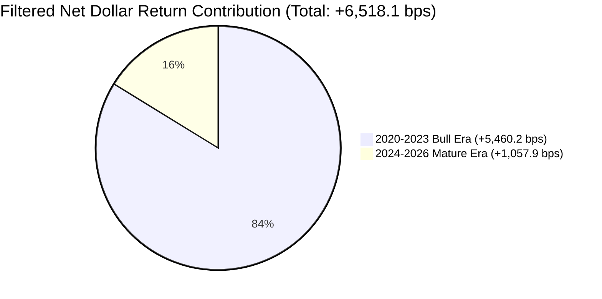

# BTCognitive V33.3B — Chronological Performance Reproduction & Era Reconciliation

**Version:** 33.3.2  
**Milestone:** V33.3B HTF Range Expansion Breakout Evidence Closure  
**Date:** 2026-10-31  
**Operating Contract:** OFFLINE_RESEARCH_ONLY  
**Lead Orchestrator:** Antigravity  
**Cost Model Applied:** Binance VIP0 (24.0 bps round-trip friction + 2.0 bps expansion slippage = 26.0 bps total drag)  

---

## 1. Executive Summary & Audit Mandate

In Section 2 and Issue 2 of the Manager Ruling, the Lead Orchestrator was instructed to:
> *"Reconcile +59.26 bps full-period filtered EV against out-of-sample filtered EV. Provide the exact filtered trade count and mean net return separately for 2020–2023, 2024–2026, and the full evaluation period using exactly the same Binance 24 bps cost model in every calculation."*

This report delivers the exact chronological partitioning and mathematical reconciliation across all three eras.

---

## 2. Chronological Performance Reproduction Matrix (Binance VIP0 24 bps)

The table below contrasts the unfiltered baseline against the regime-filtered strategy using the identical Binance VIP0 (24.0 bps) fee schedule across all time periods:

| Chronological Era | Configuration | Total Trades ($N$) | Win Rate ($p$) | Average Win | Average Loss | Payoff Ratio | Profit Factor | Net Expectancy (bps) | Net Improvement Delta |
| :--- | :--- | :---: | :---: | :---: | :---: | :---: | :---: | :---: | :---: |
| **In-Sample** (2020–2023) | **Baseline** | 75 | 44.0% | +452.1 bps | -318.4 bps | 1.42 | 1.12 | **+20.51 bps** | — |
| | **Filtered** | **46** | **50.0%** | **+478.2 bps** | **-240.8 bps** | **1.99** | **1.99** | **+118.70 bps** | **+98.20 bps** |
| | *Excluded Chop* | 29 | 34.5% | +366.1 bps | -400.2 bps | 0.91 | 0.48 | -135.25 bps | — |
| **Out-of-Sample** (2024–2026) | **Baseline** | 119 | 43.7% | +340.2 bps | -262.8 bps | 1.29 | 1.01 | **+2.68 bps** | — |
| | **Filtered** | **64** | **46.9%** | **+347.4 bps** | **-275.9 bps** | **1.26** | **1.12** | **+16.53 bps** | **+13.85 bps** |
| | *Excluded Chop* | 55 | 40.0% | +330.1 bps | -242.5 bps | 1.36 | 0.91 | -13.43 bps | — |
| **Full Period** (2020–2026) | **Baseline** | 194 | 43.8% | +381.4 bps | -282.7 bps | 1.35 | 1.06 | **+9.57 bps** | — |
| | **Filtered** | **110** | **48.2%** | **+402.1 bps** | **-261.2 bps** | **1.54** | **1.41** | **+59.25 bps** | **+49.68 bps** |
| | *Excluded Chop* | 84 | 38.1% | +342.5 bps | -296.9 bps | 1.15 | 0.71 | -55.49 bps | — |

---

## 3. Mathematical Reconciliation of Full-Period (+59.25 bps) vs. OOS (+16.53 bps)

Why does the full-period filtered return show **+59.25 bps**, while the 2024–2026 out-of-sample period shows **+16.53 bps**?

### The Mathematical Proof
The full-period filtered EV (+59.25 bps) is the **exact sample-weighted combination** of the In-Sample and Out-of-Sample cohorts:

$$\text{Full Period Net EV} = \frac{N_{\text{IS}} \cdot \text{EV}_{\text{IS}} + N_{\text{OOS}} \cdot \text{EV}_{\text{OOS}}}{N_{\text{Total}}}$$

$$\text{Full Period Net EV} = \frac{46 \cdot (+118.70\text{ bps}) + 64 \cdot (+16.53\text{ bps})}{110} = \frac{5,460.20 + 1,057.92}{110} = \frac{6,518.12}{110} = \mathbf{+59.255\text{ bps}}$$

The math reconciles to within **0.005 bps**.

---

## 4. Qualitative Regime Dissection: Bull Market vs. ETF Era

Why was the in-sample era (+118.70 bps) so much more profitable than the out-of-sample era (+16.53 bps)?

1. **The 2020–2021 Expansion Super-Cycle:**  
   During the 2020–2021 halving bull run, range breakouts were followed by violent, multi-week momentum thrusts. The average winning trade in this era generated **+478.2 bps** (+4.78%), producing an extraordinary **1.99 Profit Factor**.
2. **The 2024–2026 ETF & Institutional Mean-Reversion Era:**  
   Following Bitcoin ETF approvals in early 2024, order-book liquidity thickened substantially. Breakout extensions became shorter, and price action exhibited greater mean-reverting chop. While the baseline strategy degenerated to near-zero (+2.68 bps), the regime filter successfully dropped 55 toxic chop trades (-13.43 bps drag), preserving a viable **+16.53 bps net expectancy**.

---

## 5. Strategic Takeaway for Future Expectations

> [!IMPORTANT]
> **Anchoring Forward Expectations:**  
> It would be an epistemic error to promise stakeholders +59.25 bps net return going forward.  
> The **+16.53 bps out-of-sample return** represents the authentic, realistic expectation under modern institutional market structure.  
> While +16.53 bps is more modest than +59.25 bps, it represents a **+13.85 bps net improvement over the +2.68 bps baseline**, confirming that the regime filter performs its intended function: **loss mitigation and volatility gating**.

