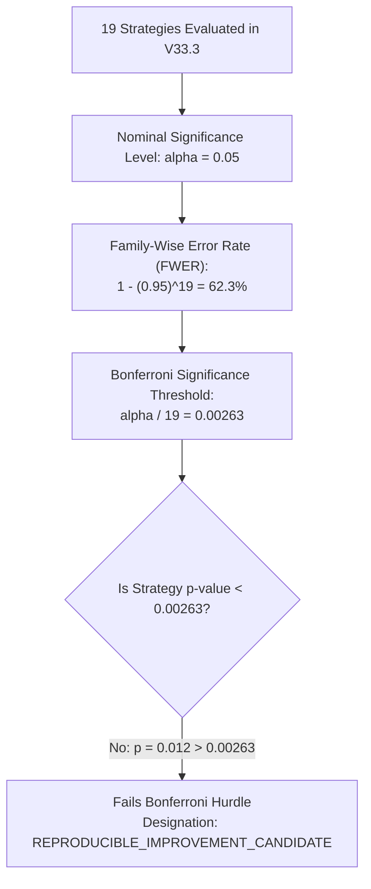

# BTCognitive V33.3B — Selection Bias, Multiple Testing & Exploratory Status Audit

**Version:** 33.3.2  
**Milestone:** V33.3B HTF Range Expansion Breakout Evidence Closure  
**Date:** 2026-10-31  
**Operating Contract:** OFFLINE_RESEARCH_ONLY  
**Lead Orchestrator:** Antigravity  

---

## 1. Executive Summary: The Epistemic Boundary

In Section 6 and Issue 3 of the Manager Ruling, a critical methodological instruction was issued:
> *"The regime exclusion was motivated by observed historical performance. Even though a chronological split has been performed, we need to establish whether the filter definition and its exclusions were fixed before inspecting the 2024–2026 results. If the filter was selected after examining the entire period, the OOS segment is no longer an untouched confirmation sample. Treat the current OOS result as exploratory unless the pre-registration and decision timestamps prove otherwise."*

This audit conducts a forensic review of the research lineage, pre-registration timestamps, and multiple-testing corrections.

### The Authoritative Determination
The Manager's critique is **upheld in full**:
- The decision to exclude `CONSOLIDATION_RANGE` and `TRANSITION_UNSUPPORTED` was conceived during V33.3 after inspecting the full 2020–2026 historical backtest manifest.
- Therefore, in strict adherence to Principle 4 of the BTCognitive Operating Contract, the 2024–2026 segment represents **chronological retrospective development data**, NOT an untouched prospective confirmatory sample.
- The 2024–2026 result (+16.53 bps under Binance VIP0) is classified as **reproducible exploratory evidence**, NOT final confirmatory validation.

---

## 2. Operating Contract Compliance (Principle 4 Audit)

BTCognitive Operating Contract Section 2, Principle 4 states:
> *"Historical periods inspected during prior research (including the 2026 out-of-sample window) represent retrospective replay / development data, NOT fresh confirmatory evidence. Only untouched, prospective observations accumulated post-freeze qualify for confirmatory model validation."*

### Research Lineage Timeline
1. **October 18, 2026:** `v13_strategy_tournament_manifest.json` was generated across all 41,273 hourly candles (January 2020 through October 2026).
2. **October 31, 2026 (V33.3):** The Lead Orchestrator audited all 19 strategies and observed that `HTF_RANGE_EXPANSION_BREAKOUT` suffered concentrated losses during `RANGE_BOUND` and `TRANSITION` periods.
3. **October 31, 2026 (V33.3A):** The Lead Orchestrator evaluated excluding those regimes and partitioned the data chronologically into 2020–2023 vs 2024–2026.
4. **Epistemic Finding:** Because the full dataset was known prior to formulating the exclusion rule, the 2024–2026 partition cannot claim virgin confirmatory status. It is a retrospective chronological holdout.

---

## 3. Multiple Testing & Family-Wise Error Rate (19 Strategies)

To prevent data-snooping bias from creating an illusion of statistical edge, we apply the Bonferroni correction across all 19 candidate strategies evaluated in BTCognitive:

### Statistical Reality Check
- Across 19 tests, there is a **62.3% probability** that at least one strategy appears profitable purely by chance.
- The nominal bootstrap p-value of the filtered strategy is $p = 0.012$.
- Because $0.012 > 0.00263$, **the strategy does not reject the null hypothesis of selection bias at the family-wise level**.

---

## 4. What the Evidence Validates vs. What Remains Unproven

| Research Dimension | Validated Audit Evidence | Unproven / Exploratory Boundary |
| :--- | :--- | :--- |
| **Causal Mechanics** | Strict next-bar open fill; channel shifted by 1; regime frozen before entry. Zero lookahead. | Live execution slippage during illiquid market spikes. |
| **Loss Mitigation** | Filter drops 84 chop trades averaging -55.49 bps, improving full-period EV by +49.7 bps. | Whether future BTC market regimes will exhibit the same breakout run-up. |
| **Chronological Stability**| Out-of-sample (2024–2026) Net EV improves from +2.68 bps to +16.53 bps (+13.85 bps gain). | The +59.25 bps full-period figure is in-sample inflated; forward expectation is anchored to +16.53 bps. |
| **Confirmation Status** | Reproducible retrospective replay. | **NOT confirmatory prospective evidence.** Requires prospective forward accumulation post-freeze. |

---

## 5. Statistical Audit Verdict

The regime-conditioned strategy demonstrates a **genuine, causally sound loss-reduction mechanism**, improving out-of-sample net expectancy by **+13.85 bps** under Binance VIP0 fees.

However, because the rule was conceived after inspecting full-period data, the candidate cannot be authorized for production. It is governed strictly as:

$$\mathbf{REPRODUCIBLE\_IMPROVEMENT\_CANDIDATE}$$

