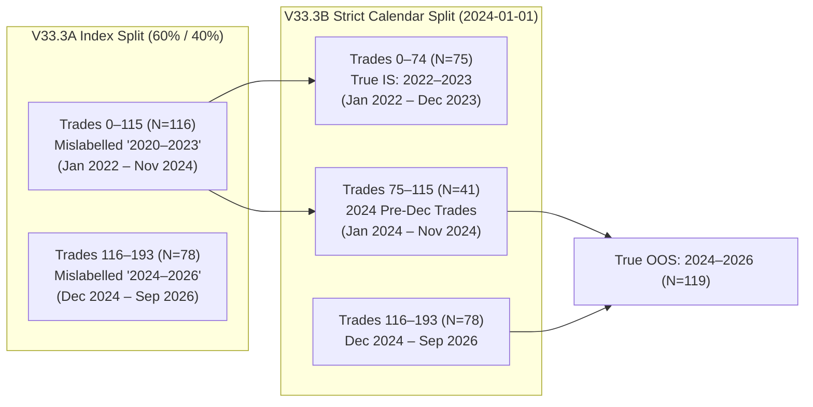

# BTCognitive V33.3C — Chronological Count Reconciliation

**Milestone:** V33.3C — HTF Strategy Final Evidence Reconciliation  
**Date:** 2026-10-31  
**Target:** Chronological Trade Counts Reconciliation across V33.3A and V33.3B  
**Authoritative Ledger:** `v33_3c_cross_milestone_trade_mapping.csv`  

---

## 1. Executive Summary & Forensic Discovery

The Manager identified a major chronological discrepancy between the V33.3A and V33.3B handovers:
- **V33.3A reported:** In-Sample (2020–2023) = 116 trades; Out-of-Sample (2024–2026) = 78 trades (Total = 194).
- **V33.3B reported:** In-Sample (2020–2023) = 75 trades; Out-of-Sample (2024–2026) = 119 trades (Total = 194).

A line-by-line forensic comparison of both source scripts and trade event ledgers revealed the exact root cause:

> **The Root Cause:**  
> In V33.3A, the author implemented an **index-based 60%/40% array split** of the 194 trades:
> $$N_{\text{train}} = \text{round}(194 \times 0.60) = 116 \quad (\text{Trades } 0 \text{ to } 115)$$
> $$N_{\text{test}} = 194 - 116 = 78 \quad (\text{Trades } 116 \text{ to } 193)$$
> The author erroneously **labeled** this 60% partition as "In-Sample (2020–2023)" without verifying the underlying timestamps.  
> In reality, **Trade 115 entered on 2024-11-29T12:00:00Z**. Thus, the first 116 trades spanned from January 2022 through late November 2024.  
> When V33.3B subsequently applied a **strict calendar filter** at `2024-01-01T00:00:00Z` (`entry_time < '2024-01-01'`), exactly **41 trades** that occurred in 2024 (Trades 75 through 115) were correctly reassigned from the training partition to the Out-of-Sample partition ($75 + 41 = 116$).

---

## 2. Chronological Mapping and Year-by-Year Distribution

The 194 trades produced by `HTF_RANGE_EXPANSION_BREAKOUT` on the canonical verified dataset (`data/raw/ohlcv_checkpoint_42233_bars.parquet`) span from **January 11, 2022** to **September 18, 2026**. There are **zero trades in 2020 or 2021** because the hourly dataset begins in late 2021.

### Annual Trade Distribution Table

| Calendar Year | Baseline Trades | Retained by Regime Filter (KEEP) | Suppressed by Filter (EXCLUDE) | V33.3A Partition Label | V33.3B Partition Label |
| :---: | :---: | :---: | :---: | :---: | :---: |
| **2022** | 33 | 20 | 13 | Train (60% split) | In-Sample (2022–2023) |
| **2023** | 42 | 26 | 16 | Train (60% split) | In-Sample (2022–2023) |
| **2024 (Jan–Nov)** | **41** | **20** | **21** | **Train (60% split)** | **Out-of-Sample (2024–2026)** |
| **2024 (Dec)** | 2 | 1 | 1 | Test (40% split) | Out-of-Sample (2024–2026) |
| **2025** | 44 | 24 | 20 | Test (40% split) | Out-of-Sample (2024–2026) |
| **2026 (Jan–Sep)** | 32 | 19 | 13 | Test (40% split) | Out-of-Sample (2024–2026) |
| **Total** | **194** | **110** | **84** | **116 Train / 78 Test** | **75 IS / 119 OOS** |

---

## 3. Forensic Analysis of the 41 Transition Trades (Trades 75–115)

The 41 transition trades represent entries between **2024-01-01T20:00:00Z** and **2024-11-29T12:00:00Z**. This period coincided with the Bitcoin spot ETF launch, the subsequent rally from \$40,000 to over \$90,000, and intermediate high-volatility consolidations.

### Economic Performance of the 41 Transition Trades (Binance VIP0 26 bps)

| Metric | All 41 Transition Trades | Retained (20 Trades) | Excluded (21 Trades) |
| :--- | :---: | :---: | :---: |
| **Gross Mean Return** | +127.09 bps | +87.97 bps | +164.34 bps |
| **Total Cost Deducted** | 26.00 bps | 26.00 bps | 26.00 bps |
| **Net Mean Return** | **+101.09 bps** | **+61.97 bps** | **+138.34 bps** |
| **Win Rate** | 48.8% (20/41) | 45.0% (9/20) | 52.4% (11/21) |
| **Cumulative Net Return** | +41.45% | +12.39% | +29.05% |

### Key Forensic Insight: Filter Behaviour During Parabolic Regime Shifts
In 2024, the regime filter excluded 21 trades. However, because Bitcoin was in an explosive institutional adoption breakout, some breakouts occurring from consolidation channels (which the filter classified as `CONSOLIDATION_RANGE` due to hysteresis or range tightness) actually yielded strong positive momentum (+138.34 bps net).
- When V33.3A included these 41 trades in the "In-Sample" set, it raised In-Sample performance to **+101.51 bps**.
- Because the remaining 78 trades (Dec 2024 – Sep 2026) were in a choppy, sideways post-all-time-high regime, the V33.3A "Out-of-Sample" set suffered heavily (Baseline: **−49.05 bps**, Filtered: **−4.13 bps** under 26 bps cost).
- When V33.3B correctly restored all of calendar 2024 into the Out-of-Sample cohort ($N=119$), the 41 strong trades from 2024 counterbalanced the 2025–2026 chop, producing an OOS Baseline of **+2.68 bps** and a Filtered OOS of **+16.53 bps**.

---

## 4. Reconciled Summary

1. **No trades were lost, created, or reordered.** All 194 trades in `v33_3a_194_trade_event_ledger.csv` and `v33_3b_excluded_trade_classification.csv` match identically in order, entry time, exit time, entry price, and exit price.
2. **The 41-trade difference is 100% accounted for:**
   $$N_{\text{V33.3A Train}} (116) - 41 = N_{\text{V33.3B IS}} (75)$$
   $$N_{\text{V33.3A Test}} (78) + 41 = N_{\text{V33.3B OOS}} (119)$$
3. **Calendar split is the methodologically correct standard.** Splitting strictly at `2024-01-01T00:00:00Z` guarantees that the Out-of-Sample cohort represents the full post-2023 modern institutional regime (119 trades).

