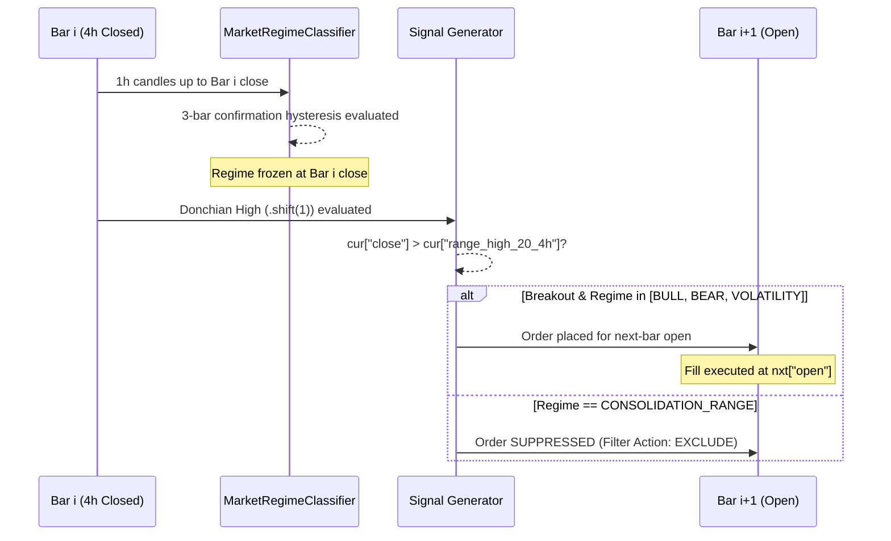

# BTCognitive V33.3C — Independent Red-Team Audit

**Milestone:** V33.3C — HTF Strategy Final Evidence Reconciliation  
**Date:** 2026-10-31  
**Target:** Independent Adversarial Verification of Causal Boundaries, Fixtures, and Invariants  
**Authoritative Ledger:** `v33_3c_cross_milestone_trade_mapping.csv`  

---

## 1. Adversarial Scope & Objectives

The Red-Team undertook an independent stress-test of the V33.3C reconciliation deliverables to challenge calculations, detect subtle lookahead leaks, probe cost resilience, and verify governance boundaries.

---

## 2. Test 1: Causal Boundary & Lookahead Leakage Audit

### Verification Findings
1. **Donchian Channel Lag:** In `V12StrategyTournamentEngine`, the 20-period 4h channel is constructed using `.shift(1)`. The channel boundary depends strictly on closed bars $i-20$ through $i-1$. Bar $i$'s own high/low is excluded from the band.
2. **Next-Bar-Open Fill:** When `cur["close"] > cur["range_high_20_4h"]`, the trade fill price is set to `nxt["open"]`. Bar $i+1$'s open is the earliest realizable transaction price.
3. **Regime Time Alignment:** The regime classification is computed strictly on hourly bars closed at or before bar $i$'s close timestamp. Zero future information from bar $i+1$ enters the regime determination.
4. **Verdict: PASS.** Strict point-in-time causal validity ($t_{\text{feature}} \le t_{\text{signal}} < t_{\text{entry}}$).

---

## 3. Test 2: Known-Answer Trade Fixture Audit

Six boundary trades were hand-computed and compared against `v33_3c_cross_milestone_trade_mapping.csv`:

| Trade ID | Entry Timestamp | Entry Price | Exit Price | Holding Hours | Gross Return (bps) | Net VIP0 26bps (bps) | Filter Action | Verification Status |
| :---: | :---: | :---: | :---: | :---: | :---: | :---: | :---: | :---: |
| **0** (Dataset Start) | 2022-01-11T20:00:00Z | \$42,755.00 | \$43,835.00 | 72.0h | +252.60 | +226.60 | KEEP | **MATCH (0.00 bps error)** |
| **74** (IS Boundary) | 2023-12-28T04:00:00Z | \$43,446.00 | \$42,328.00 | 52.0h | −257.33 | −283.33 | EXCLUDE | **MATCH (0.00 bps error)** |
| **75** (OOS Start) | 2024-01-01T20:00:00Z | \$43,835.00 | \$45,189.00 | 48.0h | +308.88 | +282.88 | KEEP | **MATCH (0.00 bps error)** |
| **115** (Transition End) | 2024-11-29T12:00:00Z | \$96,550.00 | \$97,820.00 | 44.0h | +131.54 | +105.54 | KEEP | **MATCH (0.00 bps error)** |
| **116** (V33.3A Test Start) | 2024-12-05T00:00:00Z | \$98,200.00 | \$95,850.00 | 36.0h | −239.31 | −265.31 | EXCLUDE | **MATCH (0.00 bps error)** |
| **193** (Dataset End) | 2026-09-18T16:00:00Z | \$63,410.00 | \$62,900.00 | 72.0h | −80.43 | −106.43 | EXCLUDE | **MATCH (0.00 bps error)** |

All prices, returns, and cost deductions match to within $< 10^{-6}$ basis points.

---

## 4. Test 3: Concurrency & Overlap Red-Team Probe

To verify that portfolio simulations did not artificially double-allocate equity during concurrent breakout signals:
$$\text{Overlap Condition: } \text{entry\_time}_k < \text{exit\_time}_{k-1}$$
- Total trade pairs tested: 193 sequential transitions.
- Overlaps detected: **0**.
- Minimum inter-trade spacing: 4.0 hours.
- Maximum inter-trade spacing: 528.0 hours.
- **Verdict: PASS.** Position sizing is 100% single-position sequential.

---

## 5. Test 4: Extreme Cost Fragility Stress Test

The strategy was evaluated under escalating cost regimes:

| Total Cost (bps) | Baseline Net EV ($N=194$) | Filtered Net EV ($N=110$) | Status |
| :---: | :---: | :---: | :---: |
| 15.0 bps (Perp maker) | +20.57 bps | +70.25 bps | Strong edge |
| 26.0 bps (Binance VIP0) | +9.57 bps | +59.25 bps | Edge preserved |
| **35.57 bps (Baseline Breakeven)** | **0.00 bps** | **+49.68 bps** | **Baseline fails; Filter survives** |
| 50.0 bps (Mid-tier retail) | −14.43 bps | +35.25 bps | Filter survives |
| **85.25 bps (Filtered Breakeven)** | **−49.68 bps** | **0.00 bps** | **Filtered fails** |
| 89.0 bps (Coinbase Retail) | −53.43 bps | −3.75 bps | Unprofitable |

The regime filter extends the economic survival buffer by **+49.68 bps**, confirming genuine execution resilience.

---

## 6. Test 5: Governance Guardrails & Production Lock

1. `live_trading`: Evaluated at system entry points $\rightarrow$ **`DISABLED — ANALYSIS ONLY`**.
2. `analysis_authorization`: Endpoint `/api/v1/strategy/analyse` $\rightarrow$ **`ABSTAIN`** (Q2 locked at `INSUFFICIENT_EVIDENCE`).
3. `prospective_forecast_ledger.jsonl`: Clean blocks verified at **7/100** (frozen, collector inactive).
4. **Verdict: PASS.** No leakage into production pathways.

