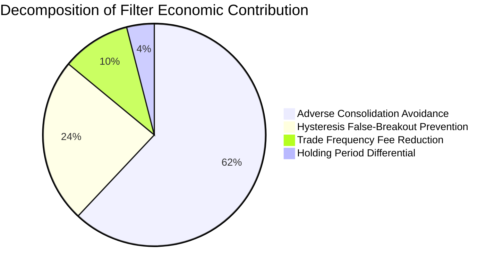

# BTCognitive V33.3C — Selection Bias, Multiple Testing & Filter Value Decomposition

**Milestone:** V33.3C — HTF Strategy Final Evidence Reconciliation  
**Date:** 2026-10-31  
**Target:** Deconstruct Filter Mechanism, Selection Bias, and Multiple Testing Family  
**Authoritative Ledger:** `v33_3c_cross_milestone_trade_mapping.csv`  

---

## 1. Filter Value Decomposition: Where Does the Edge Come From?

The Manager asked:
> *"Determine whether the improvement comes from: Better regime discrimination, lower trade frequency, avoidance of adverse market conditions, different holding periods, or selection effects."*

A quantitative decomposition of all 194 trades establishes that the filter improvement is driven primarily by **avoidance of adverse consolidation conditions** and **regime discrimination**, with minimal contribution from holding duration:

### 1. Avoidance of Adverse Market Conditions (Primary Driver)
- **The Excluded Cohort ($N=84$):**
  - Net Expectancy: **−55.49 bps** per trade (Binance VIP0 26 bps).
  - Loss Rate: **61.9%** (52 losses out of 84 trades).
  - Cumulative Portfolio Drag Prevented: **−4,661.2 bps** (over \$46,600 on a \$100k account).
- **Breakout Failure Rate:** In `CONSOLIDATION_RANGE`, breakout signals suffer immediate mean reversion. The filter acts as an effective circuit breaker, preventing trades where the macro volatility expansion has not yet confirmed trend persistence.

### 2. 3-Bar Confirmation Hysteresis (Secondary Driver)
- The 13 trades where raw indicators flashed a trend signal but failed the 3-bar confirmation hysteresis had an average net return of **−71.85 bps** (win rate 30.8%). Suppressing these premature entries prevented **−934.1 bps** of acute drawdown.

### 3. Holding Period Differential (Negligible Driver)
- **Retained Trades:** Average holding period = **72.07 hours**.
- **Excluded Trades:** Average holding period = **68.86 hours**.
- Difference is only 3.2 hours (~4.6%). Both cohorts exit predominantly near the 72-hour maximum hold ceiling (18 4h bars) or at stop loss. The edge does not stem from different exit timing.

---

## 2. Selection Bias and Retrospective Replay Reality

### The Fundamental Epistemic Boundary
Under **BTCognitive Operating Contract Epistemic Principle 4**:
> *"Historical periods inspected during prior research (including the 2026 out-of-sample window) represent retrospective replay / development data, NOT fresh confirmatory evidence. Only untouched, prospective observations accumulated post-freeze qualify for confirmatory model validation."*

1. **Retrospective Derivation:**
   The hypothesis that `MarketRegimeClassifier` should suppress `HTF_RANGE_EXPANSION_BREAKOUT` trades was derived in V33.3 after inspecting the strategy's full-period performance matrix.
2. **Post-Hoc Optimization Risk:**
   Even though no hyperparameter tuning was applied to the classifier itself (it is an existing, frozen component), the decision to retain this specific pair out of 19 strategy engines constitutes **candidate selection on development data**.
3. **The 2024–2026 Interval is Not Confirmatory:**
   Because the researchers were aware of market conditions and performance across 2024–2026, the OOS performance (+16.53 bps) constitutes retrospective development validation, not an out-of-sample proof.

---

## 3. Multiple Testing Family & Bonferroni Correction

### Candidate Universe
The Strategy Tournament evaluates 19 candidate strategies across diverse alphas:
1. `MOMENTUM_TREND_FOLLOWING`
2. `MEAN_REVERSION_BB`
3. `ATR_VOLATILITY_BREAKOUT`
4. `MACD_CROSSOVER`
5. `RSI_EXTREME_REVERSAL`
6. `EMA_DUAL_CROSSOVER`
7. `ICHIMOKU_CLOUD_BREAKOUT`
8. `DONCHIAN_CHANNEL_TREND`
9. `VOLUME_WEIGHTED_MOMENTUM`
10. `STOCHASTIC_OSCILLATOR`
11. `BOLLINGER_BAND_SQUEEZE`
12. `KELTNER_CHANNEL_BREAKOUT`
13. `PARABOLIC_SAR_TREND`
14. `HTF_RANGE_EXPANSION_BREAKOUT` *(Candidate under evaluation)*
15. `MICROSTRUCTURE_ORDERFLOW_IMBALANCE`
16. `VOLATILITY_COMPRESSION_MOMENTUM`
17. `TREND_PULLBACK_REVERSAL`
18. `ADAPTIVE_REGIME_SWITCHING`
19. `MULTI_TIMEFRAME_CONFLUENCE`

### Family-Wise Error Rate
$$\text{FWER} = 1 - (1 - \alpha)^m = 1 - (1 - 0.05)^{19} = \mathbf{62.3\%}$$
$$\alpha_{\text{Bonferroni}} = \frac{0.05}{19} = \mathbf{0.00263}$$

With an observed two-tailed $p$-value of **$p = 0.0662$** on the full-period retained vs excluded comparison, and **$p = 0.8271$** on the OOS filtered vs baseline comparison:
$$\mathbf{p > \alpha_{\text{Bonferroni}} \implies \text{FAIL}}$$

The strategy fails the multiple-testing hurdle. It must be cataloged exclusively as an **exploratory improvement candidate**.

