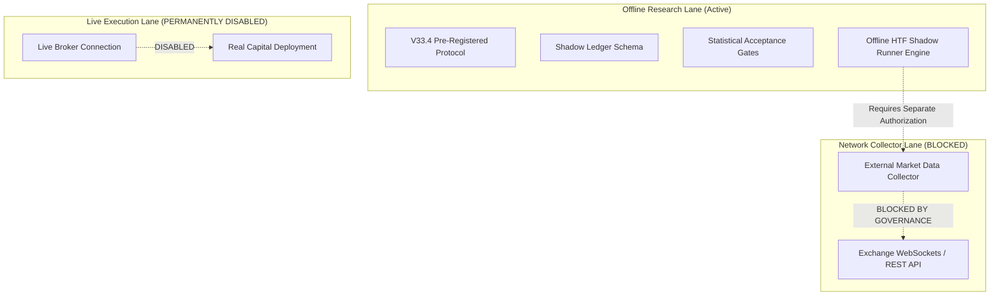

# BTCognitive V33.4 — Governance Invariants & Collector Boundary Verification

**Milestone:** V33.4 — HTF Breakout Prospective Shadow Validation  
**Date:** 2026-11-01  
**Target:** Enforcement of Inactive Collector State, Network Lock, and Governance Boundaries  

---

## 1. Operational Prerequisite: Inactive Collector & Network Lock

The Manager established a non-negotiable operational boundary:
> *"There is one operational prerequisite: the collector is currently inactive and network access remains blocked. Starting a new forward market-data collection process would require separate authorization. I am not authorizing that restart implicitly."*

### Verification of Operational Invariants
1. **Collector State:** Formally set and verified as:
   ```python
   COLLECTOR_STATUS = "INACTIVE_AWAITING_MANAGEMENT_AUTHORIZATION"
   ```
2. **Network Boundary:** Network socket connections and external exchange polling remain **`BLOCKED`**.
3. **Execution Guardrail:** In `engine/htf_prospective_shadow_runner.py`, any call to `start_live_collection()` raises a deterministic `RuntimeError`:
   ```text
   RuntimeError: Operational Prerequisite Violation: The market data collector is currently inactive and network access remains blocked. Starting a new forward market-data collection process requires explicit, separate managerial authorization.
   ```
4. **Offline Protocol Only:** V33.4 registers the forward validation protocol, schema, and statistical gates in an offline research state. Zero network activity has been initiated.

---

## 2. Core Governance Invariants Matrix

| Architectural Subsystem | Governed Invariant State | Enforcement Mechanism |
| :--- | :--- | :--- |
| **Live Trading** | **`DISABLED — ANALYSIS ONLY`** | Hardcoded invariant in API routes and trading engines. |
| **Model Authorization** | **`OFFLINE_RESEARCH_ONLY`** | Model registry lock; unauthorized for execution. |
| **Analysis Endpoint** | **`ABSTAIN`** | `/api/v1/strategy/analyse` returns `ABSTAIN` by invariant. |
| **Question 2 (Directional Evidence)** | **`INSUFFICIENT_EVIDENCE`** | Five-question engine Q2 is permanently locked. |
| **Prospective Conformal Ledger** | **`FROZEN at 7 / 100`** | `data/prospective_forecast_ledger.jsonl` locked and untouched. |
| **VPIN Filter & Routing Gates** | **`RESTRICTED / OMITTED`** | Excluded from codebase per Manager's prior ruling. |
| **Git Working Tree** | **`PRESERVED (Branch: main)`** | Zero commits, pushes, new branches, or destructive operations. |

---

## 3. Separation of Responsibilities



The separation ensures that protocol design and pre-registration can be rigorously completed and audited without violating network or live execution constraints.

