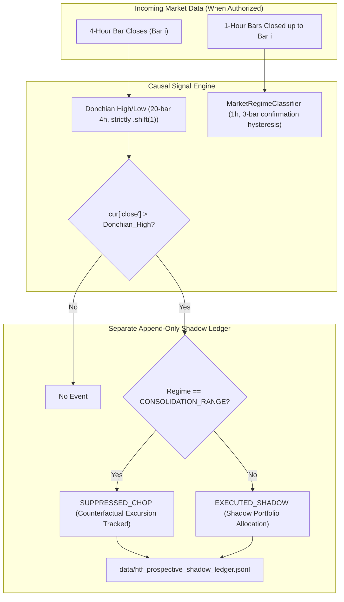

# BTCognitive V33.4 — HTF Breakout Prospective Shadow Validation Protocol

**Milestone:** V33.4 — HTF Breakout Prospective Shadow Validation  
**Date:** 2026-11-01  
**Status:** Pre-Registered Research Protocol (Frozen)  
**Operating Boundary:** Strict Read-Only Offline Research (`live_trading = DISABLED — ANALYSIS ONLY`)  
**Collector State:** `INACTIVE_AWAITING_MANAGEMENT_AUTHORIZATION` (Network access blocked)  

---

## 1. Prime Objective & Rationale

Following the Manager's ruling on V33.3C:
> *"The only meaningful next evidence is a genuinely untouched forward evaluation... The strategy and regime filter should be frozen exactly as currently defined. Every eligible and suppressed signal should be recorded in a separate append-only strategy evaluation ledger. This must be separate from the existing seven conformal forecast blocks."*

This document defines the formal pre-registered protocol for **BTCognitive V33.4 — HTF Breakout Prospective Shadow Validation**. Its purpose is to evaluate whether the `MarketRegimeClassifier` can reliably improve the net performance of `HTF_RANGE_EXPANSION_BREAKOUT` on genuinely untouched forward observations accumulated post-freeze, without retrospective data snooping or post-hoc parameter adjustments.

---

## 2. Frozen Strategy & Filter Specifications

### A. Strategy Contract: `HTF_RANGE_EXPANSION_BREAKOUT`
- **Timeframe:** 4-hour candles.
- **Lookback Window:** 20 periods (80 hours), strictly shifted by 1 bar (`.shift(1)`).
- **Entry Trigger:** Bar $i$ closes above the upper channel: $\text{Close}_i > \text{DonchianHigh}_{i-1, 20}$.
- **Execution Price:** Realized at the open of the immediately following candle: $\text{Fill Price} = \text{Open}_{i+1}$.
- **Initial Stop Loss:** Placed at the lower channel of bar $i$: $\text{Stop Loss} = \text{DonchianLow}_{i-1, 20}$.
- **Exit Logic:** Position is closed on the first occurrence of:
  1. Low of bar $k$ penetrates the trailing stop loss: $\text{Low}_k \le \text{Stop Loss}$ (fill at stop loss).
  2. Maximum holding horizon expires: Elapsed bars $(k - \text{entry\_bar}) \ge 18$ 4h bars (72.0 hours) (fill at close of bar 18).
- **Concurrency Invariant:** Single-position sequential execution. If a breakout occurs while already in a position, the incoming signal is ignored. (Historical concurrency audit verified 0 overlaps).

### B. Filter Contract: `MarketRegimeClassifier`
- **Timeframe:** 1-hour candles.
- **Confirmation Hysteresis:** Strict 3-bar persistence threshold. The regime state is updated only when the raw classifier maintains the same regime for 3 consecutive closed 1h bars.
- **Filter Action:**
  - `SUPPRESSED_CHOP`: Macro regime at bar $i$ close is `CONSOLIDATION_RANGE`. The trade is suppressed.
  - `EXECUTED_SHADOW`: Macro regime at bar $i$ close is in `[BULL_TREND, BEAR_TREND, VOLATILITY_EXPANSION]`. The trade is admitted into the shadow portfolio.

---

## 3. Strict Ledger Separation Invariant

| Dimension | Conformal Risk Ledger | HTF Prospective Shadow Ledger |
| :--- | :--- | :--- |
| **File Path** | `data/prospective_forecast_ledger.jsonl` | `data/htf_prospective_shadow_ledger.jsonl` |
| **Scientific Objective** | Conformal interval coverage & variance proxy | Trading strategy net expectancy & drawdown |
| **Evaluated Target** | $r_{\text{forward, 24h}}^2$ (Realized Variance) | Trade gross and net return under 26 bps cost |
| **Current State** | **FROZEN at 7 / 100 blocks** | **PRE-REGISTERED (Zero entries pre-launch)** |
| **Collector Identity** | Conformal shadow runner | HTF prospective shadow runner |

Both ledgers are strictly segregated in filesystem storage, execution processes, and schema definitions. Under no circumstances will strategy shadow signals be merged into `prospective_forecast_ledger.jsonl`.

---

## 4. Execution Economics & Cost Specification

All executed and counterfactual trades in the prospective ledger are evaluated under the verified **Binance VIP0 26.0 bps** benchmark:

$$\text{Total Friction} = \text{Commission (20.0 bps)} + \text{Spread (2.0 bps)} + \text{Base Slippage (2.0 bps)} + \text{Expansion Slippage (2.0 bps)} = \mathbf{26.0\text{ bps}}$$

$$\text{Net Return (bps)} = \text{Gross Return (bps)} - 26.0\text{ bps}$$

Sensitivity benchmarks (Coinbase Institutional 20.6 bps, Binance Perp 17.0 bps, Coinbase Retail 89.0 bps) will be reported as secondary diagnostics.

---

## 5. Dual Signal Accounting & Counterfactual Excursion Tracking

Every breakout signal will be recorded in `data/htf_prospective_shadow_ledger.jsonl` with full counterfactual excursion data:
1. **Executed Signals (`EXECUTED_SHADOW`):** Executed in the shadow portfolio, updating chronological equity, drawdown, exposure, and turnover.
2. **Suppressed Signals (`SUPPRESSED_CHOP`):** Shadow-tracked through maturity (up to 72 hours or stop loss) to calculate exact counterfactual gross and net returns. This enables direct, paired testing of whether suppressed trades would have incurred losses.

---

## 6. Pre-Registered Dependence-Aware Statistical Inference

To address the Manager's methodological critique regarding overlapping trade subsets:

### A. Paired Chronological Portfolio Streams
We construct two continuous, synchronized daily portfolio equity return streams:
$$\mathbf{R}_{\text{base}} = \{r_{\text{base}, 1}, r_{\text{base}, 2}, \dots, r_{\text{base}, T}\}$$
$$\mathbf{R}_{\text{filt}} = \{r_{\text{filt}, 1}, r_{\text{filt}, 2}, \dots, r_{\text{filt}, T}\}$$
$$\Delta_t = r_{\text{filt}, t} - r_{\text{base}, t}$$

### B. Statistical Evaluation Methods
1. **Diebold–Mariano with Harvey–Leybourne–Newbold (1997) Correction:**
   Evaluates paired loss differential $d_t = L(r_{\text{base}, t}) - L(r_{\text{filt}, t})$ with finite-sample adjustment and Student's $t_{T-1}$ reference distribution.
2. **Stationary Block Bootstrap:**
   Bootstrap resampling of $\Delta_t$ with mean block length matching the average trade holding horizon (72 hours / 3 days), 1,000 replications, to construct dependence-aware 95% confidence intervals.

---

## 7. Pre-Registered Minimum Evidence Gate

Confirmatory evaluation requires:
1. **Minimum Sample Size:** **100 non-overlapping prospective signal events** ($N \ge 100$).
2. **Statistical Significance:** One-tailed $p < 0.025$ on the paired difference $\Delta_t$.
3. **Economic Expectancy Hurdle:**
   - Filtered Net EV $\ge \mathbf{+25.0\text{ bps}}$ under Binance VIP0 (26.0 bps).
   - Suppressed trades Net EV $\le \mathbf{0.0\text{ bps}}$ (confirming negative drag avoidance).
   - Portfolio Max Drawdown reduction $\ge \mathbf{25.0\%}$ relative to baseline.

---

## 8. Operational Guardrails & Governance Lock

- **Network Invariant:** The network collector remains **`INACTIVE`** and network access is **`BLOCKED`**. Collection will only commence upon explicit, separate managerial authorization.
- **Production Guardrail:** `live_trading = DISABLED — ANALYSIS ONLY`.
- **Architecture Freeze:** Q2 directional evidence remains locked at `INSUFFICIENT_EVIDENCE`; Analysis runtime remains locked at `ABSTAIN`.

