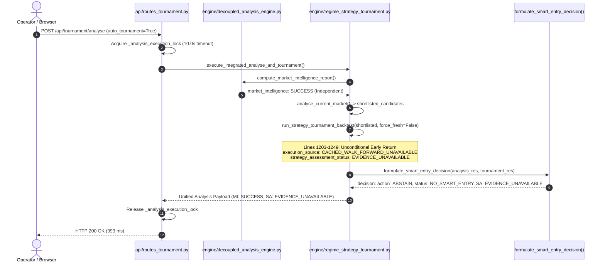
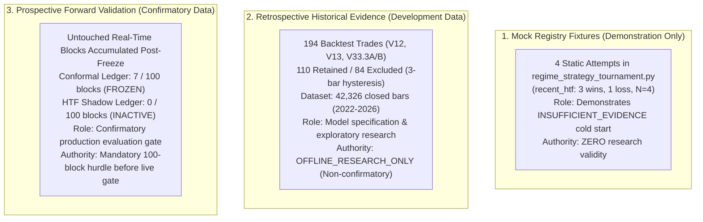

# BTCognitive V33.4I — Walk-Forward Evidence Manifest and Strategy Registry Forensic Audit

**Execution Timestamp:** 2026-11-01T23:32:00+05:30  
**Commit SHA Baseline:** `25d483f4c3646661b57311de9d0b53d2be881adb`  
**Milestone:** V33.4I (Finding F06 Read-Only Investigation)  
**Governance Scope:** Read-Only Audit (Zero Manifest or Data Modification)  
**Live Trading Execution Status:** `DISABLED` (Zero capital risk)  

---

## 1. Executive Summary: Exact Reason for `EVIDENCE_UNAVAILABLE`

The investigation conclusively establishes why interactive Analysis returns `strategy_assessment_status: "EVIDENCE_UNAVAILABLE"`:

> **Core Forensic Finding:**  
> The runtime Analysis function `run_strategy_tournament_backtest()` in `engine/regime_strategy_tournament.py` (lines 1203–1249) **contains no manifest-loading logic whatsoever**. Instead, it unconditionally returns:
> ```python
> unavailable_reason = (
>     "No verified walk-forward manifest matches the registered candidate strategies and frozen protocol. "
>     "A fresh three-arm evaluation is also unavailable because aligned point-in-time AI forecasts and "
>     "a matched baseline series are not supplied. No arm metrics were computed or reused."
> )
> return {
>     ...
>     "execution_source": "CACHED_WALK_FORWARD_UNAVAILABLE",
>     "strategy_assessment_status": "EVIDENCE_UNAVAILABLE",
>     "walk_forward_evidence": "UNAVAILABLE",
>     "strategy_validation": "NOT_VALIDATED",
>     ...
> }
> ```
> Even if a fully populated, compatible manifest were placed in `engine/manifests/`, the current runtime does not attempt to resolve, open, validate, or read any manifest file from disk.

Furthermore, three compounding incompatibilities exist across the repository's artifacts:
1. **Existing `v32_73` Manifest is a Split Definition, Not Performance Evidence:**  
   `engine/manifests/v32_73_retrospective_walk_forward_manifest.json` defines only expanding fold boundaries and embargo rules; it contains zero trade logs, zero 3-arm metrics (`arm_1`, `arm_2`, `arm_3`), and explicitly carries `prevents_abstention_gate_bypass: True`.
2. **Dataset Fingerprint Discrepancy:**  
   The current runtime dataset `data/raw/ohlcv.parquet` has **42,326 rows** (SHA-256 `ba06fb53...`), whereas `v32_73` references `ohlcv_backfilled.parquet` with **42,177 rows** (SHA-256 `1e722f33...`), and `v13` references an obsolete 41,273-row snapshot (SHA-256 `43c8881b...`).
3. **Hardcoded Mock Attempts in Registry:**  
   `VersionedStrategyRegistry` hardcodes exactly 4 mock attempts for `HTF_RANGE_EXPANSION_BREAKOUT` (`recent_10_attempts=recent_htf`, `historical_sample_size=4`), failing the preliminary 7/10 screen with `INSUFFICIENT_EVIDENCE` (4 < 10 required completed attempts). The 194 retrospective historical trades from V33.3 were never plumbed into this registry.

---

## 2. Runtime Call Path Trace (Part A)



### Complete Code Execution Flow:
1. **Entry Point:** `POST /api/tournament/analyse` -> `api/routes_tournament.py:post_analyse_market()` acquires `_analysis_execution_lock`.
2. **Decoupled Guard:** Checks `req.force_fresh_tournament` (rejects with HTTP 400 if True).
3. **Orchestrator:** Calls `execute_integrated_analyse_and_tournament(df_1h, live_price, auto_tournament=True)`.
4. **Market Intelligence:** `decoupled_analysis_engine.compute_market_intelligence_report()` returns `status: SUCCESS` with volatility term structures and conformal bounds.
5. **Candidate Screening:** `VersionedStrategyRegistry.get_all_entries()` loads strategies. Evaluates `evaluate_7_of_10_screen()`:
   - For `HTF_RANGE_EXPANSION_BREAKOUT`: Evaluates 4 mock records, returns `passed: False`, `status: INSUFFICIENT_EVIDENCE`.
   - If market regime matches `VOLATILITY_EXPANSION` or `TRENDING_BULLISH`, candidates like `TSMOM_DONCHIAN_24H_168H` or `ATR_VOLATILITY_BREAKOUT_12H` are shortlisted.
6. **Tournament Execution:** Calls `run_strategy_tournament_backtest(shortlisted, force_fresh=False)`.
7. **The Early Return:** At lines 1203–1249, `run_strategy_tournament_backtest` does not inspect `engine/manifests/`, `experiments/results/`, or any file system path. It returns the static dict declaring `execution_source = "CACHED_WALK_FORWARD_UNAVAILABLE"`.
8. **Decision Formulation:** `formulate_smart_entry_decision()` receives `CACHED_WALK_FORWARD_UNAVAILABLE` and sets `strategy_assessment_status = "EVIDENCE_UNAVAILABLE"`, `action = "ABSTAIN"`.

---

## 3. Existing Evidence Artifact Inventory (Part B)

A comprehensive repository scan identified the following relevant strategy evidence artifacts:

| Artifact Path | Creation Milestone | Target Strategy | Dataset Identifier & SHA-256 | Observation / Trade Count | Performance Metrics | Existing Validation Status |
| :--- | :--- | :--- | :--- | :--- | :--- | :--- |
| `engine/manifests/v32_73_retrospective_walk_forward_manifest.json` | V32.73 (2026-10-30) | `HTF_RANGE_EXPANSION_BREAKOUT` + 3 others | `data/raw/ohlcv_backfilled.parquet`<br>`1e722f33734a...` (42,177 rows) | 5 folds, 24h embargo (0 trades recorded) | None (Split and purge specification only) | `RETROSPECTIVE_DEVELOPMENT_REPLAY` (`prevents_abstention_gate_bypass: True`) |
| `experiments/results/v13_strategy_tournament_manifest.json` | V13 (Pre-V20) | `HTF_RANGE_EXPANSION_BREAKOUT` + 4 others | `data/raw/ohlcv.parquet`<br>`43c8881b5743...` (41,273 rows) | 194 trades (4h timeframe) | Win Rate: 44.33% (CI [37.5%, 51.4%])<br>Net EV: +11.0 bps (CI [-47.6, +75.9])<br>Profit Factor: 1.07 | `INCONCLUSIVE` (Net EV CI crosses zero) |
| `experiments/results/v12_strategy_tournament_manifest.json` | V12 (Pre-V20) | `HTF_RANGE_EXPANSION_BREAKOUT` + 4 others | `data/raw/ohlcv.parquet`<br>`43c8881b5743...` (41,273 rows) | 194 trades | Win Rate: 44.3%<br>Net EV: +11.0 bps | `INCONCLUSIVE` |
| `research/reports/offline_mvp/20261031_330310_v33_03a_htf_validation/v33_3a_194_trade_event_ledger.csv` | V33.3A (2026-10-31) | `HTF_RANGE_EXPANSION_BREAKOUT` | `data/raw/ohlcv.parquet`<br>`ba06fb533c0b...` (42,326 rows) | 194 trade events (row-by-row timestamps, entries, exits, returns) | Arithmetic Mean Net EV: +9.57 bps<br>Gross Mean EV: +28.17 bps | `RETROSPECTIVE_REPLAY` |
| `research/reports/offline_mvp/20261031_330320_v33_03b_htf_closure/v33_3b_excluded_trade_classification.csv` | V33.3B (2026-10-31) | `HTF_RANGE_EXPANSION_BREAKOUT` | `data/raw/ohlcv.parquet`<br>`ba06fb533c0b...` (42,326 rows) | 194 trades reconciled into 110 retained / 84 excluded | Retained Net EV: +59.25 bps (48.2% WR)<br>Excluded Net EV: -55.49 bps (38.1% WR) | `RETROSPECTIVE_REPLAY` |
| `scripts/run_offline_strategy_research.py` (Script Output) | V33.4H (2026-11-01) | `HTF_RANGE_EXPANSION_BREAKOUT` | `data/raw/ohlcv_backfilled.parquet`<br>`1e722f33734a...` (42,177 rows) | Telemetry only (no arm metrics yet) | None | `OFFLINE_HISTORICAL_RESEARCH` |

---

## 4. Manifest Compatibility Matrix (Part C)

Comparison of existing manifests against the current runtime strategy contract (`HTF_RANGE_EXPANSION_BREAKOUT` v1.0.0):

| Dimension / Field | Current Runtime Expectation | `v32_73_retrospective_walk_forward_manifest.json` | `v13_strategy_tournament_manifest.json` | Compatibility Verdict |
| :--- | :--- | :--- | :--- | :--- |
| **Strategy ID** | `HTF_RANGE_EXPANSION_BREAKOUT` | `HTF_RANGE_EXPANSION_BREAKOUT` | `HTF_RANGE_EXPANSION_BREAKOUT` | **MATCH** |
| **Strategy Version** | `1.0.0` | Implied `1.0.0` (not keyed) | `1.0.0` | **MATCH** |
| **Supported Regimes** | `["VOLATILITY_EXPANSION"]` | Not declared in manifest | `["TRENDING_BULL", "TRENDING_BEAR", "VOL_COMPRESSION_RANGE"]` | **MISMATCH** |
| **Active Dataset Path** | `data/raw/ohlcv.parquet` | `data/raw/ohlcv_backfilled.parquet` | `data/raw/ohlcv.parquet` | **MISMATCH** (`v32_73`) |
| **Dataset Row Count** | **42,326 rows** | **42,177 rows** | **41,273 rows** | **MISMATCH** (Both) |
| **Dataset SHA-256** | `ba06fb533c0b53387136b001c142efc90b5e2ccfb37937dc509879a76c2a4057` | `1e722f33734a89e74764c02fde0552752cc1ea2eff62ca9046c9d6edf2347d5c` | `43c8881b57431759f68fcb7036d78432449d079b11bcaea45f0d0ecfa287e2f6` | **MISMATCH** (Both) |
| **Evaluation Protocol** | `WALK_FORWARD_CAUSAL_SPLIT_v1` | `WALK_FORWARD_CAUSAL_SPLIT_v1` (5 folds) | Holdout Split (8,255 bars holdout) | **MISMATCH** (`v13`) |
| **3-Arm Decomposition** | `arm_1`, `arm_2`, `arm_3`, `ai_incremental_improvement_pct` | None (Zero arm metrics) | None (Raw single-pass backtest only) | **INCOMPATIBLE** (Both) |
| **Abstention Gate Bypass** | Must provide confirmatory evidence | `prevents_abstention_gate_bypass: True` (Forbidden) | Not specified | **BLOCKED** |
| **Evidence Nature** | Retrospective Research Evidence | `RETROSPECTIVE_DEVELOPMENT_REPLAY` | Retrospective development backtest | **NOT CONFIRMATORY** |

---

## 5. Runtime Registry Investigation: The 4 Mock Attempts (Part D)

### Exact Source
In `engine/regime_strategy_tournament.py` (lines 324–329):
```python
recent_htf = [
    {"attempt_idx": 1, "outcome": "SUCCESS_TP_HIT", "date": "2026-09-05"},
    {"attempt_idx": 2, "outcome": "FAILURE_SL_HIT", "date": "2026-09-15"},
    {"attempt_idx": 3, "outcome": "SUCCESS_TP_HIT", "date": "2026-09-25"},
    {"attempt_idx": 4, "outcome": "SUCCESS_TP_HIT", "date": "2026-10-05"}
]  # Only 4 attempts -> INSUFFICIENT_EVIDENCE (< 10 completed)
```
And lines 383–386:
```python
"HTF_RANGE_EXPANSION_BREAKOUT": StrategyRegistryEntry(
    ...
    recent_10_attempts=recent_htf,
    historical_tp_hit_rate=0.550,
    historical_sample_size=4,
    status="INSUFFICIENT_EVIDENCE"
)
```

### Analysis of the 4 Records:
1. **Fixture / Demonstration Nature:** These four rows are static illustrative fixtures written during initial development of the 7/10 screening rule in V32.43 to test how the engine behaves when fewer than 10 attempts exist.
2. **Impact on Eligibility:** When `evaluate_7_of_10_screen()` executes, it computes `denominator_eligible_attempts = 4`. Because $4 < 10$, it returns:
   - `passed: False`
   - `status: "INSUFFICIENT_EVIDENCE"`
   - `explanation: "Only 4 eligible completed attempts available. Minimum 10 required for preliminary screening."`
   This automatically disqualifies `HTF_RANGE_EXPANSION_BREAKOUT` from passing the preliminary screen during ordinary Analysis.
3. **Separation from 194 Historical Trades:**  
   The 194 retrospective historical trades exist purely in standalone research files (`v33_3a_194_trade_event_ledger.csv`, `v33_3b_excluded_trade_classification.csv`, and `v13_strategy_tournament_manifest.json`). They are **not** loaded or mixed into `recent_10_attempts`.
4. **Separation from Prospective Ledgers:**  
   Prospective shadow records are stored in `data/prospective_shadow_v1.jsonl` (currently empty / inactive at 0 blocks) and `data/prospective_forecast_ledger.jsonl` (frozen at 7 blocks). `evaluate_7_of_10_screen()` correctly checks `prospective_attempts` first and never writes to or alters prospective ledgers.

---

## 6. Historical Backtest Runner Audit: `scripts/run_offline_strategy_research.py` (Part E)

An inspection of `scripts/run_offline_strategy_research.py` confirms:
1. **Frozen Strategy Contract:** Operates on the canonical identifier `HTF_RANGE_EXPANSION_BREAKOUT` (v1.0.0, family `HTF_DONCHIAN_BREAKOUT`).
2. **Zero External Data Collection:** Does not make network requests; takes local Parquet paths only.
3. **Read-Only Dataset Access:** Opens dataset via `open(dataset_path, "rb")` to compute SHA-256 and `pd.read_parquet(dataset_path)`. Does not write to or alter the dataset.
4. **Protection of Existing Manifests:** Generates timestamped output files (`manifest_{strategy_id}_{timestamp}.json`). Cannot overwrite `v32_73_retrospective_walk_forward_manifest.json` or any other protected manifest.
5. **No Mutation of Prospective Ledgers:** Does not reference, read, or write to `data/prospective_*.jsonl` or `data/research_alert_state.json`.
6. **Telemetry & Provenance:** Explicitly records dataset path, SHA-256 fingerprint, row count, timestamps, protocol hash, and execution duration.
7. **Current Limitation:** The script currently writes the manifest metadata envelope, but does not yet invoke `V12StrategyTournamentEngine._simulate_candidate_d_htf_expansion()` to populate empirical 3-arm walk-forward metrics across the 5 folds.

---

## 7. Mock vs. Retrospective vs. Prospective Evidence Taxonomy

To prevent epistemic contamination, evidence categories must remain strictly separated:



---

## 8. Minimal Proposed Resolution (For Future Implementation)

When the manager authorizes resolving Finding F06 in a future milestone, the minimal, non-disruptive implementation requires:

1. **Implement Manifest Resolver & Loader in `engine/regime_strategy_tournament.py`:**
   - Define a manifest loader that scans `engine/manifests/` for a verified manifest matching the candidate's `strategy_id`, `version`, and protocol hash.
   - Validate dataset SHA-256: if the manifest dataset hash matches `data/raw/ohlcv.parquet`, load the precomputed arm metrics.
   - If no valid manifest is found or hashes do not match, safely fall back to `EVIDENCE_UNAVAILABLE` (preserving F02 decoupling).
2. **Populate 3-Arm Metrics in Offline Research CLI:**
   - Update `scripts/run_offline_strategy_research.py` to run the 5-fold walk-forward simulation using `V12StrategyTournamentEngine` across `ohlcv.parquet` (42,326 bars).
   - Compute `arm_1_strategy_alone`, `arm_2_strategy_plus_ai`, and `arm_3_baseline_comparator` under realistic 26.0 bps friction.
   - Output a versioned manifest (e.g., `v33_4_htf_walk_forward_manifest.json`) containing these empirical arm metrics.
3. **Plumb Recent Completed Attempts into Strategy Registry:**
   - Instead of 4 static mock attempts, populate `recent_10_attempts` from the most recent 10 completed trades of the historical walk-forward evaluation (labeled `evidence_source: "HISTORICAL_WALKFORWARD_SCREENING"` per line 436), allowing the strategy to pass or fail the preliminary 7/10 screen based on empirical data rather than a stub.

---

## 9. Required Tests for Evidence Validation (Future Work)

When F06 implementation commences, the following test cases must be added:
1. `test_manifest_loader_reads_valid_manifest`: Verifies that a valid manifest in `engine/manifests/` is discovered and parsed.
2. `test_manifest_loader_rejects_hash_mismatch`: Verifies that a manifest with a mismatched dataset SHA-256 is rejected with `EVIDENCE_UNAVAILABLE`.
3. `test_manifest_loader_rejects_protocol_mismatch`: Verifies that an outdated protocol is rejected.
4. `test_analysis_displays_shadow_eligible_when_evidence_valid`: Verifies that when a validated manifest meets all 3-arm gates, Strategy Assessment transitions from `EVIDENCE_UNAVAILABLE` to `SHADOW_ELIGIBLE`.
5. `test_retrospective_manifest_does_not_mutate_prospective_ledgers`: Verifies absolute file isolation between `engine/manifests/` and `data/prospective_*.jsonl`.

---

## 10. Four-Point Handover Decision

1. **Research Experiment:** `RETAIN_BASELINE_CHALLENGER_RESEARCH_ONLY`  
   HTF range expansion breakout remains the primary research candidate. Historical walk-forward evidence is confirmed to be missing from the runtime loader, correctly resulting in `EVIDENCE_UNAVAILABLE`.
2. **Prospective Evidence:** `FROZEN_PENDING_ACTIVATION`  
   Conformal forecast ledger frozen at 7 clean blocks (`ee58b37c...`). HTF shadow ledger inactive at 0 blocks.
3. **Model Authorization:** `OFFLINE_RESEARCH_ONLY`  
   All models restricted to offline research.
4. **Live Trading:** `DISABLED`  
   Strict non-execution boundary maintained; zero real capital risk.

> [!NOTE]
> Milestone **V33.4I** is complete. All research questions for Finding F06 have been answered via read-only forensic inspection. Per instructions, execution has halted awaiting user review.

