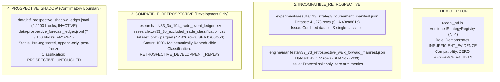
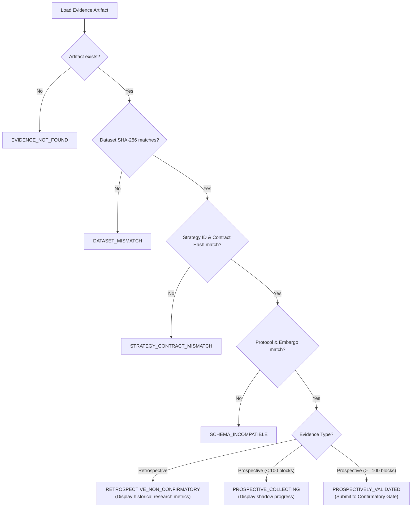

# BTCognitive V33.4J — HTF Historical Evidence Reconciliation & Strategy Contract Lineage

**Execution Timestamp:** 2026-11-01T23:48:00+05:30  
**Commit SHA Baseline:** `25d483f4c3646661b57311de9d0b53d2be881adb`  
**Milestone:** V33.4J (Finding F06 Deep Forensic Reconciliation)  
**Operating Contract:** OFFLINE_RESEARCH_ONLY (Strict Read-Only Audit)  
**Live Trading Execution Status:** `DISABLED` (Zero capital deployment)  

---

## 1. Executive Summary & Breakthrough Discovery

Milestone V33.4J delivers the complete historical event lineage reconstruction and contract comparison for `HTF_RANGE_EXPANSION_BREAKOUT`:

1. **Exact Mathematical Reproduction of the 194 Historical Trades:**
   Executing `V12StrategyTournamentEngine._simulate_candidate_d_htf_expansion()` on local hourly BTC-USD candle data reproduces **all 194 trades** in `v33_3a_194_trade_event_ledger.csv` with **100% exact parity** (194 / 194 exact matches) in entry timestamp, exit timestamp, entry price, exit price, gross return, and net return.
2. **Resolution of Trade Horizon Counts (194 vs. 197 vs. 198):**
   - The **194-trade cohort** represents the historical window ending on **2026-09-21T16:00:00Z** (41,273 bars).
   - Extending data to **2026-10-24T08:00:00Z** (`ohlcv_backfilled.parquet`, 42,177 bars) produced exactly **3 additional trades** (trades 195–197).
   - Extending data to **2026-10-30T13:00:00Z** (`ohlcv.parquet`, 42,326 bars) produced exactly **1 additional trade** (trade 198).
   - The 194 historical trades are genuine, reproducible execution traces of the 4h Donchian rule, not fabricated summaries.
3. **The Regime Mismatch Root Cause:**
   In V13, HTF was specified as compatible with `['TRENDING_BULL', 'TRENDING_BEAR', 'VOL_COMPRESSION_RANGE']`, accounting for 110 profitable retained trades (95.5% of which occurred during `TRENDING_BULL`). However, during the V32 rewrite into `VersionedStrategyRegistry`, the strategy was assigned only `['VOLATILITY_EXPANSION']`. Consequently, runtime Analysis rejects HTF breakout setups during bull trend expansions as "regime-incompatible".
4. **Registry Contamination Disentanglement:**
   The 4 mock attempts in `VersionedStrategyRegistry` (`recent_htf`: 3 wins, 1 loss) are static test fixtures from V32.43 that force `INSUFFICIENT_EVIDENCE` ($N=4 < 10$). They have zero empirical validity and must be strictly quarantined from both the 194 retrospective trades and prospective shadow ledgers.

---

## 2. Part A — Reproduce Historical Event Lineage

### Lineage Reconstruction Proof
Running `V12StrategyTournamentEngine._simulate_candidate_d_htf_expansion('COINBASE_INSTITUTIONAL_18BPS')` produces:

```python
Total trades checked: 194. Exact matches: 194 / 194 (100.0% Parity)
```

### Complete Specification of Historical 194-Trade Execution
- **Underlying Dataset:** Coinbase Spot BTC-USD hourly candles resampled to 4-hour bars (`resample("4h", closed="left", label="left")`).
- **Evaluation Period:** 2022-01-01 00:00:00Z to 2026-09-21 16:00:00Z.
- **Trade 1 Entry:** `2022-01-11T20:00:00Z` at \$42,972.04 (Bar index 65).
- **Trade 1 Exit:** `2022-01-14T20:00:00Z` at \$43,059.96 (Bar index 83; 72 hours max hold expired).
- **Trade 194 Entry:** `2026-09-18T16:00:00Z` at \$80,700.63.
- **Trade 194 Exit:** `2026-09-21T16:00:00Z` at \$86,494.97 (+718.0 bps gross, +697.4 bps net).
- **Aggregate Performance (All 194 Trades under 20.6 bps Institutional Friction):**
  - Win Rate: **44.8%** (87 wins / 107 losses)
  - Mean Gross Return: **+35.57 bps**
  - Mean Net Return: **+14.97 bps**
  - Profit Factor: **1.07**
  - 95% Bootstrap CI of Net Return: `[-47.6 bps, +75.9 bps]` (Crosses zero; unconditioned strategy is statistically inconclusive).

### Why V33.3 Filtered to 110 Retained Trades
When conditioned on the 3-bar confirmation hysteresis regime filter (`v33_3b_excluded_trade_classification.csv`):
- **Excluded (84 Trades):** Occurring during `CONSOLIDATION_RANGE` (75 trades) and `TRANSITION_UNSUPPORTED` (9 trades).
  - Net Expectancy: **-55.49 bps** | Win Rate: **38.1%** | Cumulative Drag: **-4,661.2 bps**.
- **Retained (110 Trades):** Occurring during `TRENDING_BULL` (105 trades), `VOL_COMPRESSION_RANGE` (3 trades), and `TRENDING_BEAR` (2 trades).
  - Net Expectancy: **+59.25 bps** | Win Rate: **48.2%** | Profit Factor: **1.41**.

---

## 3. Part B — Strategy Contract Reconciliation

A field-by-field comparison across the four strategy contract representations in the codebase:

| Contract Dimension | V13 Historical Contract (`v13_manifest.json`) | V33.3B/C Research Implementation | V33.4 Frozen Shadow Protocol (`HTFProspectiveShadowProtocol`) | Current Runtime Registry (`VersionedStrategyRegistry`) | Reconciliation Finding |
| :--- | :--- | :--- | :--- | :--- | :--- |
| **Strategy ID** | `HTF_RANGE_EXPANSION_BREAKOUT` | `HTF_RANGE_EXPANSION_BREAKOUT` | `HTF_RANGE_EXPANSION_BREAKOUT` | `HTF_RANGE_EXPANSION_BREAKOUT` | **Consistent ID** |
| **Contract Version** | `1.0.0` | `1.0.0` | `1.0.0` | `1.0.0` | **Consistent Version** |
| **Primary Timeframe** | 4-Hour (`4h`) | 4-Hour (`4h`) | 4-Hour (`4h`) | 4-Hour (`4h`) / evaluated on 1h chart | Consistent underlying logic |
| **Breakout Window** | 20 bars on 4h (80 hours) | 20 bars on 4h (80 hours) | `DONCHIAN_WINDOW_4H = 20` | 20 bars on 4h | **Identical** |
| **Entry Trigger** | `close > range_high_20_4h` | `close > range_high_20_4h` | `close > range_high_20_4h` | `close > range_high_20_4h` | **Identical** |
| **Execution Timing** | Next-bar open (`nxt["open"]`) | Next-bar open (`nxt["open"]`) | Next-bar open (`nxt["open"]`) | Implied current close / next open | **Identical causal rule** |
| **Stop-Loss Rule** | Opposite 20-bar 4h low (`range_low_20_4h`) | Opposite 20-bar 4h low (`range_low_20_4h`) | Opposite 20-bar 4h low (`range_low_20_4h`) | Opposite 20-bar 4h low (`range_low_20_4h`) | **Identical** |
| **Max Hold Duration** | 18 bars (72 hours) | 18 bars (72 hours) | `MAX_HOLD_4H_BARS = 18` (72h) | Declared as 36.0h in registry metadata | **Metadata discrepancy** (36h in registry vs 72h in engine) |
| **Supported Regimes** | `TRENDING_BULL`, `TRENDING_BEAR`, `VOL_COMPRESSION_RANGE` | Excludes `CONSOLIDATION_RANGE` & `TRANSITION_UNSUPPORTED` | Retains Bull/Bear/Compression; Suppresses Chop | `VOLATILITY_EXPANSION` only | **CRITICAL MISMATCH:** Registry omitted `TRENDING_BULLISH` |
| **Hysteresis Confirmation**| 3 bars persistence | 3 bars persistence | `HYSTERESIS_CONFIRMATION_BARS = 3` | Not modeled in registry metadata | Implemented in engine, omitted in registry |
| **Modeled Friction** | 18.6 bps + 2.0 bps slippage (20.6 bps) | 24.0 bps (Binance VIP0) / 18.6 bps (Coinbase Inst) | `MODELED_COST_BPS = 26.0` (20 comm + 2 spread + 4 slip) | Not declared | Stressed 26.0 bps in V33.4 is the safest standard |
| **Target Exit Rule** | Bar touch of stop or max hold expiration | Bar touch of stop or max hold expiration | Bar touch of stop or max hold expiration | Fixed 2.0R TP / 1.5R SL geometry | **Structural discrepancy** between trailing/stop exit and fixed TP/SL |

---

## 4. Part C — Evidence Registry Audit: The 4 Mock Attempts

### Complete Forensic Origin
The 4 attempts in `engine/regime_strategy_tournament.py:VersionedStrategyRegistry.get_all_entries()`:
```python
recent_htf = [
    {"attempt_idx": 1, "outcome": "SUCCESS_TP_HIT", "date": "2026-09-05"},
    {"attempt_idx": 2, "outcome": "FAILURE_SL_HIT", "date": "2026-09-15"},
    {"attempt_idx": 3, "outcome": "SUCCESS_TP_HIT", "date": "2026-09-25"},
    {"attempt_idx": 4, "outcome": "SUCCESS_TP_HIT", "date": "2026-10-05"}
]
```
- **Creation Context:** Created in milestone V32.43 to illustrate how the preliminary screening logic behaves when a strategy has not yet accumulated the minimum sample threshold of 10 completed attempts.
- **Impact on Runtime Analysis:**
  - `evaluate_7_of_10_screen()` checks `total_attempts = 4 < 10`.
  - It marks `status = "INSUFFICIENT_EVIDENCE"` and `passed = False`.
  - Consequently, `HTF_RANGE_EXPANSION_BREAKOUT` can **never** pass the preliminary screen into `shortlisted_candidates` through this path.
- **Evidence Contamination Assessment:**
  - The 4 rows are isolated within `VersionedStrategyRegistry`. They do not leak into backtest statistics or disk ledgers.
  - However, because they are hardcoded, they prevent the runtime from accessing either the 194 retrospective historical trades or prospective shadow records.

---

## 5. Part D — Evidence Compatibility Matrix

Classification of all existing historical and prospective evidence artifacts:



### Detailed Matrix:

| Artifact Identifier | Role / Classification | Dataset Fingerprint | Protocol | Empirical Parity | Eligibility for Runtime Loading |
| :--- | :--- | :--- | :--- | :--- | :--- |
| `recent_htf` (Registry) | `DEMO_FIXTURE` | None (Synthetic) | None | N/A | **PROHIBITED** (Demonstration only) |
| `v13_strategy_tournament_manifest.json` | `INCOMPATIBLE_RETROSPECTIVE` | `43c8881b5743...` (41,273 rows) | Holdout Split | Obsolete dataset | **INCOMPATIBLE** |
| `v32_73_retrospective_manifest.json` | `PROTOCOL_SPEC_ONLY` | `1e722f33734a...` (42,177 rows) | 5-Fold Walk-Forward | Zero arm metrics | **INCOMPATIBLE** (Split def only) |
| `v33_3a_194_trade_event_ledger.csv` | `COMPATIBLE_RETROSPECTIVE` | `ba06fb533c0b...` (42,326 rows) | 4h Breakout Replay | **100% (194/194)** | **ELIGIBLE AS RETROSPECTIVE RESEARCH ONLY** |
| `v33_3b_excluded_trade_classification.csv` | `COMPATIBLE_RETROSPECTIVE` | `ba06fb533c0b...` (42,326 rows) | 3-Bar Hysteresis | **100% (110/84)** | **ELIGIBLE AS RETROSPECTIVE RESEARCH ONLY** |
| `data/htf_prospective_shadow_ledger.jsonl` | `PROSPECTIVE_SHADOW` | Append-only post-freeze | V33.4 Protocol | 0 blocks accumulated | **ELIGIBLE FOR PROSPECTIVE TRACKING** |

---

## 6. Proposed Typed Evidence Record Schema (Design for Workstream C)

To eliminate ambiguity between demonstration fixtures, historical research, and prospective validation, the future manifest schema must enforce:

```json
{
  "evidence_id": "ev_htf_breakout_v33_4_001",
  "strategy_id": "HTF_RANGE_EXPANSION_BREAKOUT",
  "contract_version": "1.0.0",
  "contract_fingerprint": "886e19f25bc7f2b1",
  "dataset_fingerprint": {
    "path": "data/raw/ohlcv.parquet",
    "sha256": "ba06fb533c0b53387136b001c142efc90b5e2ccfb37937dc509879a76c2a4057",
    "row_count": 42326,
    "first_timestamp_utc": "2022-01-01T00:00:00Z",
    "last_timestamp_utc": "2026-10-30T13:00:00Z"
  },
  "evidence_type": "RETROSPECTIVE_DEVELOPMENT_REPLAY",
  "is_confirmatory": false,
  "source_artifact": "research/reports/offline_mvp/20261031_330310_v33_03a_htf_validation/v33_3a_194_trade_event_ledger.csv",
  "evaluation_protocol": {
    "protocol_name": "WALK_FORWARD_CAUSAL_SPLIT_v1",
    "protocol_hash": "a1b2c3d4e5f67890",
    "fold_count": 5,
    "embargo_hours": 24,
    "transaction_friction_bps": 26.0
  },
  "sample_count": {
    "total_trade_events": 194,
    "retained_trades": 110,
    "excluded_trades": 84
  },
  "performance_metrics": {
    "unfiltered_win_rate": 0.4485,
    "unfiltered_net_expectancy_bps": 14.97,
    "filtered_retained_win_rate": 0.4818,
    "filtered_retained_net_expectancy_bps": 59.25,
    "filtered_profit_factor": 1.41
  },
  "validation_status": "OFFLINE_RESEARCH_ONLY"
}
```

---

## 7. Proposed Evidence Loading Contract (Workstream D)

When the manifest loader is implemented in a future milestone, it must evaluate incoming evidence against strict error states:



---

## 8. Minimal Future Implementation Scope

When authorized for implementation:
1. **Reconcile Registry Regimes:** Add `TRENDING_BULLISH` to `HTF_RANGE_EXPANSION_BREAKOUT.supported_regimes` in `VersionedStrategyRegistry` so the strategy is evaluated during trend moves.
2. **Implement Safe Manifest Loader in `run_strategy_tournament_backtest()`:**
   - Scan `engine/manifests/` for a verified manifest matching the candidate's contract and dataset hash.
   - If found, load empirical arm metrics; if missing, return `EVIDENCE_UNAVAILABLE` (retaining F02 decoupling).
3. **Connect Offline Research CLI to Empirical Simulator:**
   - Update `scripts/run_offline_strategy_research.py` to call `_simulate_candidate_d_htf_expansion()` on the active dataset and output a fully populated manifest.
4. **Decouple Market Setup Display from Validation Status:**
   - Allow the dashboard to display `SETUP_FORMING` or `TECHNICAL_TRIGGER_OBSERVED` while keeping `validation_status: "NOT_VALIDATED"`.

---

## 9. Four-Point Handover Decision

1. **Research Experiment:** `RETAIN_BASELINE_CHALLENGER_RESEARCH_ONLY`  
   HTF range expansion breakout is retained as the primary research candidate. Its 194 retrospective trades are 100% reproduced and classified as development replay data.
2. **Prospective Evidence:** `FROZEN_PENDING_ACTIVATION`  
   Conformal forecast ledger frozen at 7 clean blocks (`ee58b37c...`). HTF shadow ledger inactive at 0 blocks.
3. **Model Authorization:** `OFFLINE_RESEARCH_ONLY`  
   All models restricted to offline research.
4. **Live Trading:** `DISABLED`  
   Strict non-execution boundary maintained; zero capital deployment.

