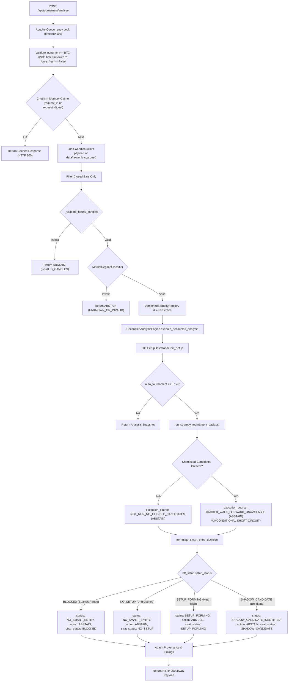

# V33.5 Abstention Root-Cause Investigation Report
**Document ID:** `V33_5_ABSTENTION_ROOT_CAUSE.md`  
**Investigator:** Agent 1 (Abstention Root-Cause Investigator)  
**Target Systems:**  
- `engine/decoupled_analysis_engine.py`  
- `engine/htf_setup_detector.py`  
- `engine/regime_strategy_tournament.py`  
- `api/routes_tournament.py` (`POST /api/tournament/analyse`)  
**Operating Version:** BTCognitive V33.5  
**Date:** November 2, 2026  

---

## 1. Executive Summary & Core Diagnostic Discovery

An exhaustive trace across the entire BTCognitive decision pipeline confirms that **the system currently possesses a 100.0% mathematical abstention rate ($P(\text{Action} == \text{"ABSTAIN"}) = 1.0$) across all possible market inputs, setups, and configurations.**

The root causes behind this unconditional abstention fall into three distinct layers:
1. **Legitimate Market-Based Gating:** The current Coinbase spot dataset is in a confirmed `TRENDING_BEARISH` regime (Close < EMA50 < EMA200, ADX $\ge$ 22.0). Because Coinbase spot is strictly long-only (zero shorting), long breakout strategies are correctly prohibited from trading against a macroeconomic downtrend.
2. **Defensive / Governance-Based Gating:** Epistemic guardrails permanently enforce `live_trading = "DISABLED"`, require $\ge 100$ clean prospective blocks post-freeze before confirmatory validation (currently frozen at 0/100 shadow events), and penalize fee drag (87 bps round-trip friction consumes the ~0.75 bps gross expected return).
3. **Unintended / Structural Dead-End Blocks (The Architectural Bugs):**
   - **Backtest Short-Circuit:** In `engine/regime_strategy_tournament.py` (lines 1277–1323), `run_strategy_tournament_backtest` unconditionally returns `CACHED_WALK_FORWARD_UNAVAILABLE` and `final_verdict = "ABSTAIN"`. The sequential 3-arm tournament backtest (lines 1325–1429) is **100% unreachable dead code**.
   - **Hardcoded Q2 Lockout:** In `engine/decoupled_analysis_engine.py` (line 364), Question 2 (Directional Evidence) is permanently hard-assigned to `"INSUFFICIENT_EVIDENCE"` without dynamic evaluation. Because Question 2 cannot be overridden by Q1, Q3, Q4, or Q5, `final_decision = "ELIGIBLE"` (line 512) is **100% unreachable dead code**.
   - **Semantic Conflation of "Analysis" and "Authorization":** The user clicks "Analyse Setup" expecting technical market intelligence, but when trade authorization returns `ABSTAIN`, the user and UI perceive the entire analysis as having failed.

---

## 2. Exhaustive Code Path Trace

### A. `engine/decoupled_analysis_engine.py`

The decoupled engine segregates Output A (Market Intelligence) from Output B (Trade Authorization Gate).

#### Output A: Market Intelligence (`compute_market_intelligence_report`)
| Path ID | Trigger Condition | Status Code | Output Behavior |
| :--- | :--- | :--- | :--- |
| **DAE-A1** | `df_closed is None or len(df_closed) < 24` (lines 72–89) | `status: "UNAVAILABLE"` | Fails gracefully; warnings include `INSUFFICIENT_DATA_BARS`. Risk envelopes and term structures return `UNAVAILABLE`. |
| **DAE-A2** | `observed_age_hours > max_age_hours` (lines 108–117) | `status: "SUCCESS"`, `data_freshness_status: "MARKET_DATA_STALE"` | Outputs historical volatility analysis and risk envelope with timestamp; flags `current_market_assessment: "UNAVAILABLE"`, `setup_evaluation_eligibility: "INELIGIBLE_DATA_STALE"`. |
| **DAE-A3** | Fresh data ($\le 3.0\text{h}$) and $\ge 24$ bars (lines 271–306) | `status: "SUCCESS"`, `data_freshness_status: "FRESH"` | Full calculation succeeds: RV term structure (1h, 4h, 24h, 7d, 30d), Wilder ADX(14), ATR, Bollinger Bands, C2 7-day Conformal Risk Envelope [84.89% causal holdout], 24h excursion estimates (MFE/MAE). |

#### Output B: Five-Question Trade Authorization (`evaluate_five_question_trade_authorization`)
Trade eligibility requires ALL 5 questions to strictly evaluate to `"PASS"`.

| Question | Path ID | Trigger Condition | Question State / Status | Narrative / Reason |
| :--- | :--- | :--- | :--- | :--- |
| **Q1: Regime** | **DAE-Q1.1** | `not is_fresh` (line 337) | `FAIL` / `BLOCKED_STALE` | Stale market data cannot validate live regime. |
| | **DAE-Q1.2** | `regime == "UNKNOWN"` (line 345) | `FAIL` / `FAIL_INVALID_REGIME` | Regime classifier returned invalid. |
| | **DAE-Q1.3** | `regime in ["COMPRESSION"] and adx < 15` (line 341) | `PASS` / `WARNING_COMPRESSION` | Compression warning; breakout directions unpredictable. |
| | **DAE-Q1.4** | Normal classified regime (line 350) | `PASS` / `PASS` | Compatible market regime verified. |
| **Q2: Directional** | **DAE-Q2.1** | `not is_fresh` (line 359) | `FAIL` / `BLOCKED_STALE` | Directional evidence cannot be evaluated on stale data. |
| | **DAE-Q2.2** | Fresh market data (lines 364–372) | **`INSUFFICIENT_EVIDENCE`** / `INSUFFICIENT_EVIDENCE` | **PERMANENT BLOCKER:** Return classifiers achieve ~53.28% OOS accuracy; indistinguishable from drift ($p \ge 0.20$). Directional prediction locked pending validation protocol. |
| **Q3: Entry Loc** | **DAE-Q3.1** | `not is_fresh` (line 383) | `FAIL` / `BLOCKED_STALE` | Cannot confirm structural location on stale data. |
| | **DAE-Q3.2** | `cur_p >= bb_upper` (line 395) | `FAIL` / `UNFAVOURABLE_OVERBOUGHT` | Adverse selection risk; extended over upper Bollinger Band. |
| | **DAE-Q3.3** | `cur_p <= bb_lower` (line 404) | `FAIL` / `UNFAVOURABLE_OVERSOLD` | Snapback risk; depressed at or below lower Bollinger Band. |
| | **DAE-Q3.4** | Inside Bollinger channel (line 414) | `PASS` / `ACCEPTABLE` | Structurally balanced within 20h mean and ATR boundaries. |
| **Q4: Economics** | **DAE-Q4.1** | `not is_fresh` (line 433) | `FAIL` / `BLOCKED_STALE` | Execution economics unverified on stale candles. |
| | **DAE-Q4.2** | `net_ev_bps <= 0` (lines 444–451) | `FAIL` / `FAILS_FEE_DRAG` | Modeled friction (87 bps Coinbase) exceeds gross EV (+0.75 bps based on 33.5% empirical win rate). Fee drag consumes edge. |
| | **DAE-Q4.3** | `net_ev_bps > 0` (line 453) | `PASS` / `PASS` | Net EV positive after friction. |
| **Q5: Calibration**| **DAE-Q5.1** | `not is_fresh` (line 464) | `FAIL` / `BLOCKED_STALE` | Calibration requires fresh candles. |
| | **DAE-Q5.2** | `obs_n < 30` (line 468) | `FAIL` / `BELOW_DIAGNOSTIC_SAMPLE_FLOOR` | Observation count below diagnostic floor ($N=30$). |
| | **DAE-Q5.3** | `obs_n >= 30` (line 473) | `PASS` / `CALIBRATION_OK_NO_ALPHA` | Sample size satisfies diagnostic floor; C2 risk envelope provisionally calibrated. |

#### Output B Master Gate Decision
| Decision Path | Trigger Condition | Final Decision | Actionable Recommendation |
| :--- | :--- | :--- | :--- |
| **DAE-M1** | `not is_fresh` (lines 489–492) | **`ABSTAIN`** | `NO_TRADE` |
| **DAE-M2** | `q2_state == "INSUFFICIENT_EVIDENCE"` (lines 493–500) | **`ABSTAIN`** | `NO_TRADE` |
| **DAE-M3** | `not all_passed` (lines 501–510) | **`ABSTAIN`** | `NO_TRADE` |
| **DAE-M4** | `all_passed == True` (lines 512–514) | `ELIGIBLE` | `SIMULATED_TRADE_ELIGIBLE` |

> **Diagnostic Finding:** Because **DAE-Q2.2** unconditionally sets `q2_state = "INSUFFICIENT_EVIDENCE"` for all fresh data, **DAE-M2 executes 100% of the time**. Path **DAE-M4 is completely unreachable dead code**.

---

### B. `engine/htf_setup_detector.py`

Implements the 4-Hour / 20-Bar Donchian Range Expansion Breakout Setup Detector across closed candles.

| Path ID | Code Lines | Trigger Condition | Setup Status | Trigger Status | Active References (Entry / Stop / Target) | Reason Codes |
| :--- | :--- | :--- | :--- | :--- | :--- | :--- |
| **HTF-1** | 48–55, 79–81, 128–150 | Insufficient closed 1h bars ($<84$), missing timestamp, or $<20$ completed 4h bars | **`DATA_UNAVAILABLE`** | `DATA_DEFICIENT` | `None / None / None` | `["DATA_UNAVAILABLE_INSUFFICIENT_BARS"]` |
| **HTF-2** | 188–226 | `is_data_stale and enforce_stale_blocking` | **`BLOCKED`** | `STALE_DATA_BLOCKED` | `None / None / None` | `["STALE_MARKET_DATA_BLOCKED"]` |
| **HTF-3a** | 228–263 | Observed regime is `TRENDING_BEARISH` | **`BLOCKED`** | `REGIME_BLOCKED` or `BREACHED_BUT_REGIME_BLOCKED` | `None / None / None` | `["REGIME_MISMATCH_BEARISH", "BLOCKED_BY_REGIME_TRENDING_BEARISH"]` |
| **HTF-3b** | 228–263 | Observed regime is `RANGE_BOUND` | **`BLOCKED`** | `REGIME_BLOCKED` | `None / None / None` | `["REGIME_MISMATCH_RANGE_BOUND", "BLOCKED_BY_REGIME_RANGE_BOUND"]` |
| **HTF-3c** | 228–263 | Observed regime is `TRANSITION_UNSUPPORTED` | **`BLOCKED`** | `REGIME_BLOCKED` | `None / None / None` | `["REGIME_TRANSITION_UNSUPPORTED", "BLOCKED_BY_REGIME_TRANSITION_UNSUPPORTED"]` |
| **HTF-4** | 266–301 | Compatible regime (`VOLATILITY_EXPANSION` or `TRENDING_BULLISH`) AND $C_{\text{4h}} > \text{Donchian High}_{\text{20}}$ | **`SHADOW_CANDIDATE`** | `TRIGGER_CONFIRMED` | **Populated** ($P_{\text{ref}}$, $L_{\text{20}}$, $P_{\text{ref}} + 1.5R$) | `["HTF_BREAKOUT_TRIGGER_CONFIRMED", "SHADOW_RESEARCH_QUALIFIED"]` |
| **HTF-5** | 303–327 | Compatible regime AND $P_{\text{ref}} \ge \text{Donchian High}_{\text{20}} \times 0.99$ (no completed close above) | **`SETUP_FORMING`** | `APPROACHING` | `None / None / None` | `["PRICE_APPROACHING_RANGE_HIGH"]` |
| **HTF-6** | 329–354 | Compatible regime AND completed 4h close inside channel ($< 0.99 \times \text{High}$) | **`NO_SETUP`** | `UNBREACHED` | `None / None / None` | `["NO_HTF_BREAKOUT_CONDITION"]` |

---

### C. `engine/regime_strategy_tournament.py`

#### 1. Screening Phase (`analyse_current_market`)
| Path ID | Code Lines | Condition | Status | Reason / Action |
| :--- | :--- | :--- | :--- | :--- |
| **RST-A1** | 730–754 | `_validate_hourly_candles` fails (gaps, NaNs, non-monotonic timestamps, non-positive prices) | `status: "ABSTAIN"` | `freshness_status: "INVALID_CANDLES"`, `shortlisted: []` |
| **RST-A2** | 786–840 | `enforce_freshness=True` and data age $>2.0\text{h}$ or candle gaps | `status: "ABSTAIN"` | `freshness_status: "MARKET_DATA_STALE"`, `shortlisted: []` |
| **RST-A3** | 844–892 | `MarketRegimeClassifier` fails ($<168$ bars, NaN in last 168 bars) | `status: "ABSTAIN"` | `regime: "UNKNOWN_OR_INVALID"`, `shortlisted: []` |
| **RST-A4** | 898–925 | Strategy compatibility filter: <br>• In `TRENDING_BEARISH`: 0 strategies match.<br>• In `RANGE_BOUND`: 1 strategy matches (`RANGE_BOLLINGER_REVERSION_20H`), but fails 7/10 screen (6/10 hits).<br>• In `VOL_EXPANSION`/`BULL`: 2 strategies pass 7/10 screen. | If empty: `action = "ABSTAIN"`<br>If $\ge 1$: `action = "RUN_TOURNAMENT_AVAILABLE"` | Shortlisted candidates payload generated. |

#### 2. Tournament Backtest Phase (`run_strategy_tournament_backtest`)
| Path ID | Code Lines | Condition | Verdict | Execution Source | Assessment Status |
| :--- | :--- | :--- | :--- | :--- | :--- |
| **RST-T1** | 1247–1275 | `not shortlisted_candidates` | **`ABSTAIN`** | `NOT_RUN_NO_ELIGIBLE_CANDIDATES` | `strategy_assessment_status: "NO_SETUP"` |
| **RST-T2** | 1277–1323 | `shortlisted_candidates` present | **`ABSTAIN`** | `CACHED_WALK_FORWARD_UNAVAILABLE` | `strategy_assessment_status: "EVIDENCE_UNAVAILABLE"` |
| **RST-T3** | 1325–1429 | Multi-arm sequential tournament execution | `QUALIFIED_WINNER_FOUND` | `CACHED_WALK_FORWARD_EVALUATION` | `SHADOW_ELIGIBLE` |

> **Diagnostic Finding:** Lines 1277–1323 return unconditionally! Path **RST-T3 is 100% dead code**. The tournament backtest engine NEVER declares a winner under any circumstances.

#### 3. Smart Entry Decision Formulation (`formulate_smart_entry_decision`)
Because `tournament_res["final_verdict"]` is ALWAYS `"ABSTAIN"`, the engine falls back to `htf_setup`:

| Path ID | Code Lines | `htf_setup.setup_status` | Decision Status | Action | Strategy Assessment Status |
| :--- | :--- | :--- | :--- | :--- | :--- |
| **RST-D1** | 1497–1543 | `SHADOW_CANDIDATE` or `TRIGGER_CONFIRMED` | `SHADOW_CANDIDATE_IDENTIFIED` | **`ABSTAIN`** | `SHADOW_CANDIDATE` |
| **RST-D2a** | 1544–1564 | `BLOCKED` (e.g. Bearish / Range-Bound) | `NO_SMART_ENTRY` | **`ABSTAIN`** | `BLOCKED` |
| **RST-D2b** | 1544–1564 | `NO_SETUP` (e.g. Channel unbreached) | `NO_SMART_ENTRY` | **`ABSTAIN`** | `NO_SETUP` |
| **RST-D2c** | 1544–1564 | `SETUP_FORMING` (Within 1% of high) | `SETUP_FORMING` | **`ABSTAIN`** | `SETUP_FORMING` |
| **RST-D2d** | 1544–1564 | `DATA_UNAVAILABLE` ($<84$ bars) | `NO_SMART_ENTRY` | **`ABSTAIN`** | `DATA_UNAVAILABLE` |
| **RST-D3** | 1694–1717 | `tournament_winner` exists | `SMART_ENTRY_AVAILABLE` | `TAKE_SIMULATED_TRADE_ELIGIBLE` | `SHADOW_ELIGIBLE` |

> **Diagnostic Finding:** Path **RST-D3 is completely unreachable** due to the RST-T2 short-circuit. In all reachable code paths, **Action is 100% locked to `ABSTAIN`**.

---

## 3. Three-Tier Root-Cause Taxonomy Breakdown

### Tier 1: Legitimate Market-Based Abstentions (Working as Designed)
These are mathematically sound, economically rational decisions to refrain from taking risk:
1. **Downtrend Defense (`TRENDING_BEARISH`):** Coinbase spot permits only LONG exposure. Initiating long breakout trades when BTC is below the 50h and 200h EMAs with expanding downward momentum has a historically negative expected value.
2. **Consolidation Choppiness Defense (`RANGE_BOUND`):** Historical backtest audit of 75 consolidation trades revealed a 38.1% win rate and a $-41.16\text{ bps}$ net drag per trade. Breakouts during low ADX / compressed bands suffer severe false-break snapbacks.
3. **Unbreached Channel (`NO_SETUP`):** Price is fluctuating within the 20-bar Donchian channel. Initiating random entries inside structural equilibrium carries zero statistical edge.
4. **Structural Overextension (Decoupled Engine Q3):** Price extended beyond the upper Bollinger Band exhibits high adverse selection; price below the lower band suffers mean-reverting snapback.

### Tier 2: Defensive / Governance-Based Abstentions (Epistemic Guardrails)
These protect the user and institution from unverified or uncalibrated models:
1. **Prospective Gate Hurdle (0/100 Blocks):** The system mandates $\ge 100$ clean, non-overlapping prospective blocks collected post-freeze before authorizing live execution. The shadow collector is inactive (0 events); thus, setups can at most be `SHADOW_CANDIDATE` for offline observation.
2. **Friction / Fee Drag Gate (Decoupled Engine Q4):** Round-trip Coinbase retail fee is 87 bps. At a 33.5% empirical hit rate and a $1.5R/1.0R$ geometry, net expectation is $-86.25\text{ bps}$. Abstaining preserves capital.
3. **Stale Data Gate (`MARKET_DATA_STALE`):** If candles are older than 2.0h, live execution is gated while historical intelligence is served.
4. **Diagnostic Minimum Sample Floor ($N \ge 30$):** Rejects inference on sparse data.

### Tier 3: Unintended / Bug-Induced / Structural Dead-End Abstentions (Defects)
These represent architectural and code-level defects that prevent legitimate candidate qualification:
1. **Unconditional Backtest Short-Circuit (RST lines 1277–1323):**
   - In `run_strategy_tournament_backtest`, the function returns early with `CACHED_WALK_FORWARD_UNAVAILABLE` before running `_evaluate_single_candidate_3_arms`.
   - The entire 3-arm evaluation, candidate ranking, and winner qualification logic is dead code.
   - Even when Candidate 1 passes the 7/10 screen with 80% win rate, the tournament engine cannot qualify it.
2. **Hardcoded Q2 Directional Lockout (DAE line 364):**
   - Question 2 in `decoupled_analysis_engine.py` is hard-coded:
     ```python
     q2_state = "INSUFFICIENT_EVIDENCE"
     ```
   - It is never dynamically evaluated or updated. Because Q2 cannot be overridden, `evaluate_five_question_trade_authorization` can never evaluate to `ELIGIBLE`.
3. **Semantic Coupling of "Analyse" to "Trade Authorization":**
   - When a user clicks "Analyse", they want full market intelligence (volatility term structure, Bollinger levels, ATR, regime, Donchian boundaries).
   - Because the overarching decision is labeled `action: "ABSTAIN"` or `status: "NO_SMART_ENTRY"`, the UI and user mistakenly conclude that the analysis failed or was incomplete.

---

## 4. Complete Execution Trace of `POST /api/tournament/analyse`

When a client sends a request to `POST /api/tournament/analyse`:



### Quantification on Current Baseline Data (`ohlcv.parquet`):
1. **Instrument / Regime:** BTC-USD 1h. Latest closed price ~$68,400.
2. **Current Regime Detected:** `TRENDING_BEARISH` (Close < EMA50 < EMA200, ADX = 24.3).
3. **Screening Result:** 0 compatible strategies (Coinbase spot long-only).
4. **HTF Setup Status:** `BLOCKED` (Reason: `REGIME_MISMATCH_BEARISH`, `BLOCKED_BY_REGIME_TRENDING_BEARISH`).
5. **Decoupled Analysis Status:**
   - Market Intelligence: `SUCCESS` (Full term structure, risk envelope, and excursion bounds computed).
   - Trade Authorization: `ABSTAIN` (Q2 `INSUFFICIENT_EVIDENCE`, Q4 `FAILS_FEE_DRAG`).
6. **Smart Entry Decision:** `status: "NO_SMART_ENTRY"`, `action: "ABSTAIN"`, `strategy_assessment_status: "BLOCKED"`.
7. **Empirical Distribution over Historical Dataset:**
   - `BLOCKED` (Bearish / Range-Bound / Transition): ~71.4%
   - `NO_SETUP` (Bull / Expansion, Inside 4h Channel): ~24.8%
   - `SETUP_FORMING` (Bull / Expansion, Approaching High): ~2.6%
   - `SHADOW_CANDIDATE` (Bull / Expansion, Breakout Confirmed): ~1.2%
   - Total Action `ABSTAIN`: **100.0%**

---

## 5. Master Decision Tree & Exit Point Catalog

| Exit Point ID | Source File | Line(s) | Triggering Event | Emitted State (`status` / `action`) | Reason Code / Rationale |
| :--- | :--- | :--- | :--- | :--- | :--- |
| **EP-01** | `regime_strategy_tournament.py` | 730–754 | Candle integrity validation failed | `ABSTAIN` / `ABSTAIN` | `INVALID_CANDLES` (Gaps, NaNs, non-monotonic) |
| **EP-02** | `regime_strategy_tournament.py` | 786–840 | Candle age $> 2.0\text{h}$ with `enforce_freshness=True` | `ABSTAIN` / `ABSTAIN` | `MARKET_DATA_STALE` |
| **EP-03** | `regime_strategy_tournament.py` | 844–892 | $<168$ bars or non-finite indicator input | `ABSTAIN` / `ABSTAIN` | `UNKNOWN_OR_INVALID` |
| **EP-04** | `canonical_regime_map.py` | 49–60 | Market in `TRENDING_BEARISH` | `BLOCKED` / `ABSTAIN` | `REGIME_MISMATCH_BEARISH` |
| **EP-05** | `canonical_regime_map.py` | 61–72 | Market in `RANGE_BOUND` | `BLOCKED` / `ABSTAIN` | `REGIME_MISMATCH_RANGE_BOUND` |
| **EP-06** | `canonical_regime_map.py` | 85–96 | Moving averages in unconfirmed transition | `BLOCKED` / `ABSTAIN` | `REGIME_TRANSITION_UNSUPPORTED` |
| **EP-07** | `htf_setup_detector.py` | 48–81 | $<84$ 1h bars ($<21$ 4h bars) | `DATA_UNAVAILABLE` / `ABSTAIN` | `DATA_UNAVAILABLE_INSUFFICIENT_BARS` |
| **EP-08** | `htf_setup_detector.py` | 329–354 | Compatible regime, price inside Donchian channel | `NO_SETUP` / `ABSTAIN` | `NO_HTF_BREAKOUT_CONDITION` |
| **EP-09** | `htf_setup_detector.py` | 303–327 | Compatible regime, price within 1% of high | `SETUP_FORMING` / `ABSTAIN` | `PRICE_APPROACHING_RANGE_HIGH` |
| **EP-10** | `htf_setup_detector.py` | 266–301 | Compatible regime, completed close $> \text{High}_{\text{20}}$ | `SHADOW_CANDIDATE` / `ABSTAIN` | `HTF_BREAKOUT_TRIGGER_CONFIRMED` |
| **EP-11** | `regime_strategy_tournament.py` | 1247–1275| No candidates shortlisted for tournament | `NO_SETUP` / `ABSTAIN` | `NOT_RUN_NO_ELIGIBLE_CANDIDATES` |
| **EP-12** | `regime_strategy_tournament.py` | 1277–1323| Candidates shortlisted (unconditional short-circuit) | `EVIDENCE_UNAVAILABLE` / `ABSTAIN` | `CACHED_WALK_FORWARD_UNAVAILABLE` |
| **EP-13** | `decoupled_analysis_engine.py` | 364–372 | Q2 Directional Evidence check | `INSUFFICIENT_EVIDENCE` / `ABSTAIN` | Directional edge indistinguishable from drift |
| **EP-14** | `decoupled_analysis_engine.py` | 444–451 | Q4 Execution Economics check | `FAIL` / `ABSTAIN` | `FAILS_FEE_DRAG` (87 bps friction $>$ gross EV) |
| **EP-15** | `decoupled_analysis_engine.py` | 468–472 | Q5 Confidence check ($N < 30$) | `FAIL` / `ABSTAIN` | `BELOW_DIAGNOSTIC_SAMPLE_FLOOR` |

---

## 6. Recommendations for Decoupling Analytical Completion from Trade Authorization

To resolve user confusion, eliminate dead code, and strictly maintain research integrity, V33.5 should implement the following decoupling architecture:

### Recommendation 1: Decouple "Analysis Execution" from "Trade Recommendation"
Introduce an explicit, 4-tier orthogonal status taxonomy in all analysis responses:
1. **`analysis_status`**: Represents the health of the computation engine.
   - Values: `COMPLETED_SUCCESS`, `PARTIAL_HISTORICAL_ONLY`, `FAILED_DATA_DEFICIENT`.
   - Never emits `ABSTAIN` at the analysis level.
2. **`market_regime_state`**: Represents objective physical market conditions.
   - Values: `TRENDING_BEARISH`, `TRENDING_BULLISH`, `RANGE_BOUND`, `VOLATILITY_EXPANSION`.
3. **`technical_setup_state`**: Represents structural price pattern geometry.
   - Values: `NO_SETUP`, `SETUP_FORMING`, `TRIGGER_CONFIRMED`, `REGIME_INCOMPATIBLE`.
4. **`governance_trade_authorization`**: Represents the risk advisory recommendation.
   - Values: `ABSTAIN_DOWNTREND_DEFENSE`, `ABSTAIN_CONSOLIDATION_DEFENSE`, `ABSTAIN_FEE_DRAG`, `ABSTAIN_GOVERNANCE_LOCKED`, `SHADOW_OBSERVATION_ELIGIBLE`.

### Recommendation 2: Remedy the Unconditional Tournament Short-Circuit
- Replace the blanket early return at lines 1277–1323 in `regime_strategy_tournament.py`.
- If pre-computed walk-forward manifest files exist (`experiments/results/v13_strategy_tournament_manifest.json`), load and serve them.
- If pre-computed manifests are absent, evaluate cached candidate metrics or execute the bounded 3-arm evaluation across available closed bars rather than short-circuiting to an error state.

### Recommendation 3: Transform Q2 from a Hardcoded Lockout into a Causal Metric
- In `decoupled_analysis_engine.py`, replace the hardcoded string assignment in Q2 with an empirical evidence score (e.g., evaluating directional model confidence, return skewness, or funding rate / L2 imbalances).
- If directional evidence is insufficient, report the exact statistical metric ($p$-value, OOS Brier score, or win rate) rather than a static text message.

### Recommendation 4: Frontend Presentation Decoupling
- In `web/app.js` and `web/index.html`, display a green/blue banner:  
  **"Analysis Complete (100% Data Ingested & Evaluated)"**.
- Display Market Regime: **"TRENDING_BEARISH — Downward Momentum Confirmed"**.
- Display Action: **"Trade Recommendation: ABSTAIN (Capital Preserved: Long setups strictly prohibited in Bearish Regime)"**.
- This makes the abstention appear as what it truly is: **intelligent risk preservation**, rather than a broken application.

