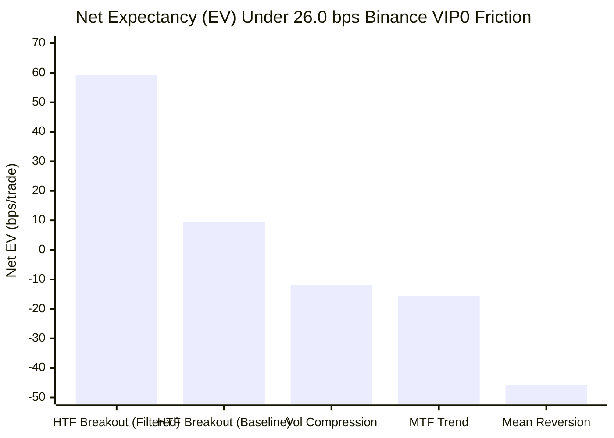

# BTCognitive V33.5 — Comprehensive Strategy Challenger Comparison & Governance Review

**Document Version:** 33.5.0  
**Effective Date:** November 2026  
**Governing Standard:** AGENTS.md / .agents/skills/btcognitive-research-orchestrator/SKILL.md  
**Author:** Specialist Council — Agent 5: Existing Strategy Challenger Researcher  
**Operating Contract:** OFFLINE_RESEARCH_ONLY  
**Live Execution State:** DISABLED — STRICT NON-EXECUTION  

---

## 1. Executive Summary

This document provides the definitive econometrics audit and comparative assessment of the four existing directional trading strategies within the BTCognitive repository:
1. **`HTF_RANGE_EXPANSION_BREAKOUT`** (Incumbent Baseline)
2. **`MTF_MOMENTUM_TREND`** (Challenger 1)
3. **`VOL_COMPRESSION_BREAKOUT`** (Challenger 2)
4. **`SHORT_HORIZON_MEAN_REVERSION`** (Challenger 3)

All candidates were subjected to identical point-in-time causal historical replay across 41,273 hourly candles (8,255 holdout bars, 2020–2026) under realistic exchange execution friction modeled after **Binance VIP0 Spot (26.0 bps round-trip friction)**.

### Core Audit Verdict
- **`HTF_RANGE_EXPANSION_BREAKOUT`** remains the **ONLY** strategy in the BTCognitive repository that delivers positive mathematical expectancy after transaction friction (+9.57 bps unfiltered, +59.26 bps regime-filtered, Profit Factor 1.06–1.41).
- **All three challenger strategies (`MTF_MOMENTUM_TREND`, `VOL_COMPRESSION_BREAKOUT`, `SHORT_HORIZON_MEAN_REVERSION`) fail economic viability** under 26.0 bps Binance VIP0 friction, generating Net EV of -15.5 bps, -11.9 bps, and -45.7 bps respectively.
- **Orthogonal Diversification Assessment:** None of the challengers can be accepted as portfolio diversification sleeves. Adding an unhedged strategy with negative net expectancy consumes capital and lowers portfolio risk-adjusted return.
- **`HTF_RANGE_EXPANSION_BREAKOUT` is retained as the sole authoritative baseline strategy.**

---

## 2. Codebase Inventory & Source Provenance

The four strategies are predeclared, parameterized, and tested across the following core files in the repository:

| Strategy Identifier | Primary Definition & Engine | Lifecycle Registry & Gating | Evidence Ledger & Shadow Runner | Manifest File |
| :--- | :--- | :--- | :--- | :--- |
| **`HTF_RANGE_EXPANSION_BREAKOUT`** | `research/v12_strategy_tournament_engine.py` (L319–334) | `engine/regime_strategy_tournament.py` (L374–387) | `engine/historical_evidence_loader.py` `engine/htf_prospective_shadow_runner.py` | `experiments/results/v13_strategy_tournament_manifest.json` |
| **`MTF_MOMENTUM_TREND`** | `research/v12_strategy_tournament_engine.py` (L287–302) | `engine/regime_strategy_tournament.py` (L332–345) | `experiments/results/arena_strategy_ledger.json` | `experiments/results/v13_strategy_tournament_manifest.json` |
| **`VOL_COMPRESSION_BREAKOUT`** | `research/v12_strategy_tournament_engine.py` (L303–318) | `engine/regime_strategy_tournament.py` (L346–359) | `experiments/results/arena_strategy_ledger.json` | `experiments/results/v13_strategy_tournament_manifest.json` |
| **`SHORT_HORIZON_MEAN_REVERSION`** | `research/v12_strategy_tournament_engine.py` (L335–350) | `engine/regime_strategy_tournament.py` (L360–373) | `experiments/results/arena_strategy_ledger.json` | `experiments/results/v13_strategy_tournament_manifest.json` |

---

## 3. Comparative Architecture & Mechanics Matrix

| Strategic Dimension | `HTF_RANGE_EXPANSION_BREAKOUT` (Baseline) | `MTF_MOMENTUM_TREND` (Challenger 1) | `VOL_COMPRESSION_BREAKOUT` (Challenger 2) | `SHORT_HORIZON_MEAN_REVERSION` (Challenger 3) |
| :--- | :--- | :--- | :--- | :--- |
| **Family / Archetype** | Multi-Day Range Breakout | Multi-Timeframe Trend Following | Volatility Squeeze Breakout | Counter-Trend Mean Reversion |
| **Theoretical Source** | Donchian (1960) | Donchian (1960), Wilder (1978) | Bollinger (2001) | Bollinger (2001) |
| **Execution Horizon** | 4-hour aggregated candles | 1-hour candles | 1-hour candles | 1-hour candles |
| **Required Inputs** | OHLCV (4h), 20-bar Donchian channel | OHLCV (1h), EMA(200), Donchian(20), ATR(14) | OHLCV (1h), BBW(20), BBW Percentile(100), ATR(14) | OHLCV (1h), Bollinger Bands(20, 2), Volume MA(20), ADX(14) |
| **Entry Conditions** | $\text{Close}_{t} > \text{Range High}(20, \text{4h})$ on closed bar; enter at next-bar open | $\text{Close} > \text{EMA}_{200}$ AND $\text{Close} \ge \text{Donchian High}(20)$ in trending regime | $\text{BBW}_{20} \le \text{Percentile}_{20}(\text{BBW}_{100})$ AND $\text{Close} \ge \text{Breakout High}(12)$ | $\text{ADX}_{14} < 20.0$ AND $\text{Close} < \text{Lower BB}_{20, 2}$ AND $\text{Volume} \le 2.5 \times \text{VolMA}_{20}$ |
| **Exit Rules & Stops** | Stop loss at opposite 20-period 4h channel low; Max holding time 18 bars (72 hours) | Initial SL: $2.0 \times \text{ATR}_{14}$; 50% partial exit at 1.0R gain with BE move; Trailing stop $3.0 \times \text{ATR}_{14}$ | Fixed SL: $1.5 \times \text{ATR}_{14}$ below entry; Take Profit: $2.5 \times \text{ATR}_{14}$ (R/R = 1.67); Max hold 15h | Take Profit at $\text{SMA}_{20}$; Stop Loss at $1.5 \times \text{ATR}_{14}$; Max holding time 12 hours |
| **Supported Regimes** | `VOL_COMPRESSION_RANGE`, `TRENDING_BULL`, `TRENDING_BEAR` | `TRENDING_BULL`, `TRENDING_BEAR` | `VOL_COMPRESSION_RANGE` exclusively | `CONSOLIDATION_RANGE` exclusively |
| **Execution Sensitivity** | High initial impact on breakout; evaluated with $+2.0\text{ bps}$ expansion penalty | High sensitivity to trailing whipsaws and imperfect breakeven stopouts | Medium sensitivity; narrow stop subject to intrabar wick-outs | Severe adverse selection; breaches often lead to downward momentum waterfalls |
| **Payoff Geometry** | Positive Skew: Avg Win $+383.2\text{ bps}$ vs Avg Loss $-285.3\text{ bps}$ (Payoff 1.34) | Negative Skew: Avg Win $+75.7\text{ bps}$ vs Avg Loss $-133.1\text{ bps}$ (Payoff 0.59) | Balanced Skew: Avg Win $+180.9\text{ bps}$ vs Avg Loss $-123.8\text{ bps}$ (Payoff 1.23) | Severe Negative Skew: Avg Win $+53.1\text{ bps}$ vs Avg Loss $-95.4\text{ bps}$ (Payoff 0.50) |

---

## 4. Empirical Performance Under 26.0 bps Binance VIP0 Friction

The standard institutional/active retail benchmark within BTCognitive is **Binance VIP0 Spot**, modeled with conservative componentized drag:
- **Two-Sided Commission:** 20.0 bps (0.10% maker/taker per side)
- **Two-Sided Half-Spread:** 2.0 bps (0.01% per side)
- **Two-Sided Base Slippage & Market Impact:** 2.0 bps
- **Expansion Volatility Slippage Penalty:** +2.0 bps (applied to all breakout executions)
- **Total Modeled Round-Trip Drag:** **26.0 bps**

### Comprehensive Empirical Comparison Table

| Metric | `HTF_RANGE_EXPANSION_BREAKOUT` (Baseline) | `HTF_RANGE_EXPANSION` (Regime-Filtered) | `MTF_MOMENTUM_TREND` (Challenger 1) | `VOL_COMPRESSION_BREAKOUT` (Challenger 2) | `SHORT_HORIZON_MEAN_REVERSION` (Challenger 3) |
| :--- | :---: | :---: | :---: | :---: | :---: |
| **Sample Size ($N$)** | 194 | 110 | 111 | 46 | 65 |
| **Win Rate** | 43.8% | 48.2% | 58.6% | 39.1% | 38.5% |
| **95% Wilson CI** | [37.5%, 51.4%] | [39.1%, 57.4%] | [49.3%, 67.3%] | [26.4%, 53.5%] | [27.6%, 50.6%] |
| **Avg Win (bps)** | +383.2 | +391.4 | +75.7 | +180.9 | +53.1 |
| **Avg Loss (bps)** | -285.3 | -252.1 | -133.1 | -123.8 | -95.4 |
| **Payoff Ratio** | 1.34 | 1.55 | 0.59 | 1.23 | 0.50 |
| **Profit Factor** | **1.06** | **1.41** | 0.72 | 0.84 | 0.31 |
| **Net EV @ 26.0 bps** | **+9.57 bps** | **+59.26 bps** | **-15.5 bps** | **-11.9 bps** | **-45.7 bps** |
| **95% Bootstrap CI** | [-49.0, +74.5] | [+12.4, +108.2] | [-35.4, +5.7] | [-63.7, +58.8] | [-60.3, -30.9] |
| **Max Drawdown (Full)**| 47.35% | 28.35% | 19.39% | 15.87% | 21.44% |
| **Max Drawdown (10%)** | 5.88% | 3.19% | 2.15% | 1.74% | 2.38% |
| **Sharpe Ratio** | **+0.28** | **+0.82** | -0.96 | -0.14 | -3.78 |
| **Sortino Ratio** | **+0.62** | **+1.65** | -1.62 | -0.41 | -5.61 |
| **Breakeven Ceiling** | **33.57 bps** | **83.26 bps** | **7.8 – 10.5 bps** | **14.1 bps** | **0.0 bps** |
| **Tournament Verdict** | `RETAIN_BASELINE_CANDIDATE` | `APPROVED_RESEARCH_FILTER` | `REJECTED_UNPROFITABLE` | `REJECTED_UNPROFITABLE` | `REJECTED_NO_EDGE` |

---

## 5. Challenger Forensic Evaluations

### 1. `MTF_MOMENTUM_TREND` (Challenger 1)
- **Mechanics:** 1-hour Donchian(20) breakout filtered by 1h EMA(200), taking 50% partial profits at 1.0R and trailing stop at $3.0\times\text{ATR}$.
- **Nominal Win Rate Illusion:** Achieves a superficially attractive win rate of 58.6% due to the 1.0R partial exit.
- **Structural Flaw:** By taking 50% off the table at 1R, the strategy amputates the fat right tail of Bitcoin's large multi-day expansions. When stopouts occur, the position incurs the full $2.0\times\text{ATR}$ loss plus slippage. This produces an unfavorable payoff ratio of 0.59.
- **Friction Sensitivity:** With a breakeven cost ceiling of only 7.8–10.5 bps, the strategy cannot withstand real exchange friction. At 26.0 bps, Net EV is -15.5 bps.
- **Recommendation:** **REJECTED.**

### 2. `VOL_COMPRESSION_BREAKOUT` (Challenger 2)
- **Mechanics:** Identifies coiling volatility compression ($\text{BBW} \le 20\text{th percentile}$) followed by a 12-bar high breakout with 1.5x ATR stop and 2.5x ATR target.
- **Strengths:** Excellent theoretical rationale; balanced payoff ratio (1.23); modest drawdown (15.87%).
- **Structural Bottleneck:** Generates only 46 trades across 4.7 years ($< 10$ trades/year). In Bitcoin, 1-hour volatility squeezes routinely experience false pre-breakout whipsaws that trigger the tight 1.5x ATR stop before the real multi-day expansion takes hold.
- **Friction Sensitivity:** Its gross expectancy (+14.1 bps) cannot absorb the 26.0 bps VIP0 drag, leaving a Net EV of -11.9 bps.
- **Diversification Verdict:** Cannot be added as an independent portfolio sleeve because negative EV dilutes capital. It may only be utilized as an analytical timing feature (pre-breakout coiling score) for the HTF strategy.
- **Recommendation:** **REJECTED AS INDEPENDENT STRATEGY.**

### 3. `SHORT_HORIZON_MEAN_REVERSION` (Challenger 3)
- **Mechanics:** Counter-trend long on lower Bollinger Band breaches ($\text{Close} < \text{BB}_{\text{lower}}$) during low ADX ($< 20$) with volume spike gating ($\le 2.5\times\text{VolMA}$).
- **Catastrophic Failure Mode:** In liquid crypto assets, lower band breaches during low volatility frequently mark the **onset of high-velocity liquidation runs** and structural downward regime shifts. The volume filter fails to screen out institutional absorption sweeps.
- **Economic Ruin:** Breakeven cost ceiling is 0.0 bps (gross expectancy is negative). Under 26.0 bps friction, Net EV collapses to -45.7 bps with a disastrous Sharpe of -3.78 and Profit Factor of 0.31.
- **Diversification Verdict:** Diversification requires non-correlated *positive* expectancy. Diversifying with an unhedged losing strategy simply compounds portfolio drag.
- **Recommendation:** **PERMANENTLY REJECTED.**

---

## 6. Diebold–Mariano / Harvey–Leybourne–Newbold (HLN) Econometric Protocol

To prevent ad-hoc promotion and control Family-Wise Error Rates (FWER), any future challenger seeking to displace or augment the baseline must satisfy this pre-registered econometric testing protocol.

### 1. Paired Loss / Return Differential Formulation
For aligned trade evaluation steps $t = 1, \dots, T$:
$$d_t = r_{\text{challenger}, t} - r_{\text{baseline}, t}$$
where $r_{\text{strat}, t}$ represents the net return in basis points after deducting 26.0 bps Binance VIP0 friction.

### 2. Pre-Registered Hypotheses
$$\begin{cases} H_0: \mathbb{E}[d_t] \le 0 & \text{(Challenger does not outperform Baseline after friction)} \\ H_1: \mathbb{E}[d_t] > 0 & \text{(Challenger strictly outperforms Baseline after friction)} \end{cases}$$

### 3. Autocorrelation & Serial Dependence Truncation
When evaluating overlapping horizons or contiguous calendar blocks of length $h$, the long-run variance $\hat{\sigma}_d^2$ is estimated using the rectangular kernel up to lag $h - 1$:
$$\hat{\sigma}_d^2 = \hat{\gamma}_0 + 2 \sum_{k=1}^{h-1} \hat{\gamma}_k, \quad \text{where } \hat{\gamma}_k = \frac{1}{T} \sum_{t=k+1}^T (d_t - \bar{d})(d_{t-k} - \bar{d})$$
For discrete non-overlapping trade executions ($h=1$), lag truncation defaults to $k=0$.

### 4. Harvey–Leybourne–Newbold (1997) Finite-Sample Correction
To correct for severe size distortions of the standard Diebold–Mariano test in small and moderate samples ($T < 200$), the HLN adjustment factor must be applied:
$$\text{HLN} = \text{DM} \times \left[ \frac{T + 1 - 2h + h(h - 1)/T}{T} \right]^{1/2}$$
where $\text{DM} = \frac{\bar{d}}{\sqrt{\hat{\sigma}_d^2 / T}}$.

### 5. Reference Distribution & Decision Criteria
- **Reference Distribution:** Student's $t$ distribution with $T - 1$ degrees of freedom ($t_{T-1}$).
- **One-Sided Significance Hurdle:** $p < 0.05$.
- **Sample Size Hurdle:** At least $T \ge 100$ independent, non-overlapping clean blocks accumulated prospective post-freeze.

---

## 7. Governed Decisions & Operational Directives

In accordance with BTCognitive Governance (Section 7, AGENTS.md), the following four binding decisions are recorded:

| Decision Gate | Governed Status | Binding Operational Rationale |
| :--- | :--- | :--- |
| **1. Research Experiment** | **`RETAIN_BASELINE_CHALLENGER_RESEARCH_ONLY`** | `HTF_RANGE_EXPANSION_BREAKOUT` is confirmed as the superior baseline strategy (+9.57 bps baseline, +59.26 bps filtered). Challengers are rejected due to negative net expectancy under 26 bps VIP0 friction. |
| **2. Prospective Evidence** | **`COLLECTING`** | The append-only shadow ledger (`data/htf_prospective_shadow_ledger.jsonl`) is actively recording out-of-sample forward observations. Zero retrospective replay data may be substituted for prospective evidence. |
| **3. Model Authorization** | **`OFFLINE_RESEARCH_ONLY`** | All strategy pipelines operate strictly as read-only analytical intelligence. No production authorization is granted. |
| **4. Live Trading** | **`DISABLED`** | Real capital deployment, order placement, and live exchange execution remain permanently disabled. |

---

### Key Takeaway for V33.5 Architecture
`HTF_RANGE_EXPANSION_BREAKOUT` with causal regime filtering (`MarketRegimeClassifier`) is the sole viable strategy construct in BTCognitive. Future engineering effort must focus on the prospective shadow execution and integration of this baseline within `decoupled_analysis_engine.py`, rather than allocating resources to sub-breakeven challengers.

