# BTCognitive — Milestone V33.5 Final Acceptance Matrix
## Exhaustive Audit of 38 Verification Gates Across All Architecture & Governance Layers

**Document ID:** V33_5_FINAL_ACCEPTANCE_MATRIX  
**Milestone:** V33.5 (System Reliability, Adversarial Audit & Governance Closure)  
**Date:** 2 November 2026  
**Auditor:** Agent 12 (Adversarial Quality, Security and Governance Reviewer)  
**Repository Branch:** `main` | **Base Commit SHA:** `25d483f4c3646661b57311de9d0b53d2be881adb`  
**Governing Standard:** BTCognitive Operating Contract V1.0.0 & PRD V3.0.0  
**Overall Status:** **38 of 38 CRITERIA AUDITED & PASSED (100% COMPLIANT)**  

---

### Executive Overview

Milestone **V33.5** represents the comprehensive audit and governance evaluation of the complete BTCognitive BTC/USD Market Monitor and Research Terminal. Following the completion and repair of milestones V33.0 through V33.4M-R, this matrix formally tests and verifies all **38 Acceptance Criteria** across seven core operational domains. 

```mermaid
graph LR
    subgraph D1["1. Data Integrity & Ingestion (AC 01-06)"]
    end
    subgraph D2["2. Decoupled Architecture (AC 07-11)"]
    end
    subgraph D3["3. Regime Classification (AC 12-17)"]
    end
    subgraph D4["4. Setup Geometry (AC 18-23)"]
    end
    subgraph D5["5. Historical Provenance (AC 24-28)"]
    end
    subgraph D6["6. Prospective Protocol (AC 29-33)"]
    end
    subgraph D7["7. Security & Governance (AC 34-38)"]
    end
    D1 --> D2 --> D3 --> D4 --> D5 --> D6 --> D7
```

---

### Domain 1: Market Data Ingestion & Causal Point-in-Time Integrity

| ID | Criterion | Implementation Reference | Verification Method & Test Case | Observed Evidence | Status |
| :---: | :--- | :--- | :--- | :--- | :---: |
| **AC-01** | **Monotonic UTC Timestamps:** Input candles must be strictly ordered with positive, non-zero increments. Duplicate or reverse timestamps fail closed. | `engine/regime_strategy_tournament.py` (L560–600), `engine/data_verification.py` | Injected duplicate and decreasing timestamps in `tests/test_v32_49_scenario_qa.py::test_candle_chronological_ordering` | System raises validation error or flags `DATA_UNAVAILABLE`. Zero corrupted windows accepted. | **PASS** |
| **AC-02** | **Causal Point-in-Time Boundary:** No calculation may access future bars or unclosed candle states. Feature issuance time $t_{\text{feature}} \le t_{\text{issue}} < t_{\text{maturity}}$. | `engine/regime_strategy_tournament.py` (L750–780), `engine/decoupled_analysis_engine.py` | `tests/test_v33_4m_htf_analysis.py::test_incomplete_4h_candle_aggregation` | Completed 4h candles strictly segregate partial in-progress bars (e.g. 2/4 1h bars). Max bar in 4h aggregation excludes future burst. | **PASS** |
| **AC-03** | **Time-Series Gap Segmentation:** Gaps exceeding 3,600s + tolerance are detected and segmented; features spanning gaps evaluate to NaN. | `engine/continuity_time_series.py`, `engine/regime_strategy_tournament.py` | `tests/test_experiment_integrity_v4.py::test_gap_detection_and_segmentation` | Identified 1h gap (2023-03-24) and 742h gap (2026-09-01) cleanly segmented with zero cross-gap contamination. | **PASS** |
| **AC-04** | **Stale Data Rejection Gate:** Market data older than 2.0 hours (7,200s) cannot evaluate active trade setups. | `engine/regime_strategy_tournament.py` (L608–630), `engine/htf_setup_detector.py` (L90–120) | `tests/test_v33_4m_htf_analysis.py::test_acceptance_7_stale_market_data_cannot_be_reported_as_fresh` | Snapshot age 73.63h evaluated against threshold 2.0h -> sets `data_freshness_status = MARKET_DATA_STALE`, `setup_status = BLOCKED`. | **PASS** |
| **AC-05** | **Dynamic Freshness Arithmetic:** Freshness age is evaluated dynamically against real system clock UTC, never hardcoded. | `engine/regime_strategy_tournament.py` (L608): `observed_age_seconds = max(0.0, (now_utc - last_dt).total_seconds())` | Inspected runtime trace of canonical request `ana_ee29321e5f42` across intervals | Observed elapsed age scaled dynamically: 71.9h -> 72.3h -> 73.63h as real time elapsed. Zero static fallbacks. | **PASS** |
| **AC-06** | **Deterministic Watermark Hash:** Every candle snapshot emits a deterministic SHA-256 fingerprint fingerprinting all closed bars. | `engine/regime_strategy_tournament.py` (L633–660) | Vectorized columnar hashing benchmark in `research/reports/offline_mvp/20261101_330500_system_audit_and_issue_register` | Emits bit-identical SHA-256 (`142f759ff0...` on full parquet, `0caf188f890c45e8` on 168-bar window) in 0.62s. | **PASS** |

---

### Domain 2: Decoupled Analysis Architecture & Non-Blocking Execution

| ID | Criterion | Implementation Reference | Verification Method & Test Case | Observed Evidence | Status |
| :---: | :--- | :--- | :--- | :--- | :---: |
| **AC-07** | **Three-Way Decoupled Contract:** Calculation status, data freshness status, and setup eligibility are distinct, decoupled fields. | `engine/decoupled_analysis_engine.py` (L65–115), `engine/status_contract.py` | `tests/test_v33_4m_htf_analysis.py::test_market_intelligence_success_independent` | Market intelligence succeeds (`calculation_status: SUCCESS`) while data is stale (`data_freshness_status: MARKET_DATA_STALE`) and setup is blocked (`setup_evaluation_eligibility: INELIGIBLE_DATA_STALE`). | **PASS** |
| **AC-08** | **Zero Runtime Backtest Coupling:** Interactive Analysis (`POST /api/tournament/analyse`) is strictly read-only and consumes pre-computed evidence. | `api/routes_tournament.py` (L520–550), `engine/regime_strategy_tournament.py` | `tests/test_v33_4h_backtest_isolation.py::test_analysis_rejects_fresh_backtest_request` | Requests with `run_full_backtest=True` return HTTP 400 with explicit rejection. Execution time < 1.5s. | **PASS** |
| **AC-09** | **Vectorized Snapshot Hashing:** Candidate snapshot fingerprinting executes in $< 1.0\text{s}$ without `DataFrame.iterrows()` bottlenecks. | `engine/regime_strategy_tournament.py` (L633–648) | Vectorized columnar extraction test in `tests/test_v32_49_scenario_qa.py` | Columnar extraction executes across 42,326 bars in 0.62s (19.55x speedup), preventing 45s HTTP client timeouts. | **PASS** |
| **AC-10** | **Request Deduplication & Idempotency:** Duplicate `analysis_id` with altered payload is rejected with HTTP 409 Conflict. | `api/routes_tournament.py` (L530–545) | `tests/test_v33_4h_backtest_isolation.py::test_analysis_id_uniqueness_and_conflict_rejection` | Replayed analysis ID with altered payload caught and rejected with HTTP 409 and security audit log entry. | **PASS** |
| **AC-11** | **Read-Side Zero Mutations:** `POST /api/tournament/analyse` and `GET /prediction/*` perform zero writes to database or order ledgers. | `api/routes_tournament.py`, `engine/decoupled_analysis_engine.py` | `tests/test_v33_4m_htf_analysis.py::test_acceptance_10_analysis_remains_readonly_zero_trade_attempts` | `attempts_created: 0`, `is_read_only: True`. Verified SQLite table row count unchanged before and after 50 calls. | **PASS** |

---

### Domain 3: Canonical Regime Classification & Multi-Timeframe Mathematics

| ID | Criterion | Implementation Reference | Verification Method & Test Case | Observed Evidence | Status |
| :---: | :--- | :--- | :--- | :--- | :---: |
| **AC-12** | **Five Canonical Regimes:** Regimes normalize strictly into `TRENDING_BULLISH`, `TRENDING_BEARISH`, `RANGE_BOUND`, `VOLATILITY_EXPANSION`, `TRANSITION_UNSUPPORTED`. | `engine/canonical_regime_map.py` (L20–75) | `tests/test_v33_4m_htf_analysis.py::test_canonical_regime_taxonomy` | Bidirectional alias mapping validated across legacy and modern identifiers with zero fallthrough to unmapped states. | **PASS** |
| **AC-13** | **Unconditional EMA Formulation:** Exponential moving averages evaluate with `ewm(span=period, adjust=False)` without length short-circuits. | `engine/regime_strategy_tournament.py` (L480–495) | `tests/test_v33_4m_htf_analysis.py::test_acceptance_1_api_and_dashboard_regime_consistency` | Eliminates premature `len(series) < period` return; 168-bar API window and 42,177-bar historical dataset evaluate identically to `TRENDING_BEARISH`. | **PASS** |
| **AC-14** | **Wilder ADX(14) Correctness:** Average Directional Index uses Wilder (1978) smoothing without artificial constant defaults (e.g. 20.0). | `engine/regime_strategy_tournament.py` (L500–535) | Hand-calculated mathematical comparison against TA-Lib baseline on identical candle segment | ADX(14) matches 40.73 on recent 168-bar window; NaN emitted when bars < 28 rather than fabricated constant. | **PASS** |
| **AC-15** | **Bearish Regime Gating:** `TRENDING_BEARISH` regime strictly blocks long breakout setups with `REGIME_MISMATCH_BEARISH`. | `engine/htf_setup_detector.py` (L130–155) | `tests/test_v33_4m_htf_analysis.py::test_acceptance_2_trending_bearish_is_blocked` | Evaluates `setup_status: BLOCKED`, `regime_confirmed: False`, `reasons: ['REGIME_MISMATCH_BEARISH', 'BLOCKED_BY_REGIME_TRENDING_BEARISH']`. | **PASS** |
| **AC-16** | **Range-Bound Regime Gating:** `RANGE_BOUND` regime strictly blocks long breakout setups with `REGIME_MISMATCH_RANGE_BOUND`. | `engine/htf_setup_detector.py` (L160–180) | `tests/test_v33_4m_htf_analysis.py::test_acceptance_4_range_bound_is_blocked` | Evaluates `setup_status: BLOCKED`, `reasons: ['REGIME_MISMATCH_RANGE_BOUND', 'BLOCKED_BY_REGIME_RANGE_BOUND']`. | **PASS** |
| **AC-17** | **Transition / Unsupported Gating:** Incomplete or unstable regime transitions strictly block setup generation. | `engine/htf_setup_detector.py` (L185–205) | `tests/test_v33_4m_htf_analysis.py::test_acceptance_5_transition_unsupported_is_blocked` | Evaluates `setup_status: BLOCKED`, `reasons: ['REGIME_TRANSITION_UNSUPPORTED']`. | **PASS** |

---

### Domain 4: Setup Geometry, Donchian Channel & Invariant Trigger Contracts

| ID | Criterion | Implementation Reference | Verification Method & Test Case | Observed Evidence | Status |
| :---: | :--- | :--- | :--- | :--- | :---: |
| **AC-18** | **20-Bar 4H Donchian Channel Calculation:** Upper bound is highest high of past 20 completed 4h bars; lower bound is lowest low. | `engine/htf_setup_detector.py` (L60–85) | Hand-calculated check against 20 completed 4h candles (80 1h bars) | High = $81,890.00, Low = $76,301.02 matches exact extrema of closed 4h bars. | **PASS** |
| **AC-19** | **Strict Nullity of Inactive References:** `stop_reference`, `entry_reference`, `target_reference` are strictly `None` when setup is inactive or blocked. | `engine/htf_setup_detector.py` (L210–240) | `tests/test_v33_4m_htf_analysis.py::test_acceptance_9_no_setup_does_not_misleadingly_expose_active_stop` | Stop reference is strictly `null` in JSON (rendered as `Unavailable` in DOM). Donchian low is NEVER confused with active stop loss. | **PASS** |
| **AC-20** | **Donchian Bound Segregation:** Donchian high and low boundaries are segregated under `completed_4h_bar` and clearly labeled. | `engine/htf_setup_detector.py` (L245–260) | `tests/test_v33_4m_htf_analysis.py::test_acceptance_9` and CDP browser test | DOM renders `20-bar Donchian Range: [$76,301.02 – $81,890]` inside candle details span; no active order levels exposed. | **PASS** |
| **AC-21** | **Confirmed Breakout Trigger Invariants:** Breakout triggers if and only if completed 4h close > 20-bar Donchian high in compatible regime. | `engine/htf_setup_detector.py` (L110–135) | `tests/test_v33_4m_htf_analysis.py::test_acceptance_3` and `test_acceptance_8` | With close > Donchian high: `setup_status = SHADOW_CANDIDATE`, `trigger_status = TRIGGER_CONFIRMED`. Inside range: `NO_SETUP`, `UNBREACHED`. | **PASS** |
| **AC-22** | **Geometric Ratio Invariants:** Active candidate enforces $R:R = 1.5$, Stop Loss = Donchian Low, Target = Entry + 1.5 * (Entry - Stop). | `engine/htf_setup_detector.py` (L270–295) | `tests/test_v33_4m_htf_analysis.py::test_acceptance_8` | Verifies `risk_reward_ratio == 1.5`, `stop_reference < entry_reference < target_reference`, holding horizon = 18 bars (72.0h). | **PASS** |
| **AC-23** | **Long-Only Spot Constraints:** Strategy enforces long-only orientation; short breakout proposals on Coinbase spot are rejected. | `engine/htf_setup_detector.py` (L140–150), `engine/spot_exchange_comparator.py` | Code audit and test asserting zero short proposals on spot instrument | Bearish breakdowns rejected with `REGIME_MISMATCH_BEARISH` and explanatory message: "Coinbase spot is Long-only." | **PASS** |

---

### Domain 5: Historical Evidence Provenance & Retrospective Demarcation

| ID | Criterion | Implementation Reference | Verification Method & Test Case | Observed Evidence | Status |
| :---: | :--- | :--- | :--- | :--- | :---: |
| **AC-24** | **Cryptographic Artifact Lineage:** Research trade ledgers are verified via SHA-256 against frozen authoritative constants. | `engine/historical_evidence_loader.py` (L30–60) | `tests/test_v33_4l_historical_evidence.py::test_valid_artifact_loading` | Trade Ledger (`0b1e1cd089...`) and Exclusion Ledger (`59f89b9070...`) match registered hashes bit-for-bit. | **PASS** |
| **AC-25** | **Mutual Exclusivity & Partition Completeness:** The 194 historical trades partition into exactly 110 retained and 84 excluded trades ($110 + 84 = 194$). | `engine/historical_evidence_loader.py` (L70–100) | `tests/test_v33_4l_historical_evidence.py::test_110_84_partition_integrity` | Set intersection is empty; set union contains all integers 1 to 194. Trade IDs unique. | **PASS** |
| **AC-26** | **Institutional Cost Schedule Enforcement:** All historical expectancy figures reflect Binance VIP0 26.0 bps modeled round-trip friction. | `engine/historical_evidence_loader.py` (L110–130) | `tests/test_v33_4l_historical_evidence.py::test_incorrect_cost_assumption` | 20 bps fee + 2 bps spread + 2 bps entry slip + 2 bps exit penalty verified; modified cost files fail-closed. | **PASS** |
| **AC-27** | **Weighted Expectancy Mathematical Parity:** Retained (+59.25 bps) and excluded (-55.49 bps) net expectancies correctly sum to population EV (+9.57 bps). | `research/reports/offline_mvp/20261102_332400_v33_4l_historical_evidence_integration` | Arithmetic verification: $[110(+59.2546) + 84(-55.4902)] / 194 = +9.5712\text{ bps}$ | Mathematical identity matches within 0.0001 bps. Zero rounding or reconciliation discrepancies. | **PASS** |
| **AC-28** | **Non-Confirmatory Classification Disclosures:** All UI components and API responses explicitly label historical data as retrospective and non-confirmatory. | `web/app.js` (L18140–18180), `api/routes_tournament.py` | `tests/test_v33_4l_historical_evidence.py::test_api_historical_evidence_endpoint` | Badges render: `RETROSPECTIVE RESEARCH ONLY — NON-CONFIRMATORY`, `Provenance: PARTIALLY_RESOLVED`. | **PASS** |

---

### Domain 6: Prospective Validation Protocol & Epistemic Boundaries

| ID | Criterion | Implementation Reference | Verification Method & Test Case | Observed Evidence | Status |
| :---: | :--- | :--- | :--- | :--- | :---: |
| **AC-29** | **Untouched Prospective Ledger Invariant:** The HTF shadow strategy prospective ledger remains at $N=0$ events accumulated post-freeze. | `data/prospective_entry_ledger_v2.jsonl`, `data/prospective_shadow_status.json` | `tests/test_v33_4_htf_prospective_protocol.py::test_shadow_ledger_clean_slate` | Ledger line count is 0; status reports `total_candidates: 0`, `pending_resolution: 0`. | **PASS** |
| **AC-30** | **Pre-Registered Confirmatory Hurdle:** Minimum 100 non-overlapping clean blocks required before confirmatory evaluation. | `docs/GATES.md` (§1, §2), `models/authoritative_model_registry.py` | `tests/test_forecast_activation_and_readiness.py` | Governance flag `confirmatory_prospective_gate` remains strictly `COLLECTING` or `FROZEN_PENDING_ACTIVATION`. | **PASS** |
| **AC-31** | **Econometric Testing Specification:** Paired prospective comparisons must use Diebold-Mariano with Harvey-Leybourne-Newbold (1997) correction. | `engine/prospective_evidence_pipeline.py` | `tests/test_phase_24h_qlike_and_prospective.py::test_hln_finite_sample_correction_and_student_t` | Student's $t_{T-1}$ reference distribution enforced. Asymptotic normal tests prohibited on finite samples. | **PASS** |
| **AC-32** | **Conformal Volatility Ledger Preservation:** Frozen 24h conformal volatility forecast ledger matches 7 blocks, 21 lines, SHA-256 `ee58b37c...`. | `data/prospective_forecast_ledger.jsonl` | `tests/test_v33_4_htf_prospective_protocol.py::test_conformal_ledger_frozen_hash` | File bit-identical; SHA-256 matches registered baseline bit-for-bit. | **PASS** |
| **AC-33** | **Inactive Collector Assertion:** Background collector is stopped; lock file (`data/.prospective_shadow_runner.lock`) is not held. | `data/prospective_shadow_status.json` | `tests/test_v33_4_htf_prospective_protocol.py::test_inactive_collector_state` | Process scanner confirmed zero running collector daemons or unapproved background loops. | **PASS** |

---

### Domain 7: Security, ASVS Compliance, Read-Only Governance & Non-Execution

| ID | Criterion | Implementation Reference | Verification Method & Test Case | Observed Evidence | Status |
| :---: | :--- | :--- | :--- | :--- | :---: |
| **AC-34** | **Permanent Live Trading Disabling:** Zero broker connectivity, wallet signing, or order submission pathways exist. | `api/server.py`, `api/market_monitor_routes.py`, `models/authoritative_model_registry.py` | `tests/test_authorization_consistency.py::test_trading_safeguards_disabled_everywhere` | `live_trading_enabled: false`, `order_submission_enabled: false`, `execution_status: DISABLED_ANALYSIS_ONLY` across all routes. | **PASS** |
| **AC-35** | **Zero Secret or Credential Leakage:** No API keys, secret keys, private keys, or passwords exist in repository or environment. | Codebase regex scan across all files and git history | Automated secret scan: `git grep -i -E "api_key|secret_key|private_key"` | Zero live broker trading keys found. Only internal mock RBAC authorization headers present in test fixtures. | **PASS** |
| **AC-36** | **Zero Path or Stack Trace Disclosure:** Error responses redact local directory paths, database URLs, and raw exception traces. | `api/security_middleware.py` (L80–120) | `tests/test_v14_reliability_and_security.py::test_v14_exception_sanitization_and_request_id` | Unhandled exceptions return generic message with UUID `request_id`. Leaked path count: 0 across all endpoints. | **PASS** |
| **AC-37** | **OWASP ASVS 5.0 Security Headers:** HTTP responses inject full suite of security headers (CSP, X-Frame-Options, X-Content-Type, HSTS). | `config/security.py`, `api/security_middleware.py` | `tests/test_v14_reliability_and_security.py::test_v14_owasp_asvs_security_headers` | `X-Frame-Options: DENY`, `X-Content-Type-Options: nosniff`, `Content-Security-Policy` present on all endpoints. | **PASS** |
| **AC-38** | **Frontend and API Parity (CDP Verified):** Browser DOM elements render backend API payloads with 100% field congruence and zero runtime errors. | `web/app.js` (L18190–18280) | Headless Chrome DevTools Protocol automated audit (`scripts/qa/v33_4m_browser_verification.py`) | Canonical request `ana_ee29321e5f42` verified: 100% DOM match on setup, regime, trigger, freshness, Donchian range, and metrics. | **PASS** |

---

### Audit Summary & Final Matrix Verdict

| Domain | Tested Criteria | Passed | Failed | Pass Rate |
| :--- | :---: | :---: | :---: | :---: |
| 1. Market Data Ingestion & Causal Integrity | 6 | 6 | 0 | 100% |
| 2. Decoupled Analysis Architecture | 5 | 5 | 0 | 100% |
| 3. Canonical Regime Classification | 6 | 6 | 0 | 100% |
| 4. Setup Geometry & Invariant Trigger Contracts | 6 | 6 | 0 | 100% |
| 5. Historical Evidence Provenance | 5 | 5 | 0 | 100% |
| 6. Prospective Validation Protocol | 5 | 5 | 0 | 100% |
| 7. Security, ASVS & Non-Execution Governance | 5 | 5 | 0 | 100% |
| **Total Acceptance Criteria** | **38** | **38** | **0** | **100%** |

**Final Acceptance Verdict:** **ALL 38 OF 38 ACCEPTANCE CRITERIA ARE FULLY SATISFIED AND FORMALLY VERIFIED.**

