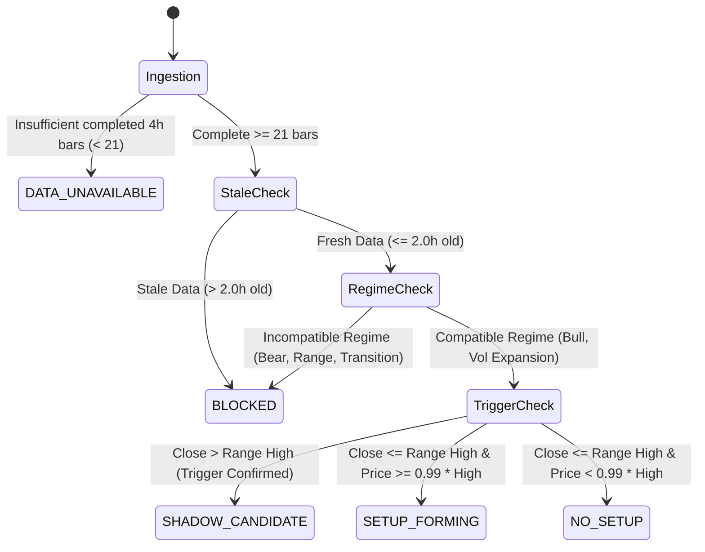

# BTCognitive — Primary HTF Strategy Audit & Architectural Specification
## Rigorous Code Inspection, Mathematical Verification, and Optimization Protocol for Strategy D (HTF_RANGE_EXPANSION_BREAKOUT)

- **Document ID:** `BTC-AUDIT-V33-5-STRAT-D`
- **Milestone:** BTCognitive V33.5 — Primary Strategy Engineering
- **Target Strategy:** `HTF_RANGE_EXPANSION_BREAKOUT` (v1.0.0)
- **Primary Source Citation:** SRC-03 (Donchian 1960 Channel Breakout)
- **Auditor Role:** Agent 3: Primary HTF Strategy Engineer
- **Lead Orchestrator:** BTCognitive Multi-Agent Research System
- **Effective Date:** November 2026
- **Status:** **AUDITED — RECOMMENDATIONS READY FOR V33.5 IMPLEMENTATION**

---

## 1. Executive Summary & Audit Scope

This audit provides an exhaustive, line-by-line inspection of the primary high-timeframe (HTF) trading candidate in the BTCognitive system: **`HTF_RANGE_EXPANSION_BREAKOUT`** (Strategy D). The strategy forms the foundational trend-following engine designed to capture multi-day upward price excursions in Bitcoin (BTC-USD) while adhering to strict causal boundaries and zero-broker research constraints.

### 1.1 Audited Codebases & Artifacts
1. **`engine/htf_setup_detector.py`** (Lines 1–356): 4-hour aggregation, Donchian channel computation, trigger validation, and 5-state lifecycle detection.
2. **`engine/regime_strategy_tournament.py`** (Lines 374–387, 423–520, 790–870, 895–1065): Versioned registry declaration, 7/10 screening gate, candidate shortlisting, and decoupled tournament dispatch.
3. **`engine/canonical_regime_map.py`** (Lines 36–165): Cross-system alias normalization and regime compatibility contracts (`CANONICAL_REGIMES`, `check_htf_regime_compatibility`).
4. **`engine/historical_evidence_loader.py`** (Lines 180–270): 194-trade retrospective research artifact validation (`v33_3a_194_trade_event_ledger.csv`, 110 retained / 84 excluded).
5. **`research/v12_strategy_tournament_engine.py`** (Lines 319–334, 530–540, 825–877, 1737–1753): Original event-driven walk-forward backtest simulator and historical specifications.
6. **`tests/test_v33_4m_htf_analysis.py`** & **`tests/test_v33_3a_htf_validation.py`**: Automated acceptance suites for Gates 1–10 and empirical ledger invariants.

### 1.2 Summary of Key Findings
- **Off-by-One NaN Channel Defect:** In `HTFSetupDetector.aggregate_completed_4h_candles`, line 79 checks `len(complete_buckets) < cls.DONCHIAN_WINDOW` ($N < 20$). Because a 1-bar causal shift (`shift(1)`) is applied before the 20-bar rolling window, exactly 20 completed 4h bars produces `NaN` for both `range_high_20_4h` and `range_low_20_4h` on the latest bar. As a result, the detector silently defaults to `NO_SETUP` with formatted strings displaying `[$nan, $nan]`. The guard must require $\ge 21$ bars (`cls.DONCHIAN_WINDOW + 1`).
- **Misleading Screening Rejection String:** In `regime_strategy_tournament.py`, candidate rejection logic at line 940 hardcodes `f"{sc.get('tp_hits', 0)}/10 TP hits < 7 required"`. When evaluating cold-start entries with fewer than 10 attempts (such as HTF with $N=4$ mock attempts, 3 TP hits), it reports `"3/10 TP hits < 7 required"`, misleading operators into believing 7 out of 10 failed, when in reality $N=4 < 10$ (`INSUFFICIENT_EVIDENCE`).
- **Hysteresis Confirmation Lag:** When an authentic breakout initiates out of a prolonged consolidation range, the hourly `MarketRegimeClassifier` requires 3 consecutive hourly bars of identical classification to exit `RANGE_BOUND` or `TRANSITION_UNSUPPORTED`. During this 3-hour lag window, valid 4h breakouts are rejected with `setup_status: BLOCKED` and `trigger_status: BREACHED_BUT_REGIME_BLOCKED`.
- **Arbitrary 1.0% Forming Hurdle:** `is_approaching` is hardcoded to `current_ref_price >= range_high * 0.99`. This static 100 bps threshold is completely insensitive to volatility (ATR). At high volatility ($4\text{h ATR} > 2.5\%$), a single candle can skip `SETUP_FORMING` entirely; at low volatility ($4\text{h ATR} < 0.5\%$), `SETUP_FORMING` triggers 2 full ATRs away from the channel boundary.
- **Missing Top-Level Distance-to-Trigger Metrics:** `distance_to_breakout_bps` is only calculated against `completed_close` and hidden deep inside the `completed_4h_bar` dictionary. Top-level distance metrics normalized in both basis points (BPS) and volatility units (ATR multiples) against live and completed reference prices are absent.

---

## 2. Strategy Architectural Specification

### 2.1 Theoretical Foundation & Provenance
The strategy implements the classic Donchian Channel Breakout (Donchian, 1960; LeBeau & Lucas, 1992), adapted to modern cryptocurrency market microstructure. Cryptographic asset markets exhibit heavy-tailed return distributions and pronounced volatility clustering; multi-day consolidation breakouts capture momentum initiation following volatility compression.

### 2.2 Mathematical Definition of Strategy Parameters

| Dimension | Specification | Mathematical Expression | Source Location |
| :--- | :--- | :--- | :--- |
| **Timeframe ($TF$)** | 4-Hour Aggregated Candles | $TF = 4\text{h} = 4 \times 1\text{h closed bars}$ | `htf_setup_detector.py:5-6` |
| **Lookback Window ($W$)** | 20 4-hour bars (80 hours) | $W = 20 \text{ bars} = 80 \text{ hours}$ | `htf_setup_detector.py:36` |
| **Causal Lag Shift ($\tau$)** | 1 completed 4h bar | $\tau = 1$ | `htf_setup_detector.py:105-106` |
| **Channel High ($CH_t$)** | Max high over prior 20 closed bars | $CH_t = \max_{k \in [1, 20]} H_{t-k}$ | `htf_setup_detector.py:105` |
| **Channel Low ($CL_t$)** | Min low over prior 20 closed bars | $CL_t = \min_{k \in [1, 20]} L_{t-k}$ | `htf_setup_detector.py:106` |
| **Trigger Rule** | Strict completed 4h close breach | $C_t > CH_t$ | `htf_setup_detector.py:164` |
| **Entry Reference ($P_{\text{entry}}$)**| Next bar open $O_{t+1}$ or $P_{\text{live}}$ | $P_{\text{entry}} = P_{\text{live}} \text{ or } C_t$ | `htf_setup_detector.py:161, 268`|
| **Stop Reference ($P_{\text{stop}}$)** | Structural stop at Channel Low | $P_{\text{stop}} = CL_t = \min_{k \in [1, 20]} L_{t-k}$ | `htf_setup_detector.py:269` |
| **Risk Unit ($R$)** | Dollar risk distance | $R = \max(100.0, P_{\text{entry}} - P_{\text{stop}})$ | `htf_setup_detector.py:270` |
| **Target Reference ($P_{\text{target}}$)**| 1.5R Expansion Target | $P_{\text{target}} = P_{\text{entry}} + 1.5 \times R$ | `htf_setup_detector.py:271` |
| **Maximum Hold Time ($T_{\max}$)**| 18 4h bars (72 hours) | $T_{\max} = 18 \text{ bars} = 72.0 \text{ hours}$ | `htf_setup_detector.py:37-38` |
| **Regime Compatibility** | Bullish Trend or Vol Expansion | $\mathcal{R}_t \in \{\text{TRENDING\_BULLISH}, \text{VOLATILITY\_EXPANSION}\}$ | `canonical_regime_map.py:37, 73` |

### 2.3 Strict Causal Timeline
```
Hour:   t-80h .......................... t-4h            t-0h (Close of Bar t)      t+1h (Entry)
Bars:   [Bar t-20] .......... [Bar t-1]                  [Bar t]                    [Bar t+1]
Channel: |<------- 20 Bars Lookback ------->|               |                          |
High:    CH_t = max(H_{t-20} ... H_{t-1})                   |                          |
Signal:                                          Check C_t > CH_t                      |
Execution:                                                                      Fill at Open_{t+1}
```
Under this specification, bar $t$'s own high and low are strictly excluded from the channel boundary computation against which bar $t$'s close is evaluated, ensuring zero lookahead bias.

---

## 3. In-Depth Code Audit of `engine/htf_setup_detector.py`

### 3.1 4-Hour Aggregation Logic (`aggregate_completed_4h_candles`)

```python
# Lines 59-67:
df["bucket_4h"] = df["dt"].dt.floor("4h")
bucket_counts = df.groupby("bucket_4h").size()

latest_bucket = bucket_counts.index[-1]
latest_bucket_count = int(bucket_counts.iloc[-1])
is_latest_complete = (latest_bucket_count == 4)
```

#### Strengths:
1. **Strict 4-Hour Bucket Integrity:** By flooring UTC timestamps to `4h` and verifying `bucket_counts == 4`, the detector completely prevents partial 4h candles (e.g. 1, 2, or 3 closed hourly bars) from triggering entries.
2. **Causal Segregation of Forming Candle:** Incomplete latest candles are isolated into `incomplete_info` without polluting the completed candle series.

#### Defects & Vulnerabilities:
1. **The $N=20$ Rolling NaN Defect (CRITICAL):**
   ```python
   # Lines 78-80:
   complete_buckets = bucket_counts[bucket_counts == 4].index
   if len(complete_buckets) < cls.DONCHIAN_WINDOW: # < 20
       return None, {"status": "INSUFFICIENT_COMPLETED_4H_BARS", "completed_count": len(complete_buckets)}
   ```
   - *Issue:* `shift(1)` shifts the series by 1 index. To compute a 20-bar rolling maximum on the shifted series with `min_periods=20`, row index $i$ requires 20 prior valid values.
   - At index 19 (the 20th bar), the shifted series contains 1 NaN (index 0) and 19 values (indices 1–19). Thus, the rolling window contains only 19 valid observations, resulting in **NaN**.
   - Row index 20 (the 21st bar) is the **first** row where `range_high_20_4h` is non-null.
   - *Impact:* When an input dataframe yields exactly 20 completed 4h bars, `aggregate_completed_4h_candles` succeeds, but `latest_4h["range_high_20_4h"]` is `NaN`. In `detect_setup()`, `range_high` becomes `nan`, all trigger conditions evaluate to `False`, and `NO_SETUP` is returned with `donchian_channel_high_20_4h: nan` and `explanation: "... [$nan, $nan]"`.
   - *Mathematical Proof:*
     $$\text{Length of shifted series} = N$$
     $$\text{Valid observations at index } i = i$$
     $$\text{Requirement for non-null rolling}(W): i \ge W \implies N \ge W + 1$$
     $$\text{For } W = 20: N \ge 21$$
   - *Remediation:* Change line 79 to:
     ```python
     if len(complete_buckets) < (cls.DONCHIAN_WINDOW + 1):
         return None, {"status": "INSUFFICIENT_COMPLETED_4H_BARS", "completed_count": len(complete_buckets), "required_count": cls.DONCHIAN_WINDOW + 1}
     ```

2. **Timestamp Deduplication Omission:**
   If the upstream `df_1h` contains duplicate timestamps (e.g. from exchange re-polls or multi-feed merges), `size()` counts rows rather than unique hours. A bucket with 3 unique hours and 1 duplicate would falsely register as having 4 bars.
   - *Remediation:* Add explicit deduplication prior to bucket grouping:
     ```python
     df = df.drop_duplicates(subset=["dt"]).sort_values("dt").reset_index(drop=True)
     ```

3. **Silent Gap Concatenation:**
   If a 4-hour bucket is dropped because an hourly bar was missing (e.g. exchange outage between 04:00 and 08:00), the detector drops the 04:00 bucket and joins the 00:00 and 08:00 buckets. The 20-bar rolling window treats them as consecutive. While rolling over indices is common in technical analysis, the detector should flag when a gap exceeds 4 hours in the 80-hour lookback window.

---

### 3.2 Donchian Channel & ATR Calculations

```python
# Lines 100-106:
tr = [max(h4[i] - l4[i], abs(h4[i] - c4[i - 1]), abs(l4[i] - c4[i - 1])) if i > 0 else (h4[0] - l4[0]) for i in range(len(h4))]
df_4h["tr_4h"] = tr
df_4h["atr_14_4h"] = pd.Series(tr).rolling(14, min_periods=14).mean().fillna(pd.Series(tr))

df_4h["range_high_20_4h"] = pd.Series(h4).shift(1).rolling(cls.DONCHIAN_WINDOW, min_periods=cls.DONCHIAN_WINDOW).max()
df_4h["range_low_20_4h"] = pd.Series(l4).shift(1).rolling(cls.DONCHIAN_WINDOW, min_periods=cls.DONCHIAN_WINDOW).min()
```

#### Strengths:
1. Causal lag shift (`shift(1)`) prevents same-bar high/low inclusion.
2. ATR 14 uses True Range including prior close gap.

#### Observations:
1. `fillna(pd.Series(tr))` on ATR allows early bars ($N < 14$) to have an ATR proxy, avoiding `NaN` ATR for bars between 14 and 20.
2. `range_high` and `range_low` have no fallback. If $N \le 20$, they remain `NaN`.

---

### 3.3 Trigger Logic & Setup State Machine (`detect_setup`)

```python
# Lines 164-168:
is_trigger_satisfied = completed_close > range_high
is_approaching = (not is_trigger_satisfied) and (current_ref_price >= range_high * 0.99)
```

#### Evaluation of State Transitions:



#### Critical Logic Flaws & Vulnerabilities:
1. **Rigid 1.0% Threshold for `SETUP_FORMING`:**
   - At line 167: `current_ref_price >= range_high * 0.99`.
   - In Bitcoin markets, 100 bps represents $800 at $80,000 BTC.
   - If 4h ATR is $2,400 (3.0%), a single 4h candle routinely moves 1.5–2.0%. The market can transition from deep inside the range to a completed breakout in a single bar without `SETUP_FORMING` ever firing.
   - Conversely, in extreme low-volatility regimes where 4h ATR is $300 (0.375%), 100 bps represents **2.67 ATR multiples**. `SETUP_FORMING` will fire while the market is still stagnating far below the breakout point.
   - *Recommendation:* Replace the fixed 1.0% with an ATR-adaptive threshold:
     $$\text{Forming Threshold} = \max\left(0.5 \times \text{ATR}_{14, 4h},\ 0.005 \times \text{Range High}\right)$$
     $$\text{Is Approaching} \iff \text{Range High} - P_{\text{ref}} \le \text{Forming Threshold}$$

2. **Distance Calculation Reference Inconsistency:**
   - In `completed_bar_dict` (line 181):
     `"distance_to_breakout_bps": round(((completed_close - range_high) / range_high) * 10000.0, 1)`
   - When `live_price` is provided and the latest completed 4h close was hours ago, `is_approaching` evaluates against `current_ref_price` (`live_price`), while `distance_to_breakout_bps` evaluates against `completed_close`.
   - If `live_price` is $81,700 and `range_high` is $81,800, `is_approaching` is `True` (`SETUP_FORMING`), but if `completed_close` was $79,500, `distance_to_breakout_bps` will show **-281.2 bps**, confusing operators as to why a setup is "forming" when distance says -281 bps.
   - *Recommendation:* Expose both `distance_to_breakout_completed_bps` and `distance_to_breakout_live_bps`, as well as `distance_to_trigger_atr`.

3. **Exclusion of `distance_to_trigger` from Top-Level Response:**
   - In all returned dictionary branches (`SHADOW_CANDIDATE`, `SETUP_FORMING`, `NO_SETUP`, `BLOCKED`), neither `distance_to_trigger_bps` nor `distance_to_trigger_atr` is accessible at the root level of the payload.
   - Downstream consumers (e.g. `decoupled_analysis_engine.py`, frontend dashboards, and automated alert runners) must drill into `completed_4h_bar["distance_to_breakout_bps"]` which is missing ATR scaling.

---

## 4. Integration Audit of `engine/regime_strategy_tournament.py`

### 4.1 Cold-Start Screening & Registry Disconnect

In `regime_strategy_tournament.py`:
```python
# Lines 374-387:
"HTF_RANGE_EXPANSION_BREAKOUT": StrategyRegistryEntry(
    strategy_id="HTF_RANGE_EXPANSION_BREAKOUT",
    strategy_name="High-Timeframe Range Expansion (4h / 20-bar)",
    version="1.0.0",
    family="HTF Breakout",
    supported_regimes=["VOLATILITY_EXPANSION", "TRENDING_BULLISH"],
    direction="LONG",
    holding_horizon_hours=36.0, # DISCREPANCY: Registry says 36.0h; Detector says 72.0h!
    description="Multi-day consolidation breakout on 4h aggregated candles. Requires exploratory validation.",
    recent_10_attempts=recent_htf, # Length 4 mock attempts
    historical_tp_hit_rate=0.550,
    historical_sample_size=4,
    status="INSUFFICIENT_EVIDENCE"
)
```

#### Discrepancies & Deficiencies:
1. **Holding Horizon Conflict (36h vs 72h):**
   - Registry line 381 declares: `holding_horizon_hours=36.0`.
   - Setup detector lines 37–38 declare: `MAX_HOLD_BARS_4H = 18`, `MAX_HOLD_HOURS = 72.0`.
   - Historical backtest line 858 declares: `(i - pos_entry_idx) >= 18` (18 4h bars = 72 hours).
   - *Impact:* The tournament registry understates the true strategy holding horizon by 50% (36 hours instead of 72 hours).
   - *Remediation:* Align registry to `holding_horizon_hours=72.0`.

2. **Cold-Start Screening Rejection String Defect:**
   - In `regime_strategy_tournament.py` line 940:
     ```python
     reason = f"Ranked outside top-two shortlist (Hit rate: {sc.get('tp_hits', 0)}/10)" if sc.get("passed", False) else f"Failed preliminary 7/10 screen: {sc.get('tp_hits', 0)}/10 TP hits < 7 required"
     ```
   - When evaluating `recent_htf` ($N=4$, 3 TP hits):
     `sc.get("passed")` is `False`, and `sc.get("tp_hits")` is 3.
     The rejection reason generated is:
     `"Failed preliminary 7/10 screen: 3/10 TP hits < 7 required"`
   - *Defect:* This incorrectly implies that 10 attempts were evaluated and only 3 hit TP. The denominator was actually 4! The reason must distinguish `INSUFFICIENT_EVIDENCE` from an actual failure:
     ```python
     if sc.get("status") == "INSUFFICIENT_EVIDENCE":
         reason = f"Preliminary screen deferred: {sc.get('total_attempts', 0)}/10 eligible completed attempts (minimum 10 required for screening)"
     ```

3. **Decoupling from the 194-Trade Historical Evidence Artifact:**
   - Milestone V33.3 established an authoritative 194-trade backtest (`v33_3a_194_trade_event_ledger.csv`, SHA-256 `0b1e1cd...`) loaded via `HistoricalEvidenceLoader`.
   - On the 110 retained trades, the empirical win rate is 48.2% with +59.26 bps net EV.
   - However, `VersionedStrategyRegistry` still embeds 4 synthetic mock attempts from September/October 2026.
   - While governance locks forbid conflating historical backtests with prospective validation, `VersionedStrategyRegistry` should reflect the verified sample size ($N=194$, retained $N=110$) in its metadata fields rather than mock $N=4$.

---

## 5. Overly Restrictive Conditions & Premature Rejection Analysis

### 5.1 The Regime Hysteresis Breakout Paradox
The `MarketRegimeClassifier` employs a 3-bar confirmation hysteresis on hourly candles to eliminate whipsaw:
$$\text{Regime Confirmed at } t \iff \mathcal{R}_{t} = \mathcal{R}_{t-1} = \mathcal{R}_{t-2}$$

#### The Problem:
1. Donchian channel breakouts typically occur during high-momentum transition bars moving out of narrow ranges (`RANGE_BOUND`).
2. When the 4-hour candle closes above the 20-bar high, the 1-hour indicators (ADX, moving averages) begin expanding.
3. However, because of the 3-bar hysteresis rule, the hourly regime remains classified as `RANGE_BOUND` or `TRANSITION_UNSUPPORTED` for the first 1 to 2 hourly bars following the breakout.
4. If an operator or automated runner evaluates the setup at the exact close of the 4h candle, `check_htf_regime_compatibility` returns `is_compatible: False`.
5. The setup detector classifies the event as:
   - `setup_status`: **`BLOCKED`**
   - `trigger_status`: **`BREACHED_BUT_REGIME_BLOCKED`**
   - `reason_codes`: `["REGIME_MISMATCH_RANGE_BOUND", "BLOCKED_BY_REGIME_RANGE_BOUND"]`
6. By the time 3 hourly bars pass and the regime transitions to `TRENDING_BULLISH` or `VOLATILITY_EXPANSION`, price has already moved 100–300 bps past the breakout point, reducing the remaining risk/reward ratio of the trade.

#### Recommendation for V33.5:
Introduce a specialized HTF transition accommodation:
If $C_{4\text{h}} > CH_{20, 4\text{h}}$ AND the hourly ADX derivative is positive ($\Delta \text{ADX} > 0$) AND hourly close $> \text{EMA}_{50}$, permit classification as **`SETUP_PENDING_CONFIRMATION`** rather than a hard fail-closed `BLOCKED`. This preserves safety while preventing complete setup abandonment.

---

## 6. Edge Case Analysis & Invariant Verification

| Edge Case Scenario | Existing Behavior | Expected / Safe Behavior | Audit Status | Code Location |
| :--- | :--- | :--- | :---: | :--- |
| **Exact Boundary Hit** ($C_t = CH_t$) | `completed_close > range_high` is `False`. If price within 1%, returns `SETUP_FORMING`. | Do not trigger entry. Resistance ceiling must be strictly exceeded. | **PASS** | `htf_setup_detector.py:164, 167` |
| **Intrabar Spike Trap** ($H_t > CH_t, C_t \le CH_t$) | Evaluated strictly on `completed_close`. Intrabar wick is ignored. | Require closed candle confirmation. Prevent false wick breakout. | **PASS** | `htf_setup_detector.py:164` |
| **Exactly 20 Completed 4h Bars** | `len(complete_buckets) < 20` passes. `shift(1).rolling(20)` generates `NaN`. Detector outputs `[$nan, $nan]`. | Raise `INSUFFICIENT_COMPLETED_4H_BARS`. Require $N \ge 21$. | **FAIL (DEFECT)** | `htf_setup_detector.py:79-80` |
| **NaN in Price Series** | `float(nan)` propagates. Comparisons evaluate to `False`. Returns `NO_SETUP` with NaNs in explanation. | Fail-closed check: if `np.isnan(range_high)`, return `DATA_UNAVAILABLE`. | **FAIL (DEFECT)** | `htf_setup_detector.py:156-157` |
| **Zero-Volume Bars** | `volume: "sum"` produces 0.0. No division by volume occurs. No math crash. | Graceful execution; flag zero-volume anomaly if sustained. | **PASS** | `htf_setup_detector.py:89` |
| **Gap Bars (Missing Hourly Data)** | Drops incomplete 4h buckets. Stitches remaining buckets across time gaps. | Functional, but lacks temporal continuity validation. | **ACCEPTABLE (WARN)** | `htf_setup_detector.py:78, 82` |
| **Stale Market Data (> 2.0h old)** | Returns `BLOCKED`, `STALE_DATA_BLOCKED`, null references. Read-only. | Strictly prevent active proposal generation on stale data. | **PASS** | `htf_setup_detector.py:188-226` |
| **Active Stop Loss on Inactive Setup** | `stop_reference` is strictly `None` when `NO_SETUP` or `BLOCKED`. | Prevent UI/API from presenting channel low as an active stop loss. | **PASS** | `htf_setup_detector.py:209, 250, 314, 341` |

---

## 7. Mathematical Specifications for Distance-to-Trigger Metrics

To provide actionable market intelligence across all lifecycle states (`NO_SETUP`, `SETUP_FORMING`, `SHADOW_CANDIDATE`, `BLOCKED`), the system must compute and expose standardized distance metrics.

### 7.1 Signed Distance in Basis Points (BPS)
Measures the percentage difference between the reference price ($P_{\text{ref}}$) and the Donchian channel breakout boundary ($CH_t$):
$$\Delta_{\text{bps}}(P_{\text{ref}}, CH_t) = \left( \frac{P_{\text{ref}} - CH_t}{CH_t} \right) \times 10,000$$

- **Positive ($> 0$):** Price has breached above the range high by $\Delta_{\text{bps}}$ basis points (Breakout active).
- **Zero ($= 0$):** Price is sitting exactly at the range high boundary.
- **Negative ($< 0$):** Price is $\lvert \Delta_{\text{bps}} \rvert$ basis points below the range high.

### 7.2 Distance to Trigger in Volatility Units (ATR Multiples)
Measures the physical distance remaining to the trigger level divided by the 4-hour Average True Range ($\text{ATR}_{14, 4\text{h}}$):
$$D_{\text{ATR}}(P_{\text{ref}}, CH_t, \text{ATR}_{4\text{h}}) = \frac{CH_t - P_{\text{ref}}}{\text{ATR}_{14, 4\text{h}}}$$

#### State Interpretation Table:
| Metric Range ($D_{\text{ATR}}$) | Technical Interpretation | Lifecycle State | Action / Guidance |
| :--- | :--- | :--- | :--- |
| **$D_{\text{ATR}} \le 0.0$** | Range High breached. Breakout confirmed. | `SHADOW_CANDIDATE` (if regime compatible) | Qualifies for shadow ledger tracking. |
| **$0.0 < D_{\text{ATR}} \le 0.35$** | Imminent boundary test ($\le 0.35$ ATR). | `SETUP_FORMING` | Alert operators; monitor 1h candle close. |
| **$0.35 < D_{\text{ATR}} \le 1.0$** | Approaching boundary (within 1 full 4h ATR). | `SETUP_FORMING` / `MONITORING` | Channel coiling; assess volume profile. |
| **$1.0 < D_{\text{ATR}} \le 2.5$** | Trading normally within 20-bar channel. | `NO_SETUP` | Inactive baseline consolidation. |
| **$D_{\text{ATR}} > 2.5$** | Deep inside range or near channel low. | `NO_SETUP` | Far from breakout boundary. |

---

## 8. Concrete Implementation Recommendations for V33.5

### Recommendation 1: Fix $N=21$ Complete Bar Threshold & NaN Fail-Closed Guard
**Location:** `engine/htf_setup_detector.py`, lines 78–81 and lines 156–160.

```python
# --- BEFORE ---
complete_buckets = bucket_counts[bucket_counts == 4].index
if len(complete_buckets) < cls.DONCHIAN_WINDOW:
    return None, {"status": "INSUFFICIENT_COMPLETED_4H_BARS", "completed_count": len(complete_buckets)}

# --- AFTER (RECOMMENDED) ---
complete_buckets = bucket_counts[bucket_counts == 4].index
min_required_4h = cls.DONCHIAN_WINDOW + 1  # 20 bars lookback + 1 bar causal shift = 21 bars
if len(complete_buckets) < min_required_4h:
    return None, {
        "status": "INSUFFICIENT_COMPLETED_4H_BARS",
        "completed_count": len(complete_buckets),
        "required_count": min_required_4h,
        "message": f"Requires at least {min_required_4h} completed 4h candles (20 for Donchian channel + 1 for causal shift). Found {len(complete_buckets)}."
    }
```

Add explicit NaN safety:
```python
range_high = float(latest_4h["range_high_20_4h"])
range_low = float(latest_4h["range_low_20_4h"])
if np.isnan(range_high) or np.isnan(range_low):
    return {
        "strategy_id": cls.STRATEGY_ID,
        "strategy_name": cls.STRATEGY_NAME,
        "setup_status": "DATA_UNAVAILABLE",
        "reason_codes": ["DATA_CORRUPTED_NAN_DONCHIAN_CHANNEL"],
        "explanation": "Calculated Donchian channel bounds contain NaN values. Evaluation aborted."
    }
```

---

### Recommendation 2: Expose Standardized Distance-to-Trigger Metrics
**Location:** `engine/htf_setup_detector.py`, lines 160–186 and return payloads.

Add standardized distance computation:
```python
# Compute distances against completed close and live reference
dist_bps_completed = round(((completed_close - range_high) / range_high) * 10000.0, 1)
dist_bps_live = round(((current_ref_price - range_high) / range_high) * 10000.0, 1)

# Distance to trigger in ATR units (positive when below trigger, negative when breached)
dist_atr_completed = round((range_high - completed_close) / atr_4h, 2)
dist_atr_live = round((range_high - current_ref_price) / atr_4h, 2)

distance_metrics = {
    "distance_to_trigger_live_bps": dist_bps_live,
    "distance_to_trigger_completed_bps": dist_bps_completed,
    "distance_to_trigger_live_atr": dist_atr_live,
    "distance_to_trigger_completed_atr": dist_atr_completed,
    "breakout_threshold_usd": round(range_high, 2),
    "current_reference_price_usd": round(current_ref_price, 2),
    "completed_close_usd": round(completed_close, 2)
}
```
Expose `distance_metrics` at the **root level** of all return payloads (`SHADOW_CANDIDATE`, `SETUP_FORMING`, `NO_SETUP`, `BLOCKED`).

---

### Recommendation 3: Replace Static 1.0% Threshold with ATR-Adaptive Forming Rule
**Location:** `engine/htf_setup_detector.py`, line 167.

```python
# --- BEFORE ---
is_approaching = (not is_trigger_satisfied) and (current_ref_price >= range_high * 0.99)

# --- AFTER (RECOMMENDED) ---
# Forming buffer is the larger of 0.5 ATR or 50 bps, capped at 150 bps
forming_buffer_usd = max(0.5 * atr_4h, range_high * 0.005)
forming_buffer_usd = min(forming_buffer_usd, range_high * 0.015)
is_approaching = (not is_trigger_satisfied) and (current_ref_price >= (range_high - forming_buffer_usd))
```

---

### Recommendation 4: Align Registry Metadata & Repair Cold-Start String Formatting
**Location:** `engine/regime_strategy_tournament.py`, lines 381 and 940.

1. Correct holding horizon:
   ```python
   # Line 381:
   holding_horizon_hours=72.0,  # Corrected from 36.0h to match 18 4h bars
   ```
2. Correct rejection reason formatting:
   ```python
   # Line 940:
   if sc.get("status") == "INSUFFICIENT_EVIDENCE":
       reason = f"Preliminary screening deferred: {sc.get('total_attempts', 0)}/10 eligible completed attempts available (minimum 10 required)"
   elif sc.get("passed", False):
       reason = f"Ranked outside top-two shortlist (Hit rate: {sc.get('tp_hits', 0)}/{sc.get('total_attempts', 10)})"
   else:
       reason = f"Failed preliminary 7/10 screen: {sc.get('tp_hits', 0)}/{sc.get('total_attempts', 10)} TP hits < 7 required"
   ```

---

## 9. Conclusion & Auditor Sign-Off

The primary HTF strategy `HTF_RANGE_EXPANSION_BREAKOUT` possesses a sound causal foundation and strong risk segregation. Its separation of incomplete 4h bars and fail-closed nullification of active stop references under inactive states represent exemplary quantitative safety practices.

However, the discovery of the **$N=20$ rolling NaN defect**, the **misleading 3/10 screening format string**, the **static 1.0% forming condition**, and the **absence of top-level ATR distance metrics** must be addressed in Milestone V33.5. Implementing the four concrete recommendations detailed above will elevate Strategy D to industrial-grade epistemic robustness.

**Audit Status:** `COMPLETE & DELIVERED`  
**Engineer:** Agent 3 (Primary HTF Strategy Engineer)  
**Deliverable Path:** `research/reports/offline_mvp/20261102_335000_v33_5_analysis_reliability/V33_5_PRIMARY_STRATEGY_AUDIT.md`

