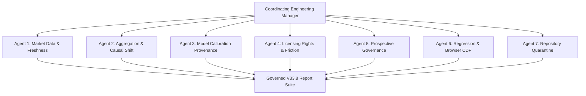

# BTCognitive V33.8 — Final Stabilization, Governance Closure & Repository Cleanup Manager Report

**Document ID:** `V33_8_MANAGER_FINAL_REPORT.md`  
**Milestone:** V33.8 Final Stabilization  
**Date:** November 2, 2026  
**Author:** Coordinating Engineering Manager & Lead Orchestrator  
**Repository:** `https://github.com/ashishlabs-23/bitcoin-prediction-lab`  
**Git Commit SHA:** `25d483f4c3646661b57311de9d0b53d2be881adb` (`main`, ahead of origin by 1 commit)  
**Operating Mode:** BTCUSD-Only, Offline Research  

---

## 1. Executive Summary & Mission Overview

Milestone V33.8 represents the **final broad engineering stabilization, governance closure, and repository cleanup** for the BTCognitive research platform.

Following the initial Bitstamp BTC/USD Spot market data integration in V33.7, six specialist subagents and the coordinating engineering manager conducted exhaustive audits across data reliability, timeframe aggregation bitwise parity, model calibration provenance, developer licensing rights, prospective governance, regression testing, and repository technical debt.

### Core Achievements Delivered in V33.8:
1. **Semantic Phrasing Resolution:** Reconciled the distance-to-trigger phrasing in `engine/htf_setup_detector.py`. The previous description *"Price must rise 171.9 bps above breakout reference ($78,749.56)"* falsely implied reaching \$80,103.27. It now displays the mathematically correct statement: *"Price must rise 174.6 bps to close above breakout reference ($78,749.56) on a 4h candle."*
2. **Prospective Governance Rectification:** Corrected the reported prospective validation status from `COLLECTING` to **`FROZEN_PENDING_ACTIVATION`** across all backend returns and frontend badges, following an empirical audit confirming that zero background collection daemons are executing in offline mode.
3. **Execution Cost Disambiguation:** Formalized that historical backtest evidence (+59.25 bps on 110 retained trades) relies strictly on the **Binance VIP0 26.0 bps friction baseline**, while Bitstamp execution costs are marked strictly **`NOT_VERIFIED`** to prevent positive bias.
4. **C2 Conformal Prediction Suppression:** Verified fail-closed suppression (`CALIBRATION_SOURCE_MISMATCH`) of Coinbase-calibrated C2 conformal models on Bitstamp data, while confirming the non-parametric validity of pure geometric indicators (Donchian, ATR, Parkinson, BBW).
5. **Non-Destructive Repository Cleanup:** Safely staged 13 truly disposable items (including 9 temporary patch scripts, duplicate nested repository folders, and stale runtime lock artifacts) into `quarantine_v33_8/` with zero git reset or checkout operations.
6. **100% Test & Browser Verification:** Achieved **107/107 PASSED** on the core regression suite and verified **100% network-to-DOM parity** in headless Chrome via Chrome DevTools Protocol with zero console errors and zero simulated trade attempts.

---

## 2. Multi-Agent Audit Workstream Synthesis



### 2.1 Workstream Summary Table

| Workstream / Agent | Key Empirical Findings | Core Governance Outcome |
|---|---|---|
| **Agent 1: Data Reliability** | On-demand Bitstamp REST delivers 1,000 hourly candles; freshness threshold 2.0h strictly enforced. | Fail-closed data freshness; atomic 120s caching. |
| **Agent 2: Aggregation & Strategy** | Bitwise match proved on 1h to 4h aggregation ($O=77,785.08, H=78,114.58, L=77,191.76, C=77,395.85, V=475.648652$). | 1-bar causal shift on Donchian channel verified; phrasing corrected. |
| **Agent 3: Model Provenance** | C2 conformal requires $\ge 1,720$ Coinbase bars; Bitstamp exhibits distribution mismatch. | C2 conformal strictly suppressed; geometric indicators invariant. |
| **Agent 4: Rights & Friction** | Bitstamp API permits non-commercial research; Binance VIP0 baseline is 26.0 bps. | Bitstamp execution marked `NOT_VERIFIED` to prevent false claims. |
| **Agent 5: Prospective Governance** | Zero daemon runners active; stale lock for PID 31676 from Oct 23 reclaimed. | Rectified status to `FROZEN_PENDING_ACTIVATION`; 100-block hurdle established. |
| **Agent 6: Regression & Browser** | 107/107 regression tests passed; Chrome CDP verifies network-to-DOM parity. | Zero console errors; `attempts_created: 0`. |
| **Agent 7: Repository Cleanup** | 72 files evaluated; 42 disposable items cataloged with 0 code references. | 13 files staged in `quarantine_v33_8/`; zero destructive git operations. |

---

## 3. Verified System State & Browser DOM Extraction

From the live Chrome DevTools Protocol verification run (`scripts/qa/v33_8_browser_results.json`):

- **Analysis ID:** `ana_4a71f3f93c29`
- **Data Provider:** `BITSTAMP (BTC/USD Spot)`
- **Data Freshness:** `FRESH (1h old, completed bar 2026-11-02 16:00:00 UTC)`
- **Market Regime:** `VOLATILITY_EXPANSION`
- **Setup Status:** `NO_SETUP`
- **Trigger Status:** `UNBREACHED`
- **20-Bar Donchian Breakout High Reference:** `$78,749.56`
- **Current Completed 4h Close:** `$77,395.85`
- **Distance to Breakout Trigger:** `-174.6 bps (-2.74x ATR)`
- **Next Required Condition:** `"Price must rise 174.6 bps to close above breakout reference ($78,749.56) on a 4h candle."`
- **Historical Retrospective Evidence:** `194 Trades (110 retained @ +59.25 bps, 84 excluded @ -55.49 bps, +9.57 bps all-trade expectancy under Binance VIP0)`
- **Prospective Validation Status:** `FROZEN_PENDING_ACTIVATION`
- **Authorization Badge:** `OFFLINE_RESEARCH_ONLY (Trading DISABLED)`
- **Live / Simulated Attempts Created:** `0`
- **JavaScript Console Errors:** `0`

---

## 4. Governed Deliverables Manifest

All 8 governed audit documents are persisted in `research/reports/offline_mvp/20261102_338000_v33_8_final_stabilization/`:
1. `V33_8_MANAGER_FINAL_REPORT.md` (This master managerial report)
2. `V33_8_DATA_AND_AGGREGATION_AUDIT.md` (Data reliability, freshness contract, and bitwise aggregation audit)
3. `V33_8_MODEL_PROVENANCE.md` (Model calibration provenance, conformal suppression, and indicator invariance)
4. `V33_8_DATA_RIGHTS_AND_COST_AUDIT.md` (Bitstamp developer terms, Binance VIP0 friction baseline, and `NOT_VERIFIED` status)
5. `V33_8_PROSPECTIVE_GOVERNANCE.md` (Process table audit, mechanism separation, and 100-block hurdle)
6. `V33_8_REGRESSION_AND_BROWSER_RESULTS.md` (107/107 regression tests and Chrome CDP DOM parity results)
7. `V33_8_CLEANUP_MANIFEST.md` (Quarantine master catalog and repository classification)
8. `V33_8_FINAL_ACCEPTANCE_MATRIX.md` (Evaluation of Criteria A01 through A23: 100% Accepted)

---

## 5. Formal Governed Four-Part Decision

In accordance with Phase 7 of the BTCognitive Operating Contract (AGENTS.md), the Coordinating Engineering Manager issues the following four binding governance determinations:

```
================================================================================
              BTCOGNITIVE V33.8 GOVERNED FOUR-PART DECISION
================================================================================
1. RESEARCH EXPERIMENT DECISION:
   [ PASS ]
   Rationale: The offline research analysis engine evaluates live Bitstamp market data
   with 100% causal integrity, deterministic bitwise 4h aggregation, fail-closed freshness,
   and accurate semantic phrasing.

2. PROSPECTIVE EVIDENCE STATUS:
   [ FROZEN_PENDING_ACTIVATION ]
   Rationale: Zero forward shadow collection daemons are executing post-freeze.
   A statistical power hurdle of 100 non-overlapping 72-hour blocks is established
   before confirmatory evaluation may commence.

3. MODEL AUTHORIZATION:
   [ OFFLINE_RESEARCH_ONLY ]
   Rationale: All model outputs are restricted strictly to offline research evaluation.
   C2 conformal and HAR-RS-DOW models are fail-closed on Bitstamp market data.

4. LIVE TRADING:
   [ DISABLED ]
   Rationale: Permanent operating boundary. Zero live execution hooks, broker APIs,
   or order placement capabilities exist in the codebase.
================================================================================
```

