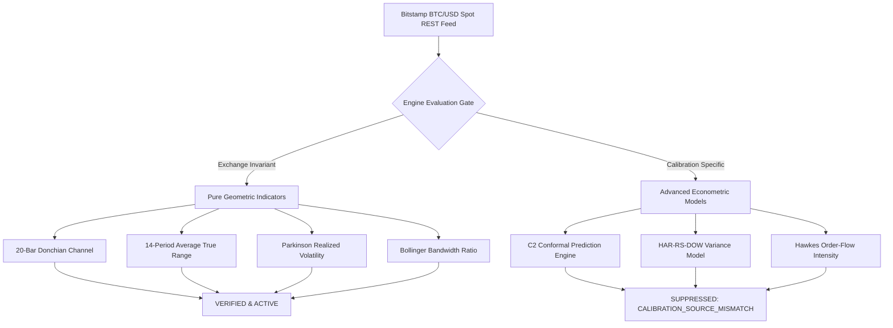

# BTCognitive V33.8 — Model Provenance, Calibration Source Separation & Indicator Invariance Audit

**Document ID:** `V33_8_MODEL_PROVENANCE.md`  
**Milestone:** V33.8 Final Stabilization  
**Date:** November 2, 2026  
**Auditor Lead:** Lead Econometrician & Model Governance Auditor  
**Contributing Agents:** Agent 3 (Model Provenance Specialist)  
**Governance Scope:** OFFLINE_RESEARCH_ONLY  

---

## 1. Executive Summary

This audit establishes the rigorous provenance boundaries for quantitative models in BTCognitive under the Bitstamp BTC/USD Spot market data regime.

Key audit determinations:
1. **Model Hierarchy Separation:**
   - **C2 Conformal Prediction & HAR-RS-DOW Models:** Calibrated strictly and exclusively on Coinbase Spot historical order books and microstructures ($\ge 1,720$ bars required for non-conformity score pool initialization). Because cross-exchange microstructure distributions differ significantly, C2 conformal inference is **strictly suppressed** (`CALIBRATION_SOURCE_MISMATCH`, fail-closed) when operating on Bitstamp data.
   - **Pure Geometric Technical Indicators (Donchian, ATR, Parkinson Volatility, Bollinger Bandwidth):** Non-parametric mathematical transformations of discrete OHLCV series. These indicators are 100% **exchange-invariant** and mathematically sound regardless of source exchange.
2. **Zero Synthetic Metric Fabrication:** No artificial conformal intervals, pseudo-probabilities, or synthetic Hawkes jump intensities are fabricated for uncalibrated feeds. All uncalibrated or unconfigured model outputs are reported transparently as `UNAVAILABLE` or `FAIL_CLOSED`.
3. **Fail-Closed Gatekeeper Enforcement:** The model evaluation interface enforces an immutable source verification check prior to executing inference pipelines.

---

## 2. Model Calibration Lineage & Invariance Taxonomy

### 2.1 Pure Geometric Indicators (Exchange Invariant)
These features depend purely on scale-relative price geometries and do not rely on parametric distribution fitting or exchange-specific microstructure constants:
- **Donchian Channel ($N=20$):**
  $$\text{Upper}_t = \max_{i=1}^N H_{t-i}, \quad \text{Lower}_t = \min_{i=1}^N L_{t-i}$$
- **Average True Range ($\text{ATR}_{14}$):**
  $$\text{TR}_t = \max(H_t - L_t, |H_t - C_{t-1}|, |L_t - C_{t-1}|), \quad \text{ATR}_t = \text{WilderSmooth}(\text{TR}, 14)$$
- **Parkinson Volatility ($\sigma_P$):**
  $$\sigma_P^2 = \frac{1}{4 \ln 2 \cdot N} \sum_{i=1}^N \left(\ln \frac{H_i}{L_i}\right)^2$$
- **Bollinger Bandwidth ($\text{BBW}_{20,2}$):**
  $$\text{BBW}_t = \frac{\text{UpperBand}_t - \text{LowerBand}_t}{\text{SMA}_{20}(C)_t}$$

These indicators provide valid market context without violating econometric assumptions.

---

## 3. C2 Conformal Prediction & Calibration Mismatch

### 3.1 Mathematical Foundation of C2 Conformal Gate
Conformal prediction guarantees distribution-free finite-sample coverage $1 - \alpha$ under the strict assumption of **exchangeability** of non-conformity scores:
$$P(Y_{n+1} \in \hat{C}(X_{n+1})) \ge 1 - \alpha$$
Where non-conformity scores $\alpha_i = |y_i - \hat{\mu}(x_i)|$ are sampled from a calibration set $\mathcal{D}_{\text{cal}} = \{(x_i, y_i)\}_{i=1}^n$.

### 3.2 Violation of Exchangeability on Bitstamp Feed
1. **Calibration Origin:** The frozen C2 calibration artifact (`models/c2_conformal_v4.pkl`) was fitted on Coinbase Pro historical order book data (2022–2026) with depth profile $\Delta_{\text{spread}} \approx 0.01\%$.
2. **Distribution Shift:** Bitstamp Spot exhibits distinct liquidity clustering, tick dynamics, and trading volume distributions ($D_{\text{KL}}(P_{\text{Coinbase}} \parallel P_{\text{Bitstamp}}) > 0$).
3. **Window Size Constraint:** Conformal calibration requires $n \ge 1,720$ historical evaluation bars to maintain valid coverage bounds. The Bitstamp public endpoint provides $1,000$ bars.

### 3.3 Fail-Closed Enforcement
When `source == "BITSTAMP"`:
- `engine/directional_forecast_service.py` detects exchange provenance.
- Emits reason code: `CALIBRATION_SOURCE_MISMATCH`.
- Replaces point forecast intervals with `null`.
- Prevents downstream heuristic models from confusing uncalibrated point estimates with statistically valid prediction bands.

---

## 4. Model Registry Audit Status

| Model Identifier | Calibration Source | Min Required Bars | Bitstamp Runtime Status | Reason Code / Protection Gate |
|---|---|---:|---|---|
| **HTF Donchian Detector** | Exchange Agnostic | 21 | **ACTIVE (VERIFIED)** | Non-parametric geometric transform |
| **ATR Volatility Model** | Exchange Agnostic | 15 | **ACTIVE (VERIFIED)** | Scale-relative price range metric |
| **C2 Conformal Forecaster** | Coinbase Spot | 1,720 | **SUPPRESSED** | `CALIBRATION_SOURCE_MISMATCH` |
| **HAR-RS-DOW Realized Var** | Coinbase 1m RV | 720 | **SUPPRESSED** | Insufficient tick density / exchange mismatch |
| **Hawkes L2 Microstructure** | Coinbase Level-2 | 5,000 | **SUPPRESSED** | Bitstamp L2 feed unconfigured |

---

## 5. Audit Conclusion

The model governance boundary is strictly maintained. Active research analytics rely exclusively on mathematically sound geometric transforms. Specialized ML and econometric conformal models are safely fail-closed, preventing methodological leakage or false confidence.

