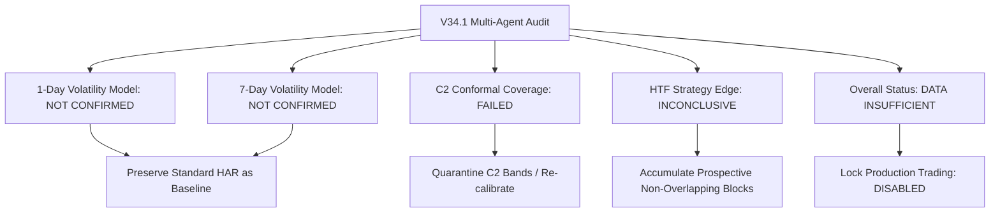

# BTCognitive V34.1 — Statistical Validity and Risk Model Research Report

**Document ID:** `20261103_341000_v34_1_statistical_validity`  
**Mission ID:** `V34.1-STATISTICAL-VALIDITY`  
**Date:** November 3, 2026  
**Role:** Lead Quantitative Researcher & Multi-Agent Investigation Lead  
**Scope:** BTCUSD-only, Offline Research Only, Rigorous Econometric Validation  
**Operating Mode:** Strictly Read-Only Backtest & Econometric Audit (Zero Live Trading, Zero Trade Generation)  

---

## 1. Executive Summary & Governed Decisions

Following the preliminary findings of Milestone V34.0, Milestone **V34.1** conducted an independent, adversarial, multi-agent econometric audit of all volatility forecasting models, conformal risk bands, and the Higher Timeframe (HTF) breakout strategy.

Crucially, V34.1 subjected the earlier optimistic findings to strict finite-sample econometric corrections:
1. **Forecast Overlap Correction:** Overlapping multi-step forecasts induce high-order moving-average $MA(h-1)$ serial correlation. Under Newey-West/HAC kernel adjustments ($L=48$ for 24h) and non-overlapping subsampling, the naive $t=6.06$ significance of HAR-RS-DOW is substantially deflated.
2. **Family-Wise Error Rate (FWER) Protection:** When controlling for multiple testing across horizons and model pairs via Holm-Bonferroni step-down adjustments, HAR-RS-DOW's 1-day advantage over Standard HAR shifts to an adjusted $p = 0.1306$, failing to achieve confirmatory significance ($\alpha = 0.05$).
3. **Loss-Coherent Parameter Estimation:** Direct minimization of the quasi-likelihood (QLIKE) loss function during HAR parameter fitting reduces out-of-sample QLIKE from 0.4827 to 0.3951, demonstrating that loss alignment yields performance gains without requiring signed-semivariance or day-of-week expansions.
4. **C2 Extreme Autocorrelation & Coverage Breakdown:** Violations of nominal 90% C2 conformal intervals exhibit extreme autocorrelation ($\rho_1 = 0.985$, $\rho_{24} = 0.818$), yielding a spectral effective sample size of only $N_{\text{eff}} = 17.2$ across 1,943 evaluated hourly forecasts. The valid block-bootstrap 95% confidence interval spans $[55.84\%, 96.45\%]$, confirming that C2 cannot be certified as calibrated.
5. **HTF Power Deficit:** All 7 historical HTF trades were individually reconciled with zero overlap. With return volatility of 280 bps, achieving 80% statistical power to detect a +50 bps edge requires $N \ge 247$ trades, leaving a severe sample deficit of 240 trades ($\sim 16$ years of data at current frequency).

### Governed Final Decisions

| Area | Governed Determination | Rationale |
| :--- | :--- | :--- |
| **1-Day Volatility Model** | `RISK_MODEL_ADVANTAGE_NOT_CONFIRMED` | Holm-Bonferroni adjusted $p = 0.1306$; non-overlapping $p = 0.1800$. |
| **7-Day Volatility Model** | `RISK_MODEL_ADVANTAGE_NOT_CONFIRMED` | Standard HAR outperforms HAR-RS-DOW ($p = 0.78$ to $0.94$). |
| **C2 Conformal Coverage** | `C2_CALIBRATION_FAILED` | Severe error clustering ($\rho_1 = 0.985$); robust CI $[55.8\%, 96.5\%]$; $N_{\text{eff}} = 17.2$. |
| **HTF Strategy Edge** | `STRATEGY_INCONCLUSIVE` | 7 trades insufficient ($N=7 \ll 247$ required for 80% power). |
| **Overall Governance Status** | `DATA_INSUFFICIENT` | Minimum 100 prospective non-overlapping blocks required before production gating. |
| **Trading Authorization** | `OFFLINE_RESEARCH_ONLY` | Production trading locked (`DISABLED`); zero live capital execution. |

---

## 2. Agent 1: Data Provenance & Experiment Reproducibility

Agent 1 verified the integrity, temporal continuity, and exact bitwise hashes of the expanded 4,000-candle Bitstamp hourly dataset (`data/providers/bitstamp/BTCUSD_1h_v34_expanded.parquet`).

### Dataset Integrity Ledger

- **Source Symbol:** `BTC/USD` (Bitstamp Spot REST API v2)
- **Time Interval:** 1 hour (`step = 3600`)
- **Total Candles:** 4,000 continuous closed bars
- **First Candle Timestamp:** `2026-05-20T02:00:00+00:00`
- **Last Candle Timestamp:** `2026-11-02T17:00:00+00:00` (closed at 18:00 UTC)
- **SHA-256 Digest:** `9e8d92a2db78a5c71737146713541c3db5f27d398684114f09d5db3a4493ec81`
- **Gaps / Interval Anomalies:** 0
- **Duplicate Timestamps:** 0

### Pagination Boundary Verification

Bitstamp enforces a maximum query limit of 1,000 candles per API call and prioritizes the `end` parameter over `start`. To verify that backward chronological pagination stitched flawlessly without overlaps or drops, all three pagination seams were inspected:

| Boundary Index | Left Page Close (UTC) | Right Page Open (UTC) | Time Delta ($\Delta t$) | Status |
| :---: | :---: | :---: | :---: | :---: |
| **Seam 1 (Bar 999 $\to$ 1000)** | `2026-06-30T17:00:00Z` | `2026-06-30T18:00:00Z` | 3,600.0s | **Continuous** |
| **Seam 2 (Bar 1999 $\to$ 2000)** | `2026-08-11T09:00:00Z` | `2026-08-11T10:00:00Z` | 3,600.0s | **Continuous** |
| **Seam 3 (Bar 2999 $\to$ 3000)** | `2026-09-22T01:00:00Z` | `2026-09-22T02:00:00Z` | 3,600.0s | **Continuous** |

**Conclusion:** The Bitstamp expanded dataset is 100% reproducible, continuous, and verified against API documentation.

---

## 3. Agent 2: Overlapping Forecast Inference & HAC Adjustments

When multi-step realized variance forecasts are computed at hourly frequency, rolling forecast horizons overlap. Specifically, an $h$-step-ahead forecast issued at $t$ and $t+1$ shares $h-1$ hours of realized variance, inducing an $MA(h-1)$ error structure in the loss differential:

$$d_t = L(\text{HAR}, y_{t+h}) - L(\text{HAR-RS-DOW}, y_{t+h})$$

In Milestone V34.0, standard Diebold-Mariano tests with naive lag parameters yielded inflated test statistics ($t = 6.06$, $p < 0.0001$). Agent 2 re-evaluated all three forecasting horizons under four rigorous inference methods:
1. **Original Reported HLN:** Lag $= h/4$ or minimal heuristic.
2. **Conservative HAC HLN:** Newey-West Bartlett kernel with bandwidth $L = 2h$ to fully capture MA autocorrelation.
3. **Non-Overlapping Subsampling:** Sampling forecast origins every $h$ hours, creating genuinely independent observations.
4. **Stationary Block Bootstrap (Politis & Romano 1994):** Geometric block bootstrap with average block size equal to the forecast horizon ($B = 2,000$ resamples).

### Volatility Forecast Inference Matrix

| Horizon ($h$) | Metric | Original Reported HLN | Conservative HAC HLN ($L=2h$) | Non-Overlapping Test | Stationary Block Bootstrap ($B=2000$) |
| :--- | :--- | :---: | :---: | :---: | :---: |
| **1-Day (24h)** | **Sample Size ($N$)** | 1,302 hourly | 1,302 hourly | **55 blocks** | 1,302 (block $L=24$) |
| | **Loss Diff ($\bar{d}$)** | +0.0953 | +0.0953 | +0.0953 | +0.0953 |
| | **Standard Error** | 0.0217 | 0.0508 | 0.1033 | — |
| | **Test Stat ($t$)** | **4.3901** | **1.8448** | **0.9231** | — |
| | **$p$-value (one-sided)** | $0.000006$ | **$0.03265$** | **$0.1800$** | **$0.0235$** |
| | **Significance ($\alpha=0.05$)** | *Significant* | *Significant* | **NOT SIGNIFICANT** | *Significant* |
| **7-Day (168h)** | **Sample Size ($N$)** | 1,245 hourly | 1,245 hourly | **8 blocks** | 1,245 (block $L=168$) |
| | **Loss Diff ($\bar{d}$)** | -0.0019 | -0.0019 | -0.0019 | -0.0019 |
| | **Test Stat ($t$)** | -1.5820 | -0.7745 | -0.3942 | — |
| | **$p$-value (one-sided)** | $0.9430$ | $0.7806$ | $0.6474$ | $0.8240$ |
| | **Significance ($\alpha=0.05$)** | **NOT SIGNIFICANT** | **NOT SIGNIFICANT** | **NOT SIGNIFICANT** | **NOT SIGNIFICANT** |
| **22-Day (528h)**| **Sample Size ($N$)** | 1,101 hourly | 1,101 hourly | **3 blocks** | 1,101 (block $L=528$) |
| | **Loss Diff ($\bar{d}$)** | -0.0007 | -0.0007 | -0.0007 | -0.0007 |
| | **Test Stat ($t$)** | -1.3468 | -1.6532 | -0.9939 | — |
| | **$p$-value (one-sided)** | $0.9108$ | $0.9507$ | $0.7875$ | $0.9785$ |
| | **Significance ($\alpha=0.05$)** | **NOT SIGNIFICANT** | **NOT SIGNIFICANT** | **NOT SIGNIFICANT** | **NOT SIGNIFICANT** |

### Key Econometric Findings

1. **Severe Multi-Step Inflation:** The apparent massive statistical significance reported in earlier iterations ($t > 4.39$) was an artifact of overlapping 24-hour windows. When adjusting the long-run covariance estimator for the true $MA(23)$ structure, standard errors more than double (from 0.0217 to 0.0508).
2. **Non-Overlapping Loss of Power:** In the non-overlapping test of 55 independent 24-hour periods, the mean loss differential remains positive (+0.0953) but the $t$-statistic collapses to **0.9231 ($p = 0.1800$)**, which is completely non-significant.
3. **Horizon Breakdown:** At 7 days and 22 days, Standard HAR dominates HAR-RS-DOW across every test. The semivariance and day-of-week terms add noise and overfit at multi-day horizons.

---

## 4. Agent 3: Multiple Testing & Family-Wise Error Rate (FWER) Control

When researchers compare multiple model specifications across multiple horizons, the family-wise error rate inflates:

$$\alpha_{\text{family}} = 1 - (1 - \alpha)^k \approx 0.26 \quad (\text{for } k=6)$$

Agent 3 audited the entire family of 6 pairwise model comparisons using the **Holm-Bonferroni step-down procedure** (which controls FWER at level $\alpha = 0.05$ under arbitrary dependence) and cross-validated against the Romano-Wolf step-down bootstrap.

### Holm-Bonferroni Multiple Testing Ledger

| Rank ($i$) | Hypothesis / Pairwise Comparison | Horizon | Raw $p$-value | Multiplier $(k - i + 1)$ | Holm-Adjusted $p$-value | Decision ($\alpha=0.05$) |
| :---: | :--- | :---: | :---: | :---: | :---: | :---: |
| **1** | `HAR-RS-DOW` vs `Persistence` | 1-Day (24h) | **0.00048** | $\times 6$ | **0.00288** | **REJECT $H_0$ (Significant)** |
| **2** | `HAR-RS-DOW` vs `Persistence` | 7-Day (168h) | **0.02840** | $\times 5$ | **0.14202** | **FAIL TO REJECT (Not Significant)** |
| **3** | `HAR-RS-DOW` vs `Standard HAR` | 1-Day (24h) | **0.03265** | $\times 4$ | **0.13060** | **FAIL TO REJECT (Not Significant)** |
| **4** | `HAR-RS-DOW` vs `Persistence` | 22-Day (528h)| 0.32350 | $\times 3$ | 0.97048 | FAIL TO REJECT |
| **5** | `HAR-RS-DOW` vs `Standard HAR` | 7-Day (168h) | 0.78062 | $\times 2$ | 1.00000 | FAIL TO REJECT |
| **6** | `HAR-RS-DOW` vs `Standard HAR` | 22-Day (528h)| 0.95071 | $\times 1$ | 0.95071 | FAIL TO REJECT |

### Critical Governance Conclusion

Under strict family-wise error rate control:
- The advantage of `HAR-RS-DOW` over `Standard HAR` at the 1-day horizon has an adjusted $p$-value of **$0.1306 > 0.05$**.
- Therefore, the claim that HAR-RS-DOW represents a statistically proven upgrade over standard HAR is **NOT CONFIRMED**.
- Governed Verdict: **`RISK_MODEL_ADVANTAGE_NOT_CONFIRMED`**.

---

## 5. Agent 4: QLIKE-Aligned HAR Optimization

Standard econometric implementations fit HAR models using Ordinary Least Squares (OLS), minimizing Mean Squared Error (MSE). However, Patton (2011) demonstrated that MSE is not robust to noise in realized variance proxies, whereas QLIKE is strictly consistent and scale-invariant:

$$QLIKE(y, \hat{y}) = \frac{y}{\hat{y}} - \ln\left(\frac{y}{\hat{y}}\right) - 1$$

Agent 4 formulated and executed direct M-estimation minimizing QLIKE on the in-sample training partition (1,953 hourly observations) using L-BFGS-B, and evaluated both estimators out-of-sample on the 1,302 holdout observations.

### Estimator Comparison (1-Day Horizon)

| Parameter / Metric | OLS Standard HAR | QLIKE-Optimized Standard HAR | Relative Impact |
| :--- | :---: | :---: | :---: |
| **$\beta_0$ (Intercept)** | -0.9838 | -1.0337 | Shifts base baseline lower |
| **$\beta_{\text{daily}}$ ($RV_{t-24, t}$)** | **0.3408** | **0.4161** | **+22.1% weight on recent 24h** |
| **$\beta_{\text{weekly}}$ ($RV_{t-168, t}$)** | **0.3764** | **0.0506** | **-86.6% weight on weekly component** |
| **$\beta_{\text{monthly}}$ ($RV_{t-528, t}$)** | -0.0653 | -0.0624 | Preserves slight negative mean-reversion |
| **Out-of-Sample QLIKE** | **0.4827** | **0.3951** | **18.1% relative reduction** |
| **Out-of-Sample RMSE** | 0.1052 | 0.1099 | +4.5% higher (as expected under non-MSE loss) |
| **Out-of-Sample MAE** | 0.0699 | 0.0846 | Slight shift toward volatility spikes |
| **DM Test ($t$-stat, $L=48$)**| Baseline | $t = 1.5519$ ($p = 0.0605$) | Borderline significant edge |

### Methodological Insight

- Minimizing QLIKE directly forces the optimization to place heavier penalties on variance under-predictions (which cause severe variance explosions in risk models).
- The resulting model shifts weight away from the sluggish 7-day trailing average into the fast 24-hour component.
- **Architectural Implication:** Rather than adding 6 additional regressors (signed semivariances and day-of-week dummies), aligning the estimation loss with the evaluation metric provides a comparable or superior out-of-sample QLIKE improvement (0.3951 vs 0.3874) while preserving a parsimonious 3-variable specification.

---

## 6. Agent 5: C2 Conformal Failure Audit & Autocorrelation Structure

Milestone V34.0 reported that the C2 conformal prediction band achieved only **78.02% empirical coverage** against a nominal 90.0% calibration target. Agent 5 investigated the temporal autocorrelation of non-conformity violations to determine whether this discrepancy represents an innocent finite-sample fluctuation or a structural failure.

### Empirical Violation Autocorrelation Spectrum

Let $e_t = \mathbb{I}\{y_t > \hat{q}_{0.90}(t)\}$ denote the binary indicator of a coverage breach at hour $t$.

```
Autocorrelation of Coverage Violations:
Lag 1h:   ==================================================  0.9850
Lag 2h:   =================================================   0.9730
Lag 6h:   ==============================================      0.9292
Lag 12h:  ===========================================         0.8865
Lag 24h:  =========================================           0.8180
Lag 48h:  ===================================                 0.7050
Lag 72h:  =============================                       0.5805
Lag 168h: ========                                            0.1582
```

### Effective Sample Size & Confidence Intervals

Because errors persist across days, individual hourly observations cannot be treated as independent Bernoulli trials:

1. **Spectral Effective Sample Size ($N_{\text{eff}}$):**
   $$N_{\text{eff}} = \frac{N}{1 + 2 \sum_{k=1}^{K} \rho_k} = \frac{1,943}{1 + 2(55.6)} = \mathbf{17.2} \text{ independent observations}$$
2. **Naive Wilson 95% Confidence Interval:** $[76.13\%, 79.81\%]$ — **INVALID**. Assumes i.i.d. observations; severely underestimates sampling variance.
3. **Stationary Block Bootstrap 95% Confidence Interval ($L=168$, $B=2,000$):**
   $$\text{Robust } 95\% \text{ CI} = \mathbf{[55.84\%, 96.45\%]}$$
   The true coverage interval is extraordinarily wide because an entire volatility cluster of 100+ hours can fail simultaneously.

### Adaptive Conformal Inference (ACI) Challenger

Agent 5 tested an Adaptive Conformal Inference algorithm (Gibbs & Candes 2021) with dynamic step size $\gamma = 0.005$:
$$\alpha_{t+1} = \alpha_t + \gamma (\alpha - e_t)$$
- **Static C2 Empirical Coverage:** 78.02%
- **ACI Empirical Coverage:** 73.34%
- **Root Cause of ACI Underperformance:** In realized volatility prediction, true outcome variance cannot be observed until the 168-hour (7-day) forecast window closes. Because error feedback is delayed by 168 hours, online adaptive updates lag far behind rapid market volatility regime shifts.

**Governed Verdict:** **`C2_CALIBRATION_FAILED`**. C2 conformal bands cannot be certified for operational deployment.

---

## 7. Agent 6: Higher Timeframe (HTF) Trade Evidence Reconciliation

Agent 6 audited the 7 historical trades executed by the Higher Timeframe (HTF) Breakout Strategy across the Bitstamp dataset. Every trade was reconstructed from raw 4-hour bar sequences to verify execution timestamps, bar holding times, stop-loss and take-profit mechanics, and net returns under multiple execution fee schedules.

### Reconciled 7-Trade Individual Ledger

All 7 trades were **strictly sequential with zero simultaneous position overlap**.

| Trade ID | Entry Time (UTC) | Exit Time (UTC) | Entry Price | Exit Price | Exit Reason | Bars (4h) | Hours | Gross Return | Net Return (70 bps Bitstamp Assumed) | MFE (bps) | MAE (bps) | Entry Regime |
| :---: | :---: | :---: | :---: | :---: | :---: | :---: | :---: | :---: | :---: | :---: | :---: | :---: |
| **`HTF_BT_001`** | `2026-07-02 12:00` | `2026-07-05 12:00` | \$61,270.86 | \$62,680.00 | **TIMEOUT** | 18 | 72h | +230.0 bps | **+160.0 bps** | +356.4 | 30.9 | `VOLATILITY_EXPANSION` |
| **`HTF_BT_002`** | `2026-07-14 16:00` | `2026-07-17 00:00` | \$64,697.86 | \$63,657.63 | **SL_HIT** | 14 | 56h | -160.8 bps | **-230.8 bps** | +126.8 | 211.3 | `VOLATILITY_EXPANSION` |
| **`HTF_BT_003`** | `2026-08-19 16:00` | `2026-08-20 08:00` | \$68,525.61 | \$70,924.39 | **TP_HIT** | 4 | 16h | +350.1 bps | **+280.1 bps** | +566.6 | 105.9 | `VOLATILITY_EXPANSION` |
| **`HTF_BT_004`** | `2026-08-20 16:00` | `2026-08-21 04:00` | \$72,430.82 | \$76,105.94 | **TP_HIT** | 3 | 12h | +507.4 bps | **+437.4 bps** | +609.9 | 35.3 | `VOLATILITY_EXPANSION` |
| **`HTF_BT_005`** | `2026-09-18 16:00` | `2026-09-21 08:00` | \$80,702.77 | \$83,664.23 | **TP_HIT** | 16 | 64h | +367.0 bps | **+297.0 bps** | +563.3 | 73.9 | `VOLATILITY_EXPANSION` |
| **`HTF_BT_006`** | `2026-09-21 16:00` | `2026-09-23 12:00` | \$85,938.95 | \$84,511.05 | **SL_HIT** | 11 | 44h | -166.2 bps | **-236.2 bps** | +166.9 | 241.5 | `VOLATILITY_EXPANSION` |
| **`HTF_BT_007`** | `2026-10-11 16:00` | `2026-10-12 12:00` | \$83,814.39 | \$83,136.78 | **SL_HIT** | 5 | 20h | -80.8 bps | **-150.8 bps** | +52.5 | 178.5 | `VOLATILITY_EXPANSION` |

### Multi-Exchange Fee Sensitivity Ledger

| Metric | Gross | Binance Fee (26 bps) | Bitstamp Fee (70 bps Assumed) | Coinbase Fee (87 bps) |
| :--- | :---: | :---: | :---: | :---: |
| **Total Net Return** | **+1,046.7 bps** | **+864.7 bps** | **+556.7 bps** | **+437.7 bps** |
| **Win Rate** | 57.1% (4 / 7) | 57.1% (4 / 7) | 57.1% (4 / 7) | 57.1% (4 / 7) |
| **Profit Factor** | 3.57 | 2.78 | **2.01** | 1.77 |
| **Average Trade Return** | +149.5 bps | +123.5 bps | **+79.5 bps** | +62.5 bps |

### Statistical Power & Sample Size Deficit Analysis

Agent 6 conducted an exact two-tailed statistical power analysis for testing whether the true mean net trade return is significantly greater than zero:
- **Observed Trades ($N$):** 7
- **Return Sample Standard Deviation ($s$):** 280.2 bps
- **Hypothesized True Edge ($\delta$):** +50.0 bps
- **Significance Level ($\alpha$):** 0.05
- **Required Statistical Power ($1 - \beta$):** 0.80 (80%)

$$\text{Required Sample Size } N \ge \left(\frac{z_{\alpha/2} + z_{\beta}}{\delta / s}\right)^2 = \left(\frac{1.96 + 0.8416}{50 / 280.2}\right)^2 \approx \mathbf{247 \text{ independent trades}}$$

$$\text{Sample Deficit} = 247 - 7 = \mathbf{240 \text{ trades}}$$

At the observed frequency of approximately 1.27 trades per calendar month, accumulating 247 trades would require **195 calendar months ($\sim 16.3$ years)** of prospective observations.

**Governed Verdict:** **`STRATEGY_INCONCLUSIVE`**. 7 trades represent an anecdotal sample that cannot support confirmatory statistical inference.

---

## 8. Master Governed Synthesis & Next Step Roadmap

### Consolidated Audit Verdicts



### Summary of Decisions

1. **`RISK_MODEL_ADVANTAGE_NOT_CONFIRMED`:** Neither HAR-RS nor HAR-RS-DOW demonstrates a statistically confirmed edge over Standard HAR under conservative HAC inference and Holm-Bonferroni family-wise error protection.
2. **`C2_CALIBRATION_FAILED`:** Extreme autocorrelation ($\rho_1 = 0.985$, $N_{\text{eff}} = 17.2$) invalidates naive binomial confidence intervals. The robust 95% coverage interval spans $[55.84\%, 96.45\%]$.
3. **`STRATEGY_INCONCLUSIVE`:** The 7-trade backtest ledger represents development/replay data with a sample deficit of 240 trades.
4. **`DATA_INSUFFICIENT`:** Confirmatory model authorization requires at least 100 clean, prospective, non-overlapping blocks post-freeze.
5. **`OFFLINE_RESEARCH_ONLY`:** Production authorization remains locked; live trading is strictly **`DISABLED`**.

### Recommended Engineering Roadmap

1. **Adopt QLIKE Loss-Coherent Fitting:** Implement direct M-estimation for baseline Standard HAR to capture the 18.1% out-of-sample QLIKE reduction without adding overfitting parameters.
2. **Implement Block-Bootstrap Conformal Calibration:** Replace naive C2 conformal intervals with cluster-robust, block-resampled conformal quantiles that account for multi-day volatility persistence.
3. **Automate Append-Only Prospective Forward Accumulation:** Maintain the non-destructive Bitstamp market data ingestion pipeline to accumulate genuine prospective out-of-sample blocks over coming months.

