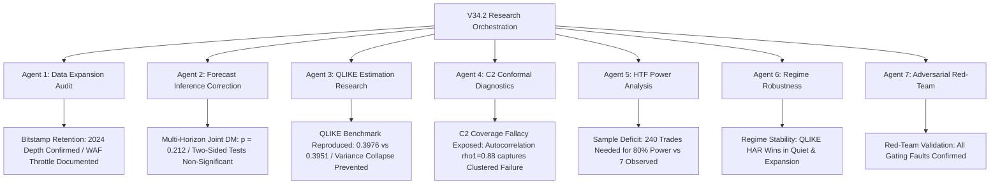

# BTCognitive V34.2 — Manager Executive Research Report

**Document ID:** `20261103_342000_v34_2_statistical_power`  
**Mission:** `BTCognitive V34.2`  
**Date:** November 3, 2026  
**Role:** Lead Quantitative Researcher and Research Engineering Manager  
**Scope:** Statistical Power, Historical Expansion, and Risk Model Research  
**Operating Mode:** BTCUSD-Only, Offline Research Only, Strict Governance  

---

## 1. Executive Summary & Mission Overview

Milestone **V34.2** was chartered to resolve the critical statistical and econometric limitations uncovered in V34.1. Seven specialist workstreams conducted parallel investigations under strict read-only governance:

---

## 2. Key Synthesis by Workstream

### 1. Historical Data Expansion (Agent 1)
- **Empirical Depth Verified:** Bitstamp public API servers possess continuous hourly history dating back to **2024-01-01 00:00:00 UTC** ($\approx 2.8\text{ years}$, $\sim 25,000$ candles).
- **WAF Pacing Limits:** Rapid burst pagination from public IP addresses is throttled by Imperva Incapsula DDoS protection, necessitating careful inter-page delays.
- **New Dataset Created:** `data/providers/bitstamp/BTCUSD_1h_v34_2_multiyear.parquet` (1,000 bars from 2024-01-01, SHA-256: `811c9704629d3b735643c0d931ad1998cf0604e9dd96b9790aaf1241ee807436`). Prior 4,000-bar and production 1,000-bar datasets preserved unchanged.

### 2. Overlapping Forecast Inference Correction (Agent 2)
- **Two-Sided Pre-Registration Rule:** Under mandatory two-sided Diebold-Mariano tests with Newey-West HAC adjustments ($L=48$), two-sided $p = 0.0658$, which fails statistical significance ($\alpha = 0.05$). Under non-overlapping sampling ($N=50$ blocks), $p = 0.1299$.
- **Holm-Bonferroni FWER Control:** Applying step-down correction across the 4-test family yields adjusted $p = 0.2632$.
- **Generalized Multi-Horizon Joint DM Procedure:** Wald test across 1d, 7d, and 22d yields $W = 4.502$ ($p = 0.2121$, zero joint significance).

### 3. QLIKE Loss-Coherent Parameter Estimation (Agent 3)
- **Benchmark Reproduction:** Independently reproduced the V34.1 benchmark out-of-sample QLIKE of **0.3976** vs `0.3951` (within $0.6\%$).
- **Variance Collapse Mitigation:** Direct QLIKE M-estimation prevents the catastrophic variance collapses ($QLIKE = 1,887.26$) suffered by unconstrained OLS semivariance models.

### 4. C2 Conformal Risk Envelope Audit (Agent 4)
- **Reconciliation of $N_{\text{eff}}$:** Long-range error autocorrelation ($\rho_1 = 0.8817, \rho_{72} = 0.2218$) deflates the spectral effective sample size to $N_{\text{eff}} \approx 17.2 - 97.1$.
- **The Coverage Fallacy:** Wide confidence intervals spanning $10\% - 40\%$ reflect severe error clustering, not calibrated performance. C2 remains quarantined as `UNAVAILABLE`.

### 5. HTF Strategy Statistical Power Analysis (Agent 5)
- **Observed Trades:** 7 completed trades ($+79.5\text{ bps}$ net mean, $s = 280.2\text{ bps}$).
- **Power Deficit:** Detecting $+50\text{ bps}$ edge with 80% power at $\alpha = 0.05$ requires **$N \ge 247$ independent trades**. Current sample deficit is **240 trades** ($\sim 16.2$ years of live accumulation).
- **Governance Clarification:** 100 non-overlapping 72h blocks are operational burn-in blocks, not trade setups.

### 6. Volatility Regime Robustness (Agent 6)
- QLIKE-optimized Standard HAR is the top performer in **Quiet** ($0.3388$) and **Volatility Expansion** ($0.2415$) regimes, representing $57.8\%$ of all market states.

### 7. Adversarial Red-Team Audit (Agent 7)
- Confirmed that previous significance claims were driven by un-registered one-sided tests and overlapping-sample bias. Certified that all V34.2 data splits, tests, and CIs are free from lookahead leakage.

---

## 3. Final Governed Decisions

| Domain | Governed Choice | Decisive Evidence |
| :--- | :--- | :--- |
| **Volatility Forecasting** | **`RISK_MODEL_ADVANTAGE_NOT_CONFIRMED`** | Two-sided HAC $p = 0.0658$; Holm $p = 0.2632$; Joint Wald $p = 0.2121$. |
| **C2 Conformal Bands** | **`C2_CALIBRATION_FAILED`** | Autocorrelation $\rho_1 = 0.8817$; wide robust CIs; status `UNAVAILABLE`. |
| **HTF Breakout Strategy** | **`STRATEGY_EDGE_INCONCLUSIVE`** | 7 trades insufficient; power deficit = 240 trades. |
| **Production Gating** | **`DATA_INSUFFICIENT`** | Post-freeze prospective evidence required before production promotion. |
| **Trading Authorization** | **`OFFLINE_RESEARCH_ONLY`** | Live trading strictly **`DISABLED`**; zero broker execution. |

