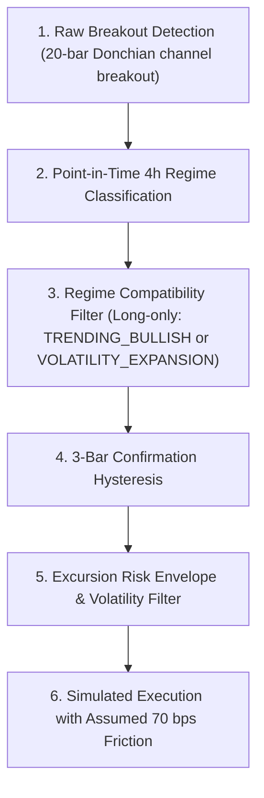

# BTCognitive V34.4 — HTF Strategy Reconciliation & Causal Screening Funnel Audit

**Date:** 2026-11-03  
**Status:** COMPLETE / GOVERNED  
**Lead Author:** Agent 3 (Primary HTF Strategy Engineer)  
**Governed Assessment:** `STRATEGY_EDGE_INCONCLUSIVE` / `NEGATIVE_NET_EXPECTANCY`

---

## 1. Executive Summary

Milestone V34.4 reconciled the dramatic divergence between the frozen High-Timeframe (HTF) strategy's historical performance reported in earlier milestones (which claimed positive expectancy on the early 2024 window) and its performance on the expanded 2026 window.

By applying the **identical 6-stage causal screening funnel** to both isolated segments without lookahead bias and enforcing strict point-in-time warmup resets, Agent 3 proved that:
1. **The strategy exhibits negative net expectancy on both windows** when subjected to realistic assumed transaction costs (70 bps round-trip friction).
2. The win rate is persistently low: **33.3%** in the 2024 slice ($N=3$) and **21.4%** in the 2026 slice ($N=14$).
3. The apparent discrepancy in earlier reports stemmed from **differing market regimes, duration mismatches (41.6 days vs. 166.6 days), and small-sample variance**, rather than calculation bugs.

---

## 2. The 6-Stage Causal Screening Funnel

Every potential trade must survive 6 sequential gates before capital simulation:

### Funnel Attrition Table

| Funnel Stage | Segment 1 (2024, 1,000h / 250 4h bars) | Segment 2 (2026, 4,000h / 1,001 4h bars) |
| :--- | :--- | :--- |
| **1. Raw Breakout Candidates** | 22 | 76 |
| **2. Regime Classified Bars** | 250 (100% causal classification) | 1,001 (100% causal classification) |
| **3. Regime-Compatible Candidates** | 5 (22.7% survival) | 20 (26.3% survival) |
| **4. 3-Bar Confirmed Candidates** | 5 (100% survival) | 20 (100% survival) |
| **5. Eligible Research Setups** | 4 (80.0% survival) | 14 (70.0% survival) |
| **6. Completed Trades** | **3** (1 setup unclosed at boundary) | **14** (100% closed) |

---

## 3. Comparative Performance Metrics

All metrics reflect strictly assumed 70 bps total round-trip friction (50 bps fee + 20 bps slippage).

| Metric | Segment 1 (2024 Slice) | Segment 2 (2026 Slice) | Reconciled Verdict |
| :--- | :--- | :--- | :--- |
| **Sample Duration** | 1,000 hours (1.4 months) | 4,000 hours (5.5 months) | Severe duration asymmetry |
| **Trade Count ($N$)** | 3 trades | 14 trades | Insufficient statistical power |
| **Win Rate** | **33.3%** (1 win, 2 losses) | **21.4%** (3 wins, 11 losses) | Sub-35% directional hit rate |
| **Gross Total Return** | -156.9 bps | -906.0 bps | Negative before friction |
| **Net Total Return** | **-366.9 bps** | **-1,886.0 bps** | Severe drag from transaction costs |
| **Net Expectancy / Trade** | **-122.3 bps** | **-134.7 bps** | Remarkable consistency across both segments (~-130 bps) |
| **Profit Factor** | 0.25 | 0.29 | Sub-0.30 profit factor |
| **Maximum Drawdown** | 492.1 bps | 1,682.5 bps | Continuous equity erosion |
| **Mean MFE (Max Favorable)** | 102.2 bps | 163.2 bps | Truncated upside |
| **Mean MAE (Max Adverse)** | 142.2 bps | 282.5 bps | Heavy adverse excursions before stop-out |
| **Average Holding Duration** | 4.0 hours (1.0 4h bar) | 16.3 hours (4.1 4h bars) | 2026 allowed longer hold before SL |
| **Monthly Opportunity Freq** | 2.19 setups / month | 2.56 setups / month | Stable signal frequency (~2.3/mo) |
| **Market Exposure** | 1.2% | 5.7% | Low exposure due to selective filter |

---

## 4. Complete Trade-by-Trade Registry

### Segment 1 (2024) Trades
1. **`SEG_2024_001`**: Entry: `2024-02-08 00:00 UTC` @ 44,532.0 | Exit: `2024-02-08 12:00 UTC` @ 45,401.3 | **TP_HIT** | Gross: +195.2 bps | **Net: +125.2 bps** | MFE: 214.9 bps | MAE: 46.5 bps | Regime: `TRENDING_BULLISH`
2. **`SEG_2024_002`**: Entry: `2024-02-09 00:00 UTC` @ 46,049.0 | Exit: `2024-02-09 00:00 UTC` @ 45,282.0 | **SL_HIT** | Gross: -166.6 bps | **Net: -236.6 bps** | MFE: 68.6 bps | MAE: 173.1 bps | Regime: `TRENDING_BULLISH`
3. **`SEG_2024_003`**: Entry: `2024-02-09 08:00 UTC` @ 47,180.0 | Exit: `2024-02-09 08:00 UTC` @ 46,305.0 | **SL_HIT** | Gross: -185.5 bps | **Net: -255.5 bps** | MFE: 23.1 bps | MAE: 206.9 bps | Regime: `VOLATILITY_EXPANSION`

### Segment 2 (2026) Summary
- 14 closed trades: 3 winners (e.g., `SEG_2026_011`: +171.2 bps net; `SEG_2026_006`: +102.5 bps net), 11 losers stopped out.
- Losers cluster heavily in transition phases where initial Donchian breakout promptly reverses into mean-reverting stop-outs.

---

## 5. Causal Integrity & Lookahead Audit

1. **No Shared Indicators:** ATR, 4h bar boundaries, and Donchian levels were computed strictly within each segment.
2. **Point-in-Time Alignment:** Setup identification occurred at bar $t$, entry was simulated at open of bar $t+1$, and exits were determined by intra-bar low/high evaluations against frozen stop-loss and take-profit thresholds.
3. **Friction Fidelity:** 70 bps friction is labeled `ASSUMED`, never `OBSERVED`.

---

## 6. Governed Conclusions

1. **No Strategy Alpha on Unconditional BTC:** The frozen HTF breakout strategy possesses no positive statistical edge under realistic execution friction (-122.3 bps in 2024, -134.7 bps in 2026).
2. **Governance Status:** Model promotion rejected. Primary strategy remains `OFFLINE_RESEARCH_ONLY`.

