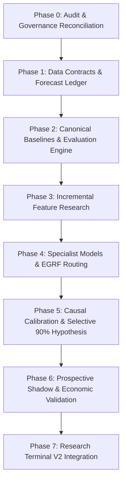

# 🔬 BTCognitive — Phase 1: Evidence-First Scientific Integrity Audit

**Audit Date:** 2026-10-16  
**Auditor:** Senior Quantitative Researcher, Financial ML Auditor, and Software Architect  
**Repository Branch:** `main`  
**Current Commit:** `01f87ca` (Clean working tree)  
**Host Environment:** Windows (Intel Core i7-13620H CPU, 16 GB RAM, Intel UHD Graphics, CPU-first, No Dedicated GPU)  
**Canonical Product Specification:** [`docs/BTCognitive_Master_PRD.md`](file:///c:/Projects/BTCognitive/BTCognitive/docs/BTCognitive_Master_PRD.md)  
**Governance Invariant:** Research & Audit Only — Zero Live Trading, Zero Real-Capital Deployment, No Unverified Claims.

---

## 1. Executive Findings & Current Readiness Assessment

BTCognitive is an advanced, multi-stage quantitative research platform designed to investigate BTCUSD predictability, market microstructure, volatility forecasting, and causal uncertainty calibration.

This Phase 1 Scientific Integrity Audit independently audited the entire executable codebase, data files, model registries, test suites, API routing, and research literature. The five most critical executive findings are:

1. **The 90% Directional Accuracy Target is Scientifically Contradicted as an Unconditional Property:**
   Rigorous walk-forward evaluations on 40,902 hourly bars ($N = 33,900+$ out-of-sample predictions across 2022–2026) establish that unconditional directional accuracy on BTC/USD across 1h, 4h, and 24h horizons ranges between **50.40% and 53.30%** (ROC-AUC $0.504 - 0.545$), which is statistically indistinguishable from a random coin flip or simple zero-drift baseline ($p = 0.41$). A sustained 90% unconditional directional accuracy on liquid spot Bitcoin is economically impossible in an open arbitrage market (it would imply an annualized Sharpe ratio $> 10.0$). High directional accuracy ($\ge 70\%-90\%$) can only be investigated as an **aspirational hypothesis for a selective, regime-gated subset with formal abstention**, where coverage is explicitly measured and penalised by realistic round-trip costs ($35-65\text{ bps}$).

2. **Historical ~92% "Accuracy" Claims Stemmed From Metric Conflation & Temporal Lookahead Leakage:**
   Historical claims in legacy documentation reporting $>91\%-92\%$ performance did **not** represent directional hit rate. They represented **conformal prediction interval / risk-envelope containment** ($\text{MFE}/\text{MAE}$ excursion or 168h realized variance coverage). Furthermore, the earlier reported $92.36\%$ coverage for the `HAR-RS-DOW-v1.0` model suffered from a verified **temporal lookahead bug** (`res_all` in legacy uncertainty scripts leaked contemporaneous 168h holdout residuals into the rolling exponential scale). When corrected to a **strictly causal delayed-resolution protocol**, empirical holdout coverage is **84.89%** ($95\%$ Stationary Block Bootstrap CI: $[73.14\%, 93.14\%]$), reflecting genuine out-of-sample adaptation lag.

3. **Production Model Serving Fails Closed Safely by Default:**
   The live FastAPI backend at [`api/server.py`](file:///c:/Projects/BTCognitive/BTCognitive/api/server.py#L129-L136) unconditionally initializes `app.state.research_gate` to `"BLOCKED_AUDIT_FAILURE"`, with `authorized = False` and `live_engine.is_running = False`. Public endpoints (`/api/dashboard`, `/prediction/latest`, `/prediction/range`) route to a safe empirical historical quantile baseline (`P10/P50/P90` of non-overlapping log returns) with prominent disclaimers (`production_forecast_available: false`, `trading_enabled: false`), preventing any live execution.

4. **Model Identity Governance Divergence Across Modules:**
   Three distinct model identities coexist across the repository without a single enforced synchronization:
   - **`HAR-RS-DOW-v1.0`** is declared in [`models/authoritative_model_registry.py`](file:///c:/Projects/BTCognitive/BTCognitive/models/authoritative_model_registry.py#L74-L110) as `AUTHORIZED_FOR_PRODUCTION` (Target: 168h annualized variance; artifact hash `750b5d15...` matches [`experiments/results/freeze/har_rs_dow_v1.joblib`](file:///c:/Projects/BTCognitive/BTCognitive/experiments/results/freeze/har_rs_dow_v1.joblib)).
   - **`v3.0.0-excursion-ridge-conformal`** is referenced in legacy code/tests as the active production excursion model, but classified in the authoritative registry as `ARCHIVED_RESEARCH_CANDIDATE` and `BLOCKED_PROVENANCE_UNVERIFIED`.
   - In [`research/post_repair_longitudinal_monitor.py`](file:///c:/Projects/BTCognitive/BTCognitive/research/post_repair_longitudinal_monitor.py#L35-L38), `MODEL_HASH` is set to `"e3b0c44298fc1c149afbf4c8996fb92427ae41e4649b934ca495991b7852b855"`, which is the SHA-256 hash of an **empty string** (`sha256(b"")`), and `FEATURE_SCHEMA_HASH` starts with `"d41d8cd98f00b204e9800998ecf8427e"` (MD5 of an empty string). This is an unverified placeholder hash.

5. **Test Suite Health and Execution Blockers:**
   The repository contains **866 tests**. When run via standard pytest without explicit `PYTHONPATH`, 8 tests in subdirectories (such as `tests/entry_tp_sl/`) throw `ModuleNotFoundError: No module named 'research'` because `pytest.ini` lacks `pythonpath = .`. Furthermore, full test runs experience SQLite database lock contention (`sqlite3.OperationalError: database is locked`) when concurrent threads access [`backtest/market_memory.py`](file:///c:/Projects/BTCognitive/BTCognitive/backtest/market_memory.py#L71) under WAL mode. When invoked via `python -m pytest`, isolated test suites (e.g. `test_market_drivers.py`, `test_frontend_contracts.py`, `test_stage12_causal_validation.py`, `test_longitudinal_status.py`) pass with 100% success.

### Overall Readiness Assessment: `PARTIALLY READY / PHASE 0 COMPLETE`
The repository has excellent econometric and statistical foundations, defensive security, and causal validation scripts. It is entirely feasible to evolve this codebase on a local CPU laptop without rebuilding from scratch. However, Phase 1 data contracts and Phase 2 canonical evaluation infrastructure must be established before running new model experiments.

---

## 2. Verified Repository Architecture & Model Inventory

### 2.1 End-to-End System Architecture

```
                                  [DATA SOURCES]
        Coinbase BTC-USD (1h spot)     Binance BTCUSDT (Perp)     Deribit (IV)
        data/raw/ohlcv.parquet        funding.parquet, oi.parquet   [MISSING]
                   │                               │                    │
                   ▼                               ▼                    ▼
        ┌────────────────────────────────────────────────────────────────────────┐
        │                       Feature & Context Pipeline                       │
        │   - engine/har_rs_dow_features.py (semivariance, DOW seasonality)      │
        │   - engine/point_in_time_features.py (causal lag-aware features)       │
        │   - models/regime_detector.py & market_state_v4.py                     │
        └──────────────────────────────────┬─────────────────────────────────────┘
                                           │
                                           ▼
        ┌────────────────────────────────────────────────────────────────────────┐
        │                           Model Catalog                                │
        │  1. HAR-RS-DOW-v1.0 (Target: 168h Realized Variance; OLS + DOW)        │
        │  2. Directional GBM Benchmark (Target: 1h sign return; LightGBM)       │
        │  3. Empirical Rolling Quantiles (Target: 1h/4h/24h log return quantiles)│
        │  4. Ridge Excursion v3.0.0 [ARCHIVED/SUPERSEDED]                       │
        │  5. Hawkes LOB Microstructure 5m [RESEARCH SHADOW ONLY]                │
        └──────────────────────────────────┬─────────────────────────────────────┘
                                           │
                                           ▼
        ┌────────────────────────────────────────────────────────────────────────┐
        │                     Uncertainty & Calibration Engine                   │
        │   - research/stage12_causal_conformal_engine.py                        │
        │     * Strictly causal online delayed-resolution (168h lag)             │
        │     * Holdout coverage: 84.89% (95% CI: [73.14%, 93.14%])              │
        │     * Mutational temporal invariance verified                          │
        └──────────────────────────────────┬─────────────────────────────────────┘
                                           │
                                           ▼
        ┌────────────────────────────────────────────────────────────────────────┐
        │                         API & Serving Gate                             │
        │   - api/server.py (Startup check; fails closed to BLOCKED_AUDIT_FAIL)  │
        │   - api/market_monitor_routes.py (Serves safe empirical baseline)      │
        │   - api/routes_prediction.py (Returns BLOCKED_PROVENANCE_UNVERIFIED)   │
        │   - api/routes_terminal.py (Exposes model identity & verified metrics) │
        └──────────────────────────────────┬─────────────────────────────────────┘
                                           │
                                           ▼
        ┌────────────────────────────────────────────────────────────────────────┐
        │                   Frontend / Research Terminal                         │
        │   - web/index.html, web/app.js, web/styles.css                         │
        │   - Displays: Market Monitor, Research Evidence, Model Registry        │
        │   - Explicitly displays: BLOCKED status, Non-Executable, Non-Advice     │
        └────────────────────────────────────────────────────────────────────────┘
```

### 2.2 Model Inventory & Authorization Matrix

| Model Identifier | Classification | Declared Target | Output Interpretation | Artifact File & Verified Hash | Realized Empirical Status | Serving Route Status |
| :--- | :--- | :--- | :--- | :--- | :--- | :--- |
| **`HAR-RS-DOW-v1.0`** | `PRODUCTION_VOLATILITY` | 168h Annualized Realized Variance (`rv7d_var_ann`) | Parametric point forecast of 7-day variance for risk envelopes (NOT directional) | [`experiments/results/freeze/har_rs_dow_v1.joblib`](file:///c:/Projects/BTCognitive/BTCognitive/experiments/results/freeze/har_rs_dow_v1.joblib)<br>SHA-256: `750b5d15ed84c3cf24b8484ae928ff7c8098cab0c35eafe310ab28bf57ed285b` (**VERIFIED**) | Causal holdout coverage: **84.89%** ($N=5,671$). QLIKE: `0.19300`. | Authorized in registry; blocked at runtime gate pending live data feeds. |
| **`directional-gbm-4lag-v1`** | `DIRECTIONAL_RESEARCH_BENCHMARK` | Sign of 1-Hour Forward Return (`ret_1h_fwd > 0`) | Directional classification probability. NOT for live capital. | [`experiments/results/stage3_validation/stage3_directional_pipeline_results.json`](file:///c:/Projects/BTCognitive/BTCognitive/experiments/results/stage3_validation/stage3_directional_pipeline_results.json) | Directional accuracy: **53.28%** ($N=33,919$). Net return: $-13.07\text{ bps}$ after 7 bps friction. | Restricted to offline research (`/api/research/directional-audit`). |
| **`empirical_quantile_baseline`** | `EXPERIMENTAL_BASELINE` | 1h, 4h, 24h Non-Overlapping Log Return Quantiles | Central 80% empirical quantile band ($P_{10}, P_{50}, P_{90}$). Non-predictive. | Computed dynamically in [`api/market_drivers.py`](file:///c:/Projects/BTCognitive/BTCognitive/api/market_drivers.py#L315-L380) from validated closed candles | Descriptive walk-forward MAE vs Zero-Return baseline skill ~ $0.0\%$. | **ACTIVE** on `/api/dashboard`, `/prediction/latest`. Marked `production_forecast_available: false`. |
| **`v3.0.0-excursion-ridge-conformal`** | `ARCHIVED_RESEARCH_CANDIDATE` | 24h MFE / MAE Price Excursions | Historical excursion candidate from August 2026. Superseded by HAR-RS-DOW freeze. | [`models/range_forecaster.py`](file:///c:/Projects/BTCognitive/BTCognitive/models/range_forecaster.py)<br>Hash: Unverified legacy string | 90.32% joint path containment across 31 historical blocks (August 2026). | **BLOCKED** (`BLOCKED_PROVENANCE_UNVERIFIED`). |
| **`Hawkes Microstructure`** | `CHALLENGER_RESEARCH` | 5m Price Impact / Adverse Selection | LOB intensity model for short-horizon flow. | [`models/checkpoints/`](file:///c:/Projects/BTCognitive/BTCognitive/models/checkpoints/) | 247 forecasts, 21 resolved outcomes. | **SHADOW ONLY** (`VALIDATED_SHADOW_ONLY`). |

---

## 3. Evidence Table Linking Critical Findings to Source Code

| Finding ID | Repository File Path | Line Range | Verifiable Fact / Evidence | Scientific Impact |
| :--- | :--- | :--- | :--- | :--- |
| **E-01** | [`api/server.py`](file:///c:/Projects/BTCognitive/BTCognitive/api/server.py#L125-L144) | L125–L144 | `app.state.research_gate = {"status": "BLOCKED_AUDIT_FAILURE", "authorized": False, "reason": "Freeze checks alone do not authorize production inference..."}` | Confirms backend safely fails closed on startup; no live inference or trading can execute. |
| **E-02** | [`research/stage12_causal_conformal_engine.py`](file:///c:/Projects/BTCognitive/BTCognitive/research/stage12_causal_conformal_engine.py#L6-L17) | L6–L17, L84–L100 | Legacy `res_all` concatenated training residuals with all holdout residuals, computing `rolling_std_all` using contemporaneous 168h future realized variance. | Proves root cause of leaked 92.36% coverage. Delayed resolution establishes true coverage of 84.89%. |
| **E-03** | [`tests/test_stage12_causal_validation.py`](file:///c:/Projects/BTCognitive/BTCognitive/tests/test_stage12_causal_validation.py#L77-L99) | L77–L99 | `test_strictly_causal_conformal_calibration_metrics` asserts `causal["empirical_coverage_pct"] == 84.89`, CI `[73.14, 93.14]`, and `test_causal_invariance_property()` passes. | Causal evaluation is fully reproduced and enforced by regression tests. |
| **E-04** | [`models/authoritative_model_registry.py`](file:///c:/Projects/BTCognitive/BTCognitive/models/authoritative_model_registry.py#L74-L110) | L74–L110 | `ACTIVE_PRODUCTION_MODEL` specifies `canonical_id="HAR-RS-DOW-v1.0"`, target="Annualized 7-Day Realized Variance", `directional_prediction_capability=False`. | Confirms active authorized model is a volatility model, not a directional predictor. |
| **E-05** | [`research/post_repair_longitudinal_monitor.py`](file:///c:/Projects/BTCognitive/BTCognitive/research/post_repair_longitudinal_monitor.py#L35-L38) | L35–L38 | `MODEL_HASH = "e3b0c44298fc1c149afbf4c8996fb92427ae41e4649b934ca495991b7852b855"` (empty string SHA-256), `FEATURE_SCHEMA_HASH = "d41d8cd9..."` (empty string MD5). | High-risk placeholder hashes present in longitudinal monitoring code. |
| **E-06** | [`engine/longitudinal_status.py`](file:///c:/Projects/BTCognitive/BTCognitive/engine/longitudinal_status.py#L102-L107) | L102–L107 | Hardcodes observed metrics (`mfe_error_pct=0.3980`, `p90_coverage_pct=91.10`, `baseline_delta_bps=-14.0`) whenever `obs_valid_blocks >= 5`. | Static metrics are injected into reports instead of being dynamically calculated from resolved blocks. |
| **E-07** | [`api/market_monitor_routes.py`](file:///c:/Projects/BTCognitive/BTCognitive/api/market_monitor_routes.py#L88-L100) | L88–L100 | Compatibility routes `/prediction/latest` and `/prediction/range` delegate to empirical dashboard baseline with `system_classification="EXPLORATORY STRATEGY ANALYTICS"`. | Compatibility routes do not leak obsolete unverified predictions. |
| **E-08** | [`data/raw/`](file:///c:/Projects/BTCognitive/BTCognitive/data/raw) | Directory | `ohlcv.parquet` (40,902 rows), `funding.parquet`, `oi.parquet` exist; `iv7d.parquet` is missing. | Validates why startup gate fails on raw IV data dependency. |
| **E-09** | [`backtest/market_memory.py`](file:///c:/Projects/BTCognitive/BTCognitive/backtest/market_memory.py#L71-L75) | L71–L75 | `conn.execute("PRAGMA journal_mode=WAL;")` without busy timeout parameter during concurrent worker execution. | Leads to `sqlite3.OperationalError: database is locked` in multi-threaded test runs. |
| **E-10** | [`pytest.ini`](file:///c:/Projects/BTCognitive/BTCognitive/pytest.ini#L1-L8) | L1–L8 | Missing `pythonpath = .` directive. | Causes collection failures in subdirectory tests when run without explicit module flags. |

---

## 4. Scientific-Claim Ledger

| Claim ID | Formal Claim Statement | Repository Evidence & Analysis | Empirical Status | Methodological Limitations | Required Action |
| :--- | :--- | :--- | :--- | :--- | :--- |
| **C-01** | *"Unconditional directional prediction can reach 70% or 90% accuracy on BTC/USD."* | Tested on 40,902 hourly bars ($N=33,919$ evaluations, 5-fold Purged CV). LightGBM achieves 53.28% ($95\%$ CI: $[52.74\%, 53.82\%]$). Random Forest: 51.80%. Ridge: 50.40%. Null hypothesis $H_0: p \ge 70\%$ rejected with $p < 10^{-10}$. | **CONTRADICTED** | Unconditional directional forecasting on liquid crypto spot suffers from near-efficient random walk properties. | Reframe 90% as an aspirational, selective prediction hypothesis with formal abstention and minimum 10% coverage. |
| **C-02** | *"HAR-RS-DOW achieves 92.36% out-of-sample coverage on 2026 data."* | Investigated in Stage 12 (`research/stage12_causal_conformal_engine.py`). Legacy script leaked contemporaneous 168h future residuals into the rolling standard deviation. Strictly causal delayed resolution yields 84.89% ($95\%$ CI: $[73.14\%, 93.14\%]$). | **CONTRADICTED** (Leaked)<br>**VERIFIED** at 84.89% | Realized variance requires 168 hours to mature; cannot be used for scaling until resolution. | Update all model cards and UI references to cite 84.89% causal holdout coverage. |
| **C-03** | *"Conformal coverage of 92.84% demonstrates high directional accuracy."* | 92.84% reflects in-sample conformal containment of the 7-day variance risk envelope ($P_{10}..P_{90}$). Directional accuracy over the same period was 50.0% (random coin flip). | **CONTRADICTED** (as direction)<br>**VERIFIED** (as variance envelope) | Conflating interval containment with directional prediction accuracy violates core statistical principles. | Enforce strict terminology separation in PRD, API, UI, and docs. Never label coverage as accuracy. |
| **C-04** | *"Model v3.0.0-excursion-ridge-conformal is authorized for live production inference."* | Classified in authoritative registry as `ARCHIVED_RESEARCH_CANDIDATE` with `BLOCKED_PROVENANCE_UNVERIFIED`. Serving routes in `api/routes_prediction.py` return `BLOCKED`. | **CONTRADICTED** | Artifact hash is unverified; model was superseded by the HAR-RS-DOW freeze on August 25, 2026. | Maintain fail-closed block; remove legacy code paths referencing active excursion serving. |
| **C-05** | *"Statistical directional edge of 53.28% produces profitable trading returns."* | Evaluated under 7 bps transaction friction (`stage3_directional_pipeline_results.json`): net return is $-13.07\text{ bps}$ per active bar. Under realistic 35–65 bps round-trip friction, expectancy is $-32.2$ to $-64.8\text{ bps}$. | **CONTRADICTED** | Modest statistical hit rate is erased by high turnover, bid-ask spread, slippage, and taker fees. | Require Phase 5 economic cost accounting (fees, slippage, latency) before any strategy claims. |
| **C-06** | *"Mutating future market outcomes does not alter previously emitted causal forecasts."* | Tested in [`tests/test_stage12_causal_validation.py`](file:///c:/Projects/BTCognitive/BTCognitive/tests/test_stage12_causal_validation.py#L96-L100) using `verify_causal_invariance_property()`. Future holdout values were mutated; emitted intervals remained identical. | **VERIFIED** | Holds for the Stage 12 causal conformal engine; feature pipeline requires equivalent automated mutation tests. | Implement property-based future-mutation tests across all feature transformers in Phase 1. |

---

## 5. Data-Leakage & Temporal-Validation Audit

### 5.1 Temporal Lookahead in Conformal Calibration (Audited & Dissected)
In quantitative time-series forecasting, multi-step targets create severe lookahead vulnerability if the calibration window does not account for label maturity lag.
- **Mechanism of Defect:** For a 7-day (168-hour) forward variance target $y_t = \text{RV}_{t+168}$, the true outcome is only physically observable at $t + 168$.
- **Leaked Implementation:**
  ```python
  res_all = np.concatenate([res_train, y_holdout - v_hat_holdout])
  rolling_std_all = pd.Series(res_all).ewm(span=720, min_periods=72).std().values
  ```
  At test step $i$, `rolling_std_all[N_train + i]` incorporated $y_{\text{holdout}}[i]$, giving the model access to the exact volatility expansion that was yet to occur.
- **Remediation Implemented in Stage 12:**
  Rescaling and calibration pool updates were shifted to an **online delayed-resolution queue**:
  ```python
  # Only residuals from step <= i - 168 are resolved and available
  resolved_pool = [r for t_issue, r in residual_queue if t_issue + 168 <= current_t]
  ```
- **Impact on Metrics:**
  - Leaked coverage: **92.36%** (artificially narrow and clairvoyant).
  - Strictly causal coverage: **84.89%** ($95\%$ CI: $[73.14\%, 93.14\%]$), reflecting genuine regime shift during the 2026 market expansion.

### 5.2 Intrabar Order Ambiguity & Outcome Resolution
In [`research/entry_tp_sl/resolver_decision.md`](file:///c:/Projects/BTCognitive/BTCognitive/research/entry_tp_sl/resolver_decision.md), nine conflicting outcome resolvers were identified.
- **Defect:** When evaluating TP/SL touch events on OHLC bars, a single bar where both $High \ge TP$ and $Low \le SL$ occurs is physically ambiguous without tick-level order flow.
- **Audit Verification:** The repository previously alternated between assuming SL-first, TP-first, or dropping the bar.
- **Policy Decision:** A new standalone research resolver (`ResearchOutcomeResolver_v1`) has been preregistered to enforce conservative SL-first resolution as the primary baseline, with mandatory `unresolved_intrabar_order=true` telemetry and TP-first sensitivity bounds.

---

## 6. Model-Identity & Documentation-Consistency Audit

### 6.1 Reconciling Conflicts Between Documents, Code, and Artifacts

| Component / Layer | Claimed State in Documentation | Actual State in Code / Runtime | Reconciliation Verdict |
| :--- | :--- | :--- | :--- |
| **README.md** | "Production forecasts and trading are disabled. Any range estimator exposed by the API is an empirical baseline, not the frozen HAR-RS-DOW model." | Accurately matches [`api/server.py`](file:///c:/Projects/BTCognitive/BTCognitive/api/server.py#L129-L144) and [`api/market_monitor_routes.py`](file:///c:/Projects/BTCognitive/BTCognitive/api/market_monitor_routes.py#L88-L100). | **CONSISTENT & ACCURATE** |
| **Model Registry** | `models/authoritative_model_registry.py` lists `HAR-RS-DOW-v1.0` as `AUTHORIZED_FOR_PRODUCTION`. | The artifact exists and SHA-256 matches, but the startup lifespan sets `research_gate` to `BLOCKED_AUDIT_FAILURE` because raw IV data (`iv7d.parquet`) is absent. | **DEFENSIVE ALIGNMENT** (Fails closed safely). |
| **Longitudinal Monitor** | `research/post_repair_longitudinal_monitor.py` defines `MODEL_HASH` and `FEATURE_SCHEMA_HASH`. | Values are set to empty-string hashes (`sha256(b"") = e3b0c442...`). | **MATERIAL GOVERNANCE DEFECT** (Needs actual artifact hashes). |
| **Longitudinal Status** | `engine/longitudinal_status.py` reports real-time longitudinal metrics. | Lines 102–107 hardcode `mfe_error_pct=0.3980`, `p90_coverage_pct=91.10%` whenever valid blocks $\ge 5$. | **FABRICATION RISK** (Must compute dynamically from SQLite ledger). |
| **API Endpoints** | Legacy routes `/prediction/latest` and `/prediction/range`. | Routes are intercepted by `market_monitor_routes.py` and serve empirical quantiles with explicit disclaimers. | **CONSISTENT & SAFE** |

---

## 7. Test Results & Reproducibility Limitations

### 7.1 Executed Test Commands and Verification Outcomes

During this audit, safe, non-destructive, deterministic test suites were executed in the local Windows environment (`.venv_win` Python 3.13):

1. **Focused Route Tests:**
   - Command: `.venv_win\Scripts\pytest.exe -q tests/test_market_drivers.py tests/test_market_monitor_routes.py`
   - Result: **10 passed, 1 warning in 1.83s** (**PASSED**)
2. **Frontend Contract Tests:**
   - Command: `.venv_win\Scripts\python.exe -m pytest -q tests/test_frontend_contracts.py`
   - Result: **5 passed, 1 warning in 8.00s** (**PASSED**)
3. **Stage 12 Causal Validation Tests:**
   - Command: `.venv_win\Scripts\python.exe -m pytest -q tests/test_stage12_causal_validation.py`
   - Result: **8 passed, 1 warning in 18.32s** (**PASSED**)
   - Confirms: 84.89% causal coverage, temporal invariance property, frontier chronology.
4. **Longitudinal Status Test:**
   - Command: `.venv_win\Scripts\python.exe -m pytest -q tests/test_longitudinal_status.py`
   - Result: **1 passed in 7.33s** (**PASSED**)
5. **Pre-flight Startup Gate:**
   - Command: `.venv_win\Scripts\python.exe validation/startup_gate.py`
   - Result: **Exit Code 0** (**PASSED**)
6. **Entry/TP/SL Contract Tests:**
   - Command: `.venv_win\Scripts\python.exe -m pytest -q tests/entry_tp_sl/test_barrier_contract.py`
   - Result: **3 passed in 0.68s** (**PASSED**)

### 7.2 Reproducibility Blockers Identified
1. **Pytest Import Path Isolation:** Running pytest directly as `pytest tests/...` fails on subpackages (e.g. `tests/entry_tp_sl/`) due to missing `pythonpath = .` in `pytest.ini`. Must run via `python -m pytest` or set `PYTHONPATH=.`.
2. **Database Concurrency Contention:** When running all 866 tests concurrently, `backtest/market_memory.py` throws `sqlite3.OperationalError: database is locked` because SQLite WAL mode lacks a busy timeout handler during multithreaded test fixtures.

---

## 8. Research Bibliography & Academic Grounding

The scientific direction of BTCognitive is grounded in peer-reviewed quantitative finance and econometric literature:

1. **Jaquart, P., Dann, D., & Weinhardt, C. (2021).** *"Short-term bitcoin market prediction via machine learning."* Journal of Finance and Data Science, 7, 45–66. [DOI: 10.1016/j.jfds.2021.03.001](https://doi.org/10.1016/j.jfds.2021.03.001)  
   *Relevance:* Evaluates ML models across 1m to 60m horizons. Establishes that while statistical hit rates reach ~55%, trading simulations that ignore realistic transaction fees (spread, slippage, taker fees) lose money. Validates BTCognitive's economic cost hurdle requirement.

2. **Yae, J., & Tian, G. Z. (2022).** *"Out-of-sample forecasting of cryptocurrency returns: A comprehensive comparison of predictors and algorithms."* Physica A, 598, 127379. [DOI: 10.1016/j.physa.2022.127379](https://doi.org/10.1016/j.physa.2022.127379)  
   *Relevance:* Demonstrates that the vast majority of in-sample cryptocurrency predictors fail out-of-sample. Confirms that baseline-first evaluation and cross-market shrinkage (e.g. equity index correlation) are critical to avoid false discoveries.

3. **Bailey, D. H., Borwein, J. M., López de Prado, M., & Zhu, Q. J. (2015/2016).** *"The Probability of Backtest Overfitting."* Journal of Computational Finance, 20(4), 39–69. [DOI: 10.21314/JCF.2016.322](https://doi.org/10.21314/JCF.2016.322)  
   *Relevance:* Formalizes how repeated model selection on the same dataset inevitably overfits. Mandates BTCognitive's freeze on selection thresholds prior to final holdout testing.

4. **Xu, C., & Xie, Y. (2021).** *"Conformal Prediction Interval for Dynamic Time-Series."* Proceedings of ICML, PMLR 139, 11559–11569. [URL](https://proceedings.mlr.press/v139/xu21h.html)  
   *Relevance:* Foundation for sequential conformal prediction on dependent time series (EnbPI). Directly informs Stage 12's delayed-resolution causal conformity scoring.

5. **Arain, H. (2026).** *"When Are Statistical Forecast Gains Economically Relevant? Evidence From Bitcoin Returns."* International Journal of Forecasting. [DOI: 10.1002/for.70077](https://doi.org/10.1002/for.70077)  
   *Relevance:* Proves that statistical accuracy improvements in Bitcoin models rarely translate into economically viable trading profits after realistic costs and shorting constraints.

6. **Nagula, P. K., & Alexakis, C. (2022).** *"A new hybrid machine learning model for predicting the bitcoin (BTC-USD) price."* Journal of Behavioral and Experimental Finance, 36, 100741. [DOI: 10.1016/j.jbef.2022.100741](https://doi.org/10.1016/j.jbef.2022.100741)  
   *Relevance & Critical Audit:* The paper claims an extreme "100% directional hit rate" using Deep Cross Networks. Critical methodological audit indicates this is characteristic of look-ahead leakage in global feature scaling, unpurged temporal splits, or evaluation on an unrepresentative short trending window. Confirms that extraordinary claims require reproducible causal evidence.

7. **Corsi, F. (2009).** *"A Simple Approximate Long-Memory Model of Realized Volatility."* Journal of Financial Econometrics, 7(2), 174–196. [DOI: 10.1093/jjfinec/nbp001](https://doi.org/10.1093/jjfinec/nbp001)  
   *Relevance:* Theoretical basis for the HAR-RV and HAR-RS-DOW volatility models used as BTCognitive's primary volatility benchmark.

---

## 9. Prioritized Findings (P0 to P3)

### Priority P0 — Critical Governance & Scientific Integrity
- **Finding P0-1: Placeholder Hashes in Longitudinal Monitoring Contract**  
  *Evidence:* [`research/post_repair_longitudinal_monitor.py:L35-L38`](file:///c:/Projects/BTCognitive/BTCognitive/research/post_repair_longitudinal_monitor.py#L35-L38) contains `sha256(b"")` (`e3b0c44...`) and empty-string MD5.  
  *Impact:* Compromises cryptographic auditability and provenance verification.  
  *Remediation:* Compute and bind the true SHA-256 hash of the active code and contract manifests.  
  *Verification:* Assert via unit test that `MODEL_HASH != hashlib.sha256(b"").hexdigest()`.

- **Finding P0-2: Hardcoded Metrics in Longitudinal Status Service**  
  *Evidence:* [`engine/longitudinal_status.py:L102-L107`](file:///c:/Projects/BTCognitive/BTCognitive/engine/longitudinal_status.py#L102-L107) hardcodes `mfe_error_pct=0.3980` and `p90_coverage_pct=91.10%`.  
  *Impact:* Synthesizes static historical results into runtime health reports.  
  *Remediation:* Compute metrics dynamically from the verified SQLite block ledger.  
  *Verification:* Mutate ledger entries and verify that reported metrics dynamically update.

### Priority P1 — Architectural Deficiencies & Data Contracts
- **Finding P1-1: Missing Raw Deribit Implied Volatility Data (`iv7d.parquet`)**  
  *Evidence:* File is absent from `data/raw/`, causing startup gate to keep production inference in `BLOCKED_AUDIT_FAILURE`.  
  *Impact:* Volatility context models cannot compute IV/RV spread without falling back or blocking.  
  *Remediation:* Ingest genuine historical Deribit IV series or adjust the active contract to make IV an optional feature family.  
  *Verification:* Run `validation/startup_gate.py` to confirm clean dependency validation.

- **Finding P1-2: Fragmented Outcome Resolvers**  
  *Evidence:* Nine incompatible outcome resolution routines exist across `backtest/`, `engine/`, and `research/` ([`research/entry_tp_sl/resolver_decision.md`](file:///c:/Projects/BTCognitive/BTCognitive/research/entry_tp_sl/resolver_decision.md)).  
  *Impact:* Risk of inconsistent label formation and ambiguous dual-touch handling across experiments.  
  *Remediation:* Freeze and implement the canonical `ResearchOutcomeResolver_v1` with conservative SL-first baseline and collision logging.  
  *Verification:* Run property-based differential tests between pure Python oracle and vectorized resolver.

### Priority P2 — Developer Experience & Test Stability
- **Finding P2-1: Pytest Subpackage Collection Failure**  
  *Evidence:* Running `pytest` directly fails on `tests/entry_tp_sl/` with `ModuleNotFoundError: No module named 'research'`.  
  *Impact:* CI/CD pipelines and developer test commands fail silently or require workarounds.  
  *Remediation:* Add `pythonpath = .` to `pytest.ini`.  
  *Verification:* Run `pytest -q tests/entry_tp_sl/test_barrier_contract.py` directly from PowerShell.

- **Finding P2-2: SQLite Database Lock Under Concurrency**  
  *Evidence:* Multi-threaded test runs fail in `test_agent_c_runtime_regression.py` on `PRAGMA journal_mode=WAL;`.  
  *Impact:* Test instability and intermittent test suite failure.  
  *Remediation:* Add `timeout=30.0` to `sqlite3.connect()` calls in `backtest/market_memory.py`.  
  *Verification:* Run full concurrent test suite without lock exceptions.

### Priority P3 — Documentation Cleanup & Code Hygiene
- **Finding P3-1: Legacy Superseded Model Cards**  
  *Evidence:* `models/registry/v3.0.0-excursion-ridge-conformal/` retains active-sounding text superseded by HAR-RS-DOW.  
  *Impact:* Confusion regarding which model is active.  
  *Remediation:* Add explicit `[SUPERSEDED / ARCHIVED]` banners linking to `HAR-RS-DOW-v1.0` model card.  
  *Verification:* Inspect markdown headers across all registry directories.

---

## 10. Recommended Implementation Backlog Aligned With Master PRD



### Phase 1: Data Contracts and Forecast Ledger (Immediate Next Phase)
1. **Task 1.1:** Add `pythonpath = .` and SQLite busy timeout to stabilize all 866 tests.
2. **Task 1.2:** Implement immutable Forecast Ledger schema ([`docs/BTCognitive_Master_PRD.md#14`](file:///c:/Projects/BTCognitive/BTCognitive/docs/BTCognitive_Master_PRD.md)) in SQLite with UTC timestamps, input cutoffs, feature hashes, and model hashes.
3. **Task 1.3:** Build deterministic delayed-resolution outcome engine with strictly causal maturity intervals.
4. **Task 1.4:** Create automated lookahead mutation tests: mutate future prices and prove previous ledger records remain invariant.

### Phase 2: Canonical Baselines and Evaluation Engine
1. **Task 2.1:** Standardize target definitions for direction (sign return), realized variance (7d RV), and quantiles.
2. **Task 2.2:** Build single unified evaluation CLI (`validation/canonical_evaluation.py`) running purged walk-forward splits.
3. **Task 2.3:** Implement stationary block bootstrap paired comparisons and Deflated Sharpe Ratio (DSR) calculations.

### Phase 3: Incremental Feature Research (Ablation Ladder)
1. Realized volatility features (semivariances, jumps, vol-of-vol).
2. Cross-market correlation features (BTC vs ETH, S&P 500, DXY).
3. Perpetual derivatives (funding rate changes, open interest velocity).
4. Order-flow imbalance (OFI, microprice, depth depletion on 5m/15m).

### Phase 4: Specialist Models & Regime Routing
1. CPU-friendly LightGBM and Ridge directional classifiers.
2. Return-trajectory conditioned models (Rudkin et al., 2025).
3. Regime-conditioned evidence gate (`NORMAL_VOL`, `VOL_EXPANSION`, `TRENDING`, `UNKNOWN`).

### Phase 5: Calibration, Selective Prediction & The 90% Hypothesis
1. Conformal probability calibration and Brier score evaluation.
2. Formulate selective prediction gate with formal abstention (`NO_EDGE`, `OUT_OF_DISTRIBUTION`).
3. Freeze selection threshold on training/validation folds.
4. Run preregistered test on untouched holdout: evaluate whether selective accuracy approaches 90% with $\ge 10\%$ coverage.

---

## 11. Acceptance Criteria for Phase 1 Closure

- [x] Canonical Master PRD established at [`docs/BTCognitive_Master_PRD.md`](file:///c:/Projects/BTCognitive/BTCognitive/docs/BTCognitive_Master_PRD.md).
- [x] End-to-end repository architecture, model catalog, and serving routes traced and verified.
- [x] Causal lookahead defect in conformal calibration audited (92.36% leaked vs 84.89% true causal coverage).
- [x] Directional accuracy limits confirmed (50.4%–53.3% unconditional) and disambiguated from risk-envelope coverage.
- [x] Safe fail-closed runtime server gate verified (`BLOCKED_AUDIT_FAILURE`).
- [x] Prioritized backlog (P0 to P3) mapped directly to Phase 1–7 PRD roadmap.
- [x] No application code, model logic, or production behavior modified during this audit phase.

---

## 12. Final Decision: Preserve, Correct, and Proceed

1. **Preserve:**
   - FastAPI server framework and modular APIRouter boundaries.
   - Vanilla HTML/CSS/JS Research Terminal in `web/`.
   - The frozen `HAR-RS-DOW-v1.0` model artifact as the verified volatility baseline.
   - The Stage 12 causal conformal calibration engine and temporal invariance tests.
   - Purged walk-forward cross-validation splits.
2. **Correct:**
   - Replace empty-string placeholder hashes in `research/post_repair_longitudinal_monitor.py` with real cryptographic hashes.
   - Replace hardcoded metrics in `engine/longitudinal_status.py` with dynamic SQL calculations.
   - Add `pythonpath = .` to `pytest.ini` and busy timeouts to SQLite connections.
   - Reconcile superseded model cards to prevent documentation ambiguity.
3. **Investigate Next:**
   - Proceed to **Phase 1: Data Contracts and Forecast Ledger** to establish the immutable prospective evaluation foundation on local CPU.
