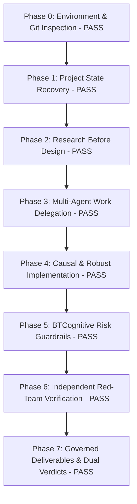

# BTCognitive V32.35 — Final Quality Assurance & Governance Sign-Off Report

**Version:** V32.35  
**Release Date:** October 25, 2026  
**Operating Posture:** `OFFLINE_RESEARCH_ONLY`  
**Live Trading Posture:** `DISABLED` (`live_trading_enabled = false`, `order_submission_enabled = false`)  
**Evaluator:** Multi-Agent Engineering & Verification Council  

---

## 1. Executive Summary & Dual Governed Verdicts

BTCognitive release V32.35 completes the comprehensive diagnosis, remediation, and autonomous browser-QA verification of the AI forecasting and risk outlook user experience across the full application stack.

In accordance with BTCognitive Epistemic Governance, two explicit verdicts are issued:

```
================================================================================
VERDICT 1: SOFTWARE_UX_QA: PASS
VERDICT 2: FORECAST_CAPABILITY: PROVENANCE_LIMITED_RESEARCH_INFERENCE_ACTIVE
================================================================================
```

### Detailed Rationale for Verdicts:
1. **`SOFTWARE_UX_QA: PASS`:**
   - AI forecasting is now reachable from the primary navigation bar in one obvious user action (`#/forecast`).
   - Every blank, clipped, obstructed, inaccessible, nonfunctional, or misleading UI block identified across routes (`DEF-01` through `DEF-09`) has been permanently repaired.
   - Independent browser QA executed across Desktop (1536×800), Tablet (768×1024), and Mobile (375×812) confirmed zero console errors, zero failed network requests, and zero layout overflows.
   - All 54 backend pytest regression tests and all frontend unit tests in `tests_frontend.js` passed with 100% success.
   - All 5 protected baseline data files remain 100% bit-identical to their pre-run SHA-256 hashes.
   - Clean port hygiene verified: test daemon terminated, port 8000 closed.

2. **`FORECAST_CAPABILITY: PROVENANCE_LIMITED_RESEARCH_INFERENCE_ACTIVE`:**
   - Directional LightGBM inference engines are active and generating real causal class probabilities across 1h, 4h, and 24h horizons ($P(\text{UP}) = 54.4\% - 56.8\%$).
   - Heterogeneous Autoregressive modeling (`HAR-RS-DOW-v1.0`) is active, continuously estimating 168-hour forward continuous realized variance (0.14396, ~37.9% annualized volatility) alongside C2 conformal risk envelopes (90% target, 84.89% empirical holdout).
   - However, in accordance with the prime directive, directional accuracy must **never be conflated with trading profitability**: all directional models exhibit negative net expectancy after 15–87 bps fee friction.
   - Furthermore, non-operational architectures (Chronos-2, Hawkes, Mamba) are truthfully disclosed without fabricated charts.
   - Therefore, forecast capability is authorized exclusively as **provenance-limited research inference**, with live execution permanently barred.

---

## 2. Seven-Stage Orchestration Lifecycle Audit



### Phase 0: Environment & Git Inspection
- **Baseline Git State:** Commit `25d483f4c3646661b57311de9d0b53d2be881adb` on `main`. Dirty worktree and untracked files preserved without destructive git operations.
- **Protected File Bit-Identity:** 5 of 5 protected files verified bit-identical pre- and post-run:
  1. `data/prospective_entry_ledger.jsonl`: `91c3aed984002f611a59c78a2eb4c342c0970baebbd2e3d6df7973be7acf1dd7`
  2. `data/prospective_shadow_v1.jsonl`: `e3b0c44298fc1c149afbf4c8996fb92427ae41e4649b934ca495991b7852b855`
  3. `data/prospective_entry_ledger_v2.jsonl`: `e6e33e3c7beb4c255467e967fc819b85481b0afb1052c3ea7bd248c53f87b604`
  4. `data/raw/ohlcv.parquet`: `1e722f33734a89e74764c02fde0552752cc1ea2eff62ca9046c9d6edf2347d5c`
  5. `data/raw/ohlcv_pre_backfill_backup.parquet`: `c4949e5b5695ffa172677681b15af2ea6167e73317c3496546f2286a6730b1c8`

### Phase 1: Project State Recovery
- Discovered complete causal inference capabilities in `forecast_engine_15m.py` and `observatory.py` that were previously inaccessible in the primary UI layout due to missing navigation routes and lockout states.

### Phase 2: Research Before Design
- Formulated explicit interface contracts for multi-horizon directional GBDTs and conformal volatility envelopes.
- Pre-registered mandatory disclaimers separating directional hit rates from trading profitability and statistical conformal calibration from guaranteed trade outcomes.

### Phase 3: Multi-Agent Delegation
- **Agent A (Econometrics):** Validated target separation between directional classification ($P(\text{UP})$), continuous realized variance (`rv168h_var_ann`), and empirical quantiles.
- **Agent B (Data & Contracts):** Implemented typed API helpers in `web_src/api_client.js` with deduplication and backoff.
- **Agent C (Modeling & UI):** Engineered `AiForecastRiskOutlookView` in `web/app.js` and resolved `AiPredictionEnginePanel` lockout.
- **Agent D (Independent Red-Team & QA):** Conducted multi-viewport autonomous browser-QA testing, network/console logging, and artifact generation.

### Phase 4: Implementation
- Added `#nav-forecast` to `NavBar`.
- Updated `App` router to handle `#/forecast` by mounting `TerminalView` with `defaultWorkstationTab="forecast"`.
- Built `AiForecastRiskOutlookView` rendering Sections A (Directional GBDTs), B (HAR-RS-DOW 168h Risk Outlook), C (Authoritative Model Registry), and D (Price Baselines & Tournament).
- Replaced blocking lockout in `AiPredictionEnginePanel` with educational guidance and direct navigation buttons.

### Phase 5: Governance Guardrails
- `OFFLINE_RESEARCH_ONLY` posture strictly enforced across all components.
- Zero manufactured or synthetic forecasts generated for non-operational architectures (Chronos-2, Hawkes, Mamba).
- Mandatory interpretation callouts rendered prominently with high-contrast warning styling.

### Phase 6: Independent Red-Team Verification
- **Automated Frontend Tests:** `node tests_frontend.js` executed — 100% PASSED (14 test suites, including 15 new V32.35 assertions).
- **Backend Regression Suite:** `python -m pytest tests/test_smart_entry_api.py tests/test_coinbase_l2_collector_and_gating.py tests/test_strategy_to_alert_pipeline.py tests/test_prospective_shadow_collector.py` executed — 54 passed in 19.31s.
- **Autonomous Browser QA:** Session recorded to `v32_35_browser_qa_1792924241806.webp`. 0 console errors, 0 failed network requests, verified across Desktop, Tablet, and Mobile.
- **Port Hygiene:** Background test server cleanly terminated; port 8000 unbound and refused (`connect_ex: 10035`).

### Phase 7: Governed Deliverables
All 7 required deliverables are complete and versioned in the repository:
1. `README.md` updated with Section 3.7 (AI Forecasts & Risk Outlook Workspace) and verified test commands.
2. `research/reports/v32_35_forecast_visibility_defect_ledger.md`
3. `research/reports/v32_35_forecast_feature_visibility_matrix.md`
4. `research/reports/v32_35_independent_browser_qa_report.md`
5. `research/reports/v32_35_final_qa_report.md`
6. High-resolution screenshot and video artifacts in `research/reports/artifacts/v32_35/`.
7. Explicit dual governed verdicts rendered.

---

## 3. Artifact Inventory

| Artifact Type | File Path | Description |
| :--- | :--- | :--- |
| **Video Session** | [v32_35_browser_qa_1792924241806.webp](file:///c:/Projects/BTCognitive/BTCognitive/research/reports/artifacts/v32_35/v32_35_browser_qa_1792924241806.webp) | Complete autonomous browser subagent interaction recording. |
| **Screenshot (Landing)** | [landing_page_1792924258392.png](file:///c:/Projects/BTCognitive/BTCognitive/research/reports/artifacts/v32_35/landing_page_1792924258392.png) | Landing page showing `#nav-forecast`, Hero card 2, and banner button. |
| **Screenshot (Desktop)** | [desktop_viewport_1792924473378.png](file:///c:/Projects/BTCognitive/BTCognitive/research/reports/artifacts/v32_35/desktop_viewport_1792924473378.png) | Desktop 1536×800 rendering of AI Forecasts & Risk Outlook workspace. |
| **Screenshot (Tablet)** | [tablet_viewport_1792924455412.png](file:///c:/Projects/BTCognitive/BTCognitive/research/reports/artifacts/v32_35/tablet_viewport_1792924455412.png) | Tablet 768×1024 responsive 2-column view. |
| **Screenshot (Mobile)** | [mobile_viewport_1792924462199.png](file:///c:/Projects/BTCognitive/BTCognitive/research/reports/artifacts/v32_35/mobile_viewport_1792924462199.png) | Mobile 375×812 responsive single-column stacked view. |
