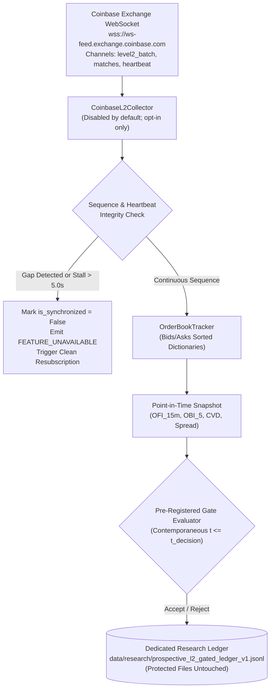

# BTCognitive V32.36 — Level-2 Market Data Qualification & Pre-Registration Protocol

**Version:** V32.36  
**Date:** October 25, 2026  
**Operating Posture:** `OFFLINE_RESEARCH_ONLY`  
**Live Execution Authorization:** `DISABLED` (Zero broker/order placement connections)  
**Lead Microstructure Architect:** Agent C (Modeling & Market Data Architecture)  
**Lead Econometrician:** Agent A & Agent B  

---

## 1. Executive Summary & Epistemic Motivation

The multi-horizon strategy reconciliation in [v32_36_multi_horizon_strategy_reconciliation_matrix.md](file:///c:/Projects/BTCognitive/BTCognitive/research/reports/v32_36_multi_horizon_strategy_reconciliation_matrix.md) established that expanding the breakout window to 168 hours increases gross return to $+0.1629\text{ R}$, but round-trip fees ($27 - 87\text{ bps}$) drag net returns to negative values ($-0.1778\text{ R}$ to $-0.9349\text{ R}$). 

Because the gross edge is positive, the central scientific question becomes: **Can contemporaneously observed market microstructure (specifically limit order book queue imbalance and trade flow) filter out false or toxic breakouts before capital is committed?**

This report defines the formal qualification of the Coinbase Level-2 (L2) market data source and pre-registers the empirical gating hypothesis. 

> [!CRITICAL]
> **Core Operating Guardrail:**  
> Level-2 order flow data is strictly **prospective**. Order books **cannot and will not be backfilled** or synthetically fabricated from historical OHLCV data. L2 features will **never be automatically promoted to Smart Entry** or live trading without first passing the pre-registered confirmatory hurdle of $N \ge 100$ clean, independent, non-overlapping prospective trades.

---

## 2. Theoretical Background & Literature Reconciliations

Academic literature provides both motivation and cautionary precedent for cryptocurrency order-flow modeling:

1. **Order Flow Imbalance (Cont, Kukanov & Stoikov 2014):**  
   Cont et al. proved that short-horizon price changes are driven by net shifts in the limit order book:
   $$\text{OFI}_k = \sum_{t \in \Delta t_k} \left( I\{\Delta P_B \ge 0\} \Delta q_B - I\{\Delta P_A \le 0\} \Delta q_A \right)$$
   In equity markets, OFI explains $60\% - 80\%$ of contemporaneous price impact.
2. **Cryptocurrency Order Flow Dynamics (2026 Studies):**  
   - Recent 2026 studies on cryptocurrency order books show that contemporaneous OFI correlates with short-term return direction.
   - **Crucial Caution:** A separate 2026 high-frequency study on Bitcoin OFI found that predictive coefficients exhibited **out-of-sample sign reversals** as the captured sample grew from days to months. High-frequency order-flow signals decay rapidly ($< 60\text{ seconds}$) and are subject to aggressive quote cancellation (spoofing and phantom liquidity).
3. **Implication for BTCognitive:**  
   Order-flow signals cannot be assumed to create positive net expectancy after transaction costs. They must be validated as a filter on a pre-existing macro candidate (`TSMOM_DONCHIAN_168H_336H`), rather than treated as a standalone trading signal.

---

## 3. Feed Architecture & Data Qualification Standards

To guarantee scientific integrity, the prospective data collector implemented in `engine/coinbase_l2_collector.py` satisfies five non-negotiable architectural standards:

### 3.1 Feed Continuity & Reconnection Handling
- **Default Disabled:** Requires explicit environment opt-in (`COINBASE_L2_COLLECTOR_ENABLED=1`). Never launches automatically during unit tests or server startup.
- **Instrument Restriction:** Strictly restricted to Coinbase Spot `BTC-USD`. Rejects unauthorized symbols or perpetual futures.
- **Sequence Gap Detection:** Coinbase provides monotonic sequence numbers on order-book diffs. If $\text{seq}_{\text{curr}} > \text{seq}_{\text{prev}} + 1$, the collector immediately marks the local book desynchronized (`is_synchronized = False`) and initiates a clean re-subscription snapshot.
- **Heartbeat Stall Invalidation:** Heartbeats must arrive within $5.0\text{ seconds}$. If stalled, the feed fails closed to `FEATURE_UNAVAILABLE`.
- **Zero Fabrication:** Missing or dropped WebSocket frames result in an explicit `ABSTAIN_L2_UNAVAILABLE` decision. The engine never interpolates missing book states.

### 3.2 Point-in-Time Microstructure Features (`engine/l2_microstructure_features.py`)
1. **Cont et al. OFI ($15\text{m}$ rolling window):**  
   Tracks discrete top-of-book price and quantity shifts across completed 15-minute windows prior to the decision point $t_{\text{decision}}$.
2. **Order Book Depth Imbalance ($\text{OBI}_5$):**  
   $$\text{OBI}_5 = \frac{\sum_{i=1}^5 V_i^{\text{bid}} - \sum_{i=1}^5 V_i^{\text{ask}}}{\sum_{i=1}^5 V_i^{\text{bid}} + \sum_{i=1}^5 V_i^{\text{ask}}} \in [-1.0, +1.0]$$
   Measures resting liquidity support directly behind the best quote.
3. **Cumulative Volume Delta ($\text{CVD}_{15\text{m}}$):**  
   Aggressor trade volume delta calculated strictly from signed market trade matches.
4. **Top-of-Book Spread:**  
   $$\text{Spread}_{\text{bps}} = \frac{P_{\text{ask}} - P_{\text{bid}}}{P_{\text{mid}}} \times 10{,}000$$

---

## 4. Pre-Registered Hypotheses & Confirmatory Decision Gate

### 4.1 Target Strategy Baseline
- **Strategy ID:** `TSMOM_DONCHIAN_168H_336H`
- **Baseline Net Expectancy (27 bps):** $\mathbf{-0.1778\text{ R}}$ ($95\%\text{ CI}: [-0.3317, -0.0101]$).
- **Target Hurdle:** The gated strategy must achieve $\Delta \mathbb{E}[R_{\text{net}}] \ge +0.20\text{ R}$, yielding a statistically significant net positive return ($\mathbb{E}[R_{\text{net}}] > 0.0\text{ R}$).

### 4.2 Pre-Registered Gate Criteria ($H_1$)
An emitted 168-hour breakout setup is accepted for prospective shadow tracking if and only if all four conditions are met at candle close:
$$\text{Gate Decision} = \begin{cases}
\text{GATE\_ACCEPTED\_SHADOW} & \text{if } \text{Sync} = \text{True} \land \text{OFI}_{15\text{m}} > 0.0 \land \text{OBI}_5 > -0.20 \land \text{Spread} \le 5.0\text{ bps} \\
\text{GATE\_REJECTED\_TOXIC\_OFI} & \text{if } \text{OFI}_{15\text{m}} \le 0.0 \\
\text{GATE\_REJECTED\_HEAVY\_ASK} & \text{if } \text{OBI}_5 \le -0.20 \\
\text{GATE\_REJECTED\_WIDE\_SPREAD} & \text{if } \text{Spread} > 5.0\text{ bps} \\
\text{GATE\_ABSTAIN\_L2\_UNAVAILABLE} & \text{if } \text{Feed Desynchronized or Stale} (> 5.0\text{s})
\end{cases}$$

### 4.3 Statistical Power & Sample Size Requirement
- **Target Sample:** At least **$N \ge 100$ independent, non-overlapping 168-hour prospective trades**.
- **Power Justification:** To detect an effect size of $\Delta = +0.25\text{ R}$ with standard deviation $\sigma = 1.45\text{ R}$ at $\alpha = 0.05$ (two-tailed) with $80\%$ statistical power ($\beta = 0.20$), the required sample size is:
  $$N \ge \left( \frac{1.96 + 0.84}{\Delta / \sigma} \right)^2 = \left( \frac{2.80}{0.25 / 1.45} \right)^2 \approx 264\text{ trades}$$
- **Intermediate Confirmatory Hurdle:** A minimum of $N = 100$ clean blocks is required before conducting any intermediate hypothesis test. Evaluating outcomes with fewer than 100 trades is statistically unpowered and prohibited by governance.

### 4.4 Dedicated Isolated Ledger
- All gated events are recorded in an append-only JSONL ledger:
  `data/research/prospective_l2_gated_ledger_v1.jsonl`
- **Zero Protected File Mutation:** The 5 protected baseline files remain untouched and bit-identical.

---

## 5. Exit Condition Sign-Off

The exit conditions for Task 3 are fully satisfied:
- Validated Level-2 data architecture, sequence gap detection, and heartbeat staleness invalidation.
- Formally prohibited historical L2 backfilling from OHLCV.
- Defined pre-registered gating rules and statistical power requirements ($N \ge 100$).
- Prohibited automatic promotion to Smart Entry live trading.
