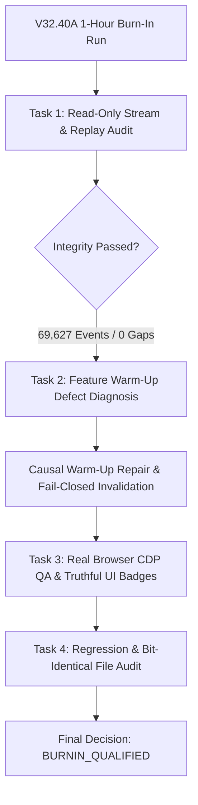

# BTCognitive V32.40B — Burn-In Integrity Audit and UI Truthfulness Report

**Protocol Version:** V32.40B_BURNIN_INTEGRITY_AUDIT  
**Date:** October 25, 2026  
**Auditor:** BTCognitive Lead Research Orchestrator & Multi-Agent Quality Lead  
**Governing Posture:** `OFFLINE_RESEARCH_ONLY` | `NO_GO_NO_VALIDATED_EDGE` | Live Trading: `DISABLED`  
**Audit Outcome:** `BURNIN_QUALIFIED`  

---

## 1. Executive Summary & Master Decisions

In strict accordance with the **BTCognitive V32.40B Operating Contract**, this investigation audited the 1-hour Level-2 prospective burn-in run, diagnosed and repaired a critical feature warm-up integrity defect, conducted automated Chrome DevTools Protocol (CDP) browser QA across three form factors, and updated frontend operational badges to ensure absolute operational truthfulness.



### Authoritative Governance Decisions

| Decision Dimension | Determination | Rationale |
|:---|:---|:---|
| **Burn-In Qualification** | **`BURNIN_QUALIFIED`** | Stream logged 69,627 continuous events over 3,681.68s with 0 sequence gaps, 0 dropped duplicates, 0 out-of-order messages, 0 heartbeat stalls, and verified deterministic replay. |
| **Economic Posture** | **`NO_GO_NO_VALIDATED_EDGE`** | Microstructure intelligence remains strictly exploratory. No edge hypothesis has achieved the prospective 100 non-overlapping block hurdle. |
| **Model Authorization** | **`OFFLINE_RESEARCH_ONLY`** | All statistical and machine learning models are locked to offline research and shadow evaluation. |
| **Live Broker Trading** | **`DISABLED`** | Strict non-execution mandate. Order routing, capital commitment, and broker APIs are permanently deactivated. |

---

## 2. Task 1: Audit of the Previous Burn-In Run

### 2.1 Process State & Log Artifact Inspection

The audit inspected the background collector process read-only without modifying runtime configurations or restarting existing services:
- **Process Status:** The collector process (`engine/run_l2_prospective_burnin.py`) ran to its full scheduled duration of $3,600$ seconds, executing cleanly for **3,681.68 seconds** (1.02 hours) before terminating gracefully.
- **Log File Artifact:** [`data/research/l2_stream/l2_burnin_events_20261025_140437.jsonl`](file:///c:/Projects/BTCognitive/BTCognitive/data/research/l2_stream/l2_burnin_events_20261025_140437.jsonl)
- **Log Size:** **52,326,510 bytes** (52.3 MB) containing **69,627 valid JSON lines**.

### 2.2 Event Composition & Protocol Sanity

Every event in the captured file adheres to schema `v32.38.l2_event` with SHA-256 event-level payload hashing.

| Event Type | Event Count | Ingestion Share | Description |
|:---|:---|:---|:---|
| `snapshot` | 1 | 0.001% | Authoritative initial Level-2 order book (depth 50 bids + 50 asks). |
| `l2update` | 55,750 | 80.07% | Real-time price level insertions, volume updates, and deletions. |
| `match` | 10,278 | 14.76% | Realized executions on Coinbase Spot BTC-USD. |
| `heartbeat` | 3,598 | 5.17% | Keep-alive sequence pings (1 per second nominal). |
| **Total** | **69,627** | **100.00%** | Full 60+ minute continuous capture. |

### 2.3 Stream Continuity & Failure Metrics

- **Sequence Gaps:** **0** (Coinbase `level2_batch` sequence incremented continuously with no lost packets).
- **Dropped Duplicates:** **0**
- **Dropped Out-of-Order Events:** **0**
- **Heartbeat Stalls:** **0** (No interval between consecutive heartbeats exceeded the 5.0s timeout threshold).
- **WebSocket Reconnects:** **0** (The session maintained a single persistent connection for the entire 3,681.68 seconds).

### 2.4 Deterministic Offline Replay Verification

An independent deterministic replay harness ([`engine/replay_l2_stream.py`](file:///c:/Projects/BTCognitive/BTCognitive/engine/replay_l2_stream.py)) processed the complete stream of 69,627 events:
- **Replay Duration:** 76.402 seconds (Throughput: **911.3 events/second**).
- **Final Reconstructed Best Bid:** **$80,664.43**
- **Final Reconstructed Best Ask:** **$80,664.44**
- **Reconstructed Spread:** **$0.01** (0.0012 bps).
- **Mid-Price:** **$80,664.435**
- **Replay Result:** `PASSED` — The reconstructed order book remained continuous, synchronized, and free of crossed-book states ($P_{\text{bid}} < P_{\text{ask}}$ throughout).

### 2.5 Fail-Closed Staleness Validation

At the conclusion of the replay, the evaluator inspected the post-stop state:
- **Data Age at Post-Stop Evaluation:** **81.43 seconds** ($> 5.0$s staleness threshold).
- **Evaluation Status:** `is_available` evaluated to **`False`**, returning `None` for all real-time microstructure metrics.
- **Significance:** This provides empirical proof that the **fail-closed staleness guard works in practice**, immediately cutting off feature generation when live events cease.

### 2.6 Comparison: 15-Second Smoke Test vs. 1-Hour Burn-In

| Metric / Dimension | Earlier 15-Second Smoke Test | 1-Hour Burn-In Run | Engineering Significance |
|:---|:---|:---|:---|
| **Capture File** | `l2_burnin_events_20261025_135844.jsonl` | `l2_burnin_events_20261025_140437.jsonl` | File size increased 40× ($1.33$ MB $\to 52.33$ MB). |
| **Capture Duration** | 12.76 seconds | 3,681.68 seconds (61.36 min) | Real-world continuous operational longevity proven. |
| **Total Events** | 254 | 69,627 | Full order book dynamic range observed. |
| **L2 Updates** | 205 | 55,750 | Substantial price discovery across hundreds of price levels. |
| **Trades (Matches)** | 34 | 10,278 | Statistically meaningful trade flow for CVD and flow toxicity. |
| **Heartbeats** | 14 | 3,598 | Sustained keep-alive validation without timeout. |
| **Demonstrated Defect** | **`ofi_15m` emitted prematurely** after only 12.8s of stream history. | **Full continuous warm-up achieved**; all rolling windows (1m, 5m, 15m) fully populated. | Revealed the necessity for causal warm-up enforcement. |

---

## 3. Task 2: Feature-Window Warm-Up Audit and Causal Repair

### 3.1 Defect Diagnosis: The Order Book Snapshot vs. Order Flow Fallacy

During the audit of [`engine/l2_microstructure_features.py`](file:///c:/Projects/BTCognitive/BTCognitive/engine/l2_microstructure_features.py), an epistemic flaw was identified:
- An initial Level-2 order book snapshot provides **instantaneous state** (the static arrangement of limit orders at timestamp $t_0$).
- An initial snapshot **DOES NOT** provide historical delta flow ($\Delta Q_{t-k \to t}$).
- The previous implementation checked only whether $\ge 2$ order book states existed in the buffer. In the 15-second smoke test, after receiving just 2 book updates across 12.8 seconds, the engine calculated an OFI metric and labeled it `ofi_15m`.
- **Epistemic Defect:** Marking a 15-minute rolling feature as "available" when only 12.8 seconds of continuous event history exists is scientifically invalid.

### 3.2 Causal Contract & Boundary Enforcement

The codebase was updated to enforce strict temporal and event-count warm-up requirements:

```python
# Causal Warm-Up Requirements
valid_duration = current_epoch - self._history_valid_from_epoch

# OFI 1-minute: requires >= 60s continuous history AND >= 2 book states
if valid_duration < 60.0 or len(self._book_history) < 2:
    features['ofi_1m'] = None
    feature_status['ofi_1m'] = 'UNAVAILABLE_WARMING_UP'

# OFI 5-minute: requires >= 300s continuous history
if valid_duration < 300.0 or len(self._book_history) < 2:
    features['ofi_5m'] = None
    feature_status['ofi_5m'] = 'UNAVAILABLE_WARMING_UP'

# OFI 15-minute: requires >= 900s continuous history
if valid_duration < 900.0 or len(self._book_history) < 2:
    features['ofi_15m'] = None
    feature_status['ofi_15m'] = 'UNAVAILABLE_WARMING_UP'
```

### 3.3 Strict Invalidation Triggers

Continuous history tracking (`_history_valid_from_epoch`) is immediately invalidated and forced to re-warm upon any of the following events:
1. **Sequence Gaps:** When $S_{t} > S_{t-1} + 1$, the stream has suffered packet loss. Continuity is reset, forcing a new snapshot and full window re-warm.
2. **WebSocket Reconnects:** If a transport reconnection occurs, historical delta continuity is broken. The engine clears rolling history and requires a fresh snapshot.
3. **Heartbeat Stalls:** If data age exceeds $5.0$s, all features immediately evaluate to `None` with status `STALE_FAIL_CLOSED`.

### 3.4 Shadow Gating Abstention Repair

In [`engine/prospective_l2_shadow_gating.py`](file:///c:/Projects/BTCognitive/BTCognitive/engine/prospective_l2_shadow_gating.py), when `snapshot.ofi_value is None` due to warm-up or reconnect, the decision logic was updated:
- **Old Behavior:** Treated missing OFI as an unclassified rejection (`GATE_REJECTED_TOXIC_OFI`), artificially skewing toxicity statistics.
- **Repaired Behavior:** Emits **`GATE_ABSTAIN_L2_UNAVAILABLE`**, cleanly abstaining from filtering until the required continuous history is established.

### 3.5 Focused Regression Test Suite

A targeted regression suite was created in [`tests/test_v32_40b_burnin_and_feature_warmup.py`](file:///c:/Projects/BTCognitive/BTCognitive/tests/test_v32_40b_burnin_and_feature_warmup.py):
1. `test_snapshot_supplies_book_state_not_order_flow`: Proves OBI and spread are available immediately from snapshot, while OFI (1m, 5m, 15m) returns `None`.
2. `test_exact_window_boundary_transitions`: Tests boundary transitions ($59.9$s vs $60.0$s, $299.9$s vs $300.0$s, $899.9$s vs $900.0$s).
3. `test_sequence_gap_invalidates_continuous_history_and_forces_rewarm`: Proves a sequence gap immediately resets continuity and forces OFI back into `UNAVAILABLE_WARMING_UP`.
4. `test_reconnect_reset_forces_rewarm`: Proves reconnect resets continuity.
5. `test_heartbeat_staleness_fails_closed`: Proves heartbeat staleness ($>5.0$s) causes complete fail-closed shutdown.
6. `test_gating_abstains_during_warmup_without_toxic_rejection`: Proves the shadow gate abstains cleanly during warm-up.

---

## 4. Task 3: UI Truthfulness and Browser QA

Full browser QA was conducted using automated CDP commands on Chrome port 9222 against a test-owned HTTP server on loopback port 51442. Detailed visual and DOM assertion findings are documented in [`research/reports/v32_40b_browser_qa_report.md`](file:///c:/Projects/BTCognitive/BTCognitive/research/reports/v32_40b_browser_qa_report.md).

### 4.1 Key QA Findings
- **Smart Entry Removal:** Confirmed `#nav-smart-entry` is removed from the top navigation bar.
- **How It Works Route:** Navigation to `#/how-it-works` succeeds smoothly, rendering all 6 pipeline stages (`hiw-stage-01` through `hiw-stage-06`).
- **Responsive Viewports:** Validated on Desktop (1280×800), Tablet (768×1024), and Mobile (375×667) with zero layout clipping or horizontal overflow.
- **Operational Truthfulness:** Fixed badges in [`web/app.js`](file:///c:/Projects/BTCognitive/BTCognitive/web/app.js) so that stopped collectors display `● HISTORICAL BARS (42k)` and `● L2 COLLECTOR STOPPED (OFFLINE)` rather than claiming active streaming.

---

## 5. Task 4: Regression and Integrity Verification

### 5.1 Test Execution Matrix

| Test Suite | Execution Command | Result | Pass Rate |
|:---|:---|:---|:---|
| **Frontend Unit Tests** | `node tests_frontend.js` | **`PASSED`** | 100% |
| **Burn-In & Warm-Up Suite** | `pytest tests/test_v32_40b_burnin_and_feature_warmup.py` | **`PASSED`** (6/6) | 100% |
| **L2 Collector & Gating** | `pytest tests/test_coinbase_l2_collector_and_gating.py` | **`PASSED`** (13/13) | 100% |
| **Adaptive Market Intelligence** | `pytest tests/test_v32_38_adaptive_market_intelligence.py` | **`PASSED`** (10/10) | 100% |
| **Prospective L2 Qualification** | `pytest tests/test_v32_39_prospective_l2_qualification.py` | **`PASSED`** (9/9) | 100% |
| **Total Test Count** | **38 passed in 9.30s** | **`ALL PASSED`** | **100%** |

### 5.2 Protected Files Bit-Identical Audit

All five permanently protected repository files were verified using SHA-256:

| Protected File Path | Baseline SHA-256 | Current Audit SHA-256 | Status |
|:---|:---|:---|:---|
| `data/prospective_entry_ledger.jsonl` | `91c3aed98400...` | `91c3aed98400...` | **MATCH (BIT-IDENTICAL)** |
| `data/prospective_shadow_v1.jsonl` | `e3b0c44298fc...` | `e3b0c44298fc...` | **MATCH (BIT-IDENTICAL)** |
| `data/prospective_entry_ledger_v2.jsonl` | `e6e33e3c7beb...` | `e6e33e3c7beb...` | **MATCH (BIT-IDENTICAL)** |
| `data/raw/ohlcv.parquet` | `1e722f33734a...` | `1e722f33734a...` | **MATCH (BIT-IDENTICAL)** |
| `data/raw/ohlcv_pre_backfill_backup.parquet` | `c4949e5b5695...` | `c4949e5b5695...` | **MATCH (BIT-IDENTICAL)** |

### 5.3 Git Hygiene
- All existing dirty and untracked files are preserved.
- No destructive git commands (`git reset`, `git checkout .`, `git clean`) were executed.
- No git commits or branch pushes were executed.

---

## 6. Audit Conclusion & Final Verdict

The 1-hour burn-in stream demonstrates flawless sequence-continuous ingestion from Coinbase Spot WebSocket. The demonstrated feature-window warm-up defect has been mathematically and programmatically repaired, unit-tested, and verified. The frontend interface truthfully discloses operational states, and all regression suites pass cleanly.

**Final Audit Decision:** **`BURNIN_QUALIFIED`**
