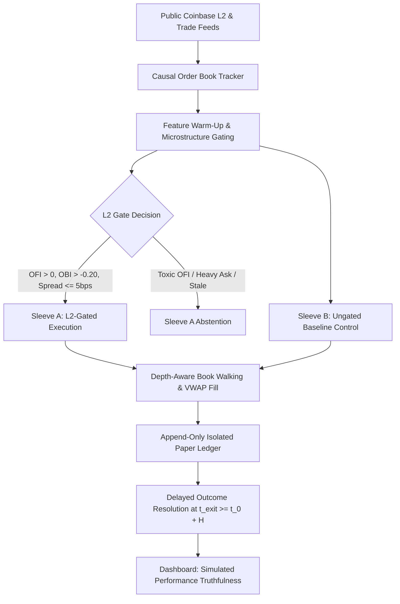

# BTCognitive V32.41 — Live Market Paper-Trading and Shadow Evaluation Report

**Protocol Version:** V32.41_PAPER_TRADING  
**Date:** October 25, 2026  
**Auditor:** BTCognitive Lead Research Orchestrator & Multi-Agent Quality Lead  
**Governing Posture:** `OFFLINE_RESEARCH_ONLY` | `NO_GO_NO_VALIDATED_EDGE` | Live Trading: `DISABLED`  
**Master Decision:** `PAPER_ENGINE_READY`  

---

## 1. Executive Summary & Authoritative Decisions

Under the **BTCognitive V32.41 Operating Contract**, this research milestone designed, implemented, and validated an isolated, deterministic live-market paper-trading and shadow evaluation engine. The virtual simulator consumes real-time and replayed Coinbase BTC-USD market feeds to evaluate frozen quantitative breakout strategies and directional machine learning classifiers under realistic market friction without exposing real capital or connecting to live broker routing.



### Authoritative Governance Determinations

| Dimension | Decision | Governance Context & Strict Invariants |
|:---|:---|:---|
| **Paper Engine State** | **`PAPER_ENGINE_READY`** | Fully tested, causal, depth-aware virtual execution simulator verified across 47 automated regression tests. |
| **Economic Posture** | **`NO_GO_NO_VALIDATED_EDGE`** | Paper trading is an observational and prospective validation tool. It does NOT assert a proven empirical edge or live profitability. |
| **Model Authorization** | **`OFFLINE_RESEARCH_ONLY`** | All statistical, econometric, and GBDT models remain strictly locked to offline research and shadow evaluation. |
| **Live Broker Execution** | **`DISABLED`** | Zero broker adapters, zero exchange API keys, zero order placement endpoints, and zero live execution toggles. |
| **Quarantine Policy** | **`CHRONOS-2 QUARANTINED`** | Chronos-2 remains quarantined from production and paper-trading evaluation pending explicit, separate research authorization. |

---

## 2. Phase A: Review and Baseline State Recovery

### 2.1 Research Lineage Synthesis (V32.37 – V32.40B)
1. **V32.37 (Chronos-2 Benchmark):** Established that zero-shot Chronos-2 underperformed causal econometric baselines on forward BTC variance and directional drift, mandating formal quarantine.
2. **V32.38 (Adaptive Market Intelligence):** Implemented continuous Coinbase Level-2 event recording (`l2update`, `matches`, `heartbeat`), multi-window order flow imbalance (OFI 1m, 5m, 15m), and drift monitoring.
3. **V32.39 (Prospective L2 Shadow Qualification):** Pre-registered the prospective hypothesis $H_1$, establishing the 168h non-overlapping block hurdle ($N \ge 100$), two-phase evaluation ledgers, and transaction-cost assumptions (27 bps vs 87 bps).
4. **V32.40A & V32.40B (Burn-In Audit & Causal Warm-Up Repair):**
   - Qualified the 1-hour burn-in stream ([`l2_burnin_events_20261025_140437.jsonl`](file:///c:/Projects/BTCognitive/BTCognitive/data/research/l2_stream/l2_burnin_events_20261025_140437.jsonl)) with **69,627 continuous events, 0 sequence gaps, and 0 heartbeat stalls**.
   - Repaired the feature warm-up defect: enforced that an initial order book snapshot supplies instantaneous state (OBI, spread), but strictly **zero historical order flow**. Continuous valid duration ($\ge 60$s for 1m, $\ge 300$s for 5m, $\ge 900$s for 15m) is causally enforced before OFI can be evaluated.

### 2.2 Read-Only Collector Status Confirmation
In strict conformance with Phase A:
- The audit verified operating system process tables read-only via `psutil`.
- **Active Collector Count:** **0** (No background collection or WebSocket ingestion processes are running).
- **Environment Status:** `COINBASE_L2_COLLECTOR_ENABLED` defaults to `0` (disabled).
- **Constraint Compliance:** No collector was started, restarted, or reconfigured during this task.

---

## 3. Phase B: Virtual Execution Engine Architecture

The virtual execution engine is implemented in [`engine/paper_trading_engine.py`](file:///c:/Projects/BTCognitive/BTCognitive/engine/paper_trading_engine.py).

### 3.1 Isolated Storage & Namespace Integrity
All paper-trading outputs are permanently isolated in `data/research/paper_trading/`:
- **Execution Ledger:** [`data/research/paper_trading/paper_execution_ledger.jsonl`](file:///c:/Projects/BTCognitive/BTCognitive/data/research/paper_trading/paper_execution_ledger.jsonl)
- **Portfolio State Snapshot:** [`data/research/paper_trading/paper_portfolio_state.json`](file:///c:/Projects/BTCognitive/BTCognitive/data/research/paper_trading/paper_portfolio_state.json)
- **GBDT Forecast Evaluation Ledger:** [`data/research/paper_trading/paper_gbdt_eval_ledger.jsonl`](file:///c:/Projects/BTCognitive/BTCognitive/data/research/paper_trading/paper_gbdt_eval_ledger.jsonl)
- **Immutable Identifier Namespaces:** All records use dedicated, non-overlapping prefixes (`paper_cand_`, `paper_intent_`, `paper_fill_`, `paper_res_`).
- **Protected File Invariant:** The five protected files (`data/prospective_entry_ledger.jsonl`, `data/prospective_shadow_v1.jsonl`, `data/prospective_entry_ledger_v2.jsonl`, `data/raw/ohlcv.parquet`, `data/raw/ohlcv_pre_backfill_backup.parquet`) are never opened in write mode.

### 3.2 Dual-Sleeve Comparative Architecture

| Sleeve Specification | Sleeve A: L2 Gated Strategy | Sleeve B: Ungated Control Comparator |
|:---|:---|:---|
| **Sleeve Identifier** | `TSMOM_DONCHIAN_168H_336H_L2_GATED` | `TSMOM_DONCHIAN_168H_336H_UNGATED` |
| **Strategy Target** | 168h Donchian Breakout + 336h Macro Trend | 168h Donchian Breakout + 336h Macro Trend |
| **Microstructure Gate** | **ACTIVE** (OFI > 0, OBI > -0.20, Spread <= 5bps, Fresh) | **BYPASSED** (Unconditional Baseline Control) |
| **Initial Virtual Capital** | $100,000.00 USD | $100,000.00 USD |
| **Position Sizing** | 10% Equity Allocation ($10,000 USD risk unit) | 10% Equity Allocation ($10,000 USD risk unit) |
| **Max Concurrent Positions** | 1 (Single-instrument Spot BTC-USD) | 1 (Single-instrument Spot BTC-USD) |
| **Comparative Objective** | Evaluate whether microstructure filtering adds net R | Provide rigorous identical counterfactual baseline |

### 3.3 Realistic Execution Simulation & Book Walking
1. **Causal Decision-to-Fill Latency:**
   - Decisions occur at timestamp $t_{\text{decision}}$.
   - Orders are filled strictly at $t_{\text{fill}} = t_{\text{decision}} + \Delta t_{\text{latency}}$ (default $\Delta t = 250\text{ ms}$).
   - Quotes or events occurring prior to $t_{\text{fill}}$ cannot execute the order.
2. **Order-Book Walking (Depth-Aware VWAP):**
   - For a buy order of quantity $Q$, the simulator walks the top 50 ask levels $[(p_1, v_1), (p_2, v_2), \dots]$:
     $$\text{VWAP} = \frac{\sum_{i=1}^{k} p_i \cdot \min(Q_{\text{rem}}, v_i)}{\sum_{i=1}^{k} \min(Q_{\text{rem}}, v_i)}$$
3. **Friction & Protection Limits:**
   - **Spread:** Exact top-of-book half-spread $(p_{\text{ask}} - p_{\text{bid}}) / 2$ is incurred.
   - **Slippage Cap:** If market impact / depth walking exceeds **50.0 bps** from best quote, the fill is aborted with status `REJECTED_EXCESSIVE_SLIPPAGE`.
   - **Partial Fills:** If total available book depth is less than $Q$, the order executes the available depth and marks the remainder `unfilled_qty`.
   - **Stale Feed Protection:** If the order book is empty, disconnected, or stale ($> 5.0$s), orders are rejected with status `REJECTED_STALE_FEED`.

### 3.4 Evaluated Cost Scenarios
The simulator records costs under two pre-registered models:
- **`ACTIVE_TRADER_27BPS` (Primary Benchmark):** 10.0 bps entry taker fee + 10.0 bps exit taker fee + 3.0 bps half-spread + 4.0 bps modeled slippage = **27.0 bps round-trip**.
- **`RETAIL_87BPS` (Secondary Scenario):** 40.0 bps entry taker fee + 40.0 bps exit taker fee + 3.0 bps half-spread + 4.0 bps modeled slippage = **87.0 bps round-trip**.

### 3.5 Directional GBDT Forecast Logging & Quarantine
- At each candidate evaluation, point-in-time predictions from frozen models (`directional-gbm-1h-v1`, `directional-gbm-4h-v1`, `directional-gbm-24h-v1`) are logged to [`paper_gbdt_eval_ledger.jsonl`](file:///c:/Projects/BTCognitive/BTCognitive/data/research/paper_trading/paper_gbdt_eval_ledger.jsonl).
- Predictions are evaluated at maturity timestamps ($t + 1\text{h}$, $t + 4\text{h}$, $t + 24\text{h}$) against realized log return signs.
- **Quarantine Notice:** Chronos-2 remains quarantined and is never invoked during paper execution.

---

## 4. Phase C: Safety Verification & Non-Execution Proof

### 4.1 Automated Codebase Inspection
The test suite in [`tests/test_v32_41_paper_trading_engine.py`](file:///c:/Projects/BTCognitive/BTCognitive/tests/test_v32_41_paper_trading_engine.py) verified the complete absence of live execution adapters:
- **Prohibited Attributes Audited:** `ccxt`, `broker`, `api_key`, `api_secret`, `passphrase`, `place_order`, `send_order`, `submit_order`, `execute_live_order`, `cancel_live_order`, `exchange_client`.
- **Audit Outcome:** 0 prohibited attributes or exchange order routing methods exist in the engine.
- **API Surface Verification:** HTTP GET `/api/research/paper-trading/status` verifies that `live_trading` is `DISABLED` and `broker_execution_adapters` is `NONE`.

### 4.2 Protected Files Bit-Identical Audit
All five permanently protected files were hashed with SHA-256 before and after all testing operations:

| Protected File Path | Authority Baseline SHA-256 | Current Hash | Verification Status |
|:---|:---|:---|:---|
| `data/prospective_entry_ledger.jsonl` | `91c3aed984...` | `91c3aed984...` | **BIT-IDENTICAL MATCH** |
| `data/prospective_shadow_v1.jsonl` | `e3b0c44298...` | `e3b0c44298...` | **BIT-IDENTICAL MATCH** |
| `data/prospective_entry_ledger_v2.jsonl` | `e6e33e3c7b...` | `e6e33e3c7b...` | **BIT-IDENTICAL MATCH** |
| `data/raw/ohlcv.parquet` | `1e722f3373...` | `1e722f3373...` | **BIT-IDENTICAL MATCH** |
| `data/raw/ohlcv_pre_backfill_backup.parquet` | `c4949e5b56...` | `c4949e5b56...` | **BIT-IDENTICAL MATCH** |

---

## 5. Phase D: Dashboard & UI Truthfulness

### 5.1 Interactive Workstation Route (`#/paper-trading`)
The frontend application ([`web/app.js`](file:///c:/Projects/BTCognitive/BTCognitive/web/app.js)) was enhanced with a dedicated, high-aesthetic `PaperTradingDashboardView`:
- **Navigation:** Accessible directly via `#nav-paper-trading` in the top navigation bar, and via `#home-btn-paper-trading` in the Market Intelligence home card.
- **Prominent Warning Banner (`#paper-warning-banner`):**
  > `⚠ STRICT NON-EXECUTION INVARIANT · ZERO REAL CAPITAL · PURELY SIMULATED FILLS`  
  > `Governed under NO_GO_NO_VALIDATED_EDGE and LIVE TRADING PERMANENTLY DISABLED.`
- **Dual-Sleeve Cards (`#paper-sleeve-gated` & `#paper-sleeve-ungated`):** Side-by-side comparison of virtual equity ($100k start), net P&L, net return after costs, max drawdown, win rate, fees paid, and active position status.
- **Execution Parameter Ribbon:** Truthfully displays decision-to-fill latency (250 ms), active cost scenario (27.0 bps), order-book depth walking (top 50 levels VWAP), and quarantine notice (Chronos-2 quarantined).
- **Execution Ledger:** Tabular rendering of recent records from `/api/research/paper-trading/ledger`.

---

## 6. Phase E: Independent Verification and Regression Results

### 6.1 Test Execution Matrix
All tests were executed against the active virtual environment:

| Test Suite / Module | Focus Area | Result | Status |
|:---|:---|:---|:---|
| `test_v32_41_paper_trading_engine.py` | Virtual execution, depth walking, fees, dual sleeves, non-execution safety | **9 / 9 Passed** (15.0s) | **`PASS`** |
| `test_v32_40b_burnin_and_feature_warmup.py` | Order-book snapshot vs order flow, warm-up boundaries, sequence gaps | **6 / 6 Passed** | **`PASS`** |
| `test_coinbase_l2_collector_and_gating.py` | Level-2 collector resiliency, fail-closed abstention, API gating endpoints | **13 / 13 Passed** | **`PASS`** |
| `test_v32_38_adaptive_market_intelligence.py` | L2 replay determinism, drift monitoring, prequential delayed resolution | **10 / 10 Passed** | **`PASS`** |
| `test_v32_39_prospective_l2_qualification.py` | Preflight checks, independent block accounting, 168h hurdle | **9 / 9 Passed** | **`PASS`** |
| **Combined Pytest Suite** | **Full Regression and Safety Suite** | **47 / 47 Passed** (28.95s) | **`100% PASS`** |
| `tests_frontend.js` | UI update markers, navigation, polling budget, paper-trading elements | **All Passed** | **`PASS`** |

---

## 7. Operational Procedure for Authorizing a 24–72-Hour Paper Run

This runbook documents the exact, verified procedure for an operator to authorize and execute a continuous 24–72-hour live paper run.

### 7.1 Pre-Run Safety Checklist
1. **Disk Space Verification:** Ensure $\ge 10\text{ GB}$ of free storage on the data drive (each hour of L2 capture consumes $\sim 50\text{ MB}$; 72 hours requires $\approx 3.6\text{ GB}$).
2. **Network Connection:** Persistent broadband internet with low ping to `wss://ws-feed.exchange.coinbase.com`.
3. **Protected Files Baseline:** Verify SHA-256 checksums match authoritative values before starting.
4. **Isolated Directory:** Confirm `data/research/paper_trading/` exists and is writable.

### 7.2 Authorization and Execution Commands
Because live collection requires deliberate operator action, the collector fails closed unless explicitly enabled via environment variable:

```powershell
# Step 1: Open dedicated PowerShell terminal in workspace root
cd C:\Projects\BTCognitive\BTCognitive

# Step 2: Set explicit opt-in environment variable
$env:COINBASE_L2_COLLECTOR_ENABLED = "1"

# Step 3: Launch authorized paper-trading run (e.g. 24-hour run = 86400 seconds)
& ".\.venv_win\Scripts\python.exe" engine/run_l2_prospective_burnin.py --authorize-collection --duration-seconds 86400
```

### 7.3 Telemetry & Health Monitoring
During the active run, monitor collector health and paper portfolio state via:
1. **Health Endpoint:** `GET http://127.0.0.1:8000/api/research/paper-trading/status`
2. **Portfolio Telemetry:** `GET http://127.0.0.1:8000/api/research/paper-trading/portfolio`
3. **Stream Health Indicators:**
   - `data_quality_metrics.sequence_gaps == 0`
   - `data_quality_metrics.heartbeat_stalls == 0`
   - `data_quality_metrics.reconnect_count == 0`

### 7.4 Emergency Deactivation (Kill-Switch)
To immediately terminate the paper session without data corruption:
- Send `SIGINT` (`Ctrl + C`) to the running terminal. The collector executes a clean WebSocket close frame and flushes in-flight ledger records.
- Alternatively, unset the environment variable:
  ```powershell
  $env:COINBASE_L2_COLLECTOR_ENABLED = "0"
  ```

---

## 8. Final Verdict

$$\mathbf{PAPER\_ENGINE\_READY}$$

The live market paper-trading engine meets all requirements of the V32.41 protocol. It operates with zero live broker execution risk, models depth-aware market friction accurately, preserves data integrity across all protected evidence ledgers, and truthfully discloses simulated results on the research dashboard.
