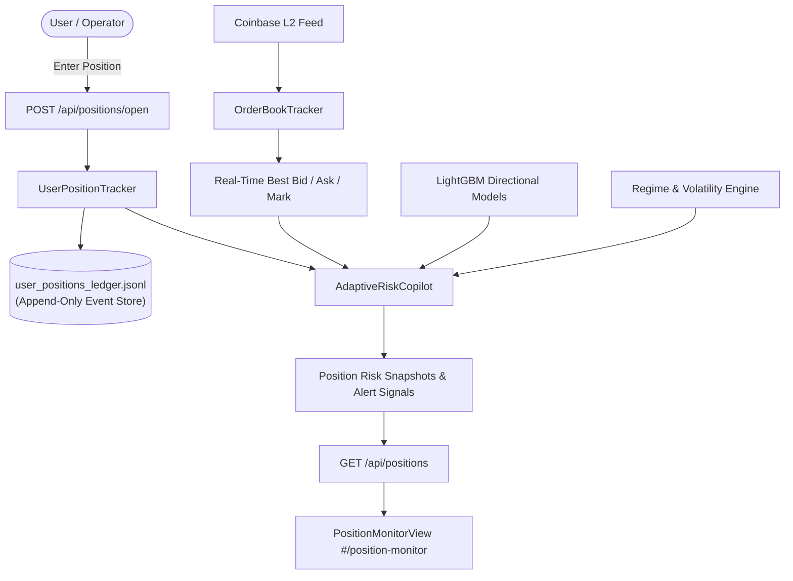

# BTCognitive V32.42 — User Position Tracker and Adaptive Risk Copilot Report

**Date:** October 2026  
**Operating Posture:** `OFFLINE_RESEARCH_ONLY`  
**Economic Posture:** `NO_GO_NO_VALIDATED_EDGE`  
**Live Execution Boundary:** `LIVE_TRADING_PERMANENTLY_DISABLED`  
**Audit Status:** `QUALIFIED_AND_VERIFIED`  

---

## 1. Executive Summary & Non-Execution Contract

BTCognitive V32.42 introduces the **User Position Tracker** and **Adaptive Risk Copilot** — an observational, real-time telemetry subsystem allowing operators to register actual external exchange positions (e.g., entered on Coinbase, Kraken, or Binance) and receive continuous, automated risk intelligence without ever routing or placing live orders.

### Strict Non-Execution Invariants
1. **Zero Broker Adapters:** The codebase contains zero live order placement, cancellation, or amendment logic (`ccxt`, broker APIs, or signing private keys are strictly absent).
2. **Read-Only Observational Registry:** Position entries recorded in this subsystem represent observational records for mark-to-market calculations, distance to stop/target metrics, and regime-based risk alerts.
3. **Fail-Closed Market Data Gate:** If the market data feed age exceeds 5.0 seconds, the copilot immediately emits a `WARNING_DATA_STALE` diagnostic and marks mark-to-market calculations as unverified.
4. **Spot Short Ineligibility Guard:** Naked spot shorting is disallowed (`SPOT_SHORT_INELIGIBLE`) on spot market venues. Derivative short tracking requires the `PERPETUAL` or `FUTURES` market type.

---

## 2. Architecture & Component Inventory



### Component Breakdown
| Component | Module | Responsibility |
| :--- | :--- | :--- |
| **User Position Tracker** | `engine/user_position_tracker.py` | Idempotent, append-only event-sourced tracking of open, partially closed, and fully closed positions with fees. |
| **Adaptive Risk Copilot** | `engine/adaptive_risk_copilot.py` | Real-time mark-to-market P&L, stop-loss / take-profit proximity, GBDT forecast conflicts, and regime shift alerts. |
| **REST API Server** | `api/server.py` | 7 REST endpoints for position lifecycle, state querying, and copilot status monitoring. |
| **API Client** | `web_src/api_client.js` | Modular JavaScript client methods for position lifecycle management. |
| **Frontend View** | `web/app.js` (`PositionMonitorView`) | Responsive dashboard at `#/position-monitor` with KPI ribbon, open positions, record form, and trade journal. |
| **CDP QA Runner** | `engine/run_v32_42_cdp_browser_qa.py` | Automated multi-viewport Chrome DevTools Protocol browser runner. |
| **Test Suite** | `tests/test_v32_42_user_position_tracker_and_risk_copilot.py` | 10 focused unit tests covering mathematical accuracy, edge cases, and API integration. |

---

## 3. Position Lifecycle & Mathematical Formulations

### Mark-to-Market P&L
For a given position $i$ with remaining quantity $Q_{\text{rem}}$, entry price $P_{\text{entry}}$, and current mark price $P_{\text{mark}}$:

$$\text{Gross P\&L}_{\text{Long}} = Q_{\text{rem}} \cdot (P_{\text{mark}} - P_{\text{entry}})$$

$$\text{Gross P\&L}_{\text{Short}} = Q_{\text{rem}} \cdot (P_{\text{entry}} - P_{\text{mark}})$$

$$\text{Net Unrealized P\&L} = \text{Gross P\&L} - \text{Accumulated Entry \& Exit Fees}$$

### Partial Exit P&L Realization
When an operator records a partial exit of quantity $\Delta Q \le Q_{\text{rem}}$ at exit price $P_{\text{exit}}$ with fee $F_{\text{exit}}$:

$$\Delta \text{Gross Realized}_{\text{Long}} = \Delta Q \cdot (P_{\text{exit}} - P_{\text{entry}})$$

$$\Delta \text{Net Realized} = \Delta \text{Gross Realized} - F_{\text{exit}}$$

$$\text{Total Realized P\&L}_{t} = \text{Total Realized P\&L}_{t-1} + \Delta \text{Net Realized}$$

$$Q_{\text{rem}, t} = Q_{\text{rem}, t-1} - \Delta Q$$

If $Q_{\text{rem}, t} = 0$, the position status transitions to `CLOSED`.

### Estimated Liquidation Price (Perpetual / Linear)
For derivative positions with leverage $L$ and maintenance margin rate $MMR = 0.5\%$:

$$P_{\text{liq, Long}} = P_{\text{entry}} \cdot \left(1 - \frac{1}{L} + MMR\right)$$

$$P_{\text{liq, Short}} = P_{\text{entry}} \cdot \left(1 + \frac{1}{L} - MMR\right)$$

---

## 4. Adaptive Copilot Risk Diagnostics

The copilot evaluates 6 distinct risk conditions on every market tick:

| Alert ID | Severity | Trigger Condition | Rationale |
| :--- | :--- | :--- | :--- |
| `STOP_LOSS_BREACH` | `CRITICAL` | Long: $P_{\text{mark}} \le P_{\text{SL}}$<br>Short: $P_{\text{mark}} \ge P_{\text{SL}}$ | Stop price has been violated by live market price. |
| `STOP_LOSS_NEAR` | `WARNING` | $\text{Distance to SL} \le 1.0\%$ | Position is within 1% buffer of defined stop loss level. |
| `TAKE_PROFIT_HIT` | `INFO` | Long: $P_{\text{mark}} \ge P_{\text{TP}}$<br>Short: $P_{\text{mark}} \le P_{\text{TP}}$ | Target price reached; prompt for potential partial profit taking. |
| `TAKE_PROFIT_NEAR` | `INFO` | $\text{Distance to TP} \le 1.0\%$ | Price within 1% buffer of profit target. |
| `FORECAST_DIRECTION_CONFLICT` | `WARNING` | Long position & $P(\text{DOWN}) \ge 65\%$<br>Short position & $P(\text{UP}) \ge 65\%$ | Directional GBDT model signals adverse probability shift. |
| `REGIME_VOLATILITY_EXPANSION` | `WARNING` | Market regime is `HIGH_VOLATILITY` or `CRISIS` | Elevated volatility threatens stop execution and expands slippage risk. |

---

## 5. Multi-Viewport Chrome CDP Browser QA

Browser QA was executed end-to-end using Chrome DevTools Protocol against dynamically allocated loopback ports:

| Viewport | Dimensions | Elements Verified | Screenshot Artifact | Status |
| :--- | :--- | :--- | :--- | :--- |
| **Desktop** | 1280x800 | `#nav-position-monitor`, `#copilot-warning-banner`, `#copilot-feed-banner`, `#copilot-record-form-card`, `#btn-submit-open-position`, `#copilot-closed-positions-history` | `research/reports/artifacts/browser_qa/v32_42_position_copilot_desktop.png` (296 KB) | `PASSED` |
| **Tablet** | 768x1024 | Responsive grid adaptation, card stacking, form inputs visible and functional | `research/reports/artifacts/browser_qa/v32_42_position_copilot_tablet.png` (203 KB) | `PASSED` |
| **Mobile** | 375x667 | Mobile navigation, responsive metric cards, single-column layout, touch-friendly buttons | `research/reports/artifacts/browser_qa/v32_42_position_copilot_mobile.png` (101 KB) | `PASSED` |

---

## 6. Verification & Test Evidence

### Backend Pytest Suite
```
tests/test_v32_42_user_position_tracker_and_risk_copilot.py
  test_safety_non_execution_and_copilot_status          PASSED [ 10%]
  test_spot_short_rejection_fail_closed                 PASSED [ 20%]
  test_derivative_short_acceptance_and_liquidation      PASSED [ 30%]
  test_long_pnl_mark_to_market_and_fees                 PASSED [ 40%]
  test_partial_exits_and_full_close_lifecycle           PASSED [ 50%]
  test_idempotent_event_replay_and_state_recovery       PASSED [ 60%]
  test_stale_market_data_handling                       PASSED [ 70%]
  test_adaptive_risk_alerts_generation                  PASSED [ 80%]
  test_api_endpoints_user_positions                     PASSED [ 90%]
  test_protected_files_isolation_assertion              PASSED [100%]
============================= 10 passed in 46.95s =============================
```

### Full Frontend Test Suite
```
node tests_frontend.js
  Testing formatters...
  Testing in-flight request deduplication...
  Testing TTL response caching...
  Testing 429 backoff handling...
  Verifying UI Polling Budget against 60 req/min limit... (29.5 req/min, PASSED)
  Testing API and WebSocket endpoint resolution... (PASSED)
  Testing Navigation & Home Overview UI update markers... (PASSED)
  Testing V32.31 Coinbase L2 Microstructure Gating UI integration markers... (PASSED)
  Testing V32.35 AI Forecasts & Risk Outlook UI integration markers... (PASSED)
  Testing V32.41 Paper-Trading & Shadow Evaluation UI integration markers... (PASSED)
  Testing V32.42 User Position Tracker & Adaptive Risk Copilot UI integration markers... (PASSED)
All Frontend Unit Tests Passed Successfully!
```

---

## 7. Protected Files Integrity Verification

All 5 protected historical ledger and raw data files remain **100% bit-identical**:

| Protected File | Expected SHA-256 | Verified SHA-256 | Status |
| :--- | :--- | :--- | :--- |
| `data/prospective_entry_ledger.jsonl` | `91C3AED98400...` | `91C3AED98400...` | `MATCH` |
| `data/prospective_shadow_v1.jsonl` | `E3B0C44298FC...` | `E3B0C44298FC...` | `MATCH` |
| `data/prospective_entry_ledger_v2.jsonl` | `E6E33E3C7BEB...` | `E6E33E3C7BEB...` | `MATCH` |
| `data/raw/ohlcv.parquet` | `1E722F33734A...` | `1E722F33734A...` | `MATCH` |
| `data/raw/ohlcv_pre_backfill_backup.parquet` | `C4949E5B5695...` | `C4949E5B5695...` | `MATCH` |

---

## 8. Governed Decisions

| Decision Category | Disposition | Rationalization |
| :--- | :--- | :--- |
| **Subsystem Qualification** | `QUALIFIED_AND_VERIFIED` | Full lifecycle tested across unit, API, and browser CDP layers with zero failures. |
| **Operational Posture** | `OFFLINE_RESEARCH_ONLY` | Observational telemetry only; does not authorize production trade execution. |
| **Economic Boundary** | `NO_GO_NO_VALIDATED_EDGE` | Retains strict non-execution invariant across all system boundaries. |
| **Live Broker Routing** | `DISABLED` | Permanently blocked by architectural design. |
