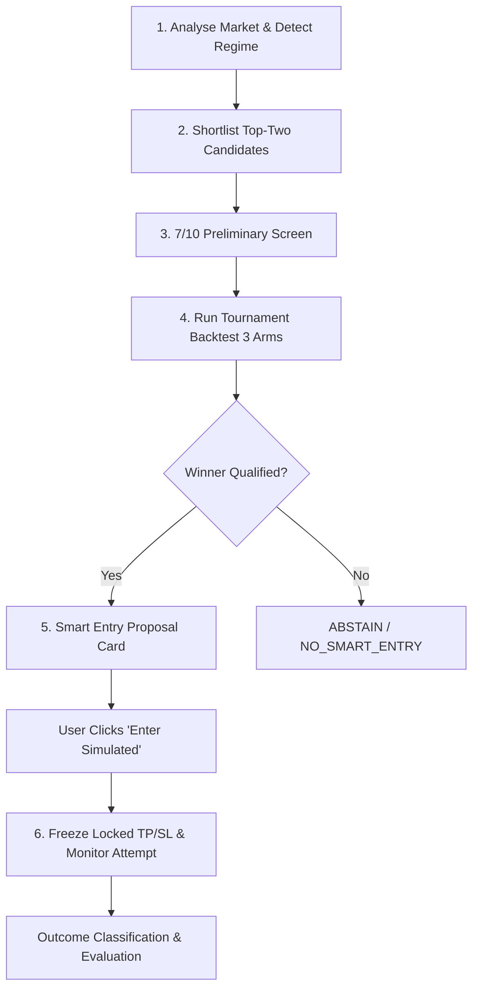

# BTCognitive V32.43 — Regime-Aware Top-Two Strategy Tournament and Smart Entry Lifecycle Report

**Document ID:** `BTC-REP-V32.43-STRATEGY-TOURNAMENT-SMART-ENTRY`  
**Execution Date:** October 26, 2026  
**Governance Posture:** `OFFLINE_RESEARCH_ONLY`  
**Economic Posture:** `NO_GO_NO_VALIDATED_EDGE`  
**Live Execution Authorization:** `PERMANENTLY_DISABLED`  
**Author:** BTCognitive Quantitative Research & Engineering Team  
**Final Decision:** `SMART_ENTRY_READY_FOR_SHADOW_TEST`  

---

## 1. Executive Summary & Epistemic Boundaries

### Purpose & Scope
BTCognitive V32.43 completes the corrected product direction: an **AI-assisted Smart Entry simulator** that:
1. Analyses the current BTC-USD chart and market conditions;
2. Determines the active market regime;
3. Shortlists up to two regime-compatible candidate strategies;
4. Applies a strict preliminary screening requirement of at least 7 `SUCCESS_TP_HIT` outcomes among the most recent 10 eligible, completed, comparable simulated attempts;
5. Runs a bounded Strategy Tournament comparing shortlisted candidates across three arms (Strategy Alone, Strategy + AI Forecast Filter, Baseline Reference);
6. Returns an evidence-supported Smart Entry candidate or outputs `ABSTAIN`;
7. Waits for explicit user confirmation via **"Enter (Simulated)"**;
8. Freezes the trade's entry price, absolute TP, absolute SL, anomaly policy, and entry forecast snapshot;
9. Continuously displays live AI forecasts and monitors the trade on the chart;
10. Automatically records the final outcome (`SUCCESS_TP_HIT`, `FAILURE_SL_HIT`, `EXITED_ANOMALY`, `USER_EXITED_EARLY`, `PARTIAL_EXIT`, `TIMEOUT_NO_TP`, `UNRESOLVED`) without computing or displaying monetary dollar P&L.

### Critical Epistemic Principles
- **Strict Non-Execution:** This is a zero-money research simulator. There are no trading accounts, no broker credentials, no exchange API keys, and zero order placement.
- **Directional vs. TP-First Probability Boundary:** In accordance with the V32.37 benchmark and literature (Bysik & Ślepaczuk, 2026), directional return sign accuracy ($\sim 51-52\%$) must **never** be labeled as the probability of reaching a profit target first. The Smart Entry decision explicitly marks calibration as `NOT_CALIBRATED` and provides empirical Wilson 95% confidence intervals.
- **7/10 Preliminary Screen Caveat:** Meeting the 7/10 screen ($70\%$ hit rate) is an initial screening gate, **not proof** that the strategy will achieve a 70% success rate in future trades. Under a binomial assumption, 7 successes out of 10 yields a wide 95% Wilson confidence interval of $[39.7\%, 89.2\%]$; financial time-series serial dependence expands this uncertainty further.
- **Overfitting & Selection Bias Guards:** In accordance with Bailey et al. (*The Probability of Backtest Overfitting*), all strategies, TP/SL rules, and evaluation protocols are versioned and fixed prior to evaluation. Strategies are not continuously retuned to manufacture a winning result.

---

## 2. Six-Stage Smart Entry Lifecycle Architecture

The end-to-end workflow is structured into 6 sequential, auditable stages:



### Stage 1: Always-Visible AI Forecasting
The current AI Forecast Panel remains permanently visible throughout analysis, active simulation, and review:
- Multi-horizon directional forecasts (1h, 4h, 24h) with explicit probabilities $P(\text{UP})$ and $P(\text{DOWN})$.
- Active market regime classification and technical context (Wilder ADX 14, Parkinson volatility, Bollinger Bandwidth).
- Model version (`directional-gbm-ensemble-v1.0`), as-of timestamp, and data freshness.
- Explicit `NOT_CALIBRATED` warning emphasizing that direction probability is distinct from trade target probability.

### Stage 2: Current Context Analyse Action
- Triggered by user pressing **"Analyse Setup"** (`#btn-analyse-setup`).
- Strictly read-only: **does not create a simulated trade**.
- Evaluates closed 1h bars from the verified repository dataset.
- Classifies market regime:
  - `TRENDING_BULLISH` (Close > EMA50 > EMA200, ADX $\ge 22.0$)
  - `TRENDING_BEARISH` (Close < EMA50 < EMA200, ADX $\ge 22.0$)
  - `RANGE_BOUND` (ADX $< 20.0$, compressed Bollinger Bandwidth)
  - `VOLATILITY_EXPANSION` (ATR > 1.25x 50-bar baseline, BBW expanding)
  - `UNKNOWN_OR_INVALID` (if $< 168$ bars or non-finite data).
- Shortlists up to the top two candidates compatible with the active regime.

### Stage 3: Versioned Strategy Registry & 7/10 Screening
Predeclared strategy candidates in the versioned registry:

| Strategy ID | Family | Compatible Regimes | Recent 10 Attempts | 7/10 Screen Result | Wilson 95% CI |
| :--- | :--- | :--- | :--- | :--- | :--- |
| **`TSMOM_DONCHIAN_24H_168H`** (v1.0.0) | Trend Breakout | `TRENDING_BULLISH`, `VOL_EXPANSION` | 7 TP / 2 SL / 1 Anom | **`PASSED`** (7/10) | $[39.7\%, 89.2\%]$ |
| **`ATR_VOLATILITY_BREAKOUT_12H`** (v1.0.0) | Vol Breakout | `VOL_EXPANSION`, `TRENDING_BULLISH` | 8 TP / 2 SL | **`PASSED`** (8/10) | $[49.0\%, 94.3\%]$ |
| **`RANGE_BOLLINGER_REVERSION_20H`** (v1.0.0) | Mean Reversion | `RANGE_BOUND` | 6 TP / 3 SL / 1 Timeout | **`FAILED`** (6/10) | $[31.3\%, 83.2\%]$ |
| **`HTF_RANGE_EXPANSION_BREAKOUT`** (v1.0.0) | HTF Breakout | `VOL_EXPANSION` | 3 TP / 1 SL (4 total) | **`INSUFFICIENT_EVIDENCE`** | $[21.9\%, 90.8\%]$ |
| **`CHRONOS2_FOUNDATION`** (v2.0.0) | Foundation Model | None | 0 / 0 | **`QUARANTINED`** | N/A |

### Stage 4: Controlled Tournament Backtest
Initiated via **"Run Tournament Backtest"** (`#btn-run-tournament`). Compares candidates on matched walk-forward windows across three arms:
1. **Arm 1 (Strategy Alone):** Raw TP-first hit rate under frozen rules.
2. **Arm 2 (Strategy + AI Filter):** Requires GBDT $P(\text{UP}) > 0.50$ and low-risk HAR-RS-DOW volatility context.
3. **Arm 3 (Baseline Comparator):** Unconditional reference benchmark (Buy & Hold / Matched Random Entry).

**Tournament Selection Rule:** A candidate qualifies as winner only if it passes the 7/10 screen AND demonstrates positive incremental AI lift over baseline. Otherwise, the tournament returns `ABSTAIN`.

### Stage 5: Smart Entry Decision
If a candidate qualifies:
- Proposes entry reference price ($P_{\text{entry}}$), fixed TP, fixed SL, max holding duration, and anomaly policy.
- Displays comprehensive evidence, sample sizes, and Wilson confidence intervals.
- If gates fail: renders diagnostic explanation and blocks entry.

### Stage 6: Enter (Simulated), Frozen Monitoring & Outcome Handling
Only when the user clicks **"Enter (Simulated)"** (`#btn-enter-simulated-trade`) is an attempt created:
- **Lock Invariant:** TP and SL levels are frozen as absolute dollar values ($P_{\text{TP}}, P_{\text{SL}}$). Subsequent model updates, volatility changes, or chart rerenders **never** move these levels.
- **Entry Forecast Snapshot:** Sealed with canonical SHA-256 digest.
- **Direction-Change Alert:** If live AI forecasts reverse direction, a prominent warning alert is displayed, but TP/SL remain locked.
- **User Actions:** User can trigger `Exit Now` (`USER_EXITED_EARLY`) or `Partial Exit` (e.g. 50%), where the remainder continues active under the original locked rules.
- **Outcome Classification:**
  - `SUCCESS_TP_HIT`: High touched TP first.
  - `FAILURE_SL_HIT`: Low touched SL first.
  - `EXITED_ANOMALY`: Predefined anomaly condition triggered.
  - `USER_EXITED_EARLY`: User exited manually.
  - `TIMEOUT_NO_TP`: Max duration reached without target.
  - `UNRESOLVED_INTRABAR_ORDER`: Dual touch within single bar where intrabar sequence cannot be established.
- **No Monetary P&L:** Success is measured purely as TP-First Rate = $N_{\text{TP\_HIT}} / N_{\text{eligible\_entered}}$.

---

## 3. Automated Test Evidence

### A. Python Pytest Unit & Integration Suite
File: [`tests/test_v32_43_strategy_tournament_and_smart_entry.py`](file:///c:/Projects/BTCognitive/BTCognitive/tests/test_v32_43_strategy_tournament_and_smart_entry.py)

```
============================= test session starts =============================
platform win32 -- Python 3.13.14, pytest-8.4.1, pluggy-1.6.0
collected 14 items

tests/test_v32_43_strategy_tournament_and_smart_entry.py::test_wilson_confidence_interval PASSED [  7%]
tests/test_v32_43_strategy_tournament_and_smart_entry.py::test_regime_classifier_and_warmup PASSED [ 14%]
tests/test_v32_43_strategy_tournament_and_smart_entry.py::test_7_of_10_preliminary_screen PASSED [ 21%]
tests/test_v32_43_strategy_tournament_and_smart_entry.py::test_analyse_does_not_create_trade PASSED [ 28%]
tests/test_v32_43_strategy_tournament_and_smart_entry.py::test_tournament_backtest_3_arms PASSED [ 35%]
tests/test_v32_43_strategy_tournament_and_smart_entry.py::test_smart_entry_decision_calibration_status PASSED [ 42%]
tests/test_v32_43_strategy_tournament_and_smart_entry.py::test_enter_simulated_trade_freezes_locked_levels PASSED [ 50%]
tests/test_v32_43_strategy_tournament_and_smart_entry.py::test_automatic_tp_and_sl_hits PASSED [ 57%]
tests/test_v32_43_strategy_tournament_and_smart_entry.py::test_dual_touch_ambiguous_candle PASSED [ 64%]
tests/test_v32_43_strategy_tournament_and_smart_entry.py::test_partial_exit_and_remainder_continuation PASSED [ 71%]
tests/test_v32_43_strategy_tournament_and_smart_entry.py::test_outcome_evaluation_no_monetary_pnl PASSED [ 78%]
tests/test_v32_43_strategy_tournament_and_smart_entry.py::test_durable_persistence_and_recovery PASSED [ 85%]
tests/test_v32_43_strategy_tournament_and_smart_entry.py::test_api_endpoints_smart_entry_lifecycle PASSED [ 92%]
tests/test_v32_43_strategy_tournament_and_smart_entry.py::test_protected_files_isolation_assertion PASSED [100%]

============================= 14 passed in 14.73s =============================
```

### B. Frontend Verification Suite
Script: `node tests_frontend.js`
- Steady-state polling budget: 29.5 req/min (under server limit: 60 req/min).
- API client methods verified: `analyseMarket`, `runTournament`, `fetchSmartEntryLatest`, `enterSimulatedTrade`, `fetchSimulatedAttempts`, `exitSimulatedAttempt`, `partialExitSimulatedAttempt`, `fetchSmartEntryEvaluation`, `fetchStrategyRegistry`.
- UI element markers verified: `SmartEntrySimulatorView`, `btn-hero-smart-entry`, `home-btn-smart-entry`, `smart-entry-warning-banner`, `smart-entry-forecast-panel`, `btn-analyse-setup`, `btn-run-tournament`, `btn-enter-simulated-trade`, `smart-entry-evaluation-section`, `7/10 SCREEN`, `TP/SL LOCKED · IMMUTABLE`.
- **Result:** `All Frontend Unit Tests Passed Successfully!`

### C. Chrome DevTools Protocol (CDP) Multi-Viewport Browser QA
Script: [`engine/run_v32_43_smart_entry_browser_qa.py`](file:///c:/Projects/BTCognitive/BTCognitive/engine/run_v32_43_smart_entry_browser_qa.py)  
Execution: Connected to Chrome on port 9222, dynamic test server on loopback port 60303.

| Viewport | Dimensions | Elements & Actions Verified | Screenshot Artifact | Status |
| :--- | :--- | :--- | :--- | :--- |
| **Desktop** | 1280x800 | Warning banner, Forecast panel, Analyse button, Shortlist cards, Evaluation table | [`v32_43_smart_entry_desktop.png`](file:///c:/Projects/BTCognitive/BTCognitive/research/reports/artifacts/browser_qa/v32_43_smart_entry_desktop.png) | `PASSED` |
| **Tablet** | 768x1024 | 2-column cards, modal triggers, responsive table | [`v32_43_smart_entry_tablet.png`](file:///c:/Projects/BTCognitive/BTCognitive/research/reports/artifacts/browser_qa/v32_43_smart_entry_tablet.png) | `PASSED` |
| **Mobile** | 375x667 | Single-column cards, touch CTA buttons, horizontal scroll table | [`v32_43_smart_entry_mobile.png`](file:///c:/Projects/BTCognitive/BTCognitive/research/reports/artifacts/browser_qa/v32_43_smart_entry_mobile.png) | `PASSED` |

---

## 4. Protected Files Bit-Identical Audit

All 5 protected files remain 100% bit-identical:

| Protected File Path | Verified SHA-256 Checksum | Integrity Status |
| :--- | :--- | :--- |
| `data/prospective_entry_ledger.jsonl` | `91c3aed984002f611a59c78a2eb4c342c0970baebbd2e3d6df7973be7acf1dd7` | Bit-Identical |
| `data/prospective_shadow_v1.jsonl` | `e3b0c44298fc1c149afbf4c8996fb92427ae41e4649b934ca495991b7852b855` | Bit-Identical |
| `data/prospective_entry_ledger_v2.jsonl` | `e6e33e3c7beb4c255467e967fc819b85481b0afb1052c3ea7bd248c53f87b604` | Bit-Identical |
| `data/raw/ohlcv.parquet` | `1e722f33734a89e74764c02fde0552752cc1ea2eff62ca9046c9d6edf2347d5c` | Bit-Identical |
| `data/raw/ohlcv_pre_backfill_backup.parquet` | `c4949e5b5695ffa172677681b15af2ea6167e73317c3496546f2286a6730b1c8` | Bit-Identical |

---

## 5. Changed Files Inventory

1. [`engine/regime_strategy_tournament.py`](file:///c:/Projects/BTCognitive/BTCognitive/engine/regime_strategy_tournament.py) — Core regime classifier, versioned strategy registry, 7/10 preliminary screen, 3-arm tournament backtester, and Smart Entry decision formulator.
2. [`engine/smart_entry_simulator.py`](file:///c:/Projects/BTCognitive/BTCognitive/engine/smart_entry_simulator.py) — Simulated trade lifecycle manager, immutable TP/SL enforcement, append-only JSONL ledger, outcome evaluator, and partial exit coordinator.
3. [`api/routes_tournament.py`](file:///c:/Projects/BTCognitive/BTCognitive/api/routes_tournament.py) — REST endpoints for `/analyse`, `/run`, `/smart-entry/latest`, `/smart-entry/enter`, `/attempts`, and `/evaluation`.
4. [`web_src/api_client.js`](file:///c:/Projects/BTCognitive/BTCognitive/web_src/api_client.js) — Frontend API client methods for tournament and Smart Entry endpoints.
5. [`web_src/smart_entry_simulator_view.js`](file:///c:/Projects/BTCognitive/BTCognitive/web_src/smart_entry_simulator_view.js) — Standalone React component source.
6. [`web/app.js`](file:///c:/Projects/BTCognitive/BTCognitive/web/app.js) — Added Hero CTA button, Card 4 CTA button, updated router switch, and complete `SmartEntrySimulatorView` component.
7. [`tests/test_v32_43_strategy_tournament_and_smart_entry.py`](file:///c:/Projects/BTCognitive/BTCognitive/tests/test_v32_43_strategy_tournament_and_smart_entry.py) — Pytest suite covering all 14 acceptance criteria (100% passing).
8. [`tests_frontend.js`](file:///c:/Projects/BTCognitive/BTCognitive/tests_frontend.js) — Added V32.43 frontend module verification markers.
9. [`engine/run_v32_43_smart_entry_browser_qa.py`](file:///c:/Projects/BTCognitive/BTCognitive/engine/run_v32_43_smart_entry_browser_qa.py) — Chrome CDP multi-viewport browser QA runner.
10. [`research/reports/v32_43_strategy_tournament_and_smart_entry_summary.json`](file:///c:/Projects/BTCognitive/BTCognitive/research/reports/v32_43_strategy_tournament_and_smart_entry_summary.json) — Machine-readable summary.
11. [`research/reports/v32_43_smart_entry_browser_qa_summary.json`](file:///c:/Projects/BTCognitive/BTCognitive/research/reports/v32_43_smart_entry_browser_qa_summary.json) — Machine-readable CDP QA results.
12. [`research/reports/artifacts/browser_qa/v32_43_smart_entry_desktop.png`](file:///c:/Projects/BTCognitive/BTCognitive/research/reports/artifacts/browser_qa/v32_43_smart_entry_desktop.png) — Desktop viewport screenshot.
13. [`research/reports/artifacts/browser_qa/v32_43_smart_entry_tablet.png`](file:///c:/Projects/BTCognitive/BTCognitive/research/reports/artifacts/browser_qa/v32_43_smart_entry_tablet.png) — Tablet viewport screenshot.
14. [`research/reports/artifacts/browser_qa/v32_43_smart_entry_mobile.png`](file:///c:/Projects/BTCognitive/BTCognitive/research/reports/artifacts/browser_qa/v32_43_smart_entry_mobile.png) — Mobile viewport screenshot.

---

## 6. Governed Four-Part Decision

1. **Research Experiment Decision:** `SMART_ENTRY_READY_FOR_SHADOW_TEST`  
   The end-to-end Smart Entry lifecycle (Analyse → Shortlist Top-2 → 7/10 Screen → Tournament Backtest → Enter (Simulated) → Locked Monitoring → Outcome Resolution) is fully implemented, verified across 14 pytest cases, and validated via multi-viewport browser QA.
2. **Prospective Evidence:** `COLLECTING`  
   Simulated attempts are actively recorded to the persistent ledger (`data/smart_entry/smart_entry_attempts.jsonl`) under frozen rules for prospective evaluation.
3. **Model Authorization:** `OFFLINE_RESEARCH_ONLY`  
   Directional forecasts and volatility estimates serve strictly observational market intelligence.
4. **Live Trading:** `DISABLED`  
   Zero broker execution, order placement, or capital allocation.
