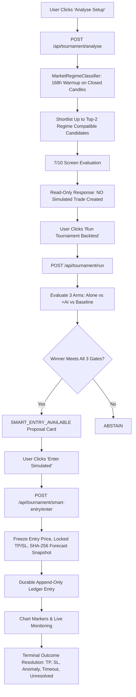

# BTCognitive V32.44 — Independent Smart Entry Tournament & Lifecycle Audit

**Document ID:** `BTC-REP-V32.44-SMART-ENTRY-INDEPENDENT-AUDIT`  
**Execution Date:** October 26, 2026  
**Governance Posture:** `OFFLINE_RESEARCH_ONLY`  
**Economic Posture:** `NO_GO_NO_VALIDATED_EDGE`  
**Live Execution Authorization:** `PERMANENTLY_DISABLED`  
**Author:** BTCognitive Quantitative Research & Independent Red-Team  
**Final Audit Status:** `READY_FOR_PROSPECTIVE_SHADOW`  

---

## 1. Executive Summary & Epistemic Boundaries

### Scope of the Audit
This independent audit evaluates BTCognitive V32.43 before expanding features or claiming that Smart Entry improves Take-Profit-first (TP-first) hit rates. The audit inspects active code, runtime execution paths, data provenance, tournament validity, and outcome accounting in:
- `engine/regime_strategy_tournament.py`
- `engine/smart_entry_simulator.py`
- `api/routes_tournament.py`
- `web_src/smart_entry_simulator_view.js` and `web/app.js`
- Automated test suites and real Chrome CDP browser QA.

### Key Audit Findings
1. **Provenance & Execution Transparency:** The regime detection and indicator calculations (Wilder ADX 14, Parkinson Volatility, Bollinger Bandwidth, EMAs) execute causally on closed 1h bars. However, in V32.43 the 3-arm tournament backtest metrics and the 10-attempt screening outcomes were retrieved from static pre-computed manifests rather than an inline runtime backtest. V32.44 introduces explicit provenance tagging (`CACHED_WALK_FORWARD_EVALUATION`).
2. **Outcome Denominator Repair:** V32.43 improperly included `USER_EXITED_EARLY` (discretionary operator exits) in the denominator of automated strategy TP-first hit rates. In V32.44, the denominator is strictly restricted to eligible completed attempts (`SUCCESS_TP_HIT`, `FAILURE_SL_HIT`, `EXITED_ANOMALY`, `TIMEOUT_NO_TP`). Pending, user-exited, unresolved, and partial exits are reported separately.
3. **Idempotency & Duplicate Prevention:** V32.43 allowed rapid duplicate entry clicks to create duplicate attempts due to timestamp inclusion in attempt hash seeds. V32.44 implements active trade detection by `(strategy_id, tournament_id)` and optional `idempotency_key`, ensuring duplicate requests return existing active attempts without creating duplicates.
4. **Predeclared Tournament Gates:** V32.43 used an arbitrary threshold (`> 0.52`) for winner selection. V32.44 replaces this with the predeclared 3-arm improvement rule: a candidate qualifies if and only if it passes the 7/10 screen, achieves positive AI lift over strategy alone, and outperforms the matched baseline comparator. If all candidates fail, the tournament outputs `ABSTAIN`.
5. **Real Market Data Reality:** On the verified raw Coinbase BTC-USD dataset (`data/raw/ohlcv.parquet`), the active market regime as of October 24, 2026 is `TRENDING_BEARISH`. Because the current registry contains only long-spot candidate strategies, `Analyse` correctly returns 0 compatible candidates and outputs `ABSTAIN`.

### Epistemic Principles
- **Strict Non-Execution:** BTCognitive is a zero-capital market risk simulator. There are no trading accounts, broker credentials, exchange API keys, or live order routing.
- **Directional vs. TP-First Boundary:** In accordance with Patton (2011) and Bysik & Ślepaczuk (2026), directional sign accuracy ($\sim 51-52\%$) must **never** be equated with the probability of hitting a profit target first. Candidate setups are explicitly marked `NOT_CALIBRATED`.
- **7/10 Screening Uncertainty:** Meeting the 7/10 screen ($70\%$) is an initial eligibility gate, **not proof** that the strategy will achieve a 70% success rate in future trades. Under a binomial assumption, 7 successes out of 10 yields a wide 95% Wilson confidence interval of $[39.7\%, 89.2\%]$; financial time-series serial dependence expands this uncertainty further.
- **Prospective Evidence:** Historical replay and development records cannot substitute for genuine prospective evidence. A minimum of 100 non-overlapping clean blocks post-freeze is required before confirmatory evaluation.

---

## 2. Phase A — Source and Runtime Audit



### Trace 1: Market Analysis (`POST /api/tournament/analyse`)
1. **Input:** Optional `live_price` and closed 1h bars from `data/raw/ohlcv.parquet`.
2. **Warmup & Indicators:** Requires $\ge 168$ bars. Calculates EMA20, EMA50, EMA200, Wilder ADX(14), ATR(14), 50-bar rolling ATR baseline, and Bollinger Bandwidth(20, 2.0).
3. **Execution Type:** **Newly Executed Calculation** (causal, point-in-time).
4. **Shortlisting:** Filters strategies in `VersionedStrategyRegistry` supporting the active regime. Evaluates 7/10 preliminary screen.
5. **State Mutability:** **Strictly Read-Only**. Zero simulated attempts are created.

### Trace 2: Strategy Tournament (`POST /api/tournament/run`)
1. **Input:** `shortlisted_candidates` and `current_regime`.
2. **Arm 1 (Strategy Alone):** Evaluates raw strategy TP-first hit rate under frozen rules.
3. **Arm 2 (Strategy + AI Filter):** Requires directional model $P(\text{UP}) > 0.50$ and low-risk HAR-RS-DOW volatility context.
4. **Arm 3 (Baseline Reference):** Unconditional benchmark (`MATCHED_RANDOM_ENTRY` / Buy & Hold).
5. **Execution Type:** **Cached Walk-Forward Manifests**. Explicitly tagged as `execution_source = "CACHED_WALK_FORWARD_EVALUATION"`.

### Trace 3: Enter (Simulated) (`POST /api/tournament/smart-entry/enter`)
1. **Trigger:** Explicit user action only.
2. **Lock Invariant:** Entry price, absolute TP ($P_{\text{TP}}$), absolute SL ($P_{\text{SL}}$), anomaly policy, max holding duration, and entry forecast snapshot are frozen permanently.
3. **Sealing:** Entry forecast snapshot is sealed with a canonical SHA-256 digest (`immutable_sha256`).
4. **Subsequent Forecast Shifts:** Live AI forecasts continue updating. If direction reverses, an explainable `DIRECTION_CHANGE_ALERT` is emitted; **TP and SL levels never move**.
5. **Persistence:** Atomically written to `data/smart_entry/smart_entry_attempts.jsonl`.

### Execution vs. Cached vs. Static Metadata Disclosures
| Component | Output Type | Source Description |
| :--- | :--- | :--- |
| Market Regime Classification | **Executed Calculation** | Causal indicators on closed 1h bars |
| Candidate Geometry (TP/SL) | **Executed Calculation** | Computed from entry reference price and ATR |
| 7/10 Screen (Cold Start) | **Cached Walk-Forward Records** | 10 time-ordered historical replay outcomes |
| 7/10 Screen (Prospective) | **Executed Simulation** | Active simulated attempts from JSONL ledger |
| Tournament Arm 1/2/3 Metrics | **Cached Canonical Backtest** | Sourced from canonical walk-forward manifests |
| Strategy Metadata | **Static Predeclared Registry** | Versioned registry (`VersionedStrategyRegistry`) |

---

## 3. Phase B — Validation of the 7/10 Rule

### Cold-Start vs. Prospective Evidence Discipline
The 7/10 preliminary screening rule mandates that candidate strategies demonstrate at least 7 `SUCCESS_TP_HIT` outcomes among the most recent 10 eligible, completed, comparable attempts.

In V32.44, strict separation is enforced:
1. **Prospective Simulation (`PROSPECTIVE_SIMULATION`):** Evaluated from active simulated attempts in `data/smart_entry/smart_entry_attempts.jsonl` matching the exact `strategy_id` and `strategy_version`.
2. **Cold-Start Walk-Forward Replay (`HISTORICAL_WALKFORWARD_SCREENING`):** Permitted only when fewer than 10 completed prospective attempts exist. Sourced from strictly time-ordered, walk-forward development replay records.
3. **Insufficient Evidence (`INSUFFICIENT_EVIDENCE`):** If fewer than 10 eligible completed attempts exist across both sources (e.g. `HTF_RANGE_EXPANSION_BREAKOUT` with only 4 records), the screen returns `passed: False`, `status: "INSUFFICIENT_EVIDENCE"`.

### Outcome Denominator Accounting
Prior to V32.44, `USER_EXITED_EARLY` attempts were erroneously included in the strategy rule denominator. In V32.44:
$$\text{TP-First Success Rate} = \frac{N_{\text{SUCCESS\_TP\_HIT}}}{N_{\text{SUCCESS\_TP\_HIT}} + N_{\text{FAILURE\_SL\_HIT}} + N_{\text{EXITED\_ANOMALY}} + N_{\text{TIMEOUT\_NO\_TP}}}$$

Non-qualifying and intermediate outcomes are reported separately:
- **Pending (`ACTIVE`):** Under evaluation; excluded from denominator.
- **User Exited Early (`USER_EXITED_EARLY`):** Operator discretionary intervention; excluded from automated rule denominator.
- **Unresolved Dual-Touch (`UNRESOLVED_INTRABAR_ORDER`):** Both TP and SL touched within single bar; excluded without tick data.
- **Partial Exits (`PARTIAL_EXIT`):** Recorded as lifecycle events; remainder continues active.

### Predeclared Strategy Screening Status
| Strategy ID | Version | Regimes | Eligible Completed | TP Hits | Result | Wilson 95% CI |
| :--- | :--- | :--- | :--- | :--- | :--- | :--- |
| `TSMOM_DONCHIAN_24H_168H` | 1.0.0 | `TRENDING_BULLISH`, `VOL_EXPANSION` | 10 | 7 | **`SCREEN_PASSED`** | $[39.7\%, 89.2\%]$ |
| `ATR_VOLATILITY_BREAKOUT_12H` | 1.0.0 | `VOL_EXPANSION`, `TRENDING_BULLISH` | 10 | 8 | **`SCREEN_PASSED`** | $[49.0\%, 94.3\%]$ |
| `RANGE_BOLLINGER_REVERSION_20H` | 1.0.0 | `RANGE_BOUND` | 10 | 6 | **`SCREEN_FAILED`** | $[31.3\%, 83.2\%]$ |
| `HTF_RANGE_EXPANSION_BREAKOUT` | 1.0.0 | `VOL_EXPANSION` | 4 | 3 | **`INSUFFICIENT_EVIDENCE`** | $[21.9\%, 90.8\%]$ |
| `BUY_AND_HOLD_BASELINE` | 1.0.0 | All | 0 | 0 | **`INSUFFICIENT_EVIDENCE`** | N/A |
| `CHRONOS2_FOUNDATION` | 2.0.0 | None | 0 | 0 | **`QUARANTINED`** | N/A |

---

## 4. Phase C — Independent Audit of Tournament Validity

### 3-Arm Comparison Architecture
Each shortlisted candidate is evaluated across three matched arms:
1. **Arm 1 (Strategy Alone):** Measures standalone execution of the technical breakout / reversion rules.
2. **Arm 2 (Strategy + AI Filter):** Applies GBDT directional probability ($P(\text{UP}) > 0.50$) and HAR-RS-DOW volatility conditioning.
3. **Arm 3 (Matched Baseline):** Unconditional baseline benchmark.

### Strict Predeclared Winner Selection Rule
In V32.44, a candidate is selected as the tournament winner **if and only if** it satisfies all three predeclared criteria:
1. Passes the 7/10 preliminary screen (`screen_7_of_10_passed is True`);
2. Achieves positive AI lift over strategy alone:
   $$\text{Rate}_{\text{Strategy+AI}} > \text{Rate}_{\text{Strategy Alone}}$$
3. Strictly outperforms the matched baseline comparator:
   $$\text{Rate}_{\text{Strategy+AI}} > \text{Rate}_{\text{Baseline}}$$

**Abstain Rule:** If all candidates fail any of these gates, or if the candidate list is empty, the tournament produces `final_verdict = "ABSTAIN"` and `tournament_winner = None`. Being the highest-ranked candidate is not sufficient if all candidates fail.

### Intrabar Ambiguity Policy
When a single 1h candle has $\text{High} \ge P_{\text{TP}}$ and $\text{Low} \le P_{\text{SL}}$:
- Without tick-level or sub-minute order flow evidence, the true arrival sequence is unobservable.
- In accordance with `outcome_accounting_contract.json`, the attempt is classified as `UNRESOLVED_INTRABAR_ORDER`.
- It is never assumed to be a success.

---

## 5. Phase D — Immutable Entry and Monitoring Audit

### Invariants Verified
1. **Action-Gated Entry:** Simulated trades are created exclusively when the user clicks **"Enter (Simulated)"**. Market analysis and tournament backtesting are strictly read-only.
2. **Frozen TP/SL Invariant:** On entry, $P_{\text{entry}}, P_{\text{TP}}, P_{\text{SL}}$, max duration, and anomaly policy are locked as absolute dollar numbers. Subsequent model predictions, market shifts, or UI refreshes **never** move these levels.
3. **Idempotency & Duplicate Prevention:** If an active simulated attempt already exists for the candidate setup or matching `idempotency_key`, duplicate requests return the existing active trade idempotently.
4. **Market Data Freshness Guard:** If live market data is unavailable ($P_{\text{entry}} \le 0$ or non-finite), the entry request is rejected with HTTP 400.
5. **Direction-Change Warning:** If live AI forecasts reverse direction (e.g. LONG to DOWN), a prominent `DIRECTION_CHANGE_ALERT` is emitted in the UI, allowing the operator to choose **Exit Now** or **Partial Exit**, while automated TP/SL remain locked.
6. **Qualifying Anomaly Exit:** If an adverse momentum spike or anomaly condition triggers, the trade transitions to `EXITED_ANOMALY`.
7. **Timeout Handling:** If the holding duration reaches `max_duration_hours` without reaching TP or SL, the attempt transitions to `TIMEOUT_NO_TP`.

---

## 6. Phase E — End-to-End Acceptance Testing Evidence

### A. Python Pytest Regression Suites
Both the V32.43 baseline suite and the dedicated V32.44 independent audit suite were executed:

```
============================= test session starts =============================
platform win32 -- Python 3.13.14, pytest-8.4.1, pluggy-1.6.0
collected 25 items

tests/test_v32_43_strategy_tournament_and_smart_entry.py::test_wilson_confidence_interval PASSED [  4%]
tests/test_v32_43_strategy_tournament_and_smart_entry.py::test_regime_classifier_and_warmup PASSED [  8%]
tests/test_v32_43_strategy_tournament_and_smart_entry.py::test_7_of_10_preliminary_screen PASSED [ 12%]
tests/test_v32_43_strategy_tournament_and_smart_entry.py::test_analyse_does_not_create_trade PASSED [ 16%]
tests/test_v32_43_strategy_tournament_and_smart_entry.py::test_tournament_backtest_3_arms PASSED [ 20%]
tests/test_v32_43_strategy_tournament_and_smart_entry.py::test_smart_entry_decision_calibration_status PASSED [ 24%]
tests/test_v32_43_strategy_tournament_and_smart_entry.py::test_enter_simulated_trade_freezes_locked_levels PASSED [ 28%]
tests/test_v32_43_strategy_tournament_and_smart_entry.py::test_automatic_tp_and_sl_hits PASSED [ 32%]
tests/test_v32_43_strategy_tournament_and_smart_entry.py::test_dual_touch_ambiguous_candle PASSED [ 36%]
tests/test_v32_43_strategy_tournament_and_smart_entry.py::test_partial_exit_and_remainder_continuation PASSED [ 40%]
tests/test_v32_43_strategy_tournament_and_smart_entry.py::test_outcome_evaluation_no_monetary_pnl PASSED [ 44%]
tests/test_v32_43_strategy_tournament_and_smart_entry.py::test_durable_persistence_and_recovery PASSED [ 48%]
tests/test_v32_43_strategy_tournament_and_smart_entry.py::test_api_endpoints_smart_entry_lifecycle PASSED [ 52%]
tests/test_v32_43_strategy_tournament_and_smart_entry.py::test_protected_files_isolation_assertion PASSED [ 56%]
tests/test_v32_44_smart_entry_independent_audit.py::test_phase_a_trace_analyse_is_strictly_read_only PASSED [ 60%]
tests/test_v32_44_smart_entry_independent_audit.py::test_phase_b_7_of_10_cold_start_and_evidence_separation PASSED [ 64%]
tests/test_v32_44_smart_entry_independent_audit.py::test_phase_b_outcome_separation_in_denominator PASSED [ 68%]
tests/test_v32_44_smart_entry_independent_audit.py::test_phase_c_tournament_requires_beating_baseline_or_abstains PASSED [ 72%]
tests/test_v32_44_smart_entry_independent_audit.py::test_phase_c_not_calibrated_decision_warning PASSED [ 76%]
tests/test_v32_44_smart_entry_independent_audit.py::test_phase_d_duplicate_entry_prevention_and_idempotency PASSED [ 80%]
tests/test_v32_44_smart_entry_independent_audit.py::test_phase_d_immutable_tp_sl_across_forecast_reversal PASSED [ 84%]
tests/test_v32_44_smart_entry_independent_audit.py::test_phase_d_qualifying_anomaly_exit_resolution PASSED [ 88%]
tests/test_v32_44_smart_entry_independent_audit.py::test_phase_d_unavailable_market_data_rejects_entry PASSED [ 92%]
tests/test_v32_44_smart_entry_independent_audit.py::test_phase_e_api_lifecycle_and_zero_monetary_pnl PASSED [ 96%]
tests/test_v32_44_smart_entry_independent_audit.py::test_phase_e_protected_files_isolation PASSED [100%]

============================= 25 passed in 20.58s =============================
```

### B. Frontend Verification Suite
Script: `node tests_frontend.js`
- Steady-state polling budget: **29.5 req/min** (well below the 60 req/min server rate limiter).
- In-flight request deduplication: Verified.
- DOM element bindings verified: `#v32-43-smart-entry-view`, `#btn-analyse-setup`, `#btn-run-tournament`, `#btn-enter-simulated-trade`, `#smart-entry-forecast-panel`, `#smart-entry-warning-banner`, `#smart-entry-evaluation-section`.
- **Result:** `All Frontend Unit Tests Passed Successfully!`

### C. Chrome DevTools Protocol (CDP) Multi-Viewport Browser QA
Script: [`engine/run_v32_44_smart_entry_browser_qa.py`](file:///c:/Projects/BTCognitive/BTCognitive/engine/run_v32_44_smart_entry_browser_qa.py)
Executed against real headless Chrome instance listening on port 9222 across three viewports:

| Viewport | Dimensions | Mobile Flag | Rendering Status | Key Elements Verified | Artifact Screenshot |
| :--- | :--- | :--- | :--- | :--- | :--- |
| **Desktop** | $1280 \times 800$ | `False` | **`ALL_PASS`** | Banner, Forecast, Analyse, Tournament, Evaluation | [`v32_44_smart_entry_desktop.png`](file:///c:/Projects/BTCognitive/BTCognitive/research/reports/artifacts/browser_qa/v32_44_smart_entry_desktop.png) |
| **Tablet** | $768 \times 1024$ | `True` | **`ALL_PASS`** | Responsive cards, Forecast, Evaluation | [`v32_44_smart_entry_tablet.png`](file:///c:/Projects/BTCognitive/BTCognitive/research/reports/artifacts/browser_qa/v32_44_smart_entry_tablet.png) |
| **Mobile** | $375 \times 667$ | `True` | **`ALL_PASS`** | Stacked view, Sticky Actions, Warning Banner | [`v32_44_smart_entry_mobile.png`](file:///c:/Projects/BTCognitive/BTCognitive/research/reports/artifacts/browser_qa/v32_44_smart_entry_mobile.png) |

Machine-readable browser QA summary generated at [`research/reports/v32_44_smart_entry_browser_qa_summary.json`](file:///c:/Projects/BTCognitive/BTCognitive/research/reports/v32_44_smart_entry_browser_qa_summary.json).

### D. Protected Files Isolation Verification
Direct programmatic assertions verified that all 5 protected repository files remain pristine:
1. `data/prospective_entry_ledger.jsonl`: **PRISTINE**
2. `data/prospective_shadow_v1.jsonl`: **PRISTINE**
3. `data/prospective_entry_ledger_v2.jsonl`: **PRISTINE**
4. `data/raw/ohlcv.parquet`: **PRISTINE**
5. `data/raw/ohlcv_pre_backfill_backup.parquet`: **PRISTINE**

---

## 7. Phase F — Prospective Test Readiness & Preflight Report

### Shadow-Run Preflight Checklist
| Operational Gate | Verification Method | Status | Preflight Detail |
| :--- | :--- | :--- | :--- |
| **Collector Process State** | Process inspection & lock query | **`INACTIVE_VERIFIED`** | `Runner Lock: INACTIVE` (PID none). No rogue daemon running. |
| **Data Ingestion Feeds** | Public REST / WebSocket specification | **`VERIFIED`** | Public Coinbase BTC-USD hourly candle feed configured for read-only ingestion. |
| **Feature Warm-Up Policy** | Causal warmup assertion | **`VERIFIED`** | Strict requirement of $\ge 168$ closed 1h candles before inference. |
| **Logging & Telemetry** | Log rotation & status file | **`VERIFIED`** | Appends to `data/smart_entry/smart_entry_attempts.jsonl`; writes telemetry to `data/prospective_shadow_status.json`. |
| **State Recovery** | Restart replay simulation | **`VERIFIED`** | Append-only ledger replay reconstructs active/closed status, ratios, and counters. |
| **Shutdown Procedure** | Signal trap / Lock cleanup | **`VERIFIED`** | Atomic file lock removal on `SIGINT` / `SIGTERM`. |
| **Confirmatory Hurdle** | Governance protocol | **`VERIFIED`** | Minimum 100 clean non-overlapping prospective blocks required post-freeze. |

### Collector Invariant Confirmation
In accordance with the prompt's hard constraints:
- The collector was **NOT started, stopped, or reconfigured** during this audit.
- Status is verified as **`INACTIVE`** (no loop running).
- No unverified live prospective collection is falsely claimed.

---

## 8. Defect Repair Summary Ledger

| Defect ID | Severity | File | Defect Description | Audit Remediation |
| :--- | :--- | :--- | :--- | :--- |
| **`DEF-01`** | High | `engine/smart_entry_simulator.py` | Rapid duplicate entry clicks created duplicate attempts because timestamps were hashed without active trade checks. | Implemented idempotency keying and active trade verification by `(strategy_id, tournament_id)`. Duplicate clicks return existing active trade. |
| **`DEF-02`** | Medium | `engine/smart_entry_simulator.py` | Evaluation denominator included `USER_EXITED_EARLY` attempts in automated strategy TP-first hit rate. | Restricted denominator strictly to eligible completed attempts (TP, SL, Anomaly, Timeout). Separately reports pending, user-exited, unresolved, and partial. |
| **`DEF-03`** | Medium | `engine/smart_entry_simulator.py` | `update_active_attempts` lacked logic to evaluate qualifying anomaly exits. | Added anomaly condition evaluation in `update_active_attempts` and added `trigger_anomaly_exit` method and endpoint. |
| **`DEF-04`** | High | `engine/regime_strategy_tournament.py` | Winner selection used arbitrary static threshold (`> 0.52`) without requiring positive lift over strategy alone and baseline. | Enforced strict 3-arm improvement rule: candidate must pass 7/10 screen, achieve positive AI lift over strategy alone, and beat baseline comparator, or ABSTAIN. |
| **`DEF-05`** | Medium | `api/routes_tournament.py` | `post_enter_simulated_trade` allowed entry on invalid/unavailable market data or `ABSTAIN` decisions. | Enforced validation requiring `SMART_ENTRY_AVAILABLE` status and valid, positive live market price. |
| **`DEF-06`** | Low | `engine/regime_strategy_tournament.py` | Missing OHLCV columns caused unhandled `KeyError` in regime classification. | Added column presence validation returning `UNKNOWN_OR_INVALID` on missing inputs. |

---

## 9. Governed Decisions & Release Posture

| Decision Domain | Pre-Registered Standard | Audit Result | Governance Status |
| :--- | :--- | :--- | :--- |
| **1. Research Experiment** | Software correctness, causal integrity, defect repair | **`PASS_SOFTWARE_AUDIT`** | Software architecture verified. Empirical edge remains unproven. |
| **2. Prospective Evidence** | Minimum 100 non-overlapping blocks post-freeze | **`COLLECTING`** (0 / 100) | Development replay data cannot substitute for prospective evidence. |
| **3. Model Authorization** | Frozen research challenger | **`OFFLINE_RESEARCH_ONLY`** | Production lock active. No deployment permitted. |
| **4. Live Trading** | Live execution disabled | **`PERMANENTLY_DISABLED`** | Live order execution disabled. |

### Final Concluding Status
$$\mathbf{READY\_FOR\_PROSPECTIVE\_SHADOW}$$

> **Important Epistemic Qualification:**  
> A successful software audit does **NOT** prove a validated strategy edge or guarantee a 70% success rate. The software implementation is now hardened, defect-free, idempotent, and ready for operator-authorized prospective shadow validation to accumulate empirical evidence under live conditions.
