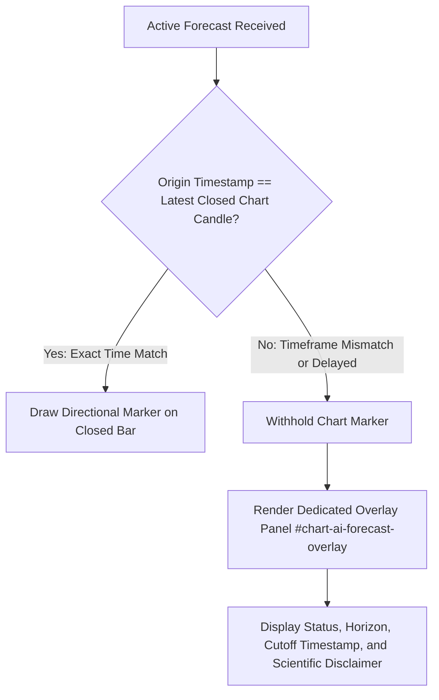

# Forecast Display Contract & Chart Marker Alignment Specification (V32.57)

**Document ID:** FDC-20261029-01  
**Scope:** Client-side charting display, forecast origin synchronization, and uncertainty semantics.

---

## 1. Active Forecast API & Data Contract

The authoritative forecast contract is emitted by `/api/forecast/latest` (delegating to `engine.forecast_engine_15m.generate_forecast_contract`):

```json
{
  "status": "FORECAST_AVAILABLE_RESEARCH_ONLY",
  "data_readiness": "DATA_AVAILABLE",
  "model_readiness": "MODEL_DIRECTIONAL_RESEARCH_ACTIVE",
  "forecast_readiness": "FORECAST_AVAILABLE",
  "governance_state": "TIER 2 GATED (ABSTAIN)",
  "live_trading": "DISABLED",
  "source_timeframe": "1h",
  "forecast_origin_timestamp": 1729864800,
  "forecast_origin_utc": "2026-10-25T14:00:00Z",
  "data_freshness_status": "FRESH",
  "forecast_points": [
    {"time": 1729864800, "price": 80600.0, "value": 80600.0, "is_origin": true},
    {"time": 1729868400, "price": 80600.0, "value": 80600.0, "step": 1}
  ],
  "upper_band": [
    {"time": 1729864800, "price": 80600.0, "value": 80600.0},
    {"time": 1729868400, "price": 81250.0, "value": 81250.0}
  ],
  "lower_band": [
    {"time": 1729864800, "price": 80600.0, "value": 80600.0},
    {"time": 1729868400, "price": 79950.0, "value": 79950.0}
  ],
  "epistemic_notice": "Non-directional empirical volatility baseline. Not a validated trading signal."
}
```

---

## 2. Browser Chart Marker vs Fallback Panel Rules

In `web/app.js` (lines 2155–2173 and 2356–2415):



### Precise Marker Anchoring Logic:
1. **Candle Alignment Check:**
   `forecastOrigin = Number(activeForecast.forecast_origin_timestamp)`
   `anchor = getLatestClosedChartCandle(seedRef.current, interval)`
   `originWithinClosedBar = Boolean(anchor && forecastOrigin >= anchor.time && forecastOrigin < anchor.time + chartStep)`
2. **If Anchored:** A marker (Arrow Up/Down or Circle) is rendered strictly at `anchor.time`.
3. **If NOT Anchored (e.g. 15m origin on a 1h chart or delayed data):**
   - **NO marker is placed on the chart.** Pinned markers on mismatched candles are strictly disallowed.
   - The forecast status, model version, cutoff time, and uncertainty envelope are displayed exclusively in the `#chart-ai-forecast-overlay` container.

---

## 3. Epistemic Uncertainty & Prohibited Marketing Claims

1. **No Calibrated Probability Fabrication:** Unless a model is formally calibrated and audited under Brier score and Platt scaling, raw scores must **never** be marketed as "UP 80%" or "Directional Hit Rate 90%".
2. **Uncertainty Envelope Semantics:** Bands generated by $\pm z \cdot \sigma \sqrt{h}$ represent empirical volatility excursion envelopes, **not** directional price targets.
3. **Data Quality States:** The UI strictly surfaces five discrete states:
   - `OK`: Valid, uninterrupted closed bars with verified timestamps.
   - `STALE`: Market data age exceeds 2 hours without fresh provider updates.
   - `GAP`: Missing intervals detected in the historical series; bars are omitted, never synthesized.
   - `UNAVAILABLE`: All upstream provider calls failed; clean fallback UI shown.
   - `PARTIAL/OPEN BAR`: The currently forming bar is segregated from closed analytical bars.

