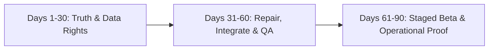

# BTCognitive MVP Scope & 30/60/90-Day Execution Roadmap (V32.57)

**Prepared:** 29 October 2026  
**Scope Category:** Online Market Charting, Technical Analysis, and Risk Forecasting Platform (TradingView Category).  
**Strict Exclusion:** No broker execution, no order placement, no custody, no real-money positions.

---

## 1. MVP Product Boundaries

### In Scope for Public Launch (Narrow Core Journey)
1. **Interactive Candlestick Charting:**
   - Single rights-cleared asset: BTC-USD Spot.
   - Candlesticks, volume histogram, dynamic zoom/pan (TradingView Lightweight Charts).
   - Supported timeframes (1h primary; 15m/4h/1d as supported by licensed data).
   - Explicit data freshness timestamp and data provider attribution.
2. **Data-Quality Indicator Layer:**
   - Visual status pill: `OK`, `STALE`, `GAP`, `UNAVAILABLE`, `OPEN_BAR`.
   - Explicit gap rendering (missing bars omitted rather than drawn continuous).
3. **Validated Technical Indicators:**
   - SMA / EMA (20, 50, 200), RSI (14), Bollinger Bands, ATR.
   - Deterministic unit test verification against known fixtures.
4. **Research & Forecast Outlook Panel:**
   - Empirical non-directional volatility envelope (conformal dispersion bounds).
   - Model ID, data cutoff timestamp, forecast horizon, explicit uncertainty definitions.
   - Clean failure / abstention state when market data is stale or gapped.
5. **Responsive & Accessible Web UI:**
   - Desktop and mobile viewports (down to 375px width).
   - Accessible keyboard controls and high-contrast color scheme.

### Out of Scope for Launch
- Broker or exchange account linking.
- Simulated "Enter / Continue / Exit" workflows placed on the primary chart journey (preserved as segregated research tools).
- User position tracking or paper execution on the public home page.
- Claims of validated trading edge, win rates, or directional price prediction.

---

## 2. 30 / 60 / 90-Day Governed Roadmap

### Days 1–30 (27 Oct – 26 Nov 2026): Establish Truth & Unblock Data Rights
- **P0 Data Rights:** Execute formal written license agreement with Coinbase or select a commercial alternative (Twelve Data / Kaiko / Polygon).
- **Audit Preservation:** Verify 47 inherited test IDs; preserve all protected parquets and ledgers.
- **Contract Definition:** Finalize `forecast_display_contract.md` and `mvp_scope.md`.
- **Exit Gate:** Affirmative written data license route established; 100% of 47 IDs categorized with owners; zero protected files modified.

### Days 31–60 (27 Nov – 26 Dec 2026): Repair, Integrate & Browser Verification
- **Targeted Repairs:** Fix confirmed defects and contract mismatches in small isolated PRs.
- **Real Browser Automation:** Implement comprehensive Playwright/CDP test suite verifying chart zoom/pan, indicator math, forecast marker alignment, and 375px mobile viewport responsiveness.
- **Performance Profiling:** Instrument end-to-end API latency and memory profiling under realistic synthetic user load (p95 < 3s for chart load, p95 < 10s for full analysis).
- **Exit Gate:** Critical-path browser journey green on desktop & mobile; all P0 code defects resolved; zero test fixtures reachable in public runtime.

### Days 61–90 (27 Dec 2026 – 25 Jan 2027): Staged Online Beta & Operational Proof
- **Staging Deployment:** Deploy staging environment with rights-cleared data feed.
- **OWASP ASVS 5.0 Audit:** Complete practical security checklist (headers, CORS, rate limits, dependency vulnerability scan).
- **DPDP Act 2023 / Rules 2025 Compliance:** Verify India Digital Personal Data Protection notice, data minimization, and grievance contact mechanisms.
- **Private Beta Launch:** Invite small cohort (50–100 researchers/analysts) with structured feedback loop and automated error monitoring.
- **Exit Gate:** Signed launch checklist, affirmative data rights, zero open P0 defects, validated rollback procedure.

