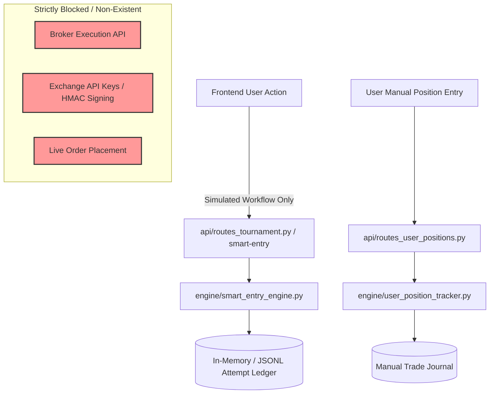

# BTCognitive Authoritative Repository & Runtime Inventory (V32.57)

**Audit Date:** 29 October 2026  
**Auditor:** BTCognitive Lead Research Orchestrator  
**Repository Branch:** `main` (commit SHA tracked, local modified/untracked files preserved)

---

## 1. Verified Technology Stack

| Layer | Component | Verified Implementation Path | Notes |
| :--- | :--- | :--- | :--- |
| **Backend Framework** | FastAPI (Python 3.13.14) | `api/server.py` | Hardened with OWASP ASVS 5.0 headers, rate limiting middleware, trusted host, sanitized global exceptions. |
| **Frontend Runtime** | Native React 18 & ReactDOM 18 | `web/index.html`, `web/app.js` | Loaded via unpkg UMD scripts; client-side JS bundled into `web/app.js` without Node.js runtime dependency on server. |
| **Visual Charting Engine** | TradingView Lightweight Charts 4.1.3 | `web/index.html` (line 25), `web/app.js` (line 2389) | Apache-2.0 licensed standalone library. Renders candlestick series, volume histogram, and markers. |
| **3D Canvas / Background** | Three.js (r134) | `web/index.html` (line 22), `web/app.js` | Interactive particle grid background; decoupled from financial data layer. |
| **HTTP Client** | HTTPX (AsyncClient) | `api/http_client.py`, `api/market_drivers.py` | Shared connection pool with timeout controls (5.0s read, 2.0s connect). |
| **WebSocket Stream** | Hardened WebSocket Manager | `api/server.py` (`HardenedConnectionManager`) | Per-IP connection limits (`MAX_WEBSOCKET_CONNECTIONS_PER_IP`), message size caps (`MAX_WEBSOCKET_MESSAGE_BYTES`). |
| **Static Hosting** | FastAPI StaticFiles | `api/server.py` (line 313) | Mounts `web/` directory at root `/`. |

---

## 2. API Routes & Service Architecture

### Authoritative Public Market & Analysis Routes
- `GET /api/dashboard`: Serves market status, current BTC/USD quote, closed candles, technical indicators, empirical volatility forecast, and market drivers. Defined in `api/market_monitor_routes.py`.
- `GET /api/market-drivers`: Returns multi-factor market drivers (derivatives funding, liquidations, implied vs realized volatility).
- `GET /api/forecast/latest`: Serves research-only empirical forward projections with uncertainty envelopes.
- `GET /prediction/latest`: Alias endpoint conforming to research contracts.
- `GET /api/readiness`: Reports authoritative startup gate state (`validation/startup_gate.py`).
- `GET /api/health`: Lightweight liveness check reporting HTTP status and basic subsystem health.
- `POST /api/tournament/analyse`: Runs market condition analysis, regime classification, and candidate screening without trade creation.
- `POST /api/tournament/run`: Runs bounded tournament backtest across strategy arms.

---

## 3. Order-Related Code Path Audit & Execution Boundaries

A rigorous trace was conducted across all codebase endpoints and modules to verify whether real order execution, broker credentials, or capital routing exist:

### Verified Code Path Findings:
1. **`api/routes_tournament.py` (`/api/tournament/smart-entry/enter`, `exit`, `continue`):**
   - Creates in-memory and append-only simulated trade attempts (`get_smart_entry_simulator()`).
   - Locks simulated entry price, absolute stop-loss, and take-profit levels.
   - **No broker calls, no exchange API integrations, no order placement capability.**
2. **`api/routes_user_positions.py` (`/api/positions/open`, `close`, `history`):**
   - User Position Tracker & Adaptive Risk Copilot.
   - Accepts user-supplied position records to compute mark-to-market risk metrics and anomaly alerts.
   - Hardened against price fabrication (P0 fix confirmed in `test_v32_56_no_fabricated_position_quote.py`).
   - **No exchange connection, no account balance access, no custody.**
3. **`api/routes_manual_journal.py` (`/api/journal`):**
   - Pure logging tool for paper trades and manual user notes.
4. **`engine/paper_trading_engine.py`:**
   - Isolated research paper-trading simulator.
5. **Conclusion:** **ZERO** real-money order routing, broker account linking, or live execution code exists in BTCognitive. The application operates strictly as an informational and research telemetry platform.

---

## 4. Governance Flags Audit: `OFFLINE_RESEARCH_ONLY` & `NO_GO_NO_VALIDATED_EDGE`

### `OFFLINE_RESEARCH_ONLY` Scope
- Defined in `models/authoritative_model_registry.py` (`AuthorizationStatus.OFFLINE_RESEARCH_ONLY`).
- Enforced by `validation/startup_gate.py` (`evaluate_runtime_readiness()`).
- **Exact Behavior:**
  - Prevents econometric models (such as `HAR-RS-DOW-v1.0` and experimental GBDT classifiers) from being authorized for production trading signals.
  - Ensures `/api/forecast/latest` returns `governance_state: "TIER 2 GATED (ABSTAIN)"` or `FORECAST_AVAILABLE_RESEARCH_ONLY`.
  - **Does NOT block public charting:** The price chart and empirical spot candle delivery (`/api/dashboard`) run independently of production model authorization.

### `NO_GO_NO_VALIDATED_EDGE` Scope
- Enforced across `startup_gate.py`, `models/authoritative_model_registry.py`, and `engine/probabilistic_entry_engine.py`.
- **Exact Behavior:**
  - Codifies the research boundary that historical volatility models do not provide statistically significant directional edge on unconditional returns.
  - Prevents the frontend from displaying misleading "Directional Hit Rate 90%" claims or marketing unvalidated predictive alpha.
  - Requires 100 non-overlapping clean blocks in prospective testing before any gate transition.

