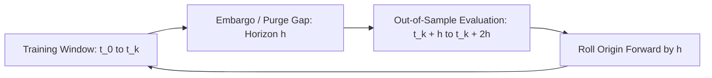

# Time-Series Forecasting Model Benchmark Protocol (V32.58 — Research Only)

**Audit Date:** 29 October 2026  
**Auditor:** BTCognitive Lead Research Orchestrator  
**Governance:** `OFFLINE_RESEARCH_ONLY` | Strict Non-Execution | No Production Model Promotion

---

## 1. Candidate Model Governance & Licensing Review

| Model Candidate | Source / Model Card | Checkpoint License | Commercial Production Suitability | Research Role |
| :--- | :--- | :--- | :--- | :--- |
| **Current Baseline** (`HAR-RS-DOW-v1.0`) | In-repo frozen artifact (`experiments/results/freeze/`) | Proprietary / MIT Code | Permitted (Offline Volatility Serving) | Benchmark anchor for all comparative evaluations. |
| **Kronos-mini / Kronos-small** | [Hugging Face: NeoQuasar/Kronos-small](https://huggingface.co/NeoQuasar/Kronos-small) | **MIT** | Permitted for commercial use | Candlestick-specific tokenizer and K-line autoregressive path generator (~4.1M / ~24.7M params). |
| **Amazon Chronos-Bolt-small** | [Hugging Face: amazon/chronos-bolt-small](https://huggingface.co/amazon/chronos-bolt-small) | **Apache-2.0** | Permitted for commercial use | Fast, pretrained probabilistic time-series foundation model (~48M params). |
| **Amazon Chronos-2** | [Hugging Face: amazon/chronos-2](https://huggingface.co/amazon/chronos-2) | **Apache-2.0** | Permitted for commercial use | Diverse probabilistic time-series transformer. |
| **Google TimesFM 3.0** | [Hugging Face: google/timesfm-3.0-pytorch](https://huggingface.co/google/timesfm-3.0-pytorch) | **Non-Commercial License v1.0** | **STRICTLY PROHIBITED** from commercial production plans | **EXCLUDE FROM COMMERCIAL ROADMAP.** May only be used in non-commercial academic research. |
| **FoundationForecast Wrapper** | [GitHub: TimeCopilot/foundationforecast](https://github.com/TimeCopilot/foundationforecast) | Apache-2.0 (Wrapper code only) | Permitted as harness | Standardizes time-series CV APIs; checkpoint licenses must be independently verified. |

---

## 2. Temporal Walk-Forward Holdout Protocol

To prevent lookahead leakage, data snooping, and spurious volatility fits, all candidate models must be evaluated under strict temporal protocols:

### Protocol Guidelines:
1. **Purged & Embargoed Cross-Validation (de Prado):**
   - For a 24-hour horizon forecast, an embargo period of at least 24 hours must be enforced between training cutoffs and test samples.
   - For a 168-hour (7-day) forecast, an embargo of at least 168 hours is required.
   - **Zero Random Train/Test Splits:** Cross-validation must strictly respect chronological time direction.
2. **Evaluation Metrics:**
   - **Volatility Forecasts:** Quasi-Likelihood Loss ($\text{QLIKE} = \frac{RV}{\hat{\sigma}^2} - \ln\left(\frac{RV}{\hat{\sigma}^2}\right) - 1$) and Root Mean Squared Error (RMSE).
   - **Excursion Envelopes:** Empirical Coverage Percentage ($\% \text{ of actual closes within } [\hat{L}, \hat{U}]$), Average Interval Width (Sharpness), and Winkler Score.
   - **Hypothesis Testing:** Paired model loss comparisons must apply the Diebold–Mariano test with the Harvey–Leybourne–Newbold (1997) finite-sample correction against Student's $t_{T-1}$.
3. **Epistemic Invariant:** Directional prediction hit rate (e.g. 90%) must **never** be claimed based on volatility or excursion bounds.

