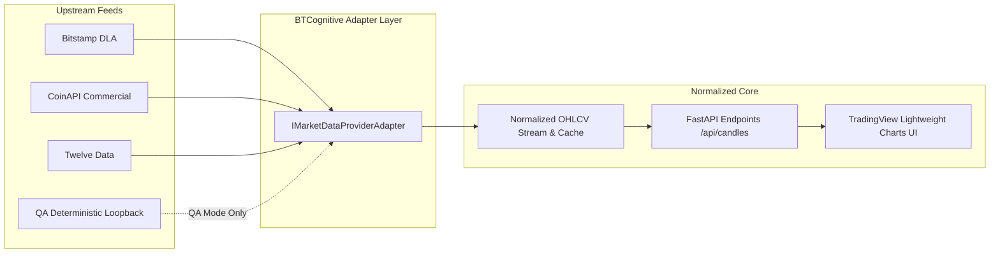

# Minimum Normalized Provider Contract Specification (V32.60)

**Date:** 29 October 2026  
**Auditor:** BTCognitive Lead Research Orchestrator  
**Status:** PROPOSAL / PRE-IMPLEMENTATION SPECIFICATION  
**Target Scope:** Public Chart MVP (TradingView-like read-only market charting & technical analytics).

---

## 1. Architectural Motivation & Boundary

BTCognitive is transitioning from ad-hoc provider integrations (e.g., direct Coinbase REST calls) to a pluggable **Provider Adapter Architecture**. To eliminate the risk of upstream API lock-in, vendor policy shifts, or accidental TOS violations, all market data ingestion must pass through a strictly typed, normalized contract.



---

## 2. Canonical Data Models (Python / Pydantic V2)

```python
from datetime import datetime
from enum import Enum
from typing import List, Optional
from pydantic import BaseModel, Field, field_validator


class FeedFreshnessStatus(str, Enum):
    FRESH = "FRESH"
    STALE = "STALE"
    UNAVAILABLE = "UNAVAILABLE"
    DISCONNECTED = "DISCONNECTED"


class TimeframeEnum(str, Enum):
    M15 = "15m"
    H1 = "1h"
    H4 = "4h"
    D1 = "1d"


class NormalizedCandle(BaseModel):
    """Canonical representation of a single OHLCV bar."""
    timestamp_utc: str = Field(
        ..., 
        description="ISO 8601 UTC timestamp string (e.g., '2026-10-29T18:00:00Z')"
    )
    timestamp_epoch: int = Field(
        ..., 
        description="Unix timestamp in seconds representing candle open time"
    )
    open: float = Field(..., gt=0.0, description="Open price in quote currency (USD)")
    high: float = Field(..., gt=0.0, description="High price in quote currency (USD)")
    low: float = Field(..., gt=0.0, description="Low price in quote currency (USD)")
    close: float = Field(..., gt=0.0, description="Close price in quote currency (USD)")
    volume: float = Field(..., ge=0.0, description="Trading volume in base currency (BTC)")
    is_closed: bool = Field(
        ..., 
        description="True if the candle interval has fully concluded; False if forming"
    )

    @field_validator("high")
    @classmethod
    def validate_high_extremum(cls, v: float, info) -> float:
        data = info.data
        if "open" in data and v < data["open"]:
            raise ValueError(f"High ({v}) cannot be less than Open ({data['open']})")
        if "close" in data and v < data["close"]:
            raise ValueError(f"High ({v}) cannot be less than Close ({data['close']})")
        return v

    @field_validator("low")
    @classmethod
    def validate_low_extremum(cls, v: float, info) -> float:
        data = info.data
        if "open" in data and v > data["open"]:
            raise ValueError(f"Low ({v}) cannot be greater than Open ({data['open']})")
        if "close" in data and v > data["close"]:
            raise ValueError(f"Low ({v}) cannot be greater than Close ({data['close']})")
        if "high" in data and v > data["high"]:
            raise ValueError(f"Low ({v}) cannot be greater than High ({data['high']})")
        return v


class FeedDiagnostics(BaseModel):
    """Metadata regarding provider request latency, health, and error states."""
    latency_ms: float = Field(..., description="Round-trip request latency in milliseconds")
    http_status: int = Field(..., description="HTTP status code from upstream feed")
    raw_payload_sha256: str = Field(..., description="SHA-256 hash of the raw provider response")
    error_code: Optional[str] = Field(None, description="Standardized error code if failed")
    error_message: Optional[str] = Field(None, description="Detailed error description if failed")
    upstream_disclaimer: Optional[str] = Field(
        None, 
        description="Mandatory legal attribution string (e.g., 'Market Data by Bitstamp')"
    )


class NormalizedCandleResponse(BaseModel):
    """Root response structure returned to API consumers."""
    provider_id: str = Field(..., description="Identifier of the provider adapter (e.g. 'bitstamp_dla')")
    venue: str = Field(..., description="Execution venue or composite source (e.g. 'BITSTAMP')")
    symbol: str = Field(..., description="Standardized market symbol (e.g. 'BTC/USD')")
    timeframe: TimeframeEnum = Field(..., description="Candle interval")
    retrieval_timestamp_utc: str = Field(..., description="ISO 8601 UTC timestamp of retrieval")
    freshness_status: FeedFreshnessStatus = Field(..., description="Current data freshness health")
    candles: List[NormalizedCandle] = Field(default_factory=list, description="Ordered historical bars")
    diagnostics: FeedDiagnostics = Field(..., description="Diagnostics and audit metadata")
```

---

## 3. Mandatory Invariants & Safeguards

### Invariant 1: Zero Synthetic Candle Fabrication
- **Rule:** Under no circumstance may the adapter or storage engine interpolate, linearly synthesize, or carry forward prices to fill missing time intervals or outages.
- **Enforcement:** If an expected hourly candle is missing from the provider, the response must reflect an explicit gap in the timestamp series. The backend must flag `gap_detected = True` and fail closed (`status: "ABSTAIN"` / `DATA_UNAVAILABLE`) if downstream algorithms require gap-free series.

### Invariant 2: Explicit Null Price & Fail-Closed Behavior
- **Rule:** When the provider feed is unavailable, disconnected, rate-limited, or returns a 5xx error, the adapter must return an explicit `FeedFreshnessStatus.UNAVAILABLE` with `candles: []`.
- **Enforcement:** It is strictly prohibited to return a fabricated fallback quote (such as the legacy $80,000 price). The frontend must receive HTTP 400 or HTTP 503 with a structured error payload and render an empty chart with an "Offline Market Data" warning banner.

### Invariant 3: Quarantine of Test Fixtures
- **Rule:** Deterministic QA fixtures (such as `deterministic_hourly_v1`) must NEVER be reachable via URL query parameters on public production endpoints (e.g., `/api/candles?use_fixture=true` is forbidden).
- **Enforcement:** Test fixtures may only be injected via the dedicated QA loopback route (`/api/qa/seed-candles`), which is strictly conditioned on `BTC_ENVIRONMENT in ("test", "qa", "development")` and completely unregistered in production builds.

### Invariant 4: Point-in-Time Causal Boundary
- **Rule:** A candle at timestamp $T$ with `is_closed: True` must strictly contain data observed at or before $T + \Delta t$.
- **Enforcement:** The current open candle must have `is_closed: False`. Any feature extraction pipeline or volatility calculation that operates on closed candles must strictly filter out `is_closed == False` bars to prevent lookahead bias.

### Invariant 5: Caching & Freshness Policy
- **Rule:**
  - Closed candles (`is_closed == True`) are immutable and may be cached permanently in local Parquet stores.
  - Forming candles (`is_closed == False`) must be cached with a maximum TTL of 5 seconds.
  - A feed is designated `STALE` if the elapsed time since the close of the most recent candle exceeds $2 \times \text{timeframe}$ (e.g., > 2 hours for 1h candles).

---

## 4. Provider Adapter Interface Definition

```python
from abc import ABC, abstractmethod


class IMarketDataProviderAdapter(ABC):
    """Abstract interface defining required provider adapter methods."""

    @abstractmethod
    def get_provider_id(self) -> str:
        """Returns unique provider identifier (e.g. 'bitstamp_dla')."""
        pass

    @abstractmethod
    def get_attribution_disclaimer(self) -> str:
        """Returns required legal attribution string for display in UI."""
        pass

    @abstractmethod
    async def fetch_candles(
        self,
        symbol: str,
        timeframe: TimeframeEnum,
        limit: int = 500,
        before_epoch: Optional[int] = None,
    ) -> NormalizedCandleResponse:
        """
        Fetches historical candles from the provider, validating all
        extrema and freshness invariants before returning.
        """
        pass

    @abstractmethod
    async def check_health(self) -> FeedFreshnessStatus:
        """Performs liveness check against upstream endpoint."""
        pass
```

---

## 5. Next Steps for Implementation
1. **Implement `BitstampAdapter`:** Concrete implementation of `IMarketDataProviderAdapter` targeting Bitstamp REST v2 API (`/api/v2/ohlc/btcusd/`).
2. **Implement `CoinApiAdapter`:** Secondary concrete implementation targeting CoinAPI `/v1/ohlcv/BITSTAMP_SPOT_BTC_USD/history`.
3. **Wire Configuration Flag:** `BTC_MARKET_DATA_PROVIDER=bitstamp|coinapi|qa_fixture`.
4. **Enforce Unit Verification:** Verify with independent red-team tests asserting zero synthetic price fabrication and strict fail-closed behavior on mock 503 errors.

