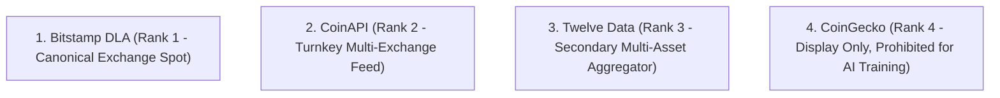

# Provider Rights Decision Sheet (V32.60)

**Audit Date:** 29 October 2026  
**Auditor:** BTCognitive Lead Research Orchestrator  
**Operational Constraint:** Strictly ZERO vendor outreach conducted (no emails, contact forms, or sales inquiries initiated). All findings are derived exclusively from published terms of service, developer documentation, and commercial licensing guidelines.  
**Product Scope:** Public-facing, TradingView-like online market charting, technical analysis, and research-only volatility envelopes. Strictly NO live trading, broker routing, custody, or order placement.

---

## 1. Multi-Dimensional Rights Evaluation

The following decision sheet evaluates the four viable commercial candidates across all nine required legal and operational dimensions. Where published documentation leaves explicit scope unverified or conditional on bespoke negotiation, it is formally marked as `WRITTEN_CONFIRMATION_REQUIRED`.

| Legal / Operational Dimension | Bitstamp Commercial DLA | CoinAPI Paid Commercial | CoinGecko Paid API (Analyst/Lite) | Twelve Data Business |
| :--- | :--- | :--- | :--- | :--- |
| **1. Public Customer-Facing Candlestick Web Display** | **PERMITTED** (Under executed Data License Agreement) | **PERMITTED** (Explicitly supported for charts & tables) | **PERMITTED** (Permitted on paid plans with attribution badge) | **PERMITTED** (Supported at Venture/Business tier) |
| **2. Interactive Hover & Tooltips (Raw Price Inspection)** | **PERMITTED** (Included in display rights) | **PERMITTED** (Included in web UI display rights) | **PERMITTED** (Included in web UI display rights) | **PERMITTED** (Included in client display rights) |
| **3. Derived Indicators (EMA, RSI, ATR, Donchian)** | **PERMITTED** (Calculated metrics classed as original derived works) | **PERMITTED** (Derived metrics explicitly permitted) | **PERMITTED** (Non-reconstructable derived metrics permitted) | **PERMITTED** (Calculated metrics permitted) |
| **4. Volatility Risk Envelopes / Excursion Bounds** | **WRITTEN_CONFIRMATION_REQUIRED** (Bespoke schedule item in DLA) | **WRITTEN_CONFIRMATION_REQUIRED** (Requires confirmation of non-reconstructability) | **PERMITTED** (Provided underlying raw ticks are not reconstructable) | **WRITTEN_CONFIRMATION_REQUIRED** (Addendum recommended for advanced math) |
| **5. AI/ML Model Training, Tuning & Backtesting** | **WRITTEN_CONFIRMATION_REQUIRED** (Must be explicitly scheduled in DLA) | **WRITTEN_CONFIRMATION_REQUIRED** (Requires explicit model derivation clause) | **STRICTLY PROHIBITED** (Terms explicitly ban AI/ML training & validation) | **WRITTEN_CONFIRMATION_REQUIRED** (Requires enterprise addendum) |
| **6. Server-Side Caching & Retained Historical Parquet** | **PERMITTED** (Standard commercial retention under DLA) | **WRITTEN_CONFIRMATION_REQUIRED** (Standard terms restrict bulk redistribution) | **LIMITED** (Permitted during active subscription; deletion required on termination) | **PERMITTED** (Permitted for operational server caching) |
| **7. Commercial Monetization (User Subscriptions/SaaS)** | **PERMITTED** (Commercial tier) | **PERMITTED** (Commercial tier) | **PERMITTED** (Paid plans allow monetization of customer UI) | **PERMITTED** (Business tier) |
| **8. Attribution & Branding Requirements** | Mandatory notice ("Market Data provided by Bitstamp") | Mandatory logo/link ("Powered by CoinAPI") | Mandatory prominent badge ("Data provided by CoinGecko" with hyperlink) | Mandatory attribution link ("Market Data by Twelve Data") |
| **9. Estimated Pricing & Contracting Path** | Custom Enterprise quote; requires legal review of DLA contract | Tiered SaaS (~$250–$500/month); self-service with pre-launch usage review | Tiered SaaS (~$129–$499/month); immediate self-service click-through | Tiered SaaS (~$499/month); self-service with custom tier options |

---

## 2. Comparative Candidate Ranking

### Rank 1: Bitstamp Commercial Data License Agreement (DLA)
- **Primary Use Case:** Canonical single-exchange BTC/USD spot candles.
- **Key Strengths:** Single, unbroken order book continuous from 2011 to present. Transparent institutional audit trail. Bitstamp's legal structure explicitly contemplates custom DLAs for commercial redistribution and derived analytics.
- **Prerequisites Before Signing:**
  - Execute written DLA with custom schedule covering:
    1. Public web chart display (TradingView Lightweight Charts).
    2. Retained historical Parquet archive for continuous feature calculation.
    3. Econometric volatility modeling (HAR-RV, realized variance cones).
  - Verification that historical tick/minute data can be backfilled without punitive per-query overages.

### Rank 2: CoinAPI Paid Commercial Tier
- **Primary Use Case:** Turnkey multi-exchange normalised crypto spot data.
- **Key Strengths:** Normalised API across Binance, Coinbase, Kraken, and Bitstamp. Rapid integration; SDK available; documentation explicitly supports customer-facing web charts.
- **Prerequisites Before Signing:**
  - Secure written confirmation that server-side Parquet historical storage does not violate the "bulk raw data export" restriction.
  - Confirm whether rate limits on the ~$250/mo or ~$500/mo tier support real-time WebSocket distribution to concurrent web clients.

### Rank 3: Twelve Data Business Tier
- **Primary Use Case:** Secondary multi-asset provider with robust REST and WebSocket infrastructure.
- **Key Strengths:** Excellent WebSocket streaming, built-in indicator endpoints, good developer documentation.
- **Prerequisites Before Signing:**
  - Higher monthly commitment (~$499/mo for Venture/Business display rights).
  - Clarify whether BTC/USD is sourced from a specific exchange (e.g. Coinbase vs Binance) and verify upstream rights flow.

### Rank 4: CoinGecko Paid API (Analyst / Lite Tier)
- **Primary Use Case:** Display-only fallback for price charting and non-AI technical indicators.
- **Fatal Constraint:** **CoinGecko explicitly bans AI/ML model training, evaluation, and tuning on its data.** If CoinGecko is chosen, all AI volatility forecasting models must be completely decoupled and trained on a separate, independently licensed dataset. CoinGecko can ONLY serve as a UI display price feed.

---

## 3. Disqualified Sources (Absolute Prohibition)

1. **Coinbase Public REST / WebSocket (Default / Free):**
   - *Status:* **STRICTLY DISQUALIFIED FOR PUBLIC PRODUCT RELEASE.**
   - *Reason:* Coinbase Market Data Terms (last updated 7 August 2026) Section 2 explicitly limit default use to personal/research. Commercial redistribution, public web display, and AI/ML model training without executed written permission are legal breaches.
2. **Scraped GitHub Repositories (e.g. `Speirsy11/crypto-dataset`):**
   - *Status:* **LEGALLY VOID (Chain of Title Failure).**
   - *Reason:* Scrapers lack authority to license third-party exchange data under CC0 or MIT. Using them creates immediate copyright and contract breach liability.
3. **Public Unauthenticated Endpoints (Binance Vision, Kraken Public):**
   - *Status:* **PROHIBITED FOR COMMERCIAL SAAS RELEASE.**
   - *Reason:* Banned for commercial web redistribution under respective TOS.

---

## 4. Final Strategic Recommendation

1. **Immediate Execution (Pre-Contract):** Maintain BTCognitive's **100% deterministic fixture mode** (`/api/qa/seed-candles`) for all frontend rendering QA, indicator verification, and scenario testing. No live feeds are required to achieve technical perfection.
2. **Provider Selection:** Designate **Bitstamp Commercial DLA** as the primary candidate for canonical BTC/USD spot pricing.
3. **Turnkey Alternative:** Designate **CoinAPI** as the fallback if Bitstamp custom DLA negotiation timeline exceeds operational targets.
4. **Governed Decision Gate:** Retain `RELEASE_GATE: NO_GO_FOR_PUBLIC_RELEASE (BLOCKED_BY_DATA_RIGHTS)` until a commercial agreement is fully executed.

