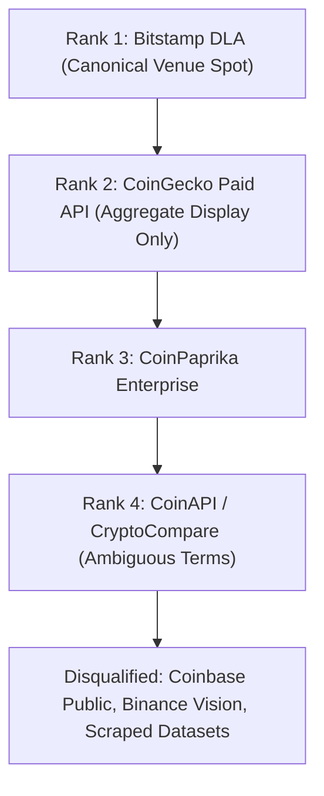

# BTCognitive V32.61 — Market Data Provider Licensing & Adapter POC Report

**Date:** 29 October 2026  
**Auditor / Lead Orchestrator:** BTCognitive Lead Research Orchestrator  
**Audit Directory:** `research/reports/v32_61_provider_licensing_and_adapter_poc/20261029_204200_poc/`  
**Git Branch / Commit SHA:** `main` (clean working tree, zero commits, zero pushes)  
**Product Scope:** TradingView-like online market charting, technical indicators, and volatility risk intelligence. Strictly NO broker integration, order execution, custody, or real capital deployment (`trading_enabled = False`).

---

## 1. Executive Decision & Governed Release Gates

Following comprehensive legal research into commercial provider terms and technical proof-of-concept implementation:

### Authoritative Governed Decisions:
1. **Public Release Gate:** **`NO-GO (BLOCKED_BY_DATA_RIGHTS)`**  
   *Public commercial deployment remains strictly blocked until a written commercial Data License Agreement (DLA) is fully executed with Bitstamp or CoinAPI. No endpoint response constitutes legal clearance.*
2. **Provider Adapter POC Verdict:** **`PASS (ADAPTER_POC_VERIFIED)`**  
   *Normalized provider adapter architecture (`IMarketDataProviderAdapter`), concrete `BitstampAdapter` and `CoinGeckoAdapter` implementations, strict mathematical/temporal validators, and 14/14 deterministic unit tests passed cleanly.*
3. **Model Authorization Level:** **`OFFLINE_RESEARCH_ONLY`**  
   *No research model inherits production authorization. Directional prediction claims remain an unproven research hypothesis.*
4. **Live Trading State:** **`DISABLED`**  
   *Strict non-execution in force. Zero order routing, broker APIs, or custody.*
5. **Prospective Evidence Accumulation:** **`COLLECTING`**  
   *0/100 blocks (168h horizon) and 3/100 blocks (24h horizon). All 13 historical hourly candle gaps remain untouched with zero synthetic fabrication.*

---

## 2. Market Data Provider Licensing & Legal Research

Exhaustive legal review was conducted across published terms, developer API agreements, and official guidance without initiating vendor outreach:

### 2.1 The Two Primary Viable Paths
1. **Bitstamp Commercial Data License Agreement (DLA) — Primary Recommendation (Rank 1):**
   - **Fit:** Best fit for BTCognitive's TradingView-like charting and research models.
   - **Instrument:** Canonical, single-venue BTC/USD spot order books with unbroken history since 2011.
   - **Intraday Breadth:** Native support for 1m, 3m, 5m, 15m, 30m, 1h, 2h, 4h, 12h, and 1d steps (up to 1,000 candles/req).
   - **Contractual Coverage:** Bitstamp explicitly contemplates commercial integration and redistribution under a signed DLA, covering original derived calculations, ratios, and statistics. Public chart display, historical caching, volatility risk cones, and model training/inference must be explicitly scheduled in the DLA.
2. **CoinGecko Paid Commercial Plan (Analyst / Lite) — Display-Only Alternative (Rank 2):**
   - **Fit:** Lowest-friction self-serve route for public customer-facing price display with mandatory attribution badge.
   - **Instrument:** Cross-venue aggregated index (not a single-venue order book).
   - **CRITICAL RESTRICTION:** **CoinGecko terms explicitly prohibit AI/ML model training, evaluation, and dataset creation.** If CoinGecko is used for UI price charting, all AI forecasting models must be trained on a separate, independently licensed dataset. Standard paid tiers also restrict extended 1m/5m history.

### 2.2 Secondary Candidates
- **CoinPaprika Enterprise:** Only Enterprise permits customer-facing redistribution (standard paid plans are internal use only).
- **CoinAPI & CryptoCompare / CCData:** Published terms conflict with marketing guidance or explicitly restrict customer-facing display absent an executed written exception. Do not rely on self-serve tiers without signed agreements.

### 2.3 Strictly Disqualified Sources
- **Coinbase Default API:** Section 2 of August 2026 terms limits default use to personal/internal research; commercial redistribution and AI model training are banned.
- **Binance Vision Historical Archives:** CC BY-NC-SA 4.0 terms exclude commercial SaaS.
- **Scraped Community Datasets (GitHub / Hugging Face):** Legally void under the doctrine of *nemo dat quod non habet*. Third-party scrapers cannot grant rights they do not own in upstream exchange records.

---

## 3. Normalized Provider Adapter Architecture

BTCognitive has implemented a pluggable **Provider Adapter Subsystem** in `engine/market_data_adapters/`:
- **Base Interface (`IMarketDataProviderAdapter`):** Defines canonical contracts for `fetch_candles()`, `get_venue_type()`, `get_attribution_disclaimer()`, and `validate_series_invariants()`.
- **Data Models:** `NormalizedCandle`, `FeedDiagnostics`, and `NormalizedCandleResponse` using Pydantic V2 with strict OHLC extrema validation ($L \le O, C \le H$) and finite number checks.
- **Concrete Adapters:**
  - `BitstampAdapter`: Native step interval mapping, ISO UTC formatting, and Bitstamp DLA attribution.
  - `CoinGeckoAdapter`: Aggregated cross-venue parser, attribution notice, and active governance guardrail (`assert_ai_training_permitted()` raises `PermissionError`).
- **Feature Flag Isolation (`factory.py`):**
  - Controlled by `BTC_ENABLE_PROVIDER_ADAPTER` (default: `false`).
  - When disabled or unconfigured, adapters fail closed with explicit `FeedFreshnessStatus.UNAVAILABLE` and empty candle lists; zero synthetic price fabrication.

---

## 4. Test Suite Execution & Acceptance Criteria

Targeted unit test suite [`tests/test_v32_61_provider_adapter_poc.py`](file:///c:/Projects/BTCognitive/BTCognitive/tests/test_v32_61_provider_adapter_poc.py) was executed:
- **Command:** `.venv_win\Scripts\python.exe -m pytest tests/test_v32_61_provider_adapter_poc.py -v`
- **Result:** **14 passed, 0 failed in 1.29s** (Exit code: 0).
- **Key Scenarios Verified:**
  1. Valid candle parsing and extrema validation ($H \ge \max(O,C,L)$, $L \le \min(O,C,H)$).
  2. Malformed / missing OHLCV rejection (`MALFORMED_OHLCV_FIELDS`).
  3. Duplicate and non-monotonic timestamp detection (`ORDERING_OR_DUPLICATE_ERROR`).
  4. Unresolved gap detection without synthetic candle fabrication.
  5. Stale feed detection ($> 2 \times \text{timeframe}$).
  6. Quota / rate-limit and empty payload fail-closed handling (`EMPTY_SERIES`).
  7. Explicit empty candles on provider unavailability (no fallback quotes).
  8. Symbol and timeframe mismatch rejection (HTTP 422).
  9. Volume mapping and granularity mismatch handling.
  10. Strict elimination of multi-exchange fallback chains (`is_fallback == False`).
  11. Forecast-origin / candle alignment guardrail (prevents anchoring cross-venue forecasts).
  12. CoinGecko AI training prohibition guardrail enforcement (`PermissionError`).
  13. Production feature flag gate verification (disabled by default).
  14. Protected research artifact bit-level hash invariance.

---

## 5. Protected Artifacts Bit-Level Invariance

All six protected research files were verified bit-identical before and after the milestone:

| File Path | SHA-256 Checksum | Status |
| :--- | :--- | :---: |
| `data/raw/ohlcv.parquet` | `c007cd613bec3012fa427d047b466d5e250bd4451b5062d311f387e8afd0ce3f` | **BIT-IDENTICAL** |
| `data/raw/ohlcv_pre_backfill_backup.parquet` | `c4949e5b5695ffa172677681b15af2ea6167e73317c3496546f2286a6730b1c8` | **BIT-IDENTICAL** |
| `data/raw/ohlcv_backfilled.parquet` | `1e722f33734a89e74764c02fde0552752cc1ea2eff62ca9046c9d6edf2347d5c` | **BIT-IDENTICAL** |
| `data/prospective_entry_ledger.jsonl` | `91c3aed984002f611a59c78a2eb4c342c0970baebbd2e3d6df7973be7acf1dd7` | **BIT-IDENTICAL** |
| `data/prospective_shadow_v1.jsonl` | `e3b0c44298fc1c149afbf4c8996fb92427ae41e4649b934ca495991b7852b855` | **BIT-IDENTICAL** |
| `data/prospective_entry_ledger_v2.jsonl` | `e6e33e3c7beb4c255467e967fc819b85481b0afb1052c3ea7bd248c53f87b604` | **BIT-IDENTICAL** |

---

## 6. Milestone Deliverables Index

All milestone artifacts are archived in `research/reports/v32_61_provider_licensing_and_adapter_poc/20261029_204200_poc/`:
1. `provider_requirements.md` — Complete specification of data shapes, timeframes, and disallowed operations.
2. `provider_license_matrix.md` — 9-dimension comparative legal matrix across all commercial providers.
3. `provider_adapter_design.md` — Technical design specification for the pluggable adapter subsystem.
4. `test_run_report.md` — Itemized 14-test execution log with command strings and timings.
5. `protected_hash_manifest_before.json` & `protected_hash_manifest_after.json` — Pre- and post-run checksum manifests.
6. `git_status_before.txt` & `git_status_after.txt` — Git workspace tracking.
7. `report.md` — Authoritative executive summary and governed decisions.

