# BTCognitive V32.63 — End-to-End Feature Dependency Map

**Date:** 29 October 2026  
**Auditor:** BTCognitive Lead Research Orchestrator  
**Audit Directory:** `research/reports/v32_63_feature_value_audit/20261029_223400_audit/`  
**Execution Scope:** Complete architectural lineage tracing UI interactions through FastAPI routes, backend computation engines, underlying datasets, and render paths.

---

## 1. Architectural Tracing Diagram

```mermaid
flowchart TD
    subgraph UI["Frontend UI (web/app.js & TradingView v4.1.3)"]
        UI_Chart["Chart Canvas & Candlestick Series"]
        UI_Overlays["Technical Overlays (EMA, Donchian, BB)"]
        UI_AnalyseBtn["'Analyse' Action Trigger"]
        UI_Tournament["Tournament & Shortlist Cards"]
        UI_Risk["Friction & Net-EV Breakdown"]
        UI_Gov["Governance & Terminal Status Banner"]
        UI_Ext["Market Comparator Panel"]
    end

    subgraph API["FastAPI Endpoints (api/)"]
        R_Candles["GET /api/market/candles"]
        R_Analyse["POST /api/tournament/analyse"]
        R_Reg["GET /api/tournament/registry"]
        R_Run["POST /api/tournament/run"]
        R_Contract["GET /api/tournament/contract/{id}"]
        R_Status["GET /api/terminal/status"]
        R_Live["POST /api/terminal/live"]
        R_Comp["GET /market/comparator"]
    end

    subgraph Engine["Computation Engines (engine/)"]
        E_CandleMgr["CandleManager & Cache"]
        E_FeatPipe["FeaturePipeline (EMA, ATR, ADX)"]
        E_Regime["MarketRegimeClassifier (168h tree)"]
        E_Signal["StrategySignalEngine (Donchian, BB)"]
        E_Cost["ExecutionCostModel (Friction in R, BEP)"]
        E_Wilson["Wilson Confidence Interval (7/10)"]
        E_HAR["HAR-RS-DOW Feature Extractor"]
        E_Comp["SpotExchangeComparator (Async fetch)"]
    end

    subgraph Data["Data & Governance Layer"]
        D_Raw["data/raw/ohlcv.parquet (42,233 bars)"]
        D_Prot["Protected Hash Manifests"]
        D_Gov["Hardcoded OFFLINE_RESEARCH_ONLY Lock"]
        D_Ext["External Exchange REST APIs"]
    end

    %% UI to API Links
    UI_Chart --> R_Candles
    UI_Overlays --> R_Candles
    UI_AnalyseBtn --> R_Analyse
    UI_Tournament --> R_Reg
    UI_Tournament --> R_Run
    UI_Risk --> R_Contract
    UI_Gov --> R_Status
    UI_Gov --> R_Live
    UI_Ext --> R_Comp

    %% API to Engine Links
    R_Candles --> E_CandleMgr
    R_Analyse --> E_Regime
    R_Analyse --> E_Signal
    R_Analyse --> E_Wilson
    R_Reg --> E_Regime
    R_Run --> E_Signal
    R_Run --> E_Cost
    R_Contract --> E_Cost
    R_Status --> D_Gov
    R_Live --> D_Gov
    R_Comp --> E_Comp

    %% Engine to Data Links
    E_CandleMgr --> D_Raw
    E_FeatPipe --> D_Raw
    E_Regime --> D_Raw
    E_Signal --> D_Raw
    E_HAR --> D_Raw
    E_Comp -.->|Network Call Offline| D_Ext
```



---

## 2. End-to-End Execution Lifecycles

### Path A: Primary Candlestick Chart & Indicator Overlays (Working & Verified)
1. **User Action:** User loads dashboard or selects 1h timeframe on chart viewport.
2. **UI Handler:** `web/app.js` calls `api.fetchMarketCandles({ symbol: "BTCUSDT", interval: "1h" })`.
3. **API Route:** `GET /api/market/candles` in `api/routes_market.py`.
4. **Engine Service:** Calls `api/candle_manager.py:CandleManager.get_candles()`.
5. **Data Layer:** Reads from cached memory or loads `data/raw/ohlcv.parquet` (42,233 rows).
6. **Processing:**
   - Filters requested candle window (e.g. 500 recent bars).
   - Validates timestamps and enforces monotonicity.
   - Computes causal overlay values: EMA-20, EMA-50, EMA-200, Donchian High/Low (shifted by 1 bar).
7. **Output Payload:** JSON array of candle objects `{ time: epoch_sec, open, high, low, close, volume }` + overlay series arrays.
8. **Render:** TradingView Lightweight Charts `v4.1.3` `CandlestickSeries` renders candlestick bodies; `LineSeries` overlays indicators.

---

### Path B: The "Analyse" Button Workflow (Working & Verified)
1. **User Action:** User clicks the primary "Analyse" button.
2. **UI Handler:** `web/app.js:runAnalyseFlow()` generates idempotent client request ID and sends `POST /api/tournament/analyse`.
3. **API Route:** `api/routes_tournament.py:analyse_tournament_setup()`.
4. **Data Verification:** `engine/data_verification.py:validate_market_data()` checks for missing bars, NaNs, and instrument validity.
5. **Regime Classification:**
   - `engine/regime_strategy_tournament.py:MarketRegimeClassifier.classify()` processes trailing 168 closed hourly bars.
   - Calculates EMA-20, EMA-50, EMA-200, ADX(14), ATR(14), and Bollinger Bandwidth.
   - Evaluates tree logic: classifies as `TRENDING_BULLISH`, `TRENDING_BEARISH`, `RANGE_BOUND`, or `VOLATILITY_EXPANSION`.
6. **Candidate Shortlisting:**
   - Identifies compatible strategies from `VersionedStrategyRegistry`.
   - Generates candidate entry setups via `engine/strategy_signal_engine.py`.
   - Primary candidate: `TSMOM_DONCHIAN_24H_168H`.
7. **7/10 Preliminary Screen & Wilson Scoring:**
   - Inspects the strategy's recent 10 historical attempts.
   - Checks if $TP\_hits \ge 7$. If yes, screen PASS; else FAIL.
   - Computes analytical Wilson 95% confidence interval: $\hat{p} = 0.70 \implies [0.3968, 0.8922]$.
8. **Execution Cost Computation:**
   - Calls `engine/execution_cost_model.py:ExecutionCostModel(venue="COINBASE")`.
   - Computes roundtrip friction in USD and in units of R ($R = \text{Price} \cdot k_{sl} \cdot \sigma_{Parkinson}$).
   - Computes break-even win rate $p_{\text{breakeven}} = \frac{1 + \text{friction}_R}{RR + 1}$.
9. **Decision Output:** Emits immutable response containing `analysis_id`, `regime`, `shortlisted_strategies`, `smart_entry_decision` (Candidate Setup or ABSTAIN), and `candle_watermark`.
10. **Invariance Guarantee:** Zero simulated trades created, zero writes to `prospective_entry_ledger.jsonl`.
11. **Render:** UI displays Regime Badge, Strategy Card, 7/10 Screen Pill, and Risk Envelope.

---

### Path C: Terminal Status & Governance Lockdown (Working & Fail-Closed)
1. **User Action:** User inspects Terminal Status panel or attempts live execution.
2. **API Route:** `GET /api/terminal/status` and `POST /api/terminal/live`.
3. **Engine / Config:** Inspects `config.py` and `status_contract.py`.
4. **Behavior:**
   - `GET /api/terminal/status` returns:
     ```json
     {
       "execution_status": "DISABLED — ANALYSIS ONLY",
       "governance_status": "OFFLINE_RESEARCH_ONLY",
       "live_trading_enabled": false,
       "model_authorization": "OFFLINE_RESEARCH_ONLY"
     }
     ```
   - `POST /api/terminal/live` intercepts execution request and immediately halts:
     - Returns HTTP 503 `MODEL_UNAUTHORIZED`.
     - Payload: `"error": "LIVE_EXECUTION_PROHIBITED", "message": "Model authorized for offline research only."`
5. **Render:** UI renders red locked status badge; live execution controls are disabled.

---

### Path D: Multi-Exchange Spot Comparator (Degraded / Offline Fail-Closed)
1. **User Action:** UI renders the market driver comparator panel.
2. **API Route:** `GET /market/comparator` in `api/routes_market.py`.
3. **Engine Service:** Calls `engine/spot_exchange_comparator.py:fetch_and_compare_spot_quotes()`.
4. **Offline Dependency Failure:**
   - In offline research mode, outbound network calls to Binance, Bitstamp, and Kraken fail or timeout.
5. **Fail-Closed Handling:**
   - Exception is caught in `routes_market.py`.
   - Endpoint does NOT return an unhandled HTTP 500 error.
   - Returns structured degraded response: `status: "DATA_UNAVAILABLE"`, `code: 503`, `reason: "Offline research mode: external exchange polling disabled"`.
6. **Render:** UI renders "External Data Unavailable (Offline Mode)" warning banner gracefully.

---

### Path E: L2 Microstructure Collector (Blocked / Deferred)
1. **Engine Service:** `engine/coinbase_l2_collector.py`.
2. **Dependency:** Requires live WebSocket connection to Coinbase L2 order book stream.
3. **Offline Status:** Inactive and blocked.
4. **Evaluation:** Not required for MVP offline technical charting and research backtesting. Deferred.

