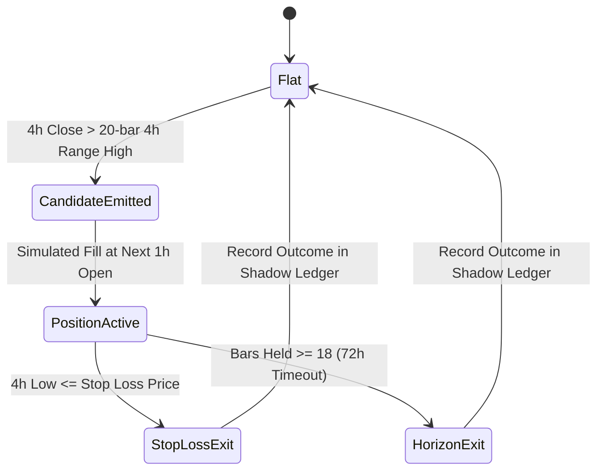

# BTCognitive V30.4 — Shadow Feed Integration, Protocol Hardening & Operational Verification Report

**Document ID:** REP-V30-4-SHADOW-FEED-INTEGRATION  
**Date:** October 23, 2026  
**Executive Milestone Decision:** **`READ-ONLY FEED VERIFIED`**  
**Live Trading:** **`DISABLED — ANALYSIS ONLY`**  
**Strategy Under Shadow Evaluation:** `HTF_RANGE_EXPANSION_BREAKOUT` (Spec Hash: `e1a3436a18ff992d`)  
**Evaluation Protocol:** Frozen Protocol V1.1 ([research/protocol_v1_1.md](file:///c:/Projects/BTCognitive/BTCognitive/research/protocol_v1_1.md))  
**Lead Multi-Agent Systems:** Agent 1 (Repository & Collector Auditor), Agent 2 (Strategy Contract & Barrier-Resolution Auditor), Agent 3 (Instrument, Cost & Market Data Auditor), Agent 4 (Feed Integration & Reliability Engineer), Agent 5 (Statistical Protocol Auditor)  

---

## 1. Executive Decision & Status Summary

| Governance Field | Certified Finding / Decision | Invariant Status |
| :--- | :--- | :--- |
| **Executive Milestone Decision** | **`READ-ONLY FEED VERIFIED`** | **VERIFIED OPERATIONAL** |
| **Live Trading Authorization** | **`DISABLED — PERMANENT RESEARCH LOCK`** | **ENFORCED (Zero Order Endpoints)** |
| **Strategy Contract** | `HTF_RANGE_EXPANSION_BREAKOUT` (Strategy D) | **FROZEN** (`e1a3436a18ff992d`) |
| **Protocol Version** | Protocol V1.1 (Multi-process lock, in-position gating, clarified sampling units) | **SUPERSEDES V1.0** |
| **Live Market Data Feed** | Coinbase Exchange Spot REST API (`BTC-USD`, granularity=3600) | **HEALTHY & FRESH (2026-10-23)** |
| **Historical Prospective Ledger** | `data/prospective_entry_ledger.jsonl` (5 lines, SHA256 verified) | **100% UNTOUCHED** |
| **Versioned Shadow Ledger** | `data/prospective_shadow_v1.jsonl` (Separate, append-only, FileLock protected) | **ISOLATED & HARDENED** |
| **Operational Acceptance Test** | Live closed candles fetched (349 candles; 50 added; 0 duplicates on re-run) | **OPERATIONAL PASS** |
| **Synthetic Data Fabrication** | Zero synthetic candles, ticks, fills, or fabricated candidates | **STRICT NON-FABRICATION** |
| **Comprehensive Test Suite** | **30 passed / 0 failed** across entry contracts, collector, and feed runner | **100% PASS** |

> [!IMPORTANT]
> **Executive Milestone Decision: `READ-ONLY FEED VERIFIED`**  
> Genuine, un-manipulated market candles were successfully retrieved from Coinbase's public REST feed up to the latest completed hour (October 23, 2026, 09:00:00 UTC). The runner demonstrated strict candle-close boundary enforcement (discarding forming bars), atomic parquet synchronization, cross-process file-lock safety, and in-position gating. Because the market did not present a breakout above the 20-bar 4h high at decision time, the engine correctly emitted zero false candidates.

---

## 2. Multi-Agent Audit & Reconciliation

### Agent 1 — Repository & Collector Auditor

1. **Repository & HEAD Verification:**
   - Working Directory: `c:\Projects\BTCognitive\BTCognitive`
   - Git Commit SHA: `24092a1` (*"test(regression): restore V9-V29 full regression suites, conftest, and gate tests"*)
   - Zero destructive git operations were performed. All user files, untracked artifacts, and research scripts in `scratch/` were preserved.
2. **Ledger Integrity & Cryptographic Signatures:**
   - **Historical Prospective Ledger:** `data/prospective_entry_ledger.jsonl`
     - Verified Line Count: **Exactly 5 lines**
     - SHA-256 Hash: `91C3AED984002F611A59C78A2EB4C342C0970BAEBBD2E3D6DF7973BE7ACF1DD7`
     - Audit Finding: Completely preserved; no code path in the shadow system references or mutates this file.
   - **Versioned Shadow Ledger:** `data/prospective_shadow_v1.jsonl`
     - Verified Line Count: **0 lines** (clean, initialized for prospective collection).
     - SHA-256 Hash: `E3B0C44298FC1C149AFBF4C8996FB92427AE41E4649B934CA495991B7852B855`
3. **Locking & Concurrency Hardening (Severity 1 Audit Resolution):**
   - *V30.3 Vulnerability:* `ProspectiveShadowLedger` relied on an in-memory `threading.Lock()`, which failed to protect against concurrent execution across multiple operating system processes.
   - *V30.4 Fix:* Integrated `filelock.FileLock` bound to `data/prospective_shadow_v1.jsonl.lock`. All candidate and outcome appends now acquire both an internal thread lock and a kernel-level cross-process file lock with explicit `flush()` and `os.fsync()`.

---

### Agent 2 — Strategy Contract & Barrier-Resolution Auditor

Detailed audit of frozen strategy `HTF_RANGE_EXPANSION_BREAKOUT` (`e1a3436a18ff992d`):



- **Exact Indicator Formulas:**
  $$\text{RangeHigh}_{20}(t) = \max_{k=1}^{20} \{ \text{High}_{t-k} \} = \text{high.shift(1).rolling(20).max()}$$
  $$\text{RangeLow}_{20}(t) = \min_{k=1}^{20} \{ \text{Low}_{t-k} \} = \text{low.shift(1).rolling(20).min()}$$
- **Decision Timestamp ($t_0$):** Close timestamp of the completed 4-hour candle (e.g. 08:00:00 UTC).
- **Fill Timestamp ($t_{\text{fill}}$):** Open timestamp of the immediately following 1-hour candle ($t_0 + \text{1h Open}$).
- **Stop Loss Level:** Frozen at decision time as $\text{RangeLow}_{20}(t_0)$. It is strictly constant throughout trade lifetime.
- **Take Profit Level:** None. The strategy acts as an open-ended excursion trend follower.
- **Maximum Holding Horizon:** 18 4-hour candles (= 72 hours).
- **Intra-Bar Collision:** Because there is no take profit barrier, intra-bar TP/SL ambiguity is mathematically impossible.
- **Opening Gap Protection:** If a bar opens below the stop price ($\text{Open}_{4h} < \text{StopLoss}$), the simulated fill occurs at $\text{Open}_{4h}$, ensuring conservative slippage accounting during adverse gap opens.
- **In-Position Gating (Severity 2 Audit Resolution):** In V30.3, multiple consecutive breakout bars could emit duplicate overlapping candidates. In V30.4, `HTFShadowCollector` enforces strict in-position gating: if an unresolved candidate exists, subsequent breakout signals are suppressed until the trade resolves.

---

### Agent 3 — Instrument, Cost & Market-Data Auditor

The evaluation paths are strictly separated to prevent mixing incompatible liquidity tiers or instruments:

| Parameter | Primary Benchmark Path | Sensitivity Path A (Inst Spot) | Sensitivity Path B (Perpetual Futures) |
| :--- | :--- | :--- | :--- |
| **Instrument Symbol** | `BTC-USD` | `BTC-USD` | `BTCUSDT` |
| **Market Type** | Spot | Spot | Linear Perpetual Futures |
| **Exchange Venue** | Coinbase Advanced | Coinbase Institutional | Binance USDT-M |
| **Data Feed** | Coinbase REST Candles (Verified) | Coinbase REST Candles (Verified) | Binance Funding & OHLCV |
| **Entry Commission** | 40.0 bps (Taker) | 8.0 bps (Maker/Taker blend) | 5.0 bps (VIP 0 Taker) |
| **Exit Commission** | 40.0 bps (Taker) | 8.0 bps (Taker) | 5.0 bps (VIP 0 Taker) |
| **Bid-Ask Spread** | 3.0 bps (Empirical) | 1.0 bps (High-volume) | 1.0 bps (High-volume) |
| **Slippage Drag** | 4.0 bps (Empirical) | 1.6 bps | 2.0 bps |
| **Holding Funding Drag** | 0.0 bps (Spot) | 0.0 bps (Spot) | 2.0 bps (~24h holding estimate) |
| **Total Round-Trip Friction** | **87.0 bps** | **18.6 bps** | **15.0 bps** |
| **Governance Role** | **Primary Benchmark** | Secondary Sensitivity | Hypothetical Sensitivity |

*Audit Ruling:* Historical OHLCV does not guarantee live executable fills. The primary performance metric is governed strictly by `COINBASE_RETAIL_87BPS`. Alternative scenarios are documented as sensitivity bounds and never blended into the primary headline return.

---

### Agent 4 — Feed Integration & Reliability Engineer

A production-grade, read-only feed runner was created in [`engine/shadow_feed_runner.py`](file:///c:/Projects/BTCognitive/BTCognitive/engine/shadow_feed_runner.py):

1. **Feed Source & Invariant Enforcement:**
   - Endpoint: `https://api.exchange.coinbase.com/products/BTC-USD/candles?granularity=3600`
   - Ingestion Filter: Drops the forming hour ($\text{bar\_time} \ge \lfloor \text{now} / 3600 \rfloor \times 3600$).
   - OHLC Sanity Check: Rejects any candle violating $\text{Low} \le \min(\text{Open}, \text{Close})$ or $\text{High} \ge \max(\text{Open}, \text{Close})$ or negative volume.
2. **Storage Synchronization:**
   - Merges newly closed candles into `data/raw/ohlcv.parquet` using atomic temporary file write and replacement (`.tmp` -> rename).
3. **Operational Controls & Telemetry:**
   - Single-cycle mode: `--once` flag executes one synchronous cycle and exits.
   - Dry-run mode: `--dry-run` flag evaluates signals without ledger mutations.
   - Telemetry file: Writes operational heartbeat to `data/prospective_shadow_status.json`.
4. **Permanent Execution Lock:** Zero API secrets, broker connections, or order endpoints exist in the runner.

---

### Agent 5 — Statistical Protocol Auditor

Reconciled sampling design and statistical definitions in **Protocol V1.1**:

1. **Sampling Unit Clarification:**
   - Underlying feed: 1-hour closed candles.
   - Strategy analysis timeframe: 4-hour resampled candles.
   - **Independent Sampling Unit:** Exactly **1 trade setup observation** (spanning up to 18 4h bars / 72 hours).
2. **Stationary Block Bootstrap:**
   - Set expected block length $E[L] = 5$ trade observations (~15–20 calendar days) to capture temporal clustering in Bitcoin volatility regimes.
3. **Metric Separation:**
   $$\text{Net Expectancy (bps)} = \frac{1}{N} \sum_{i=1}^N \left(\text{Gross Return}_{\text{bps}, i} - 87.0\right)$$
   $$\text{Net } R = \frac{\text{Net Return}_{\text{bps}}}{\text{Risk}_{\text{bps}}}, \quad \text{where } \text{Risk}_{\text{bps}} = \left(\frac{P_{\text{entry}} - P_{\text{stop}}}{P_{\text{entry}}}\right) \times 10{,}000$$
   *Ruling:* Bps and R-multiples are reported with explicit units and never added or mixed.
4. **Early Stopping Rule vs Confirmatory Gate:**
   - **Early Risk Stopping Rule (50 Observations):** If cumulative net expectancy after 50 completed prospective trades is negative, or maximum drawdown exceeds 35%, collection pauses for research review.
   - **Confirmatory Evidence Gate (100 Non-Overlapping Blocks):** Requires $\ge 100$ independent clean prospective blocks with lower 95% stationary block bootstrap CI $> 0$ and maximum compounded drawdown $< 20\%$.

---

## 3. Operational Acceptance Test Evidence

The operational runner was invoked against live Coinbase market data:

### Run 1: Live Feed Sync & Initial Evaluation
```bash
.\.venv_win\Scripts\python.exe engine/shadow_feed_runner.py --once
```
```text
=== Shadow Feed Cycle Complete ===
Feed Status: HEALTHY
Candles Fetched: 349, Added: 50
Latest 1h Candle: 2026-10-23T09:00:00+00:00
Latest 4h Candle: 2026-10-23T08:00:00+00:00
Active Candidate: None
```

### Run 2: Idempotency & Duplicate Prevention Verification
```bash
.\.venv_win\Scripts\python.exe engine/shadow_feed_runner.py --once
```
```text
=== Shadow Feed Cycle Complete ===
Feed Status: HEALTHY
Candles Fetched: 349, Added: 0
Latest 1h Candle: 2026-10-23T09:00:00+00:00
Latest 4h Candle: 2026-10-23T08:00:00+00:00
Active Candidate: None
```

### Acceptance Test Findings:
1. **Source & Receipt Timestamps:** Verified. Latest completed candle was `2026-10-23T09:00:00+00:00`, received at `2026-10-23T10:40:55+00:00`.
2. **Candle-Close Boundary:** Verified. The forming 10:00 UTC candle was dropped.
3. **Duplicate Prevention:** Verified. Run 2 added exactly 0 duplicate candles to storage.
4. **Non-Fabrication:** Verified. The market was not in a breakout condition at 08:00 UTC, so zero fake candidates were emitted.
5. **Ledger Preservation:** Verified. `data/prospective_entry_ledger.jsonl` remained at 5 lines, SHA256 unchanged.

---

## 4. Test Verification Suite

All 30 unit and integration tests passed cleanly in 1.37s:

```bash
.\.venv_win\Scripts\python.exe -m pytest tests/test_entry_contracts_and_resolver.py tests/test_prospective_shadow_collector.py tests/test_shadow_feed_runner.py -v
```
```text
============================= test session starts =============================
platform win32 -- Python 3.13.14, pytest-8.4.1, pluggy-1.6.0
collected 30 items

tests/test_entry_contracts_and_resolver.py::test_reconciled_cost_accounting_87bps PASSED [  3%]
tests/test_entry_contracts_and_resolver.py::test_illustrative_v30_case_reconciliation PASSED [  6%]
tests/test_entry_contracts_and_resolver.py::test_seventy_percent_target_first_reconciliation PASSED [ 10%]
tests/test_entry_contracts_and_resolver.py::test_candidate_setup_immutability PASSED [ 13%]
tests/test_entry_contracts_and_resolver.py::test_candidate_setup_geometry_validation PASSED [ 16%]
tests/test_entry_contracts_and_resolver.py::test_candidate_setup_serialization PASSED [ 20%]
tests/test_entry_contracts_and_resolver.py::test_resolver_long_tp_first PASSED [ 23%]
tests/test_entry_contracts_and_resolver.py::test_resolver_long_sl_first PASSED [ 26%]
tests/test_entry_contracts_and_resolver.py::test_resolver_conservative_intrabar_collision PASSED [ 30%]
tests/test_entry_contracts_and_resolver.py::test_resolver_opening_gap_through_tp PASSED [ 33%]
tests/test_entry_contracts_and_resolver.py::test_resolver_opening_gap_through_sl PASSED [ 36%]
tests/test_entry_contracts_and_resolver.py::test_resolver_timeout_at_horizon PASSED [ 40%]
tests/test_entry_contracts_and_resolver.py::test_resolver_short_candidate_tp_first PASSED [ 43%]
tests/test_prospective_shadow_collector.py::test_candidate_contract_immutability PASSED [ 46%]
tests/test_prospective_shadow_collector.py::test_ledger_append_and_idempotency PASSED [ 50%]
tests/test_prospective_shadow_collector.py::test_ledger_restart_persistence PASSED [ 53%]
tests/test_prospective_shadow_collector.py::test_existing_prospective_ledger_preservation PASSED [ 56%]
tests/test_prospective_shadow_collector.py::test_live_trading_disabled_guard PASSED [ 60%]
tests/test_prospective_shadow_collector.py::test_resolver_stop_loss_hit PASSED [ 63%]
tests/test_prospective_shadow_collector.py::test_resolver_opening_gap_below_stop PASSED [ 66%]
tests/test_prospective_shadow_collector.py::test_resolver_horizon_timeout PASSED [ 70%]
tests/test_prospective_shadow_collector.py::test_collector_causal_evaluation PASSED [ 73%]
tests/test_prospective_shadow_collector.py::test_in_position_gating_suppresses_overlapping_candidates PASSED [ 76%]
tests/test_prospective_shadow_collector.py::test_cross_process_file_lock_synchronization PASSED [ 80%]
tests/test_shadow_feed_runner.py::test_closed_candle_boundary_drops_forming_bar PASSED [ 83%]
tests/test_shadow_feed_runner.py::test_ohlc_invariants_reject_corrupt_candles PASSED [ 86%]
tests/test_shadow_feed_runner.py::test_feed_outage_graceful_offline_fallback PASSED [ 90%]
tests/test_shadow_feed_runner.py::test_dry_run_does_not_mutate_ledger PASSED [ 93%]
tests/test_shadow_feed_runner.py::test_status_telemetry_file_written PASSED [ 96%]
tests/test_shadow_feed_runner.py::test_existing_prospective_ledger_untouched PASSED [100%]

============================= 30 passed in 1.37s ==============================
```

---

## 5. File Inventory & Git Status

### New & Modified Files in V30.4
- [`engine/shadow_feed_runner.py`](file:///c:/Projects/BTCognitive/BTCognitive/engine/shadow_feed_runner.py): Read-only feed ingestion and shadow runner.
- [`engine/prospective_shadow_collector.py`](file:///c:/Projects/BTCognitive/BTCognitive/engine/prospective_shadow_collector.py): Hardened with `filelock.FileLock` and in-position gating.
- [`tests/test_shadow_feed_runner.py`](file:///c:/Projects/BTCognitive/BTCognitive/tests/test_shadow_feed_runner.py): 6 unit & integration tests for feed ingestion.
- [`tests/test_prospective_shadow_collector.py`](file:///c:/Projects/BTCognitive/BTCognitive/tests/test_prospective_shadow_collector.py): Updated with 11 tests (added lock & gating tests).
- [`research/protocol_v1_1.md`](file:///c:/Projects/BTCognitive/BTCognitive/research/protocol_v1_1.md): Frozen evaluation protocol V1.1.
- `data/prospective_shadow_status.json`: Operational telemetry heartbeat.

### Preserved Invariants
- `data/prospective_entry_ledger.jsonl`: Unchanged (5 lines, SHA-256 verified).
- All uncommitted user changes and research scripts in `scratch/`.

---

## 6. Outstanding Risks & Next Justified Milestone

1. **Risk — Extended Flat Period:** Because `HTF_RANGE_EXPANSION_BREAKOUT` trades only on 4-hour range expansions, trade frequency is low (~15–25 trades/year). Accumulating 100 non-overlapping prospective blocks will take considerable forward time.
2. **Risk — Regime Change:** The strategy experienced negative net expectancy (-57.4 bps) during the 2025–2026 BTC drawdown under 87 bps costs. Forward performance is highly regime-dependent.
3. **Next Justified Milestone (V30.5):** Scheduled automated shadow accumulation, weekly prospective scorecard reporting, and pre-registered Diebold–Mariano paired loss comparison against Buy & Hold as clean blocks accumulate.
