# BTCognitive V32.14 — Live Terminal Smart Entry Integration & Win-Rate Research Framework Report

**Document ID:** `research/v32_14_live_terminal_smart_entry_report.md`  
**Milestone:** V32.14 — Live Terminal Smart Entry Native Integration & Research Framework  
**Repository:** `C:\Projects\BTCognitive\BTCognitive`  
**Date:** October 2026  
**Status:** Governed Research Artifact — Verified End-to-End  
**Author:** Multi-Agent Research & Engineering Team (Agents A through E)  
**Final Verdict:** `INTEGRATED — SOFTWARE VERIFICATION PASSED`

---

## Executive Summary & Core Research Inquiry

### "Cannot the AI Prediction and Smart Entry work together?"
**Yes, profoundly and cohesively.** In BTCognitive's quantitative architecture, the AI Prediction Engine and the Smart Entry Decision Engine are complementary layers of a unified market intelligence pipeline:

```mermaid
graph LR
    subgraph L1["Layer 1: AI Prediction & Risk Engine"]
        M1["Macro / Micro Realized Volatility term structure (sigma_t)"]
        M2["Market Regime Classification (VOL_EXPANDING, CHOP, etc.)"]
        M3["Conformal Empirical Excursion Bounds (P10 / P50 / P90)"]
        M4["Order Flow Toxicity & Jump Intensity (VPIN, OFI, Hawkes)"]
    end

    subgraph L2["Layer 2: Smart Entry Decision & Execution Risk Layer"]
        S1["Conditioned on AI Regime & Volatility sigma_t"]
        S2["Independent 5-Archetype Dual-Hypothesis Evaluation"]
        S3["Triple-Barrier Geometry Scaling (TP = k_tp * sigma_t, SL = k_sl * sigma_t)"]
        S4["Friction Cost Gating: E[R_net] > 0 after 87 bps friction"]
        S5["Conservative Collision Resolution (SL_FIRST on ambiguous bars)"]
        S6["Final Decision: ACCEPTED_RESEARCH_CANDIDATE vs ABSTAIN"]
    end

    L1 -->|Conditioning Inputs| L2
```



1. **AI Prediction provides the probability distribution and state:** It models the continuous market environment—realized variance ($\sigma_t$), multi-horizon conformal quantile envelopes, jump intensities, and regime classification (`VOL_EXPANDING`, `VOL_COMPRESSING`, `TRENDING_UP`, `TRENDING_DOWN`, `RANGE_BOUND`).
2. **Smart Entry provides the tactical geometry, cost hurdle, and decision contract:** It scales the take-profit ($k_{\text{tp}} \cdot \sigma_t$) and stop-loss ($k_{\text{sl}} \cdot \sigma_t$) barriers directly from the AI prediction's volatility parameter, evaluates whether the archetypes clear the net economic hurdle after realistic execution friction (87.0 bps on Coinbase Spot), and strictly abstains when evidence or expected net edge is inadequate.

In V32.14, we unified this workflow directly inside the **Live Terminal Workstation**, allowing researchers to pass live market price, regime, and volatility predictions into the Smart Entry barrier contract with zero context switching.

---

## 1. Files Inspected and Modified

| File Path | Changes Made | Rationale |
|---|---|---|
| `web/app.js` | 1. Added native `smart_entry` tab (`id="tab-btn-smart-entry"`) to `TerminalView.tabs`.<br>2. Mounted native tab pane `#v19-area-smart-entry` rendering `SmartEntryPanel`.<br>3. Linked AI Prediction Panel to Smart Entry via `#btn-open-smart-entry-tab`.<br>4. Enhanced `SmartEntryPanel` with live AI telemetry synchronization (`#smart-entry-btn-live-context`), data source identity badge (`#smart-entry-data-source-badge`), and execution disabled notice (`#smart-entry-exec-disabled-badge`).<br>5. Implemented complete rendering of all 10 required items.<br>6. Corrected hardcoded `BTC/USDT` label to `BTC-USD (Coinbase)`. | Put Smart Entry directly inside the Live Terminal workstation; establish clean real-time AI prediction data flow. |
| `tests_frontend.js` | Added unit tests asserting Live Terminal Smart Entry tab ID, container pane, AI prediction bridge button, live context sync action, data source badge, execution disabled badge, and all 10 item IDs. | Prevent regression of workstation integration and user-facing controls. |
| `tests/test_smart_entry_api.py` | Added `test_smart_entry_endpoint_live_terminal_telemetry_flow` verifying API acceptance of Live Terminal BTCUSD telemetry conditioned on active AI prediction regime and volatility. | Validate backend contract compatibility with live terminal payloads. |
| `engine/smart_entry_engine.py` | Audited strategy selection, probabilistic entry gating, barrier resolution, and 87 bps friction accounting. | Confirmed zero core calculation mutation. |
| `engine/barrier_resolver.py` | Audited conservative `SL_FIRST` collision handling and horizon timeout logic. | Verified compliance with conservative triple-barrier invariants. |

---

## 2. Actual Strategy & Backtest Data-Flow Findings

An exhaustive audit of the strategy engines confirmed the following operational states:

### 2.1 The 5 Canonical MEIE Archetypes (`engine/strategy_selection.py`)
Each of the 5 canonical archetypes independently evaluates $H_{\text{long}}$ and $H_{\text{short}}$ using dedicated microstructure signals:
1. **`MEIE-IGNITION` (Momentum Ignition):** Fires during volatility expansion with aggressive order flow imbalance (OFI $\uparrow$) and Hawkes jump intensity acceleration.
2. **`MEIE-ABSORPTION` (Limit Order Book Absorption):** Mean-reversion archetype triggered when heavy passive limit orders absorb aggressive market sweeps at range boundaries.
3. **`MEIE-VACUUM` (Liquidity Thinning):** Momentum-continuation archetype activated when order book depth thins out, allowing modest flow to create rapid directional displacement.
4. **`MEIE-TOXICITY` (Adverse Selection Defense):** Defensive filter monitoring Volume-Synchronized Probability of Toxicity (VPIN); fades informed toxic flow or triggers mandatory system abstention.
5. **`MEIE-COMBINED` (Multi-Factor Ensemble):** Weighted synthesis across all active microstructural factors.

### 2.2 Benchmark & Routing Baselines (`engine/strategy_registry.py`)
- `REGIME_ADAPTIVE_ROUTER`, `MTF_MOMENTUM_TREND`, `VOL_COMPRESSION_BREAKOUT`, `HTF_RANGE_EXPANSION_BREAKOUT`, and `SHORT_HORIZON_MEAN_REVERSION` exist as registered candidate baselines and historical benchmark definitions.
- **Data Flow Trace:**
  $$\text{Market Inputs} \longrightarrow \text{AI Regime / Volatility Evaluation} \longrightarrow \text{Strategy Eligibility (Hard Gates)} \longrightarrow \text{Dual Hypothesis } (H_{\text{long}}, H_{\text{short}}) \longrightarrow \text{Execution Cost Drag } (87\text{ bps}) \longrightarrow \text{Triple-Barrier Contract} \longrightarrow \text{Decision } (D_t \in \{\text{ACCEPT}, \text{ABSTAIN}\})$$

---

## 3. Live Terminal Integration Details

The Smart Entry interface is now natively embedded into the `TerminalView` workstation component:
- **Bottom Navigation Bar:** Contains a dedicated tab button (`id="tab-btn-smart-entry"`, labeled `🎯 SMART ENTRY`) alongside `LIVE`, `FORECAST`, `MARKET`, `STRATEGIES`, `TRADES`, `RESEARCH`, `REPLAY`, and `ARENA`.
- **Preserved Terminal Architecture:** Switching to `smart_entry` keeps the user within the Live Terminal workstation. The candlestick chart, status tickers, institutional ribbons, and WebSocket latency counters remain active and unperturbed.
- **AI Prediction Bridge Button:** The `AiPredictionEnginePanel` includes a direct action button (`id="btn-open-smart-entry-tab"`, "🎯 Smart Entry ↗") that seamlessly switches the terminal to the Smart Entry section.

### The 10 Required Visual Elements

| # | Item Name | Element ID / Visual Treatment | Source & Behavior |
|---|---|---|---|
| 1 | **Market Regime & Volatility State** | `#result-market-regime-vol` | Shows active AI regime (e.g. `VOL_EXPANDING`) and 24h annualized realized volatility (`48.5% ann.`). |
| 2 | **Selected Strategy & Selection Rationale** | `#result-strategy-rationale` | Displays winning archetype (e.g. `MEIE-IGNITION`) and economic justification (clearing 87 bps friction). |
| 3 | **Candidate Direction** | `#result-direction` | Displays `LONG` (green), `SHORT` (red), or `NO_TRADE` / `ABSTAIN` (muted slate). |
| 4 | **Proposed Entry Reference / Zone** | `#result-entry-ref` | Displays exact reference entry price (e.g. `$65,085.00`) or `—` when abstaining. |
| 5 | **Proposed Stop-Loss & Take-Profit** | `#result-tp-sl` | Displays explicit barrier prices (e.g. `TP: $67,037.55 / SL: $63,783.30`). |
| 6 | **Estimated Reward-to-Risk & Transaction Costs** | `#result-rrr-costs` | Displays `1.50 : 1 RRR` and round-trip transaction costs (`87.0 bps friction` under Coinbase Spot retail). |
| 7 | **Estimated Holding Horizon** | `#result-horizon` | Displays `24 bars (~24h on 1h candles)`. |
| 8 | **Evidence-Quality & Uncertainty Status** | `#result-evidence-quality` | Displays `Data Quality: VALID · Calibration: CALIBRATED · Direction Preference: AUTO`. |
| 9 | **Decision Reasons** | `#result-reasons-list` | Displays bulleted list of gate evaluations (e.g. `POSITIVE_NET_EXPECTANCY_CONFIRMED`). |
| 10 | **Data-Source Identity & Freshness** | `#smart-entry-data-source-badge`, `#result-data-source` | Explicitly distinguishes `COINBASE BTC-USD SPOT (LIVE TELEMETRY)` from `SYNTHETIC RESEARCH FIXTURE`. |

---

## 4. Confirmed Defects and Repairs

1. **Defect: Isolated Standalone Page vs Native Workstation Integration**
   - *Finding:* In V32.13, Smart Entry was only mounted on route `#/smart-entry` and buried within `ResearchResultsView`. It was absent from `TerminalView`'s 8 workstation tabs.
   - *Fix:* Added `{ id: "smart_entry", label: "🎯 SMART ENTRY" }` into `TerminalView.tabs` and mounted container pane `#v19-area-smart-entry`.
2. **Defect: Hardcoded `BTC/USDT` Instrument Label in AI Prediction Panel**
   - *Finding:* Line 8892 of `web/app.js` rendered a hardcoded `BTC/USDT` badge in `AiPredictionEnginePanel`.
   - *Fix:* Replaced with explicit `BTC-USD (Coinbase)` adhering strictly to the BTC-USD exclusive invariant.
3. **Defect: Lack of Live Telemetry AI Synchronization Action**
   - *Finding:* Users in the Smart Entry panel had to manually construct or re-paste live market snapshots.
   - *Fix:* Implemented `#smart-entry-btn-live-context` ("⚡ Sync Live Terminal AI Context"), which automatically populates current Coinbase spot price, active AI market regime, and empirical volatility.

---

## 5. Definition of the 70–80% Win-Rate Objective

Per section 4 of the mission, a 70–80% win rate is formally treated as an **unverified research hypothesis**, not an entitlement or an operational guarantee:

$$\text{Research Hypothesis: } P(\text{Win} \mid \text{Accepted Candidate}, \text{C2 Valid}) \in [0.70, 0.80] \quad \text{on unseen out-of-sample data}$$

### Epistemic & Methodological Boundaries
1. **The Selectivity vs Frequency Trade-off:**
   To elevate win rate from baseline 50% to 70–80%, the system must become extremely selective. Gating thresholds on OFI, VPIN, and expected net R drop trade frequency drastically. The system must be allowed to return `NO_TRADE` indefinitely during noisy, ambiguous regimes.
2. **Strict Denominator Integrity:**
   $$\text{Realized Win Rate} = \frac{N_{\text{TP First}}}{N_{\text{TP First}} + N_{\text{SL First}} + N_{\text{Timeout}} + N_{\text{Ambiguous}}}$$
   Unresolved trades, timeouts, and adverse gap exits must never be removed from the denominator or artificially classified as wins.
3. **Friction Reality:**
   On Coinbase Spot retail, round-trip friction is 87.0 bps ($0.87\%$). On a trade with $2.0\%$ volatility risk ($\sigma_{t0}$), friction alone consumes $0.435R$. To achieve a 70% win rate net of friction, the gross structural signal must be exceptionally strong.
4. **Conservative Same-Bar Collision:**
   When a single 1-minute or 1-hour candle touches both TP and SL, the resolver strictly enforces `SL_FIRST`. Optimistic intrabar assumptions are forbidden.
5. **No Curve-Fitting on Holdout Data:**
   Thresholds cannot be tuned post-hoc after inspecting historical holdout results. Confirmatory evidence requires accumulating fresh observations in an append-only prospective ledger.

---

## 6. Automated Test & Regression Evidence

### 6.1 Frontend Syntax, Unit & Build Verification
Command:
```powershell
npm run check && npm run test && npm run build
```
Execution log:
```text
> btcognitive-web@1.0.0 check
> node --check web/app.js && node --check web_src/api_client.js && node --check web_src/websocket.js && node --check web_src/formatters.js

> btcognitive-web@1.0.0 test
> node tests_frontend.js

Starting Frontend Module Verification Tests...
Testing formatters...
Testing in-flight request deduplication...
Testing TTL response caching...
Testing 429 backoff handling...
Verifying UI Polling Budget against 60 req/min limit...
Steady-state polling budget: 29.5 req/min (server limiter: 60 req/min). PASSED.
Testing API and WebSocket endpoint resolution...
All API and WebSocket endpoint resolution tests PASSED.
Testing Smart Entry dashboard integration markers...
Smart Entry dashboard and Live Terminal integration markers PASSED.
All Frontend Unit Tests Passed Successfully!

> btcognitive-web@1.0.0 build
> node build_frontend.js

=== BTCognitive Frontend Build & Smoke Verification ===
Checking web/app.js... OK
Checking web_src/api_client.js... OK
Checking web_src/websocket.js... OK
Checking web_src/formatters.js... OK
Checking tests_frontend.js... OK
Verifying asset web/index.html... OK (1.7 KB)
Verifying asset web/styles.css... OK (103.0 KB)
Verifying asset web/app.js... OK (674.0 KB)
=== Frontend Build and Verification Complete: SUCCESS ===
```
**Outcome:** PASSED (Exit Code 0).

### 6.2 Backend Pytest Suite
Command:
```powershell
.\.venv_win\Scripts\pytest tests/test_smart_entry_engine.py tests/test_smart_entry_api.py tests/test_strategy_selection_engine.py tests/test_entry_contracts_and_resolver.py -v
```
Test Results Breakdown:
- `tests/test_smart_entry_engine.py`: 2 PASSED
- `tests/test_smart_entry_api.py`: 7 PASSED (including new `test_smart_entry_endpoint_live_terminal_telemetry_flow`)
- `tests/test_strategy_selection_engine.py`: 9 PASSED
- `tests/test_entry_contracts_and_resolver.py`: 13 PASSED

**Total Outcome:** **31 PASSED**, 1 warning in 13.20s.

---

## 7. End-to-End Browser Verification Evidence

Full browser verification was conducted against the active Live Terminal at `http://127.0.0.1:8000/#/terminal`.

**Browser Session Recording Artifact:**  
`C:/Users/Ashish/.gemini/antigravity-ide/brain/a3386aa4-012c-48fd-9ccc-c71233b8aeaf/live_terminal_smart_entry_1792826795648.webp`

### Verified Browser Steps & Rendered DOM Elements
1. **Workstation Load:** Navigated to `http://127.0.0.1:8000/#/terminal`. Verified candlestick chart, live price ($65,000+), and bottom navigation tab strip.
2. **Native Tab Element:** Verified `#tab-btn-smart-entry` rendered inside `.workstation-tabs-nav` with label `🎯 SMART ENTRY`.
3. **Pane Mounting:** Clicking `#tab-btn-smart-entry` mounts `#v19-area-smart-entry` directly within the Live Terminal without navigating away or causing full-page reloads.
4. **Badges:** Verified `#smart-entry-data-source-badge` and `#smart-entry-exec-disabled-badge` render prominently.
5. **Context Synchronization:** Clicked `#smart-entry-btn-live-context`; populated 40 hourly candles rooted at current UTC time and linked live Coinbase spot telemetry.
6. **API Evaluation:** Clicked `#smart-entry-btn-evaluate`; backend returned `ACCEPTED_RESEARCH_CANDIDATE`, direction `LONG`, archetype `MEIE-IGNITION`, RRR `1.50 : 1`, friction `87.0 bps`, and expected net R `0.3303 R`.
7. **Synthetic Distinction:** Clicked `#smart-entry-btn-demo`; badge updated immediately to `SYNTHETIC RESEARCH FIXTURE — OFFLINE ANALYSIS ONLY`.

---

## 8. Governance, Data Provenance & Safety Boundaries

1. **Strict Research-Only Boundary:**
   `execution_authorization == "DISABLED — ANALYSIS ONLY"` and `governance_status == "OFFLINE_RESEARCH_ONLY"`. Live trading, order submission, broker execution, or automated trading are strictly disabled.
2. **Unqualified BTCUSD Dataset Provenance:**
   The historical Bitstamp CSV dataset remains unqualified pending legal/usage-rights clearance. No strategy optimization, parameter fitting, or historical validation claims were made using that dataset.
3. **Protected Ledgers Untouched:**
   `data/prospective_entry_ledger.jsonl` and `data/prospective_shadow_v1.jsonl` were completely untouched.
4. **Server & Service Preservation:**
   FastAPI server process PID 25648 on `127.0.0.1:8000` was preserved without interruption.

---

## 9. Final Verdict

```
================================================================================
FINAL VERDICT:
INTEGRATED — SOFTWARE VERIFICATION PASSED
================================================================================
1. Live Terminal Smart Entry Tab:   MOUNTED & VERIFIED (tab-btn-smart-entry)
2. AI Prediction Data Flow:         LINKED (Regime, Volatility, Direction)
3. 10 Required Visual Elements:      ALL 10 RENDERED WITH UNIQUE IDS
4. 70-80% Win-Rate Target:          MAINTAINED AS UNVERIFIED RESEARCH HYPOTHESIS
5. Live Trading & Broker Execution: DISABLED
================================================================================
```
