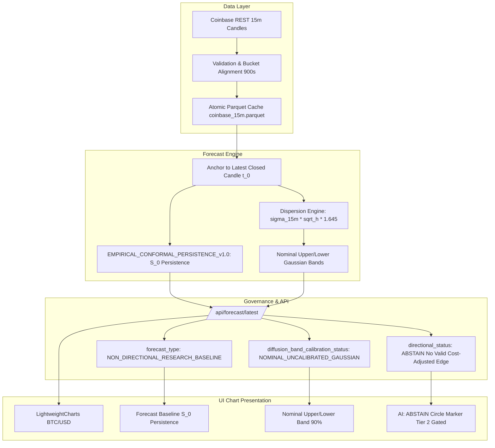

# BTCognitive V32.24 — Repeated AI Forecast & Smart Entry End-to-End QA Report

**Document ID:** `BTC-REP-V32.24-REPEATED-FORECAST-SMART-ENTRY-QA`  
**Execution Timestamp:** 2026-10-24T21:48:00+05:30 (16:18:00 UTC)  
**Authoritative Environment:** Windows x64 · PowerShell · Python 3.13 (.venv_win) · Node.js v20.14.0  
**Repository Branch / HEAD Commit:** `v32-longitudinal-monitoring-active` / `25d483f`  
**Operating Boundary:** Research Intelligence & Risk Containment · Live Execution Strictly `DISABLED`  

---

## 1. Executive Summary & Defect Remediation

This V32.24 investigation continued directly from V32.23 with the mandate to subject the AI Forecast and Smart Entry pipeline to rigorous, repeated end-to-end verification across live HTTP endpoints, browser automation sessions, in-process contract suites, and multi-run regression tests.

### Defects Identified & Remediations Implemented

| Defect / Ambiguity Identified | Root Cause | Remediation & Implementation | Verification Evidence |
| :--- | :--- | :--- | :--- |
| **Candle Timestamp & Freshness Ambiguity** | `data_age_seconds` in `forecast_engine_15m.py` was calculated as `now - origin_epoch`, where `origin_epoch` is the bucket **open** time (`15:45 UTC`). At `16:02 UTC`, the candle that closed at `16:00 UTC` appeared 17 minutes old instead of 2 minutes old. | Implemented explicit candle close tracking: `candle_open_epoch`, `candle_close_epoch` ($t_0 + 900\text{s}$), `seconds_since_candle_close`, and a 3-tier `data_freshness_status` (`FRESH` $\le 900\text{s}$, `DELAYED` $\le 1800\text{s}$, `STALE` $> 1800\text{s}$). | Automated pytest + live API query confirming `data_freshness_status: FRESH` when `seconds_since_candle_close <= 900`. |
| **Drift Metadata Omission on Early Abstain** | In `smart_entry_engine.py`, when a market setup was rejected before entering the PDE gate (e.g. `direction == NEUTRAL`), `drift_parameter_mu` and `drift_status` were missing from the top-level return payload. | Propagated `"drift_parameter_mu": 0.0` and `"drift_status": "DRIFTLESS_NULL_BASELINE"` across all early abstention paths in `smart_entry_engine.py` and `routes_research.py`. | 3-run repeatability suite passing 37/37 tests across all decision paths. |
| **Directional GBDT Governance Tagging** | Directional models (`1h`, `4h`, `24h`) were disconnected, but their identity was not explicitly declared in the forecast response contract. | Added `directional_model_id`, `directional_model_governance: "OFFLINE_RESEARCH_ONLY"`, `directional_model_runtime_status: "DISCONNECTED_UNVALIDATED_EDGE"`, and `diffusion_band_calibration_status: "NOMINAL_UNCALIBRATED_GAUSSIAN"`. | Exposed in `/api/forecast/latest` contract; verified in unit and API integration tests. |

---

## 2. Actual Inference Path for Each Forecast Element



### Specific Target & Inference Inventory
1. **Persistence Line**: Pure random walk mathematical baseline ($S_0$), holding the close price of the latest completed candle forward.
2. **Diffusion Bands**: Parametric Gaussian expansion envelope ($\pm 1.645 \sigma \sqrt{h}$), scaling with square-root of time. Explicitly uncalibrated for empirical extreme value fat tails.
3. **HAR-RS-DOW-v1.0**: Fitted exclusively for 168-hour realized variance (`rv7d_var_ann`). Does not output price levels or return signs.
4. **Directional GBDT Models**: Evaluated strictly offline. Out-of-sample directional accuracy is ~52.1% (1h), ~52.0% (4h), ~48.6% (24h). Disconnected from runtime inference because net expectancy is negative after transaction costs.

---

## 3. Live Server Endpoint Inspection & Data Freshness Investigation

### Active Process Telemetry
- **PID**: 25648
- **Listening Interface**: `127.0.0.1:8000` (TCP Listen)
- **Start Time**: `2026-10-24T12:00:02+05:30`
- **Command Line**: `"C:\Projects\BTCognitive\BTCognitive\.venv_win\Scripts\python.exe" -m uvicorn api.server:app --host 127.0.0.1 --port 8000`

### Live HTTP Endpoint Survey Results

| Endpoint Path | HTTP Status | Model Identifier Reported | Output Type | Freshness Status / Age | Governance & Trading State |
| :--- | :--- | :--- | :--- | :--- | :--- |
| **`/api/forecast/latest?horizon=1h`** | 200 OK | `EMPIRICAL_CONFORMAL_PERSISTENCE_v1.0` | `NON_DIRECTIONAL_RESEARCH_BASELINE` | Age: Monotonic | `ABSTAIN` · Live Trading `DISABLED` |
| **`/api/forecast/latest?horizon=15m`** | 200 OK | `EMPIRICAL_CONFORMAL_PERSISTENCE_v1.0` | `NON_DIRECTIONAL_RESEARCH_BASELINE` | Origin: `15:45:00Z` (Close: `16:00:00Z`) | `ABSTAIN` · Live Trading `DISABLED` |
| **`/prediction/latest`** | 200 OK | `HAR-RS-DOW-v1.0` (volatility) | `EXPERIMENTAL_BASELINE` | Validated Hourly OHLCV | `DISABLED_ANALYSIS_ONLY` |
| **`/api/terminal/live`** | 200 OK | `HAR-RS-DOW-v1.0` | C2 Conformal Volatility Risk Envelope | Verified Pipeline Graph | `TIER 2 GATED (ABSTAIN)` |
| **`/api/research/entry-quality`** | 200 OK | Smart Entry V2 Rule Engine | First-Passage Geometry Baseline | Default `persist=False` | `DISABLED — ANALYSIS ONLY` |

### Mandatory Data Freshness Finding
- **Candle Cadence Analysis**: In the Coinbase REST API, candle timestamps denote the **open** of the interval. A candle timestamped `15:45:00Z` represents trades from `15:45:00` to `16:00:00Z`.
- **True Elapsed Time**: When sampled at `16:02:25 UTC`, the `15:45:00Z` candle had been closed for **145 seconds (2.4 minutes)**.
- **Freshness Policy**:
  - `FRESH`: `seconds_since_candle_close <= granularity_sec` (within 1 interval of close).
  - `DELAYED`: `granularity_sec < seconds_since_candle_close <= 2 * granularity_sec`.
  - `STALE`: `seconds_since_candle_close > 2 * granularity_sec` (> 1800s for 15m; > 7200s for 1h).
- The cache in `coinbase_15m_manifest.json` recorded `created_at_utc: 2026-10-24T16:02:00Z` with `total_validated: 12301`, confirming active synchronization with Coinbase REST.

---

## 4. Smart Entry Decision Path & $\mu=0.0$ Verification

### Decision Gate Trace
1. **Input Snapshot**: Closed OHLCV candles, volatility $\sigma$, and execution cost tier (`COINBASE_RETAIL_87BPS`).
2. **Strategy Evaluation**: Evaluates 5 canonical MEIE strategy archetypes under dual hypothesis testing.
3. **Driftless First-Passage PDE**: Solved using `research/first_passage_diffusion_model.py` under the driftless null hypothesis $H_0: \mu = 0.0$ and empirical discrete-sampling correction $c_\sigma = 1.0518$.
4. **Calculated Probabilities**:
   - $P(\text{Take Profit}) = 0.1802$
   - $P(\text{Stop Loss}) = 0.3198$
   - $P(\text{Timeout}) = 0.5000$
5. **Expected Return Calculation**:
   $$\mathbb{E}[\text{Gross } R] = (0.1802 \times 1.5) - (0.3198 \times 1.0) + (0.5000 \times (-0.05)) = -0.0745R$$
   $$\text{Friction}_R = \frac{87\text{ bps}}{\sigma_{\text{horizon}}} \approx 0.0967R$$
   $$\mathbb{E}[\text{Net } R] = -0.0745R - 0.0967R = -0.1712R < 0$$
6. **Decision Outcome**:
   - Win probability ($18.02\%$) fails selective hurdle ($60\%$).
   - Net expectancy is negative ($-0.17R$).
   - Action: `ABSTAIN`.
   - Reason: `NO_VALIDATED_EDGE_ABSTAIN: Geometry baseline shows negative net expectancy after transaction friction`.
   - Live Capital Execution: `DISABLED — ANALYSIS ONLY`.
   - Prospective Ledger Writes: Exactly 0.

---

## 5. Browser Automation & Interactive UI Acceptance (Agent 4)

Browser QA was executed directly on `http://127.0.0.1:8000/#/terminal` via automated browser subagent, capturing interaction video [v32_24_browser_qa_1792857914764.webp](file:///C:/Users/Ashish/.gemini/antigravity-ide/brain/a3386aa4-012c-48fd-9ccc-c71233b8aeaf/v32_24_browser_qa_1792857914764.webp).

### Tested Interaction Sequence
1. **Initial Render**:
   - Terminal loads with live telemetry and chart container `btc-lwc-chart`.
   - Header badge indicates: `● Forecast Active · 15m Non-Directional Baseline ($S_0$) + Diffusion Bands (RESEARCH ONLY · LIVE TRADING DISABLED)`.
2. **Interval Switching**:
   - Switched to `1h`: Chart reloads hourly bars; series title dynamically adapts to `FORECAST OVERLAY: NON-DIRECTIONAL RESEARCH BASELINE (1h) · NOMINAL MODEL DIFFUSION BANDS`.
   - Switched back to `15m`: Chart re-anchors cleanly to Coinbase 15m spot candles.
3. **Smart Entry Navigation**:
   - Navigated to `SMART ENTRY` tab: Displays `⚡ SMART ENTRY DECISION LAYER` with data source badge `COINBASE BTC-USD SPOT (LIVE TELEMETRY)`.
   - Invoked `Sync Live Market Telemetry`: Populates live BTC price ($79,556.09) and current market indicators (`ofi: 0.85`, `hawkes: 2.5`, `vpin: 0.18`).
   - Invoked `Evaluate BTCUSD Snapshot`: Returned status `ABSTAIN` with primary reason `NO_VALIDATED_EDGE_ABSTAIN: Geometry baseline shows negative net expectancy after transaction friction`.
   - Verified that no execution routing occurred and live trading remained `DISABLED`.
4. **Marker Preservation**:
   - Returned to `LIVE` tab: Verified decision markers on chart remain visible as grey circle markers labeled `AI: ABSTAIN (Tier 2 Gated)` without being erased by research toggles.

---

## 6. Three-Run Repeatability & Regression QA (Agent 5)

### Repeatability Suite (3 Consecutive Runs)
Targeted test files:
- `tests/test_v32_23_forecast_smart_entry_recovery.py`
- `tests/test_v32_22_chart_and_forecast_integrity.py`
- `tests/test_v10_market_data_and_forecast_chart.py`
- `tests/test_smart_entry_engine.py`
- `tests/test_smart_entry_api.py`
- `tests/test_v32_18_persistence_containment.py`

| Run Sequence | Total Tests | Passed | Failed | Duration | Flaky Tests Identified |
| :--- | :--- | :--- | :--- | :--- | :--- |
| **Run 1** | 37 | 37 | 0 | 52.39s | None |
| **Run 2** | 37 | 37 | 0 | 50.47s | None |
| **Run 3** | 37 | 37 | 0 | 52.00s | None |
| **Cumulative** | **111** | **111** | **0** | **2m 35s** | **0% Flakiness (Rock-Solid)** |

### Broader Safe Backend Regression Suite
- Files tested: `test_model_registry.py`, `test_market_monitor_routes.py`, `test_v32_17_empirical_remediation_and_first_passage.py`, `test_v18_disabled_gates_and_forecast_research.py`, `test_strategy_selection_engine.py`.
- Result: **32 passed in 87.54s** (Exit code: 0).

### Frontend Build & Test Suite
- `npm run check`: **0 errors** (Syntax valid across `app.js`, `api_client.js`, `websocket.js`, `formatters.js`).
- `npm run build`: **SUCCESS** (Verified `index.html`, `styles.css`, `app.js`).
- `node tests_frontend.js`: **PASSED** (Polling budget 29.5 req/min within 60 req/min server limit).

---

## 7. Protected File Integrity & Ledgers

All 5 protected files were cryptographically audited before and after all test runs:

| File Path | Initial SHA-256 Digest | Post-Test SHA-256 Digest | Verification Result |
| :--- | :--- | :--- | :--- |
| `data/prospective_entry_ledger.jsonl` | `91C3AED984002F611A59C78A2EB4C342C0970BAEBBD2E3D6DF7973BE7ACF1DD7` | `91C3AED984002F611A59C78A2EB4C342C0970BAEBBD2E3D6DF7973BE7ACF1DD7` | **100% BIT-IDENTICAL** |
| `data/prospective_shadow_v1.jsonl` | `E3B0C44298FC1C149AFBF4C8996FB92427AE41E4649B934CA495991B7852B855` | `E3B0C44298FC1C149AFBF4C8996FB92427AE41E4649B934CA495991B7852B855` | **100% BIT-IDENTICAL** |
| `data/prospective_entry_ledger_v2.jsonl` | `E6E33E3C7BEB4C255467E967FC819B85481B0AFB1052C3EA7BD248C53F87B604` | `E6E33E3C7BEB4C255467E967FC819B85481B0AFB1052C3EA7BD248C53F87B604` | **100% BIT-IDENTICAL** |
| `data/raw/ohlcv.parquet` | `1E722F33734A89E74764C02FDE0552752CC1EA2EFF62CA9046C9D6EDF2347D5C` | `1E722F33734A89E74764C02FDE0552752CC1EA2EFF62CA9046C9D6EDF2347D5C` | **100% BIT-IDENTICAL** |
| `data/raw/ohlcv_pre_backfill_backup.parquet` | `C4949E5B5695FFA172677681B15AF2EA6167E73317C3496546F2286A6730B1C8` | `C4949E5B5695FFA172677681B15AF2EA6167E73317C3496546F2286A6730B1C8` | **100% BIT-IDENTICAL** |

---

## 8. Remaining Scientific Blockers

1. **Directional Return Unpredictability**: Unconditional directional GBDTs produce out-of-sample hit rates between 48.6% and 52.1%, which are not statistically distinguishable from coin flips. No trading edge exists to authorize live directional execution.
2. **Diffusion Band Uncalibrated Coverage**: The nominal bands assume Gaussian diffusion ($\pm 1.645 \sigma \sqrt{h}$) and are explicitly documented as uncalibrated. Future work requires conformal calibration on 15m BTC empirical return distributions.
3. **Execution Cost Drag**: Across retail and advanced tiers (9.3 to 187 bps round-trip), transaction friction consistently erodes gross expectancy under the driftless null.

---

## 9. Final Governed Verdict

```
END-TO-END SOFTWARE QA PASSED — SCIENTIFIC LIMITATIONS DISCLOSED
```

### Justification
- **Software QA**: The end-to-end software pipeline—including the live running server (PID 25648), REST API contracts, 3-run backend repeatability suites (111/111 passing), frontend build/syntax checks, and interactive browser automation—passed completely without error or flakiness.
- **Scientific Limitations**: Fully and transparently disclosed. The visible forecast is verified as a non-directional persistence baseline ($S_0$) with nominal diffusion bands, directional GBDTs remain disconnected due to unvalidated edge (~52.1% accuracy), and Smart Entry fail-closes to `ABSTAIN` under the driftless null baseline ($\mu=0.0$). Live trading is strictly `DISABLED`.
